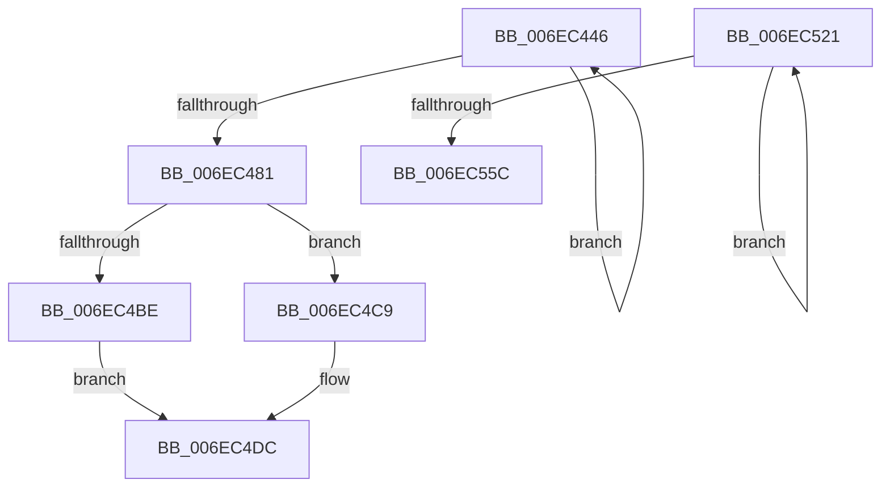

# sub_006EC446

- RVA: `0x006EC446`–`0x006EC582` (길이 `316` bytes)
- VA: `0x00000001406EC446`
- 실행 섹션: `.text`
- PDB 이름 있음: `아니요`; PDB Function 태그: `아니요`
- unwind 정보 RVA: `0x0009A8BC`
- 디코드: `79`개 명령, `316/316` bytes 표시
- 미해석 바이트: `0` (있으면 어셈블리에 `.byte`로 보존)

> 이 문서는 커널 이미지의 기계어와 PDB 기호를 분석해 생성했습니다. 4번과 5번은 함수 원형과 자료형을 바이너리 사용 방식에서 추정한 C 해석이며 원본 소스 복구 결과는 아닙니다.

## 1. Dependencies

- 직접 호출 지점: **9**; 고유 호출 대상: **5**
- 직접 호출자로 확인된 함수: **0**
- RIP 상대 이미지 참조: **0**

### Outgoing calls
- `0x006EC45E` → [MiLockPageInline](../31/MiLockPageInline_function_0031A340.md) (function, `0x0031A340`)
- `0x006EC46D` → [MiWriteCompletePfn](../37/MiWriteCompletePfn_function_003737C4.md) (function, `0x003737C4`)
- `0x006EC477` → [MiUnlockPage](../31/MiUnlockPage_function_0031A3E0.md) (function, `0x0031A3E0`)
- `0x006EC4A6` → [MiReleaseWriteInProgressCharges](../40/MiReleaseWriteInProgressCharges_function_00407B4C.md) (function, `0x00407B4C`)
- `0x006EC4F7` → [MiMapPageInHyperSpaceWorker](../33/MiMapPageInHyperSpaceWorker_function_00332B10.md) (function, `0x00332B10`)
- `0x006EC539` → [MiLockPageInline](../31/MiLockPageInline_function_0031A340.md) (function, `0x0031A340`)
- `0x006EC548` → [MiWriteCompletePfn](../37/MiWriteCompletePfn_function_003737C4.md) (function, `0x003737C4`)
- `0x006EC552` → [MiUnlockPage](../31/MiUnlockPage_function_0031A3E0.md) (function, `0x0031A3E0`)
- `0x006EC577` → [MiReleaseWriteInProgressCharges](../40/MiReleaseWriteInProgressCharges_function_00407B4C.md) (function, `0x00407B4C`)

### Direct callers
- 이 함수 시작 RVA로 연결되는 직접 call은 확인되지 않았습니다. 간접 호출은 완전히 역산할 수 없습니다.

### Static image references
- 디코드된 RIP-relative 메모리 참조가 없습니다.

## 2. Other-region calls and transfers

- 다른 실행 섹션으로 향하는 call: **0**
- call이 아닌 외부 분기/꼬리 이동: **2**
  - `0x006EC51C` → [MiBuildMappedCluster + 0x2CC](../40/MiBuildMappedCluster_function_00405F1C.md) (`tail-transfer`)
  - `0x006EC57D` → [MiBuildMappedCluster + 0x847](../40/MiBuildMappedCluster_function_00405F1C.md) (`tail-transfer`)

## 3. Assembly (complete function range)

```asm
006EC446  49 83 EF 08                     sub r15, 8
006EC44A  49 8B 07                        mov rax, qword ptr [r15]
006EC44D  48 8D 34 40                     lea rsi, [rax + rax*2]
006EC451  48 C1 E6 04                     shl rsi, 4
006EC455  48 8B C5                        mov rax, rbp
006EC458  48 03 F0                        add rsi, rax
006EC45B  48 8B CE                        mov rcx, rsi
006EC45E  E8 DD DE C2 FF                  call 0x14031a340
006EC463  45 33 C0                        xor r8d, r8d
006EC466  8B D7                           mov edx, edi
006EC468  48 8B CE                        mov rcx, rsi
006EC46B  8A D8                           mov bl, al
006EC46D  E8 52 73 C8 FF                  call 0x1403737c4
006EC472  8A D3                           mov dl, bl
006EC474  48 8B CE                        mov rcx, rsi
006EC477  E8 64 DF C2 FF                  call 0x14031a3e0
006EC47C  4D 3B FE                        cmp r15, r14
006EC47F  77 C5                           ja 0x1406ec446
006EC481  48 8B 6C 24 50                  mov rbp, qword ptr [rsp + 0x50]
006EC486  4C 8B 74 24 30                  mov r14, qword ptr [rsp + 0x30]
006EC48B  4C 89 7C 24 38                  mov qword ptr [rsp + 0x38], r15
006EC490  4C 8B BC 24 D8 00 00 00         mov r15, qword ptr [rsp + 0xd8]
006EC498  48 8B 4C 24 58                  mov rcx, qword ptr [rsp + 0x58]
006EC49D  41 B8 01 00 00 00               mov r8d, 1
006EC4A3  48 8B D5                        mov rdx, rbp
006EC4A6  E8 A1 B6 D1 FF                  call 0x140407b4c
006EC4AB  48 8B 44 24 20                  mov rax, qword ptr [rsp + 0x20]
006EC4B0  48 8B 5C 24 48                  mov rbx, qword ptr [rsp + 0x48]
006EC4B5  48 83 C0 08                     add rax, 8
006EC4B9  48 3B D8                        cmp rbx, rax
006EC4BC  75 0B                           jne 0x1406ec4c9
006EC4BE  4D 8D 66 08                     lea r12, [r14 + 8]
006EC4C2  4C 89 64 24 48                  mov qword ptr [rsp + 0x48], r12
006EC4C7  EB 13                           jmp 0x1406ec4dc
006EC4C9  49 8D 86 80 00 00 00            lea rax, [r14 + 0x80]
006EC4D0  4C 3B E0                        cmp r12, rax
006EC4D3  48 0F 47 D8                     cmova rbx, rax
006EC4D7  48 89 5C 24 48                  mov qword ptr [rsp + 0x48], rbx
006EC4DC  48 8B 4C 24 60                  mov rcx, qword ptr [rsp + 0x60]
006EC4E1  48 8D 94 24 E0 00 00 00         lea rdx, [rsp + 0xe0]
006EC4E9  41 B8 00 00 00 80               mov r8d, 0x80000000
006EC4EF  4C 89 74 24 20                  mov qword ptr [rsp + 0x20], r14
006EC4F4  49 8B F6                        mov rsi, r14
006EC4F7  E8 14 66 C4 FF                  call 0x140332b10
006EC4FC  4C 8B D0                        mov r10, rax
006EC4FF  48 89 44 24 28                  mov qword ptr [rsp + 0x28], rax
006EC504  49 8B C6                        mov rax, r14
006EC507  25 FF 0F 00 00                  and eax, 0xfff
006EC50C  4D 8D 72 F8                     lea r14, [r10 - 8]
006EC510  4C 03 F0                        add r14, rax
006EC513  48 8B 44 24 30                  mov rax, qword ptr [rsp + 0x30]
006EC518  48 8D 68 F8                     lea rbp, [rax - 8]
006EC51C  E9 C7 9C D1 FF                  jmp 0x1404061e8
006EC521  49 83 EE 08                     sub r14, 8
006EC525  49 8B 06                        mov rax, qword ptr [r14]
006EC528  48 8D 34 40                     lea rsi, [rax + rax*2]
006EC52C  48 C1 E6 04                     shl rsi, 4
006EC530  48 8B C5                        mov rax, rbp
006EC533  48 03 F0                        add rsi, rax
006EC536  48 8B CE                        mov rcx, rsi
006EC539  E8 02 DE C2 FF                  call 0x14031a340
006EC53E  45 33 C0                        xor r8d, r8d
006EC541  8B D7                           mov edx, edi
006EC543  48 8B CE                        mov rcx, rsi
006EC546  8A D8                           mov bl, al
006EC548  E8 77 72 C8 FF                  call 0x1403737c4
006EC54D  8A D3                           mov dl, bl
006EC54F  48 8B CE                        mov rcx, rsi
006EC552  E8 89 DE C2 FF                  call 0x14031a3e0
006EC557  4D 3B F7                        cmp r14, r15
006EC55A  77 C5                           ja 0x1406ec521
006EC55C  48 8B AC 24 E8 00 00 00         mov rbp, qword ptr [rsp + 0xe8]
006EC564  48 8B 74 24 20                  mov rsi, qword ptr [rsp + 0x20]
006EC569  48 8B 4C 24 58                  mov rcx, qword ptr [rsp + 0x58]
006EC56E  41 B8 01 00 00 00               mov r8d, 1
006EC574  48 8B D5                        mov rdx, rbp
006EC577  E8 D0 B5 D1 FF                  call 0x140407b4c
006EC57C  90                              nop
006EC57D  E9 E1 A1 D1 FF                  jmp 0x140406763
```

## 4. C-style interpretation (structured pseudocode)

```c
__int64 __fastcall sub_006EC446(__int64 a1, __int64 a2, int a3, __int64 a4, __int64 a5, __int64 a6, __int64 a7, __int64 a8, __int64 a9, __int64 a10, __int64 a11, __int64 a12, __int64 a13, __int64 a14, __int64 a15, __int64 a16, __int64 a17, __int64 a18, __int64 a19, __int64 a20, __int64 a21, __int64 a22, __int64 a23, __int64 a24, __int64 a25, __int64 a26, __int64 a27, __int64 a28)
{
    __int64 result;
    __int64 v_r14;
    __int64 v_r15;
    __int64 v_rsi;
    unsigned __int64 v_stack_p20;
    unsigned __int64 v_stack_p28;
    unsigned __int64 v_stack_p38;
    unsigned __int64 v_stack_p48;
    unsigned __int64 v_stack_p58;
    unsigned __int64 v_stack_pE8;

    v_r15 = (v_r15) - (8);
    v_rsi = (*(unsigned __int64 *)(v_r15) + *(unsigned __int64 *)(v_r15) * 2) << (4);
    v_rsi = (v_rsi) + (v_rbp);
    result = MiLockPageInline(v_rsi, a2, a3, a4);
    a3 = 0;
    result = MiWriteCompletePfn(v_rsi, (unsigned int)((unsigned int)(v_rdi)), a3, a4);
    result = MiUnlockPage(v_rsi, (unsigned __int8)((unsigned __int8)(result)), a3, a4);
    if (v_r15 > v_r14) goto loc_006EC446;
    v_stack_p38 = v_r15;
    result = MiReleaseWriteInProgressCharges(a11, a10, 1, a4);
    result = (v_stack_p20) + (8);
    if (a9 != result) goto loc_006EC4C9;
    v_stack_p48 = a6 + 8;
    goto loc_006EC4DC;
loc_006EC4C9:
    if ((a6 + 8) > (a6 + 128)) { a9 = a6 + 128; }
    v_stack_p48 = a9;
loc_006EC4DC:
    v_stack_p20 = a6;
    result = MiMapPageInHyperSpaceWorker(a12, a28, (unsigned int)(0x80000000ULL), a4);
    v_stack_p28 = result;
    result = (unsigned int)((a6) & (0xFFFULL));
    v_r14 = (result - 8) + (result);
}
```

## 5. (Beta) C Style

```c
int64_t sub_006EC446(int64_t Arg1, int64_t Arg2, int32_t Arg3, int64_t Arg4, uint64_t Arg5, void *Arg6, uint64_t Arg7, uint64_t Arg8, int64_t Arg9, int64_t Arg10, int64_t Arg11, int64_t Arg12, uint64_t Arg13, uint64_t Arg14, uint64_t Arg15, uint64_t Arg16, uint64_t Arg17, uint64_t Arg18, uint64_t Arg19, uint64_t Arg20, uint64_t Arg21, uint64_t Arg22, uint64_t Arg23, uint64_t Arg24, uint64_t Arg25, uint64_t Arg26, int64_t Arg27, int64_t Arg28)
{
    uint8_t *arg6 = (uint8_t *)Arg6;

    int64_t result;
    int64_t local_r14;
    int64_t local_r15;
    int64_t local_rsi;
    uint64_t v_stack_p20;
    uint64_t v_stack_p28;
    uint64_t v_stack_p38;
    uint64_t v_stack_p48;
    uint64_t v_stack_p58;
    uint64_t v_stack_pE8;

    local_r15 = (local_r15) - (8);
    local_rsi = (*(uint64_t *)(local_r15) + *(uint64_t *)(local_r15) * 2) << (4);
    local_rsi = (local_rsi) + (local_rbp);
    result = MiLockPageInline(local_rsi, Arg2, Arg3, Arg4);
    Arg3 = 0;
    result = MiWriteCompletePfn(local_rsi, (uint32_t)((uint32_t)(local_rdi)), Arg3, Arg4);
    result = MiUnlockPage(local_rsi, (uint8_t)((uint8_t)(result)), Arg3, Arg4);
    if (local_r15 > local_r14) goto loc_006EC446;
    v_stack_p38 = local_r15;
    result = MiReleaseWriteInProgressCharges(Arg11, Arg10, 1, Arg4);
    result = (v_stack_p20) + (8);
    if (Arg9 != result) goto loc_006EC4C9;
    v_stack_p48 = Arg6 + 8;
    goto loc_006EC4DC;
loc_006EC4C9:
    if ((Arg6 + 8) > (Arg6 + 128)) { Arg9 = Arg6 + 128; }
    v_stack_p48 = Arg9;
loc_006EC4DC:
    v_stack_p20 = Arg6;
    result = MiMapPageInHyperSpaceWorker(Arg12, Arg28, (uint32_t)(0x80000000ULL), Arg4);
    v_stack_p28 = result;
    result = (uint32_t)((Arg6) & (0xFFFULL));
    local_r14 = (result - 8) + (result);
}
```

### 관측된 메모리 오프셋

구조체 형식이 확인되지 않은 접근은 인자 기준의 오프셋으로만 기록했습니다.

| 기준 인자 | 오프셋 표현 | 폭 (bit) | 접근 |
|---|---:|---:|---|
| `Arg6` | `- 0x8` | `64` | `R` |
| `Arg6` | `+ 0x8` | `64` | `R` |
| `Arg6` | `+ 0x80` | `64` | `R` |

## 6. Execution-region graph

[열기: 2D/3D 그래프와 함수 탐색 컨트롤 패널](../../../control-panel.html?section=text&rva=0x006EC446&view=graph)

- 2D 그래프는 위에서 아래로 흐르고, 3D 그래프는 빈 공간을 드래그해 회전합니다. Shift+드래그는 이동, 휠은 확대·축소, 함수 노드 선택은 대상 보고서 이동입니다.

### Static fallback


