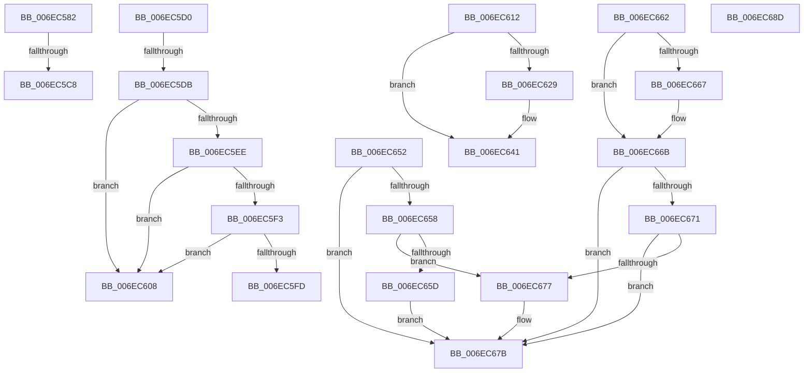

# sub_006EC582

- RVA: `0x006EC582`–`0x006EC69A` (길이 `280` bytes)
- VA: `0x00000001406EC582`
- 실행 섹션: `.text`
- PDB 이름 있음: `아니요`; PDB Function 태그: `아니요`
- unwind 정보 RVA: `0x0009A8E8`
- 디코드: `75`개 명령, `280/280` bytes 표시
- 미해석 바이트: `0` (있으면 어셈블리에 `.byte`로 보존)

> 이 문서는 커널 이미지의 기계어와 PDB 기호를 분석해 생성했습니다. 4번과 5번은 함수 원형과 자료형을 바이너리 사용 방식에서 추정한 C 해석이며 원본 소스 복구 결과는 아닙니다.

## 1. Dependencies

- 직접 호출 지점: **7**; 고유 호출 대상: **7**
- 직접 호출자로 확인된 함수: **0**
- RIP 상대 이미지 참조: **0**

### Outgoing calls
- `0x006EC590` → [CcNotifyOfMappedWriteComplete](../40/CcNotifyOfMappedWriteComplete_function_0040873C.md) (function, `0x0040873C`)
- `0x006EC59F` → [FsRtlReleaseFileForModWrite](../29/FsRtlReleaseFileForModWrite_function_00299100.md) (function, `0x00299100`)
- `0x006EC5B7` → [ObFastDereferenceObjectDeferDelete](../23/ObFastDereferenceObjectDeferDelete_function_002378C0.md) (function, `0x002378C0`)
- `0x006EC5E2` → [MiIsRetryIoStatus](../40/MiIsRetryIoStatus_function_00408640.md) (function, `0x00408640`)
- `0x006EC63C` → [KeSetEvent](../33/KeSetEvent_function_0033F310.md) (function, `0x0033F310`)
- `0x006EC647` → [MiUnlockPartitionMappedWriter](../40/MiUnlockPartitionMappedWriter_function_004030EC.md) (function, `0x004030EC`)
- `0x006EC682` → [MiReleaseSpinLockExclusive](../24/MiReleaseSpinLockExclusive_function_002482C0.md) (function, `0x002482C0`)

### Direct callers
- 이 함수 시작 RVA로 연결되는 직접 call은 확인되지 않았습니다. 간접 호출은 완전히 역산할 수 없습니다.

### Static image references
- 디코드된 RIP-relative 메모리 참조가 없습니다.

## 2. Other-region calls and transfers

- 다른 실행 섹션으로 향하는 call: **0**
- call이 아닌 외부 분기/꼬리 이동: **8**
  - `0x006EC5C2` → [MiWriteComplete + 0x4C2](../40/MiWriteComplete_function_004069B0.md) (`tail-transfer`)
  - `0x006EC5CB` → [MiWriteComplete + 0x2E2](../40/MiWriteComplete_function_004069B0.md) (`tail-transfer`)
  - `0x006EC5D5` → [MiWriteComplete + 0x31F](../40/MiWriteComplete_function_004069B0.md) (`tail-transfer`)
  - `0x006EC603` → [MiWriteComplete + 0x31F](../40/MiWriteComplete_function_004069B0.md) (`tail-transfer`)
  - `0x006EC60D` → [MiWriteComplete + 0x31F](../40/MiWriteComplete_function_004069B0.md) (`tail-transfer`)
  - `0x006EC64D` → [MiWriteComplete + 0x254](../40/MiWriteComplete_function_004069B0.md) (`tail-transfer`)
  - `0x006EC688` → [MiWriteComplete + 0x287](../40/MiWriteComplete_function_004069B0.md) (`tail-transfer`)
  - `0x006EC695` → [MiWriteComplete + 0x287](../40/MiWriteComplete_function_004069B0.md) (`tail-transfer`)

## 3. Assembly (complete function range)

```asm
006EC582  49 8B 57 58                     mov rdx, qword ptr [r15 + 0x58]
006EC586  45 8B CD                        mov r9d, r13d
006EC589  48 8B 48 28                     mov rcx, qword ptr [rax + 0x28]
006EC58D  45 8B C2                        mov r8d, r10d
006EC590  E8 A7 C1 D1 FF                  call 0x14040873c
006EC595  48 8B 45 67                     mov rax, qword ptr [rbp + 0x67]
006EC599  49 8B D4                        mov rdx, r12
006EC59C  48 8B C8                        mov rcx, rax
006EC59F  E8 5C CB BA FF                  call 0x140299100
006EC5A4  4C 8B 65 C7                     mov r12, qword ptr [rbp - 0x39]
006EC5A8  41 B8 4D 6D 53 63               mov r8d, 0x63536d4d
006EC5AE  48 8B 55 67                     mov rdx, qword ptr [rbp + 0x67]
006EC5B2  49 8D 4C 24 40                  lea rcx, [r12 + 0x40]
006EC5B7  E8 04 B3 B4 FF                  call 0x1402378c0
006EC5BC  45 33 C9                        xor r9d, r9d
006EC5BF  45 85 ED                        test r13d, r13d
006EC5C2  0F 89 AA A8 D1 FF               jns 0x140406e72
006EC5C8  49 8B D4                        mov rdx, r12
006EC5CB  E9 C2 A6 D1 FF                  jmp 0x140406c92
006EC5D0  8B 40 38                        mov eax, dword ptr [rax + 0x38]
006EC5D3  A8 10                           test al, 0x10
006EC5D5  0F 85 F4 A6 D1 FF               jne 0x140406ccf
006EC5DB  48 63 55 7F                     movsxd rdx, dword ptr [rbp + 0x7f]
006EC5DF  41 8B CD                        mov ecx, r13d
006EC5E2  E8 59 C0 D1 FF                  call 0x140408640
006EC5E7  45 33 C9                        xor r9d, r9d
006EC5EA  85 C0                           test eax, eax
006EC5EC  74 1A                           je 0x1406ec608
006EC5EE  45 85 E4                        test r12d, r12d
006EC5F1  74 15                           je 0x1406ec608
006EC5F3  48 8D 46 38                     lea rax, [rsi + 0x38]
006EC5F7  48 39 45 F7                     cmp qword ptr [rbp - 9], rax
006EC5FB  76 0B                           jbe 0x1406ec608
006EC5FD  83 CB 01                        or ebx, 1
006EC600  89 5D 6F                        mov dword ptr [rbp + 0x6f], ebx
006EC603  E9 C7 A6 D1 FF                  jmp 0x140406ccf
006EC608  BF 01 00 00 00                  mov edi, 1
006EC60D  E9 BD A6 D1 FF                  jmp 0x140406ccf
006EC612  49 89 07                        mov qword ptr [r15], rax
006EC615  49 89 4F 08                     mov qword ptr [r15 + 8], rcx
006EC619  4C 89 39                        mov qword ptr [rcx], r15
006EC61C  4C 89 78 08                     mov qword ptr [rax + 8], r15
006EC620  41 38 B6 D0 02 00 00            cmp byte ptr [r14 + 0x2d0], sil
006EC627  74 18                           je 0x1406ec641
006EC629  49 8D 8E B8 02 00 00            lea rcx, [r14 + 0x2b8]
006EC630  41 88 B6 D0 02 00 00            mov byte ptr [r14 + 0x2d0], sil
006EC637  45 33 C0                        xor r8d, r8d
006EC63A  33 D2                           xor edx, edx
006EC63C  E8 CF 2C C5 FF                  call 0x14033f310
006EC641  48 8B D3                        mov rdx, rbx
006EC644  49 8B CE                        mov rcx, r14
006EC647  E8 A0 6A D1 FF                  call 0x1404030ec
006EC64C  90                              nop
006EC64D  E9 B2 A5 D1 FF                  jmp 0x140406c04
006EC652  80 6B 01 01                     sub byte ptr [rbx + 1], 1
006EC656  75 23                           jne 0x1406ec67b
006EC658  80 F9 01                        cmp cl, 1
006EC65B  76 1A                           jbe 0x1406ec677
006EC65D  40 88 33                        mov byte ptr [rbx], sil
006EC660  EB 19                           jmp 0x1406ec67b
006EC662  80 F9 01                        cmp cl, 1
006EC665  76 04                           jbe 0x1406ec66b
006EC667  D0 E9                           shr cl, 1
006EC669  88 0B                           mov byte ptr [rbx], cl
006EC66B  40 38 73 02                     cmp byte ptr [rbx + 2], sil
006EC66F  75 0A                           jne 0x1406ec67b
006EC671  80 6B 01 01                     sub byte ptr [rbx + 1], 1
006EC675  75 04                           jne 0x1406ec67b
006EC677  C6 43 02 01                     mov byte ptr [rbx + 2], 1
006EC67B  49 8D 8E 14 04 00 00            lea rcx, [r14 + 0x414]
006EC682  E8 39 BC B5 FF                  call 0x1402482c0
006EC687  90                              nop
006EC688  E9 AA A5 D1 FF                  jmp 0x140406c37
006EC68D  41 C6 86 38 04 00 00 01         mov byte ptr [r14 + 0x438], 1
006EC695  E9 9D A5 D1 FF                  jmp 0x140406c37
```

## 4. C-style interpretation (structured pseudocode)

```c
__int64 __fastcall sub_006EC582(void)
{
    __int64 result;

    result = CcNotifyOfMappedWriteComplete(*(unsigned __int64 *)(result + 40), *(unsigned __int64 *)(v_r15 + 88), (unsigned int)((unsigned int)(v_r10)), (unsigned int)((unsigned int)(v_r13)));
    result = FsRtlReleaseFileForModWrite(*(unsigned __int64 *)(v_rbp + 103), v_r12, (unsigned int)((unsigned int)(v_r10)), (unsigned int)((unsigned int)(v_r13)));
    result = ObFastDereferenceObjectDeferDelete(*(unsigned __int64 *)(v_rbp - 57) + 64, *(unsigned __int64 *)(v_rbp + 103), (unsigned int)(0x63536D4DULL), (unsigned int)((unsigned int)(v_r13)));
    a4 = 0;
}
```

## 5. (Beta) C Style

```c
void sub_006EC582(void)
{
    int64_t result;

    result = CcNotifyOfMappedWriteComplete(*(uint64_t *)(result + 0x28), *(uint64_t *)(local_r15 + 0x58), (uint32_t)((uint32_t)(local_r10)), (uint32_t)((uint32_t)(local_r13)));
    result = FsRtlReleaseFileForModWrite(*(uint64_t *)(local_rbp + 0x67), local_r12, (uint32_t)((uint32_t)(local_r10)), (uint32_t)((uint32_t)(local_r13)));
    result = ObFastDereferenceObjectDeferDelete(*(uint64_t *)(local_rbp - 0x39) + 64, *(uint64_t *)(local_rbp + 0x67), (uint32_t)(0x63536D4DULL), (uint32_t)((uint32_t)(local_r13)));
    a4 = 0;
}
```

## 6. Execution-region graph

[열기: 2D/3D 그래프와 함수 탐색 컨트롤 패널](../../../control-panel.html?section=text&rva=0x006EC582&view=graph)

- 2D 그래프는 위에서 아래로 흐르고, 3D 그래프는 빈 공간을 드래그해 회전합니다. Shift+드래그는 이동, 휠은 확대·축소, 함수 노드 선택은 대상 보고서 이동입니다.

### Static fallback


