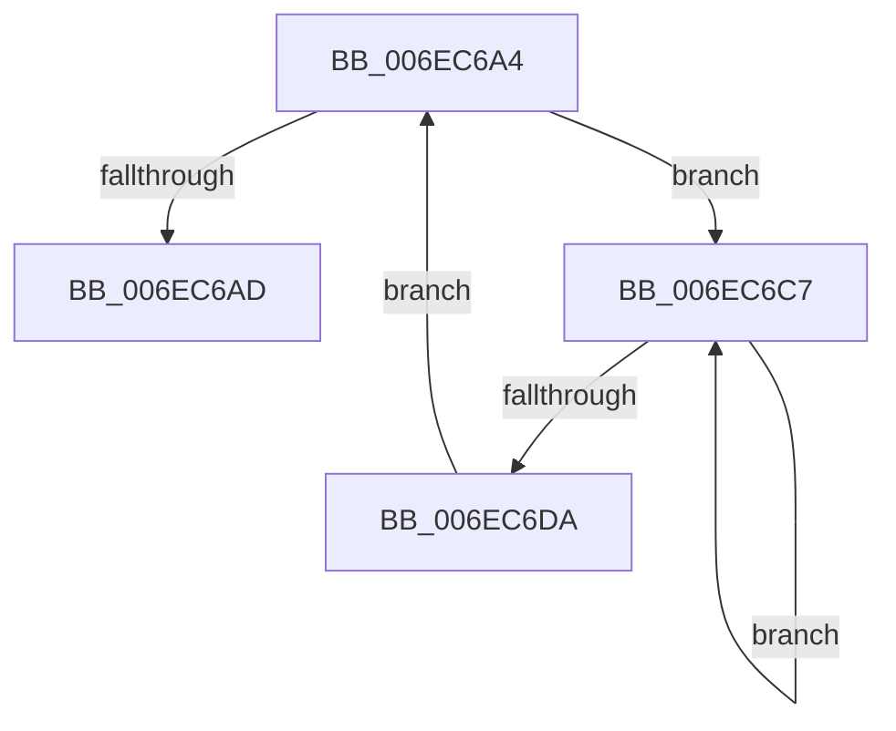

# sub_006EC6A4

- RVA: `0x006EC6A4`–`0x006EC6DC` (길이 `56` bytes)
- VA: `0x00000001406EC6A4`
- 실행 섹션: `.text`
- PDB 이름 있음: `아니요`; PDB Function 태그: `아니요`
- unwind 정보 RVA: `0x0009A9F8`
- 디코드: `13`개 명령, `56/56` bytes 표시
- 미해석 바이트: `0` (있으면 어셈블리에 `.byte`로 보존)

> 이 문서는 커널 이미지의 기계어와 PDB 기호를 분석해 생성했습니다. 4번과 5번은 함수 원형과 자료형을 바이너리 사용 방식에서 추정한 C 해석이며 원본 소스 복구 결과는 아닙니다.

## 1. Dependencies

- 직접 호출 지점: **1**; 고유 호출 대상: **1**
- 직접 호출자로 확인된 함수: **0**
- RIP 상대 이미지 참조: **0**

### Outgoing calls
- `0x006EC6CC` → [KeYieldProcessorEx](../3F/KeYieldProcessorEx_function_003FBD00.md) (function, `0x003FBD00`)

### Direct callers
- 이 함수 시작 RVA로 연결되는 직접 call은 확인되지 않았습니다. 간접 호출은 완전히 역산할 수 없습니다.

### Static image references
- 디코드된 RIP-relative 메모리 참조가 없습니다.

## 2. Other-region calls and transfers

- 다른 실행 섹션으로 향하는 call: **0**
- call이 아닌 외부 분기/꼬리 이동: **1**
  - `0x006EC6C2` → [MiUnlockWsle + 0x172](../40/MiUnlockWsle_function_00407F84.md) (`tail-transfer`)

## 3. Assembly (complete function range)

```asm
006EC6A4  F0 48 0F BA 6F 18 3F            lock bts qword ptr [rdi + 0x18], 0x3f
006EC6AB  72 1A                           jb 0x1406ec6c7
006EC6AD  48 8B 47 18                     mov rax, qword ptr [rdi + 0x18]
006EC6B1  48 B9 00 00 00 00 00 00 00 40   movabs rcx, 0x4000000000000000
006EC6BB  48 0B C1                        or rax, rcx
006EC6BE  48 89 47 18                     mov qword ptr [rdi + 0x18], rax
006EC6C2  E9 2F BA D1 FF                  jmp 0x1404080f6
006EC6C7  48 8D 4C 24 58                  lea rcx, [rsp + 0x58]
006EC6CC  E8 2F F6 D0 FF                  call 0x1403fbd00
006EC6D1  48 8B 47 18                     mov rax, qword ptr [rdi + 0x18]
006EC6D5  48 85 C0                        test rax, rax
006EC6D8  78 ED                           js 0x1406ec6c7
006EC6DA  EB C8                           jmp 0x1406ec6a4
```

## 4. C-style interpretation (structured pseudocode)

```c
__int64 __fastcall sub_006EC6A4(__int64 a1, __int64 a2, __int64 a3, __int64 a4, __int64 a5, __int64 a6, __int64 a7, __int64 a8, __int64 a9, __int64 a10, __int64 a11)
{
    __int64 result;

    if (condition_is_below) goto loc_006EC6C7;
    result = (*(unsigned __int64 *)(v_rdi + 24)) | (a1);
    *(unsigned __int64 *)(v_rdi + 24) = result;
loc_006EC6C7:
    result = KeYieldProcessorEx(a11, a2, a3, a4);
    if (sign_flag) goto loc_006EC6C7;
    goto loc_006EC6A4;
}
```

## 5. (Beta) C Style

```c
int64_t sub_006EC6A4(int64_t Arg1, int64_t Arg2, int64_t Arg3, int64_t Arg4, uint64_t Arg5, uint64_t Arg6, uint64_t Arg7, uint64_t Arg8, uint64_t Arg9, uint64_t Arg10, int64_t Arg11)
{
    int64_t result;

    if (condition_is_below) goto loc_006EC6C7;
    result = (*(uint64_t *)(local_rdi + 0x18)) | (Arg1);
    *(uint64_t *)(local_rdi + 0x18) = result;
loc_006EC6C7:
    result = KeYieldProcessorEx(Arg11, Arg2, Arg3, Arg4);
    if (sign_flag) goto loc_006EC6C7;
    goto loc_006EC6A4;
}
```

## 6. Execution-region graph

[열기: 2D/3D 그래프와 함수 탐색 컨트롤 패널](../../../control-panel.html?section=text&rva=0x006EC6A4&view=graph)

- 2D 그래프는 위에서 아래로 흐르고, 3D 그래프는 빈 공간을 드래그해 회전합니다. Shift+드래그는 이동, 휠은 확대·축소, 함수 노드 선택은 대상 보고서 이동입니다.

### Static fallback


