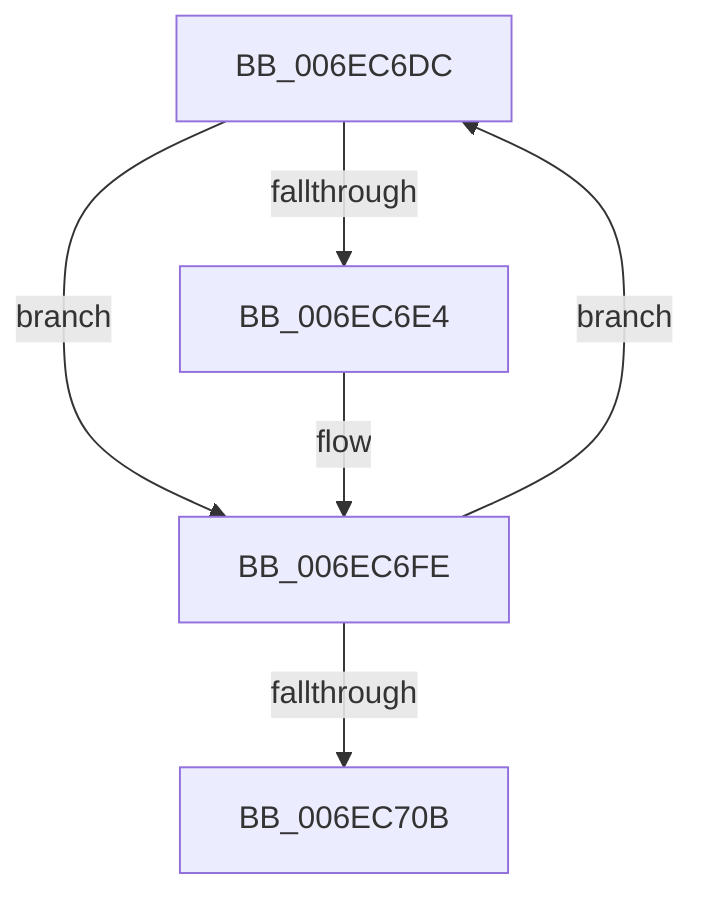

# sub_006EC6DC

- RVA: `0x006EC6DC`–`0x006EC724` (길이 `72` bytes)
- VA: `0x00000001406EC6DC`
- 실행 섹션: `.text`
- PDB 이름 있음: `아니요`; PDB Function 태그: `아니요`
- unwind 정보 RVA: `0x0009AC88`
- 디코드: `20`개 명령, `72/72` bytes 표시
- 미해석 바이트: `0` (있으면 어셈블리에 `.byte`로 보존)

> 이 문서는 커널 이미지의 기계어와 PDB 기호를 분석해 생성했습니다. 4번과 5번은 함수 원형과 자료형을 바이너리 사용 방식에서 추정한 C 해석이며 원본 소스 복구 결과는 아닙니다.

## 1. Dependencies

- 직접 호출 지점: **0**; 고유 호출 대상: **0**
- 직접 호출자로 확인된 함수: **0**
- RIP 상대 이미지 참조: **0**

### Outgoing calls
- 직접 디코드된 call 명령이 없습니다.

### Direct callers
- 이 함수 시작 RVA로 연결되는 직접 call은 확인되지 않았습니다. 간접 호출은 완전히 역산할 수 없습니다.

### Static image references
- 디코드된 RIP-relative 메모리 참조가 없습니다.

## 2. Other-region calls and transfers

- 다른 실행 섹션으로 향하는 call: **0**
- call이 아닌 외부 분기/꼬리 이동: **1**
  - `0x006EC71F` → [MiOrderTrimList + 0x1C8](../40/MiOrderTrimList_function_00409F24.md) (`tail-transfer`)

## 3. Assembly (complete function range)

```asm
006EC6DC  49 8B 09                        mov rcx, qword ptr [r9]
006EC6DF  49 3B C9                        cmp rcx, r9
006EC6E2  74 1A                           je 0x1406ec6fe
006EC6E4  48 03 D2                        add rdx, rdx
006EC6E7  48 8B 44 D4 78                  mov rax, qword ptr [rsp + rdx*8 + 0x78]
006EC6EC  48 89 08                        mov qword ptr [rax], rcx
006EC6EF  48 8B 44 D4 78                  mov rax, qword ptr [rsp + rdx*8 + 0x78]
006EC6F4  49 8B 09                        mov rcx, qword ptr [r9]
006EC6F7  41 8B D0                        mov edx, r8d
006EC6FA  48 89 41 08                     mov qword ptr [rcx + 8], rax
006EC6FE  41 FF C0                        inc r8d
006EC701  49 83 C1 10                     add r9, 0x10
006EC705  41 83 F8 0C                     cmp r8d, 0xc
006EC709  72 D1                           jb 0x1406ec6dc
006EC70B  8B C2                           mov eax, edx
006EC70D  48 03 C0                        add rax, rax
006EC710  48 8B 4C C4 78                  mov rcx, qword ptr [rsp + rax*8 + 0x78]
006EC715  49 89 8D D0 44 00 00            mov qword ptr [r13 + 0x44d0], rcx
006EC71C  48 89 31                        mov qword ptr [rcx], rsi
006EC71F  E9 C8 D9 D1 FF                  jmp 0x14040a0ec
```

## 4. C-style interpretation (structured pseudocode)

```c
__int64 __fastcall sub_006EC6DC(__int64 a1, __int64 a2, int a3, __int64 a4, __int64 a5, __int64 a6, __int64 a7, __int64 a8, __int64 a9, __int64 a10, __int64 a11, __int64 a12, __int64 a13, __int64 a14, __int64 a15)
{
    __int64 result;

    if ((*(unsigned __int64 *)(a4)) != a4) {
        a2 = (a2) + (a2);
        result = *(unsigned __int64 *)(v_rsp + a2 * 8 + 120);
        *(unsigned __int64 *)(result) = *(unsigned __int64 *)(a4);
        result = *(unsigned __int64 *)(v_rsp + a2 * 8 + 120);
        a1 = *(unsigned __int64 *)(a4);
        a2 = a3;
        *(unsigned __int64 *)(a1 + 8) = result;
    }
    a3 = (unsigned int)((a3) + 1);
    a4 = (a4) + (16);
    if (a3 < 12) goto loc_006EC6DC;
    result = ((unsigned int)((unsigned int)(a2))) + ((unsigned int)((unsigned int)(a2)));
    *(unsigned __int64 *)(v_r13 + 17616) = *(unsigned __int64 *)(v_rsp + result * 8 + 120);
    *(unsigned __int64 *)(*(unsigned __int64 *)(v_rsp + result * 8 + 120)) = v_rsi;
}
```

## 5. (Beta) C Style

```c
int64_t sub_006EC6DC(int64_t Arg1, int64_t Arg2, int32_t Arg3, void *Arg4, uint64_t Arg5, uint64_t Arg6, uint64_t Arg7, uint64_t Arg8, uint64_t Arg9, uint64_t Arg10, uint64_t Arg11, uint64_t Arg12, uint64_t Arg13, uint64_t Arg14, void *Arg15)
{
    uint8_t *arg4 = (uint8_t *)Arg4;
    uint8_t *arg15 = (uint8_t *)Arg15;

    int64_t result;

    if ((*(uint64_t *)(arg4)) != Arg4) {
        Arg2 = (Arg2) + (Arg2);
        result = *(uint64_t *)(local_rsp + Arg2 * 8 + 0x78);
        *(uint64_t *)(result) = *(uint64_t *)(arg4);
        result = *(uint64_t *)(local_rsp + Arg2 * 8 + 0x78);
        Arg1 = *(uint64_t *)(arg4);
        Arg2 = Arg3;
        *(uint64_t *)(Arg1 + 0x8) = result;
    }
    Arg3 = (uint32_t)((Arg3) + 1);
    Arg4 = (Arg4) + (16);
    if (Arg3 < 12) goto loc_006EC6DC;
    result = ((uint32_t)((uint32_t)(Arg2))) + ((uint32_t)((uint32_t)(Arg2)));
    *(uint64_t *)(local_r13 + 0x44D0) = *(uint64_t *)(local_rsp + result * 8 + 0x78);
    *(uint64_t *)(*(uint64_t *)(local_rsp + result * 8 + 0x78)) = local_rsi;
}
```

### 관측된 메모리 오프셋

구조체 형식이 확인되지 않은 접근은 인자 기준의 오프셋으로만 기록했습니다.

| 기준 인자 | 오프셋 표현 | 폭 (bit) | 접근 |
|---|---:|---:|---|
| `Arg4` | `+ 0x0` | `64` | `R` |
| `Arg15` | `+ 0x0` | `64` | `W` |

## 6. Execution-region graph

[열기: 2D/3D 그래프와 함수 탐색 컨트롤 패널](../../../control-panel.html?section=text&rva=0x006EC6DC&view=graph)

- 2D 그래프는 위에서 아래로 흐르고, 3D 그래프는 빈 공간을 드래그해 회전합니다. Shift+드래그는 이동, 휠은 확대·축소, 함수 노드 선택은 대상 보고서 이동입니다.

### Static fallback


