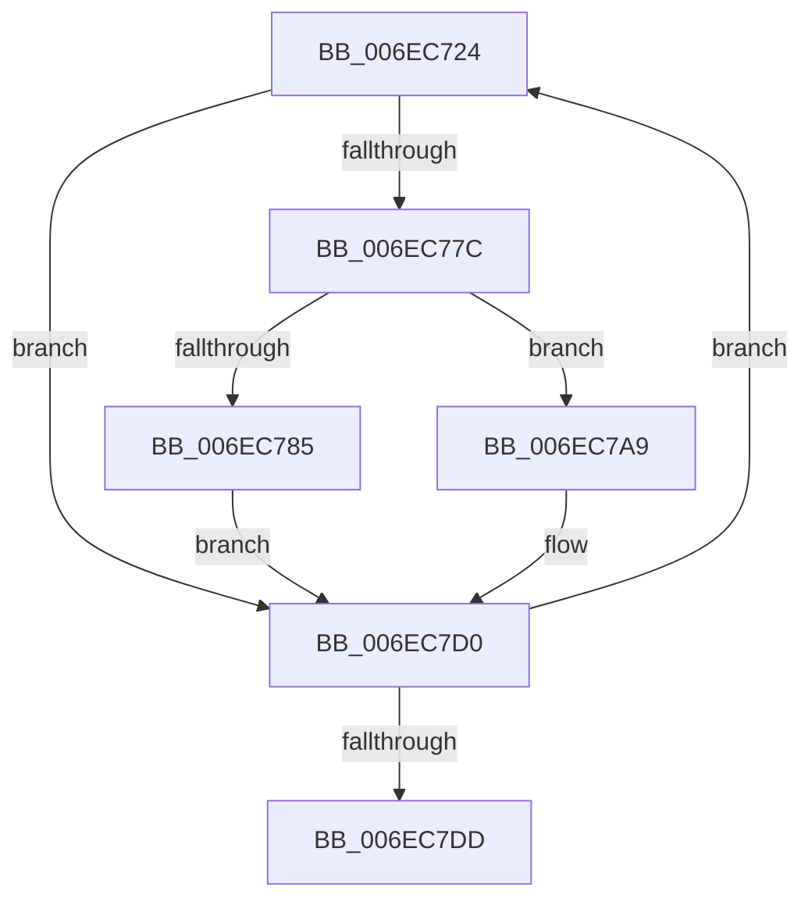

# sub_006EC724

- RVA: `0x006EC724`–`0x006EC7ED` (길이 `201` bytes)
- VA: `0x00000001406EC724`
- 실행 섹션: `.text`
- PDB 이름 있음: `아니요`; PDB Function 태그: `아니요`
- unwind 정보 RVA: `0x0009ADE4`
- 디코드: `46`개 명령, `201/201` bytes 표시
- 미해석 바이트: `0` (있으면 어셈블리에 `.byte`로 보존)

> 이 문서는 커널 이미지의 기계어와 PDB 기호를 분석해 생성했습니다. 4번과 5번은 함수 원형과 자료형을 바이너리 사용 방식에서 추정한 C 해석이며 원본 소스 복구 결과는 아닙니다.

## 1. Dependencies

- 직접 호출 지점: **4**; 고유 호출 대상: **4**
- 직접 호출자로 확인된 함수: **0**
- RIP 상대 이미지 참조: **0**

### Outgoing calls
- `0x006EC773` → [PpmParkComputeSnapStatistics](../40/PpmParkComputeSnapStatistics_function_0040B480.md) (function, `0x0040B480`)
- `0x006EC77C` → [Feature_PpmParkEx__private_IsEnabledDeviceUsageNoInline](../4F/Feature_PpmParkEx__private_IsEnabledDeviceUsageNoInline_function_004F135C.md) (function, `0x004F135C`)
- `0x006EC7A2` → [PpmEventParkNodeClassRecordedStatsEx](../5D/PpmEventParkNodeClassRecordedStatsEx_function_005DE748.md) (function, `0x005DE748`)
- `0x006EC7CB` → [PpmEventParkNodeClassRecordedStats](../4D/PpmEventParkNodeClassRecordedStats_function_004D66AC.md) (function, `0x004D66AC`)

### Direct callers
- 이 함수 시작 RVA로 연결되는 직접 call은 확인되지 않았습니다. 간접 호출은 완전히 역산할 수 없습니다.

### Static image references
- 디코드된 RIP-relative 메모리 참조가 없습니다.

## 2. Other-region calls and transfers

- 다른 실행 섹션으로 향하는 call: **0**
- call이 아닌 외부 분기/꼬리 이동: **1**
  - `0x006EC7E8` → [PpmParkRecordNodeStatistics + 0xCD](../40/PpmParkRecordNodeStatistics_function_0040B02C.md) (`tail-transfer`)

## 3. Assembly (complete function range)

```asm
006EC724  44 8A 84 24 88 00 00 00         mov r8b, byte ptr [rsp + 0x88]
006EC72C  40 8A D6                        mov dl, sil
006EC72F  40 0F B6 C7                     movzx eax, dil
006EC733  48 8D 0C 80                     lea rcx, [rax + rax*4]
006EC737  48 C1 E1 07                     shl rcx, 7
006EC73B  48 03 8B 08 05 00 00            add rcx, qword ptr [rbx + 0x508]
006EC742  4C 8D B1 78 02 00 00            lea r14, [rcx + 0x278]
006EC749  4C 8D B9 7C 02 00 00            lea r15, [rcx + 0x27c]
006EC750  4C 89 74 24 30                  mov qword ptr [rsp + 0x30], r14
006EC755  4C 8D A1 40 02 00 00            lea r12, [rcx + 0x240]
006EC75C  4C 89 7C 24 28                  mov qword ptr [rsp + 0x28], r15
006EC761  48 8D A9 7A 02 00 00            lea rbp, [rcx + 0x27a]
006EC768  4D 8B CC                        mov r9, r12
006EC76B  41 8B CD                        mov ecx, r13d
006EC76E  48 89 6C 24 20                  mov qword ptr [rsp + 0x20], rbp
006EC773  E8 08 ED D1 FF                  call 0x14040b480
006EC778  84 C0                           test al, al
006EC77A  74 54                           je 0x1406ec7d0
006EC77C  E8 DB 4B E0 FF                  call 0x1404f135c
006EC781  85 C0                           test eax, eax
006EC783  74 24                           je 0x1406ec7a9
006EC785  41 0F B7 06                     movzx eax, word ptr [r14]
006EC789  48 8D 4B 30                     lea rcx, [rbx + 0x30]
006EC78D  45 8A 0F                        mov r9b, byte ptr [r15]
006EC790  40 8A D7                        mov dl, dil
006EC793  44 0F B7 45 00                  movzx r8d, word ptr [rbp]
006EC798  66 89 44 24 28                  mov word ptr [rsp + 0x28], ax
006EC79D  4C 89 64 24 20                  mov qword ptr [rsp + 0x20], r12
006EC7A2  E8 A1 1F EF FF                  call 0x1405de748
006EC7A7  EB 27                           jmp 0x1406ec7d0
006EC7A9  41 8A 06                        mov al, byte ptr [r14]
006EC7AC  44 8A C7                        mov r8b, dil
006EC7AF  44 8A 4D 00                     mov r9b, byte ptr [rbp]
006EC7B3  48 8B 53 10                     mov rdx, qword ptr [rbx + 0x10]
006EC7B7  0F B7 4B 04                     movzx ecx, word ptr [rbx + 4]
006EC7BB  88 44 24 30                     mov byte ptr [rsp + 0x30], al
006EC7BF  41 8A 07                        mov al, byte ptr [r15]
006EC7C2  4C 89 64 24 28                  mov qword ptr [rsp + 0x28], r12
006EC7C7  88 44 24 20                     mov byte ptr [rsp + 0x20], al
006EC7CB  E8 DC 9E DE FF                  call 0x1404d66ac
006EC7D0  40 FE C7                        inc dil
006EC7D3  40 3A 7B 0C                     cmp dil, byte ptr [rbx + 0xc]
006EC7D7  0F 82 47 FF FF FF               jb 0x1406ec724
006EC7DD  0F B7 B4 24 90 00 00 00         movzx esi, word ptr [rsp + 0x90]
006EC7E5  45 33 FF                        xor r15d, r15d
006EC7E8  E9 0C E9 D1 FF                  jmp 0x14040b0f9
```

## 4. C-style interpretation (structured pseudocode)

```c
__int64 __fastcall sub_006EC724(__int64 a1, __int64 a2, __int64 a3, __int64 a4, __int64 a5, __int64 a6, __int64 a7, __int64 a8, __int64 a9, __int64 a10, __int64 a11, __int64 a12, __int64 a13, __int64 a14, __int64 a15, __int64 a16, unsigned __int8 a17, unsigned __int16 a18)
{
    __int64 result;
    __int64 v_r15;
    __int64 v_rdi;
    unsigned __int64 v_stack_p20;
    unsigned __int64 v_stack_p28;
    unsigned __int64 v_stack_p30;

    a1 = ((unsigned __int8)(v_rdi) + (unsigned __int8)(v_rdi) * 4) << (7);
    a1 = (a1) + (*(unsigned __int64 *)(v_rbx + 1288));
    v_stack_p30 = a1 + 632;
    v_stack_p28 = a1 + 636;
    v_stack_p20 = a1 + 634;
    result = PpmParkComputeSnapStatistics((unsigned int)((unsigned int)(v_r13)), (unsigned __int8)(v_rsi), a17, a1 + 576);
    if ((unsigned __int8)(result) == 0) goto loc_006EC7D0;
    result = Feature_PpmParkEx__private_IsEnabledDeviceUsageNoInline((unsigned int)((unsigned int)(v_r13)), (unsigned __int8)(v_rsi), a17, a1 + 576);
    if ((unsigned int)(result) == 0) goto loc_006EC7A9;
    v_stack_p28 = (unsigned __int16)(*(unsigned __int16 *)(a1 + 632));
    v_stack_p20 = a1 + 576;
    result = PpmEventParkNodeClassRecordedStatsEx(v_rbx + 48, (unsigned __int8)(v_rdi), *(unsigned __int16 *)(a1 + 634), *(unsigned __int8 *)(a1 + 636));
    goto loc_006EC7D0;
loc_006EC7A9:
    v_stack_p30 = (unsigned __int8)(*(unsigned __int8 *)(a1 + 632));
    v_stack_p28 = a1 + 576;
    v_stack_p20 = (unsigned __int8)(*(unsigned __int8 *)(a1 + 636));
    result = PpmEventParkNodeClassRecordedStats(*(unsigned __int16 *)(v_rbx + 4), *(unsigned __int64 *)(v_rbx + 16), (unsigned __int8)(v_rdi), *(unsigned __int8 *)(a1 + 634));
loc_006EC7D0:
    v_rdi = (unsigned __int8)((v_rdi) + 1);
    if (((unsigned __int8)(v_rdi)) < (*(unsigned __int8 *)(v_rbx + 12))) goto loc_006EC724;
    v_r15 = 0;
}
```

## 5. (Beta) C Style

```c
int64_t sub_006EC724(int64_t Arg1, int64_t Arg2, int64_t Arg3, int64_t Arg4, uint64_t Arg5, uint64_t Arg6, uint64_t Arg7, uint64_t Arg8, uint64_t Arg9, uint64_t Arg10, uint64_t Arg11, uint64_t Arg12, uint64_t Arg13, uint64_t Arg14, uint64_t Arg15, uint64_t Arg16, uint8_t Arg17, uint16_t Arg18)
{
    int64_t result;
    int64_t local_r15;
    int64_t local_rdi;
    uint64_t v_stack_p20;
    uint64_t v_stack_p28;
    uint64_t v_stack_p30;

    Arg1 = ((uint8_t)(local_rdi) + (uint8_t)(local_rdi) * 4) << (7);
    Arg1 = (Arg1) + (*(uint64_t *)(local_rbx + 0x508));
    v_stack_p30 = Arg1 + 632;
    v_stack_p28 = Arg1 + 636;
    v_stack_p20 = Arg1 + 634;
    result = PpmParkComputeSnapStatistics((uint32_t)((uint32_t)(local_r13)), (uint8_t)(local_rsi), Arg17, Arg1 + 576);
    if ((uint8_t)(result) == 0) goto loc_006EC7D0;
    result = Feature_PpmParkEx__private_IsEnabledDeviceUsageNoInline((uint32_t)((uint32_t)(local_r13)), (uint8_t)(local_rsi), Arg17, Arg1 + 576);
    if ((uint32_t)(result) == 0) goto loc_006EC7A9;
    v_stack_p28 = (uint16_t)(*(uint16_t *)(Arg1 + 0x278));
    v_stack_p20 = Arg1 + 576;
    result = PpmEventParkNodeClassRecordedStatsEx(local_rbx + 48, (uint8_t)(local_rdi), *(uint16_t *)(Arg1 + 0x27A), *(uint8_t *)(Arg1 + 0x27C));
    goto loc_006EC7D0;
loc_006EC7A9:
    v_stack_p30 = (uint8_t)(*(uint8_t *)(Arg1 + 0x278));
    v_stack_p28 = Arg1 + 576;
    v_stack_p20 = (uint8_t)(*(uint8_t *)(Arg1 + 0x27C));
    result = PpmEventParkNodeClassRecordedStats(*(uint16_t *)(local_rbx + 0x4), *(uint64_t *)(local_rbx + 0x10), (uint8_t)(local_rdi), *(uint8_t *)(Arg1 + 0x27A));
loc_006EC7D0:
    local_rdi = (uint8_t)((local_rdi) + 1);
    if (((uint8_t)(local_rdi)) < (*(uint8_t *)(local_rbx + 0xC))) goto loc_006EC724;
    local_r15 = 0;
}
```

## 6. Execution-region graph

[열기: 2D/3D 그래프와 함수 탐색 컨트롤 패널](../../../control-panel.html?section=text&rva=0x006EC724&view=graph)

- 2D 그래프는 위에서 아래로 흐르고, 3D 그래프는 빈 공간을 드래그해 회전합니다. Shift+드래그는 이동, 휠은 확대·축소, 함수 노드 선택은 대상 보고서 이동입니다.

### Static fallback


