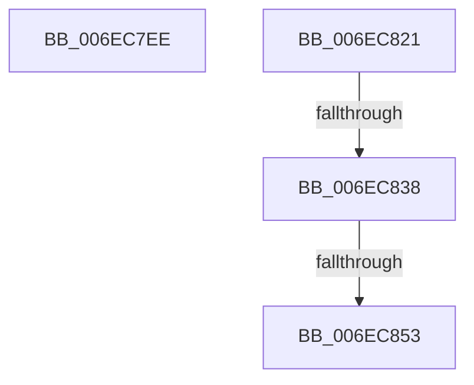

# sub_006EC7EE

- RVA: `0x006EC7EE`–`0x006EC90E` (길이 `288` bytes)
- VA: `0x00000001406EC7EE`
- 실행 섹션: `.text`
- PDB 이름 있음: `아니요`; PDB Function 태그: `아니요`
- unwind 정보 RVA: `0x0009AE20`
- 디코드: `57`개 명령, `288/288` bytes 표시
- 미해석 바이트: `0` (있으면 어셈블리에 `.byte`로 보존)

> 이 문서는 커널 이미지의 기계어와 PDB 기호를 분석해 생성했습니다. 4번과 5번은 함수 원형과 자료형을 바이너리 사용 방식에서 추정한 C 해석이며 원본 소스 복구 결과는 아닙니다.

## 1. Dependencies

- 직접 호출 지점: **3**; 고유 호출 대상: **3**
- 직접 호출자로 확인된 함수: **0**
- RIP 상대 이미지 참조: **4**

### Outgoing calls
- `0x006EC7F2` → [KeGetPrcb](../2D/KeGetPrcb_function_002D85D0.md) (function, `0x002D85D0`)
- `0x006EC846` → [EtwEventEnabled](../39/EtwEventEnabled_function_00392450.md) (function, `0x00392450`)
- `0x006EC903` → [EtwWriteEx](../25/EtwWriteEx_function_0025F0D0.md) (function, `0x0025F0D0`)

### Direct callers
- 이 함수 시작 RVA로 연결되는 직접 call은 확인되지 않았습니다. 간접 호출은 완전히 역산할 수 없습니다.

### Static image references
- `0x006EC821` → RVA `0x00E67A39` (`.data`; read)
- `0x006EC828` → RVA `0x00E0B804` (`.data`; read)
- `0x006EC838` → RVA `0x00F083E8` (`.data`; read)
- `0x006EC83F` → RVA `0x00021DD0` (`.rdata`; read)

## 2. Other-region calls and transfers

- 다른 실행 섹션으로 향하는 call: **0**
- call이 아닌 외부 분기/꼬리 이동: **4**
  - `0x006EC81C` → [PpmPerfRecordMostActiveWorkloadClass + 0x19E](../40/PpmPerfRecordMostActiveWorkloadClass_function_0040B1A4.md) (`tail-transfer`)
  - `0x006EC832` → [PpmPerfRecordMostActiveWorkloadClass + 0x55](../40/PpmPerfRecordMostActiveWorkloadClass_function_0040B1A4.md) (`tail-transfer`)
  - `0x006EC84D` → [PpmPerfRecordMostActiveWorkloadClass + 0x55](../40/PpmPerfRecordMostActiveWorkloadClass_function_0040B1A4.md) (`tail-transfer`)
  - `0x006EC909` → [PpmPerfRecordMostActiveWorkloadClass + 0x55](../40/PpmPerfRecordMostActiveWorkloadClass_function_0040B1A4.md) (`tail-transfer`)

## 3. Assembly (complete function range)

```asm
006EC7EE  8B 4C 24 48                     mov ecx, dword ptr [rsp + 0x48]
006EC7F2  E8 D9 BD BE FF                  call 0x1402d85d0
006EC7F7  48 8B 90 58 8A 00 00            mov rdx, qword ptr [rax + 0x8a58]
006EC7FE  48 8B 80 60 8A 00 00            mov rax, qword ptr [rax + 0x8a60]
006EC805  48 8B 4C D8 08                  mov rcx, qword ptr [rax + rbx*8 + 8]
006EC80A  48 01 8C DD 00 01 00 00         add qword ptr [rbp + rbx*8 + 0x100], rcx
006EC812  48 8B 44 DA 08                  mov rax, qword ptr [rdx + rbx*8 + 8]
006EC817  48 01 44 DD 00                  add qword ptr [rbp + rbx*8], rax
006EC81C  E9 21 EB D1 FF                  jmp 0x14040b342
006EC821  44 38 2D 11 B2 77 00            cmp byte ptr [rip + 0x77b211], r13b
006EC828  8B 05 D6 EF 71 00               mov eax, dword ptr [rip + 0x71efd6]
006EC82E  89 44 24 50                     mov dword ptr [rsp + 0x50], eax
006EC832  0F 84 C1 E9 D1 FF               je 0x14040b1f9
006EC838  48 8B 0D A9 BB 81 00            mov rcx, qword ptr [rip + 0x81bba9]
006EC83F  48 8D 15 8A 55 93 FF            lea rdx, [rip - 0x6caa76]
006EC846  E8 05 5C CA FF                  call 0x140392450
006EC84B  84 C0                           test al, al
006EC84D  0F 84 A6 E9 D1 FF               je 0x14040b1f9
006EC853  41 B8 08 00 00 00               mov r8d, 8
006EC859  48 C7 45 88 02 00 00 00         mov qword ptr [rbp - 0x78], 2
006EC861  48 8D 46 04                     lea rax, [rsi + 4]
006EC865  4C 89 45 98                     mov qword ptr [rbp - 0x68], r8
006EC869  48 89 45 80                     mov qword ptr [rbp - 0x80], rax
006EC86D  48 8D 4D 00                     lea rcx, [rbp]
006EC871  48 8D 46 10                     lea rax, [rsi + 0x10]
006EC875  48 89 4D E0                     mov qword ptr [rbp - 0x20], rcx
006EC879  48 8B 0D 68 BB 81 00            mov rcx, qword ptr [rip + 0x81bb68]
006EC880  48 8D 15 49 55 93 FF            lea rdx, [rip - 0x6caab7]
006EC887  48 89 45 90                     mov qword ptr [rbp - 0x70], rax
006EC88B  45 33 C9                        xor r9d, r9d
006EC88E  48 8D 44 24 50                  lea rax, [rsp + 0x50]
006EC893  48 89 5D A0                     mov qword ptr [rbp - 0x60], rbx
006EC897  48 89 45 C0                     mov qword ptr [rbp - 0x40], rax
006EC89B  48 8D 85 00 01 00 00            lea rax, [rbp + 0x100]
006EC8A2  48 89 45 D0                     mov qword ptr [rbp - 0x30], rax
006EC8A6  8B 44 24 50                     mov eax, dword ptr [rsp + 0x50]
006EC8AA  C1 E0 03                        shl eax, 3
006EC8AD  89 45 D8                        mov dword ptr [rbp - 0x28], eax
006EC8B0  89 45 E8                        mov dword ptr [rbp - 0x18], eax
006EC8B3  48 8D 44 24 48                  lea rax, [rsp + 0x48]
006EC8B8  48 89 45 F0                     mov qword ptr [rbp - 0x10], rax
006EC8BC  48 8D 45 80                     lea rax, [rbp - 0x80]
006EC8C0  48 89 44 24 38                  mov qword ptr [rsp + 0x38], rax
006EC8C5  44 89 44 24 30                  mov dword ptr [rsp + 0x30], r8d
006EC8CA  45 33 C0                        xor r8d, r8d
006EC8CD  4C 89 6C 24 28                  mov qword ptr [rsp + 0x28], r13
006EC8D2  4C 89 6C 24 20                  mov qword ptr [rsp + 0x20], r13
006EC8D7  48 C7 45 A8 01 00 00 00         mov qword ptr [rbp - 0x58], 1
006EC8DF  4C 89 75 B0                     mov qword ptr [rbp - 0x50], r14
006EC8E3  48 C7 45 B8 01 00 00 00         mov qword ptr [rbp - 0x48], 1
006EC8EB  48 C7 45 C8 04 00 00 00         mov qword ptr [rbp - 0x38], 4
006EC8F3  44 89 6D DC                     mov dword ptr [rbp - 0x24], r13d
006EC8F7  44 89 6D EC                     mov dword ptr [rbp - 0x14], r13d
006EC8FB  48 C7 45 F8 04 00 00 00         mov qword ptr [rbp - 8], 4
006EC903  E8 C8 27 B7 FF                  call 0x14025f0d0
006EC908  90                              nop
006EC909  E9 EB E8 D1 FF                  jmp 0x14040b1f9
```

## 4. C-style interpretation (structured pseudocode)

```c
__int64 __fastcall sub_006EC7EE(__int64 a1, __int64 a2, __int64 a3, int a4, __int64 a5, __int64 a6, __int64 a7, __int64 a8, unsigned int a9)
{
    __int64 result;
    unsigned __int64 v_stack_p20;
    unsigned __int64 v_stack_p28;
    unsigned int v_stack_p30;
    unsigned __int64 v_stack_p38;
    unsigned __int64 v_stack_p48;
    unsigned int v_stack_p50;

    result = KeGetPrcb((unsigned int)(a9), a2, a3, a4);
}
```

## 5. (Beta) C Style

```c
int64_t sub_006EC7EE(int64_t Arg1, int64_t Arg2, int64_t Arg3, int32_t Arg4, uint64_t Arg5, uint64_t Arg6, uint64_t Arg7, uint64_t Arg8, uint32_t Arg9)
{
    int64_t result;
    uint64_t v_stack_p20;
    uint64_t v_stack_p28;
    uint32_t v_stack_p30;
    uint64_t v_stack_p38;
    uint64_t v_stack_p48;
    uint32_t v_stack_p50;

    result = KeGetPrcb((uint32_t)(Arg9), Arg2, Arg3, Arg4);
}
```

## 6. Execution-region graph

[열기: 2D/3D 그래프와 함수 탐색 컨트롤 패널](../../../control-panel.html?section=text&rva=0x006EC7EE&view=graph)

- 2D 그래프는 위에서 아래로 흐르고, 3D 그래프는 빈 공간을 드래그해 회전합니다. Shift+드래그는 이동, 휠은 확대·축소, 함수 노드 선택은 대상 보고서 이동입니다.

### Static fallback


