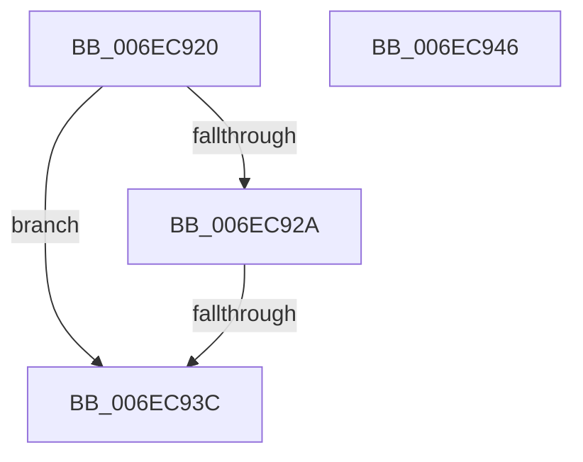

# sub_006EC920

- RVA: `0x006EC920`–`0x006EC956` (길이 `54` bytes)
- VA: `0x00000001406EC920`
- 실행 섹션: `.text`
- PDB 이름 있음: `아니요`; PDB Function 태그: `아니요`
- unwind 정보 RVA: `0x0009B054`
- 디코드: `14`개 명령, `54/54` bytes 표시
- 미해석 바이트: `0` (있으면 어셈블리에 `.byte`로 보존)

> 이 문서는 커널 이미지의 기계어와 PDB 기호를 분석해 생성했습니다. 4번과 5번은 함수 원형과 자료형을 바이너리 사용 방식에서 추정한 C 해석이며 원본 소스 복구 결과는 아닙니다.

## 1. Dependencies

- 직접 호출 지점: **2**; 고유 호출 대상: **2**
- 직접 호출자로 확인된 함수: **0**
- RIP 상대 이미지 참조: **0**

### Outgoing calls
- `0x006EC92F` → [RtlGuardIsValidWow64StackPointer](../../page/A5/RtlGuardIsValidWow64StackPointer_function_00A57124.md) (function, `0x00A57124`)
- `0x006EC94B` → [KiLogUserCetSetContextIpValidationFailure](../5C/KiLogUserCetSetContextIpValidationFailure_function_005C830C.md) (function, `0x005C830C`)

### Direct callers
- 이 함수 시작 RVA로 연결되는 직접 call은 확인되지 않았습니다. 간접 호출은 완전히 역산할 수 없습니다.

### Static image references
- 디코드된 RIP-relative 메모리 참조가 없습니다.

## 2. Other-region calls and transfers

- 다른 실행 섹션으로 향하는 call: **1**
  - `0x006EC92F` → [RtlGuardIsValidWow64StackPointer](../../page/A5/RtlGuardIsValidWow64StackPointer_function_00A57124.md) (`.text` → `PAGE`)
- call이 아닌 외부 분기/꼬리 이동: **3**
  - `0x006EC936` → [KeVerifyContextRecord + 0x70](../40/KeVerifyContextRecord_function_0040BE90.md) (`tail-transfer`)
  - `0x006EC941` → [KeVerifyContextRecord + 0xFB](../40/KeVerifyContextRecord_function_0040BE90.md) (`tail-transfer`)
  - `0x006EC951` → [KeVerifyContextRecord + 0xF5](../40/KeVerifyContextRecord_function_0040BE90.md) (`tail-transfer`)

## 3. Assembly (complete function range)

```asm
006EC920  B8 FF FF FF FF                  mov eax, 0xffffffff
006EC925  48 3B F8                        cmp rdi, rax
006EC928  73 12                           jae 0x1406ec93c
006EC92A  48 8B D5                        mov rdx, rbp
006EC92D  8B CF                           mov ecx, edi
006EC92F  E8 F0 A7 36 00                  call 0x140a57124
006EC934  85 C0                           test eax, eax
006EC936  0F 85 C4 F5 D1 FF               jne 0x14040bf00
006EC93C  B8 0D 00 00 C0                  mov eax, 0xc000000d
006EC941  E9 45 F6 D1 FF                  jmp 0x14040bf8b
006EC946  B9 02 00 00 00                  mov ecx, 2
006EC94B  E8 BC B9 ED FF                  call 0x1405c830c
006EC950  90                              nop
006EC951  E9 2F F6 D1 FF                  jmp 0x14040bf85
```

## 4. C-style interpretation (structured pseudocode)

```c
__int64 __fastcall sub_006EC920(void)
{
    __int64 result;

    if (v_rdi >= ((unsigned int)(0xFFFFFFFFULL))) goto loc_006EC93C;
    result = RtlGuardIsValidWow64StackPointer((unsigned int)((unsigned int)(v_rdi)), v_rbp, a3, a4);
loc_006EC93C:
}
```

## 5. (Beta) C Style

```c
void sub_006EC920(void)
{
    int64_t result;

    if (local_rdi >= ((uint32_t)(0xFFFFFFFFULL))) goto loc_006EC93C;
    result = RtlGuardIsValidWow64StackPointer((uint32_t)((uint32_t)(local_rdi)), local_rbp, a3, a4);
loc_006EC93C:
}
```

## 6. Execution-region graph

[열기: 2D/3D 그래프와 함수 탐색 컨트롤 패널](../../../control-panel.html?section=text&rva=0x006EC920&view=graph)

- 2D 그래프는 위에서 아래로 흐르고, 3D 그래프는 빈 공간을 드래그해 회전합니다. Shift+드래그는 이동, 휠은 확대·축소, 함수 노드 선택은 대상 보고서 이동입니다.

### Static fallback


