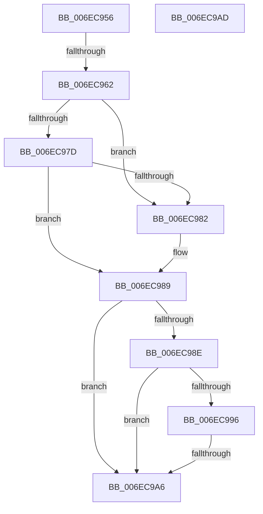

# sub_006EC956

- RVA: `0x006EC956`–`0x006EC9C9` (길이 `115` bytes)
- VA: `0x00000001406EC956`
- 실행 섹션: `.text`
- PDB 이름 있음: `아니요`; PDB Function 태그: `아니요`
- unwind 정보 RVA: `0x0009B0A8`
- 디코드: `24`개 명령, `115/115` bytes 표시
- 미해석 바이트: `0` (있으면 어셈블리에 `.byte`로 보존)

> 이 문서는 커널 이미지의 기계어와 PDB 기호를 분석해 생성했습니다. 4번과 5번은 함수 원형과 자료형을 바이너리 사용 방식에서 추정한 C 해석이며 원본 소스 복구 결과는 아닙니다.

## 1. Dependencies

- 직접 호출 지점: **0**; 고유 호출 대상: **0**
- 직접 호출자로 확인된 함수: **0**
- RIP 상대 이미지 참조: **0**

### Outgoing calls
- 직접 디코드된 call 명령이 없습니다.

### Direct callers
- 이 함수 시작 RVA로 연결되는 직접 call은 확인되지 않았습니다. 간접 호출은 완전히 역산할 수 없습니다.

### Static image references
- 디코드된 RIP-relative 메모리 참조가 없습니다.

## 2. Other-region calls and transfers

- 다른 실행 섹션으로 향하는 call: **0**
- call이 아닌 외부 분기/꼬리 이동: **4**
  - `0x006EC95C` → [KiVerifyContextIpForUserCet + 0x156](../40/KiVerifyContextIpForUserCet_function_0040C028.md) (`tail-transfer`)
  - `0x006EC9A0` → [KiVerifyContextIpForUserCet + 0xFC](../40/KiVerifyContextIpForUserCet_function_0040C028.md) (`tail-transfer`)
  - `0x006EC9A8` → [KiVerifyContextIpForUserCet + 0xD2](../40/KiVerifyContextIpForUserCet_function_0040C028.md) (`tail-transfer`)
  - `0x006EC9C4` → [KiVerifyContextIpForUserCet + 0xFC](../40/KiVerifyContextIpForUserCet_function_0040C028.md) (`tail-transfer`)

## 3. Assembly (complete function range)

```asm
006EC956  48 83 7C 24 30 00               cmp qword ptr [rsp + 0x30], 0
006EC95C  0F 84 1C F8 D1 FF               je 0x14040c17e
006EC962  48 8B 44 24 38                  mov rax, qword ptr [rsp + 0x38]
006EC967  48 8D 88 18 01 00 00            lea rcx, [rax + 0x118]
006EC96E  48 BA 00 00 FF FF FF 7F 00 00   movabs rdx, 0x7fffffff0000
006EC978  48 3B CA                        cmp rcx, rdx
006EC97B  77 05                           ja 0x1406ec982
006EC97D  48 3B C8                        cmp rcx, rax
006EC980  73 07                           jae 0x1406ec989
006EC982  8A 02                           mov al, byte ptr [rdx]
006EC984  48 8B 44 24 38                  mov rax, qword ptr [rsp + 0x38]
006EC989  48 85 C0                        test rax, rax
006EC98C  74 18                           je 0x1406ec9a6
006EC98E  81 38 18 01 00 00               cmp dword ptr [rax], 0x118
006EC994  72 10                           jb 0x1406ec9a6
006EC996  F7 80 90 00 00 00 00 00 40 00   test dword ptr [rax + 0x90], 0x400000
006EC9A0  0F 85 7E F7 D1 FF               jne 0x14040c124
006EC9A6  33 C0                           xor eax, eax
006EC9A8  E9 4D F7 D1 FF                  jmp 0x14040c0fa
006EC9AD  BB 01 00 00 00                  mov ebx, 1
006EC9B2  4C 8B BC 24 90 00 00 00         mov r15, qword ptr [rsp + 0x90]
006EC9BA  48 8B 7C 24 20                  mov rdi, qword ptr [rsp + 0x20]
006EC9BF  4C 8B 74 24 28                  mov r14, qword ptr [rsp + 0x28]
006EC9C4  E9 5B F7 D1 FF                  jmp 0x14040c124
```

## 4. C-style interpretation (structured pseudocode)

```c
__int64 __fastcall sub_006EC956(__int64 a1, __int64 a2, __int64 a3, __int64 a4, __int64 a5, __int64 a6, __int64 a7)
{
    __int64 result;
    unsigned __int64 v_stack_p20;
    unsigned __int64 v_stack_p28;
    unsigned __int64 v_stack_p90;

    if ((a7 + 280) > a2) goto loc_006EC982;
    result = a7;
    if ((a7 + 280) < a7) {
        result = *(unsigned __int8 *)(a2);
        result = a7;
    }
    if (result == 0) goto loc_006EC9A6;
    if ((*(unsigned int *)(result)) < 280) goto loc_006EC9A6;
loc_006EC9A6:
    result = 0;
}
```

## 5. (Beta) C Style

```c
int64_t sub_006EC956(int64_t Arg1, int64_t Arg2, int64_t Arg3, int64_t Arg4, uint64_t Arg5, int64_t Arg6, void *Arg7)
{
    uint8_t *arg7 = (uint8_t *)Arg7;

    int64_t result;
    uint64_t v_stack_p20;
    uint64_t v_stack_p28;
    uint64_t v_stack_p90;

    if ((Arg7 + 280) > Arg2) goto loc_006EC982;
    result = Arg7;
    if ((Arg7 + 280) < Arg7) {
        result = *(uint8_t *)(Arg2);
        result = Arg7;
    }
    if (result == 0) goto loc_006EC9A6;
    if ((*(uint32_t *)(result)) < 280) goto loc_006EC9A6;
loc_006EC9A6:
    result = 0;
}
```

### 관측된 메모리 오프셋

구조체 형식이 확인되지 않은 접근은 인자 기준의 오프셋으로만 기록했습니다.

| 기준 인자 | 오프셋 표현 | 폭 (bit) | 접근 |
|---|---:|---:|---|
| `Arg7` | `+ 0x118` | `64` | `R` |

## 6. Execution-region graph

[열기: 2D/3D 그래프와 함수 탐색 컨트롤 패널](../../../control-panel.html?section=text&rva=0x006EC956&view=graph)

- 2D 그래프는 위에서 아래로 흐르고, 3D 그래프는 빈 공간을 드래그해 회전합니다. Shift+드래그는 이동, 휠은 확대·축소, 함수 노드 선택은 대상 보고서 이동입니다.

### Static fallback


