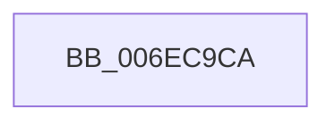

# sub_006EC9CA

- RVA: `0x006EC9CA`–`0x006ECA2C` (길이 `98` bytes)
- VA: `0x00000001406EC9CA`
- 실행 섹션: `.text`
- PDB 이름 있음: `아니요`; PDB Function 태그: `아니요`
- unwind 정보 RVA: `0x0009B1F8`
- 디코드: `19`개 명령, `98/98` bytes 표시
- 미해석 바이트: `0` (있으면 어셈블리에 `.byte`로 보존)

> 이 문서는 커널 이미지의 기계어와 PDB 기호를 분석해 생성했습니다. 4번과 5번은 함수 원형과 자료형을 바이너리 사용 방식에서 추정한 C 해석이며 원본 소스 복구 결과는 아닙니다.

## 1. Dependencies

- 직접 호출 지점: **1**; 고유 호출 대상: **1**
- 직접 호출자로 확인된 함수: **0**
- RIP 상대 이미지 참조: **0**

### Outgoing calls
- `0x006EC9E6` → [MI_READ_PTE_LOCK_FREE](../28/MI_READ_PTE_LOCK_FREE_function_002828A0.md) (function, `0x002828A0`)

### Direct callers
- 이 함수 시작 RVA로 연결되는 직접 call은 확인되지 않았습니다. 간접 호출은 완전히 역산할 수 없습니다.

### Static image references
- 디코드된 RIP-relative 메모리 참조가 없습니다.

## 2. Other-region calls and transfers

- 다른 실행 섹션으로 향하는 call: **0**
- call이 아닌 외부 분기/꼬리 이동: **1**
  - `0x006ECA27` → [sub_0040D91B + 0xA3](../40/Unknown_function_0040D91B.md) (`tail-transfer`)

## 3. Assembly (complete function range)

```asm
006EC9CA  49 C1 EE 12                     shr r14, 0x12
006EC9CE  41 81 E6 F8 FF FF 3F            and r14d, 0x3ffffff8
006EC9D5  48 B8 00 00 00 40 FB F6 FF FF   movabs rax, 0xfffff6fb40000000
006EC9DF  48 8B C0                        mov rax, rax
006EC9E2  4A 8D 0C 30                     lea rcx, [rax + r14]
006EC9E6  E8 B5 5E B9 FF                  call 0x1402828a0
006EC9EB  48 C1 E8 0C                     shr rax, 0xc
006EC9EF  48 B9 FF FF FF FF FF 00 00 00   movabs rcx, 0xffffffffff
006EC9F9  48 23 C1                        and rax, rcx
006EC9FC  48 8D 0C 40                     lea rcx, [rax + rax*2]
006ECA00  48 B8 00 00 00 00 00 DE FF FF   movabs rax, 0xffffde0000000000
006ECA0A  48 C1 E1 04                     shl rcx, 4
006ECA0E  48 8B C0                        mov rax, rax
006ECA11  48 03 C8                        add rcx, rax
006ECA14  48 BA FF FF FF FF FF E3 FF FF   movabs rdx, 0xffffe3ffffffffff
006ECA1E  48 8B 01                        mov rax, qword ptr [rcx]
006ECA21  48 23 C2                        and rax, rdx
006ECA24  48 89 01                        mov qword ptr [rcx], rax
006ECA27  E9 92 0F D2 FF                  jmp 0x14040d9be
```

## 4. C-style interpretation (structured pseudocode)

```c
__int64 __fastcall sub_006EC9CA(void)
{
    __int64 result;
    __int64 v_r14;

    v_r14 = (v_r14) >> (18);
    v_r14 = (unsigned int)((v_r14) & (0x3FFFFFF8ULL));
    result = MI_READ_PTE_LOCK_FREE(result + v_r14 * 1, a2, a3, a4);
    result = (result) >> (12);
    result = (result) & (result + v_r14 * 1);
    a1 = (result + result * 2) << (4);
    a1 = (a1) + (result);
    result = (*(unsigned __int64 *)(a1)) & (a2);
    *(unsigned __int64 *)(a1) = result;
}
```

## 5. (Beta) C Style

```c
void sub_006EC9CA(void)
{
    int64_t result;
    int64_t local_r14;

    local_r14 = (local_r14) >> (18);
    local_r14 = (uint32_t)((local_r14) & (0x3FFFFFF8ULL));
    result = MI_READ_PTE_LOCK_FREE(result + local_r14 * 1, a2, a3, a4);
    result = (result) >> (12);
    result = (result) & (result + local_r14 * 1);
    a1 = (result + result * 2) << (4);
    a1 = (a1) + (result);
    result = (*(uint64_t *)(a1)) & (a2);
    *(uint64_t *)(a1) = result;
}
```

## 6. Execution-region graph

[열기: 2D/3D 그래프와 함수 탐색 컨트롤 패널](../../../control-panel.html?section=text&rva=0x006EC9CA&view=graph)

- 2D 그래프는 위에서 아래로 흐르고, 3D 그래프는 빈 공간을 드래그해 회전합니다. Shift+드래그는 이동, 휠은 확대·축소, 함수 노드 선택은 대상 보고서 이동입니다.

### Static fallback


