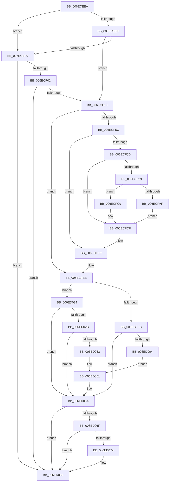

# sub_006ECEEA

- RVA: `0x006ECEEA`–`0x006ED096` (길이 `428` bytes)
- VA: `0x00000001406ECEEA`
- 실행 섹션: `.text`
- PDB 이름 있음: `아니요`; PDB Function 태그: `아니요`
- unwind 정보 RVA: `0x0009BCC0`
- 디코드: `99`개 명령, `428/428` bytes 표시
- 미해석 바이트: `0` (있으면 어셈블리에 `.byte`로 보존)

> 이 문서는 커널 이미지의 기계어와 PDB 기호를 분석해 생성했습니다. 4번과 5번은 함수 원형과 자료형을 바이너리 사용 방식에서 추정한 C 해석이며 원본 소스 복구 결과는 아닙니다.

## 1. Dependencies

- 직접 호출 지점: **8**; 고유 호출 대상: **6**
- 직접 호출자로 확인된 함수: **0**
- RIP 상대 이미지 참조: **5**

### Outgoing calls
- `0x006ECF64` → [IoGetDiskDeviceObject](../4A/IoGetDiskDeviceObject_function_004A8540.md) (function, `0x004A8540`)
- `0x006ECF84` → [ObQueryNameString](../../page/8A/ObQueryNameString_function_008A7EB0.md) (function, `0x008A7EB0`)
- `0x006ECFA2` → [ExAllocatePool2](../../poolcode/B8/ExAllocatePool2_function_00B820F0.md) (function, `0x00B820F0`)
- `0x006ECFBF` → [ObQueryNameString](../../page/8A/ObQueryNameString_function_008A7EB0.md) (function, `0x008A7EB0`)
- `0x006ECFD7` → [ObfDereferenceObjectWithTag](../2F/ObfDereferenceObjectWithTag_function_002F78E0.md) (function, `0x002F78E0`)
- `0x006ED065` → [McTemplateK0hzr0hzr2_EtwWriteTransfer](../59/McTemplateK0hzr0hzr2_EtwWriteTransfer_function_005980AC.md) (function, `0x005980AC`)
- `0x006ED07E` → [ExFreePoolWithTag](../../poolcode/B8/ExFreePoolWithTag_function_00B82870.md) (function, `0x00B82870`)
- `0x006ED08B` → [ObfDereferenceObjectWithTag](../2F/ObfDereferenceObjectWithTag_function_002F78E0.md) (function, `0x002F78E0`)

### Direct callers
- 이 함수 시작 RVA로 연결되는 직접 call은 확인되지 않았습니다. 간접 호출은 완전히 역산할 수 없습니다.

### Static image references
- `0x006ECEEF` → RVA `0x00F8D8D4` (`.data`; read)
- `0x006ECF2C` → RVA `0x006C9E70` (` ?? ::FNODOBFM::`string'`; read)
- `0x006ECFFC` → RVA `0x00F8D8D4` (`.data`; reference)
- `0x006ED01B` → RVA `0x00021A08` (`.rdata`; read)
- `0x006ED04A` → RVA `0x000235A0` (`.rdata`; read)

## 2. Other-region calls and transfers

- 다른 실행 섹션으로 향하는 call: **4**
  - `0x006ECF84` → [ObQueryNameString](../../page/8A/ObQueryNameString_function_008A7EB0.md) (`.text` → `PAGE`)
  - `0x006ECFA2` → [ExAllocatePool2](../../poolcode/B8/ExAllocatePool2_function_00B820F0.md) (`.text` → `POOLCODE`)
  - `0x006ECFBF` → [ObQueryNameString](../../page/8A/ObQueryNameString_function_008A7EB0.md) (`.text` → `PAGE`)
  - `0x006ED07E` → [ExFreePoolWithTag](../../poolcode/B8/ExFreePoolWithTag_function_00B82870.md) (`.text` → `POOLCODE`)
- call이 아닌 외부 분기/꼬리 이동: **1**
  - `0x006ED091` → [IopAttachDeviceToDeviceStackSafe + 0x1AC](../41/IopAttachDeviceToDeviceStackSafe_function_00410574.md) (`tail-transfer`)

## 3. Assembly (complete function range)

```asm
006ECEEA  45 84 FF                        test r15b, r15b
006ECEED  74 0A                           je 0x1406ecef9
006ECEEF  8B 05 DF 09 8A 00               mov eax, dword ptr [rip + 0x8a09df]
006ECEF5  84 C3                           test bl, al
006ECEF7  75 17                           jne 0x1406ecf10
006ECEF9  40 84 F6                        test sil, sil
006ECEFC  0F 84 81 01 00 00               je 0x1406ed083
006ECF02  8B 05 CC 09 8A 00               mov eax, dword ptr [rip + 0x8a09cc]
006ECF08  84 C3                           test bl, al
006ECF0A  0F 84 73 01 00 00               je 0x1406ed083
006ECF10  49 8B 46 08                     mov rax, qword ptr [r14 + 8]
006ECF14  48 8D 74 24 70                  lea rsi, [rsp + 0x70]
006ECF19  48 C7 44 24 50 1A 00 1C 00      mov qword ptr [rsp + 0x50], 0x1c001a
006ECF22  4C 8D 7C 24 50                  lea r15, [rsp + 0x50]
006ECF27  44 0F B7 48 38                  movzx r9d, word ptr [rax + 0x38]
006ECF2C  48 8D 05 3D CF FD FF            lea rax, [rip - 0x230c3]
006ECF33  66 41 D1 E9                     shr r9w, 1
006ECF37  48 83 64 24 48 00               and qword ptr [rsp + 0x48], 0
006ECF3D  66 44 89 4C 24 42               mov word ptr [rsp + 0x42], r9w
006ECF43  48 89 44 24 58                  mov qword ptr [rsp + 0x58], rax
006ECF48  C7 44 24 44 40 00 00 00         mov dword ptr [rsp + 0x44], 0x40
006ECF50  44 0F 20 C0                     mov rax, cr8
006ECF54  3C 02                           cmp al, 2
006ECF56  0F 83 92 00 00 00               jae 0x1406ecfee
006ECF5C  48 8D 54 24 48                  lea rdx, [rsp + 0x48]
006ECF61  49 8B CD                        mov rcx, r13
006ECF64  E8 D7 B5 DB FF                  call 0x1404a8540
006ECF69  85 C0                           test eax, eax
006ECF6B  78 7B                           js 0x1406ecfe8
006ECF6D  4C 8B 6C 24 48                  mov r13, qword ptr [rsp + 0x48]
006ECF72  4C 8D 4C 24 44                  lea r9, [rsp + 0x44]
006ECF77  44 8B 44 24 44                  mov r8d, dword ptr [rsp + 0x44]
006ECF7C  48 8D 54 24 70                  lea rdx, [rsp + 0x70]
006ECF81  49 8B CD                        mov rcx, r13
006ECF84  E8 27 AF 1B 00                  call 0x1408a7eb0
006ECF89  44 8B E0                        mov r12d, eax
006ECF8C  3D 04 00 00 C0                  cmp eax, 0xc0000004
006ECF91  75 3C                           jne 0x1406ecfcf
006ECF93  8B 54 24 44                     mov edx, dword ptr [rsp + 0x44]
006ECF97  B9 00 01 00 00                  mov ecx, 0x100
006ECF9C  41 B8 49 6F 4F 6E               mov r8d, 0x6e4f6f49
006ECFA2  E8 49 51 49 00                  call 0x140b820f0
006ECFA7  48 8B F0                        mov rsi, rax
006ECFAA  48 85 C0                        test rax, rax
006ECFAD  74 1A                           je 0x1406ecfc9
006ECFAF  44 8B 44 24 44                  mov r8d, dword ptr [rsp + 0x44]
006ECFB4  4C 8D 4C 24 44                  lea r9, [rsp + 0x44]
006ECFB9  48 8B D0                        mov rdx, rax
006ECFBC  49 8B CD                        mov rcx, r13
006ECFBF  E8 EC AE 1B 00                  call 0x1408a7eb0
006ECFC4  44 8B E0                        mov r12d, eax
006ECFC7  EB 06                           jmp 0x1406ecfcf
006ECFC9  41 BC 9A 00 00 C0               mov r12d, 0xc000009a
006ECFCF  BA 44 66 6C 74                  mov edx, 0x746c6644
006ECFD4  49 8B CD                        mov rcx, r13
006ECFD7  E8 04 A9 C0 FF                  call 0x1402f78e0
006ECFDC  4C 8B 6C 24 60                  mov r13, qword ptr [rsp + 0x60]
006ECFE1  45 85 E4                        test r12d, r12d
006ECFE4  4C 0F 49 FE                     cmovns r15, rsi
006ECFE8  44 0F B7 4C 24 42               movzx r9d, word ptr [rsp + 0x42]
006ECFEE  41 0F B7 17                     movzx edx, word ptr [r15]
006ECFF2  66 D1 EA                        shr dx, 1
006ECFF5  80 7C 24 40 00                  cmp byte ptr [rsp + 0x40], 0
006ECFFA  74 28                           je 0x1406ed024
006ECFFC  84 1D D2 08 8A 00               test byte ptr [rip + 0x8a08d2], bl
006ED002  74 66                           je 0x1406ed06a
006ED004  65 4C 8B 04 25 88 01 00 00      mov r8, qword ptr gs:[0x188]
006ED00D  49 8B 47 08                     mov rax, qword ptr [r15 + 8]
006ED011  48 89 44 24 30                  mov qword ptr [rsp + 0x30], rax
006ED016  66 89 54 24 28                  mov word ptr [rsp + 0x28], dx
006ED01B  48 8D 15 E6 49 93 FF            lea rdx, [rip - 0x6cb61a]
006ED022  EB 2D                           jmp 0x1406ed051
006ED024  80 7C 24 41 00                  cmp byte ptr [rsp + 0x41], 0
006ED029  74 3F                           je 0x1406ed06a
006ED02B  84 1D A3 08 8A 00               test byte ptr [rip + 0x8a08a3], bl
006ED031  74 37                           je 0x1406ed06a
006ED033  65 4C 8B 04 25 88 01 00 00      mov r8, qword ptr gs:[0x188]
006ED03C  49 8B 47 08                     mov rax, qword ptr [r15 + 8]
006ED040  48 89 44 24 30                  mov qword ptr [rsp + 0x30], rax
006ED045  66 89 54 24 28                  mov word ptr [rsp + 0x28], dx
006ED04A  48 8D 15 4F 65 93 FF            lea rdx, [rip - 0x6c9ab1]
006ED051  49 8B 4E 08                     mov rcx, qword ptr [r14 + 8]
006ED055  4D 8B 80 30 06 00 00            mov r8, qword ptr [r8 + 0x630]
006ED05C  48 8B 41 40                     mov rax, qword ptr [rcx + 0x40]
006ED060  48 89 44 24 20                  mov qword ptr [rsp + 0x20], rax
006ED065  E8 42 B0 EA FF                  call 0x1405980ac
006ED06A  48 85 F6                        test rsi, rsi
006ED06D  74 14                           je 0x1406ed083
006ED06F  48 8D 44 24 70                  lea rax, [rsp + 0x70]
006ED074  48 3B F0                        cmp rsi, rax
006ED077  74 0A                           je 0x1406ed083
006ED079  33 D2                           xor edx, edx
006ED07B  48 8B CE                        mov rcx, rsi
006ED07E  E8 ED 57 49 00                  call 0x140b82870
006ED083  BA 44 66 6C 74                  mov edx, 0x746c6644
006ED088  49 8B CD                        mov rcx, r13
006ED08B  E8 50 A8 C0 FF                  call 0x1402f78e0
006ED090  90                              nop
006ED091  E9 8A 36 D2 FF                  jmp 0x140410720
```

## 4. C-style interpretation (structured pseudocode)

```c
__int64 __fastcall sub_006ECEEA(__int64 a1, __int64 a2, __int64 a3, __int64 a4, __int64 a5, __int64 a6, __int64 a7, unsigned __int8 a8, __int64 a9, __int64 a10, __int64 a11, __int64 a12, __int64 a13, __int64 a14)
{
    __int64 result;
    unsigned __int64 v_stack_p20;
    unsigned __int16 v_stack_p28;
    unsigned __int64 v_stack_p30;
    unsigned __int8 v_stack_p41;
    unsigned __int16 v_stack_p42;
    unsigned int v_stack_p44;
    unsigned __int64 v_stack_p50;
    unsigned __int64 v_stack_p58;

    if ((unsigned __int8)(v_r15) == 0) goto loc_006ECEF9;
    if ((((unsigned __int8)(v_rbx)) & ((unsigned __int8)((unsigned int)(*(unsigned int *)(v_rip + 9046495))))) != 0) goto loc_006ECF10;
loc_006ECEF9:
    if ((unsigned __int8)(v_rsi) == 0) goto loc_006ED083;
    if ((((unsigned __int8)(v_rbx)) & ((unsigned __int8)((unsigned int)(*(unsigned int *)(v_rip + 9046476))))) == 0) goto loc_006ED083;
loc_006ECF10:
    v_stack_p50 = 0x1C001AULL;
    a4 = (unsigned __int16)((*(unsigned __int16 *)(*(unsigned __int64 *)(v_r14 + 8) + 56)) >> (1));
    v_stack_p42 = (unsigned __int16)(a4);
    v_stack_p58 = v_rip - 143555;
    v_stack_p44 = 64;
    if (((unsigned __int8)(v_cr8)) >= 2) goto loc_006ECFEE;
    result = IoGetDiskDeviceObject(v_r13, a9, a3, a4);
    if (sign_flag) goto loc_006ECFE8;
    result = ObQueryNameString(a9, a14, (unsigned int)(v_stack_p44), v_stack_p44);
    if (((unsigned int)(result)) != 0xC0000004ULL) goto loc_006ECFCF;
    result = ExAllocatePool2(256, (unsigned int)(v_stack_p44), (unsigned int)(0x6E4F6F49ULL), v_stack_p44);
    if (result == 0) goto loc_006ECFC9;
    result = ObQueryNameString(a9, result, (unsigned int)(v_stack_p44), v_stack_p44);
    goto loc_006ECFCF;
loc_006ECFC9:
loc_006ECFCF:
    result = ObfDereferenceObjectWithTag(a9, (unsigned int)(0x746C6644ULL), (unsigned int)(v_stack_p44), v_stack_p44);
    if (!sign_flag) { a10 = result; }
loc_006ECFE8:
loc_006ECFEE:
    a2 = (unsigned __int16)((*(unsigned __int16 *)(a10)) >> (1));
    if (a8 == 0) goto loc_006ED024;
    if (((*(unsigned __int8 *)(v_rip + 9046226)) & ((unsigned __int8)(v_rbx))) == 0) goto loc_006ED06A;
    v_stack_p30 = *(unsigned __int64 *)(a10 + 8);
    v_stack_p28 = (unsigned __int16)(a2);
    goto loc_006ED051;
loc_006ED024:
    if (v_stack_p41 == 0) goto loc_006ED06A;
    if (((*(unsigned __int8 *)(v_rip + 9046179)) & ((unsigned __int8)(v_rbx))) == 0) goto loc_006ED06A;
    v_stack_p30 = *(unsigned __int64 *)(a10 + 8);
    v_stack_p28 = (unsigned __int16)(v_rip - 7124506);
loc_006ED051:
    v_stack_p20 = *(unsigned __int64 *)(*(unsigned __int64 *)(v_r14 + 8) + 64);
    result = McTemplateK0hzr0hzr2_EtwWriteTransfer(*(unsigned __int64 *)(v_r14 + 8), v_rip - 7117489, *(unsigned __int64 *)(*(unsigned __int64 *)(gs_base + (0 + 392)) + 1584), v_stack_p42);
loc_006ED06A:
    if (result == 0) goto loc_006ED083;
    result = a14;
    if (result != a14) {
        a2 = 0;
        a1 = result;
        result = ExFreePoolWithTag(a1, a2, *(unsigned __int64 *)(*(unsigned __int64 *)(gs_base + (0 + 392)) + 1584), v_stack_p42);
    }
    result = ObfDereferenceObjectWithTag(a12, (unsigned int)(0x746C6644ULL), *(unsigned __int64 *)(*(unsigned __int64 *)(gs_base + (0 + 392)) + 1584), v_stack_p42);
}
```

## 5. (Beta) C Style

```c
int64_t sub_006ECEEA(int64_t Arg1, int64_t Arg2, int64_t Arg3, int64_t Arg4, uint64_t Arg5, uint64_t Arg6, uint64_t Arg7, uint8_t Arg8, int64_t Arg9, int64_t Arg10, uint64_t Arg11, int64_t Arg12, uint64_t Arg13, int64_t Arg14)
{
    int64_t result;
    uint64_t v_stack_p20;
    uint16_t v_stack_p28;
    uint64_t v_stack_p30;
    uint8_t v_stack_p41;
    uint16_t v_stack_p42;
    uint32_t v_stack_p44;
    uint64_t v_stack_p50;
    uint64_t v_stack_p58;

    if ((uint8_t)(local_r15) == 0) goto loc_006ECEF9;
    if ((((uint8_t)(local_rbx)) & ((uint8_t)((uint32_t)(*(uint32_t *)(v_rip + 0x8A09DF))))) != 0) goto loc_006ECF10;
loc_006ECEF9:
    if ((uint8_t)(local_rsi) == 0) goto loc_006ED083;
    if ((((uint8_t)(local_rbx)) & ((uint8_t)((uint32_t)(*(uint32_t *)(v_rip + 0x8A09CC))))) == 0) goto loc_006ED083;
loc_006ECF10:
    v_stack_p50 = 0x1C001AULL;
    Arg4 = (uint16_t)((*(uint16_t *)(*(uint64_t *)(local_r14 + 0x8) + 0x38)) >> (1));
    v_stack_p42 = (uint16_t)(Arg4);
    v_stack_p58 = v_rip - 143555;
    v_stack_p44 = 64;
    if (((uint8_t)(v_cr8)) >= 2) goto loc_006ECFEE;
    result = IoGetDiskDeviceObject(local_r13, Arg9, Arg3, Arg4);
    if (sign_flag) goto loc_006ECFE8;
    result = ObQueryNameString(Arg9, Arg14, (uint32_t)(v_stack_p44), v_stack_p44);
    if (((uint32_t)(result)) != 0xC0000004ULL) goto loc_006ECFCF;
    result = ExAllocatePool2(256, (uint32_t)(v_stack_p44), (uint32_t)(0x6E4F6F49ULL), v_stack_p44);
    if (result == 0) goto loc_006ECFC9;
    result = ObQueryNameString(Arg9, result, (uint32_t)(v_stack_p44), v_stack_p44);
    goto loc_006ECFCF;
loc_006ECFC9:
loc_006ECFCF:
    result = ObfDereferenceObjectWithTag(Arg9, (uint32_t)(0x746C6644ULL), (uint32_t)(v_stack_p44), v_stack_p44);
    if (!sign_flag) { Arg10 = result; }
loc_006ECFE8:
loc_006ECFEE:
    Arg2 = (uint16_t)((*(uint16_t *)(Arg10)) >> (1));
    if (Arg8 == 0) goto loc_006ED024;
    if (((*(uint8_t *)(v_rip + 0x8A08D2)) & ((uint8_t)(local_rbx))) == 0) goto loc_006ED06A;
    v_stack_p30 = *(uint64_t *)(Arg10 + 0x8);
    v_stack_p28 = (uint16_t)(Arg2);
    goto loc_006ED051;
loc_006ED024:
    if (v_stack_p41 == 0) goto loc_006ED06A;
    if (((*(uint8_t *)(v_rip + 0x8A08A3)) & ((uint8_t)(local_rbx))) == 0) goto loc_006ED06A;
    v_stack_p30 = *(uint64_t *)(Arg10 + 0x8);
    v_stack_p28 = (uint16_t)(v_rip - 7124506);
loc_006ED051:
    v_stack_p20 = *(uint64_t *)(*(uint64_t *)(local_r14 + 0x8) + 0x40);
    result = McTemplateK0hzr0hzr2_EtwWriteTransfer(*(uint64_t *)(local_r14 + 0x8), v_rip - 7117489, *(uint64_t *)(*(uint64_t *)(gs_base + (0 + 0x188)) + 0x630), v_stack_p42);
loc_006ED06A:
    if (result == 0) goto loc_006ED083;
    result = Arg14;
    if (result != Arg14) {
        Arg2 = 0;
        Arg1 = result;
        result = ExFreePoolWithTag(Arg1, Arg2, *(uint64_t *)(*(uint64_t *)(gs_base + (0 + 0x188)) + 0x630), v_stack_p42);
    }
    result = ObfDereferenceObjectWithTag(Arg12, (uint32_t)(0x746C6644ULL), *(uint64_t *)(*(uint64_t *)(gs_base + (0 + 0x188)) + 0x630), v_stack_p42);
}
```

## 6. Execution-region graph

[열기: 2D/3D 그래프와 함수 탐색 컨트롤 패널](../../../control-panel.html?section=text&rva=0x006ECEEA&view=graph)

- 2D 그래프는 위에서 아래로 흐르고, 3D 그래프는 빈 공간을 드래그해 회전합니다. Shift+드래그는 이동, 휠은 확대·축소, 함수 노드 선택은 대상 보고서 이동입니다.

### Static fallback


