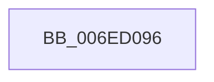

# sub_006ED096

- RVA: `0x006ED096`–`0x006ED0BF` (길이 `41` bytes)
- VA: `0x00000001406ED096`
- 실행 섹션: `.text`
- PDB 이름 있음: `아니요`; PDB Function 태그: `아니요`
- unwind 정보 RVA: `0x0009BD68`
- 디코드: `11`개 명령, `41/41` bytes 표시
- 미해석 바이트: `0` (있으면 어셈블리에 `.byte`로 보존)

> 이 문서는 커널 이미지의 기계어와 PDB 기호를 분석해 생성했습니다. 4번과 5번은 함수 원형과 자료형을 바이너리 사용 방식에서 추정한 C 해석이며 원본 소스 복구 결과는 아닙니다.

## 1. Dependencies

- 직접 호출 지점: **2**; 고유 호출 대상: **2**
- 직접 호출자로 확인된 함수: **0**
- RIP 상대 이미지 참조: **0**

### Outgoing calls
- `0x006ED0A3` → [B_TREE<_SM_PAGE_KEY,ST_STORE<SM_TRAITS>::_ST_PAGE_ENTRY,4096,NP_CONTEXT,B_TREE_KEY_COMPARATOR<_SM_PAGE_KEY> >::BTreeSearchKey](../3A/B_TREE__SM_PAGE_KEY_ST_STORE_SM_TRAITS__ST_PAGE_ENTRY_4096_NP_CONTEXT_B_TREE_KEY_COMPARATOR__SM_PAGE_function_003AC3C0.md) (function, `0x003AC3C0`)
- `0x006ED0B4` → [B_TREE<_SM_PAGE_KEY,ST_STORE<SM_TRAITS>::_ST_PAGE_ENTRY,4096,NP_CONTEXT,B_TREE_KEY_COMPARATOR<_SM_PAGE_KEY> >::BTreeIteratorFromSearchResult](../43/B_TREE__SM_PAGE_KEY_ST_STORE_SM_TRAITS__ST_PAGE_ENTRY_4096_NP_CONTEXT_B_TREE_KEY_COMPARATOR__SM_PAGE_function_00434250.md) (function, `0x00434250`)

### Direct callers
- 이 함수 시작 RVA로 연결되는 직접 call은 확인되지 않았습니다. 간접 호출은 완전히 역산할 수 없습니다.

### Static image references
- 디코드된 RIP-relative 메모리 참조가 없습니다.

## 2. Other-region calls and transfers

- 다른 실행 섹션으로 향하는 call: **0**
- call이 아닌 외부 분기/꼬리 이동: **1**
  - `0x006ED0BA` → [sub_00410B56 + 0x4C](../41/Unknown_function_00410B56.md) (`tail-transfer`)

## 3. Assembly (complete function range)

```asm
006ED096  83 4E 38 01                     or dword ptr [rsi + 0x38], 1
006ED09A  4C 8D 46 18                     lea r8, [rsi + 0x18]
006ED09E  8B D3                           mov edx, ebx
006ED0A0  48 8B CE                        mov rcx, rsi
006ED0A3  E8 18 F3 CB FF                  call 0x1403ac3c0
006ED0A8  4C 8D 46 18                     lea r8, [rsi + 0x18]
006ED0AC  48 8B CE                        mov rcx, rsi
006ED0AF  48 8D 54 24 20                  lea rdx, [rsp + 0x20]
006ED0B4  E8 97 71 D4 FF                  call 0x140434250
006ED0B9  90                              nop
006ED0BA  E9 E3 3A D2 FF                  jmp 0x140410ba2
```

## 4. C-style interpretation (structured pseudocode)

```c
__int64 __fastcall sub_006ED096(void)
{
    __int64 result;
    unsigned __int64 v_stack_p20;

    result = B_TREE__SM_PAGE_KEY_ST_STORE_SM_TRAITS____ST_PAGE_ENTRY_4096_NP_CONTEXT_B_TREE_KEY_COMPARATOR__SM_PA(v_rsi, (unsigned int)((unsigned int)(v_rbx)), v_rsi + 24, a4);
    result = B_TREE__SM_PAGE_KEY_ST_STORE_SM_TRAITS____ST_PAGE_ENTRY_4096_NP_CONTEXT_B_TREE_KEY_COMPARATOR__SM_PA(v_rsi, v_stack_p20, v_rsi + 24, a4);
}
```

## 5. (Beta) C Style

```c
void sub_006ED096(void)
{
    int64_t result;
    uint64_t v_stack_p20;

    result = B_TREE__SM_PAGE_KEY_ST_STORE_SM_TRAITS____ST_PAGE_ENTRY_4096_NP_CONTEXT_B_TREE_KEY_COMPARATOR__SM_PA(local_rsi, (uint32_t)((uint32_t)(local_rbx)), local_rsi + 24, a4);
    result = B_TREE__SM_PAGE_KEY_ST_STORE_SM_TRAITS____ST_PAGE_ENTRY_4096_NP_CONTEXT_B_TREE_KEY_COMPARATOR__SM_PA(local_rsi, v_stack_p20, local_rsi + 24, a4);
}
```

## 6. Execution-region graph

[열기: 2D/3D 그래프와 함수 탐색 컨트롤 패널](../../../control-panel.html?section=text&rva=0x006ED096&view=graph)

- 2D 그래프는 위에서 아래로 흐르고, 3D 그래프는 빈 공간을 드래그해 회전합니다. Shift+드래그는 이동, 휠은 확대·축소, 함수 노드 선택은 대상 보고서 이동입니다.

### Static fallback


