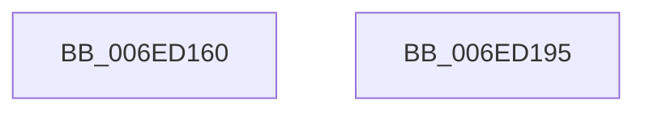

# sub_006ED160

- RVA: `0x006ED160`–`0x006ED19D` (길이 `61` bytes)
- VA: `0x00000001406ED160`
- 실행 섹션: `.text`
- PDB 이름 있음: `아니요`; PDB Function 태그: `아니요`
- unwind 정보 RVA: `0x0009BE3C`
- 디코드: `15`개 명령, `61/61` bytes 표시
- 미해석 바이트: `0` (있으면 어셈블리에 `.byte`로 보존)

> 이 문서는 커널 이미지의 기계어와 PDB 기호를 분석해 생성했습니다. 4번과 5번은 함수 원형과 자료형을 바이너리 사용 방식에서 추정한 C 해석이며 원본 소스 복구 결과는 아닙니다.

## 1. Dependencies

- 직접 호출 지점: **0**; 고유 호출 대상: **0**
- 직접 호출자로 확인된 함수: **0**
- RIP 상대 이미지 참조: **1**

### Outgoing calls
- 직접 디코드된 call 명령이 없습니다.

### Direct callers
- 이 함수 시작 RVA로 연결되는 직접 call은 확인되지 않았습니다. 간접 호출은 완전히 역산할 수 없습니다.

### Static image references
- `0x006ED181` → RVA `0x00E0E918` (`.data`; read)

## 2. Other-region calls and transfers

- 다른 실행 섹션으로 향하는 call: **0**
- call이 아닌 외부 분기/꼬리 이동: **2**
  - `0x006ED190` → [ST_STORE<SM_TRAITS>::StDmCheckForCompaction + 0x6E](../41/ST_STORE_SM_TRAITS_StDmCheckForCompaction_function_0041147C.md) (`tail-transfer`)
  - `0x006ED198` → [ST_STORE<SM_TRAITS>::StDmCheckForCompaction + 0x231](../41/ST_STORE_SM_TRAITS_StDmCheckForCompaction_function_0041147C.md) (`tail-transfer`)

## 3. Assembly (complete function range)

```asm
006ED160  41 8B C0                        mov eax, r8d
006ED163  C1 E8 02                        shr eax, 2
006ED166  8D 0C 40                        lea ecx, [rax + rax*2]
006ED169  41 8D 40 80                     lea eax, [r8 - 0x80]
006ED16D  3B C8                           cmp ecx, eax
006ED16F  44 8B C0                        mov r8d, eax
006ED172  44 0F 42 C1                     cmovb r8d, ecx
006ED176  45 3B C1                        cmp r8d, r9d
006ED179  44 89 AC 24 98 00 00 00         mov dword ptr [rsp + 0x98], r13d
006ED181  4C 8D 35 90 17 72 00            lea r14, [rip + 0x721790]
006ED188  45 0F 42 C1                     cmovb r8d, r9d
006ED18C  44 89 04 24                     mov dword ptr [rsp], r8d
006ED190  E9 55 43 D2 FF                  jmp 0x1404114ea
006ED195  45 8B CD                        mov r9d, r13d
006ED198  E9 10 45 D2 FF                  jmp 0x1404116ad
```

## 4. C-style interpretation (structured pseudocode)

```c
__int64 __fastcall sub_006ED160(__int64 a1, __int64 a2, __int64 a3, int a4)
{
    __int64 result;
    unsigned int v_stack_p0;
    unsigned int v_stack_p98;

    result = (unsigned int)(((unsigned int)((unsigned int)(a3))) >> (2));
    a3 = (unsigned int)((unsigned int)(a3 - 128));
    if (((unsigned int)(result + result * 2)) < ((unsigned int)(a3 - 128))) { a3 = (unsigned int)(result + result * 2); }
    v_stack_p98 = (unsigned int)(v_r13);
    if (((unsigned int)(a3)) < a4) { a3 = a4; }
    v_stack_p0 = (unsigned int)(a3);
}
```

## 5. (Beta) C Style

```c
int64_t sub_006ED160(int64_t Arg1, int64_t Arg2, void *Arg3, int32_t Arg4)
{
    uint8_t *arg3 = (uint8_t *)Arg3;

    int64_t result;
    uint32_t v_stack_p0;
    uint32_t v_stack_p98;

    result = (uint32_t)(((uint32_t)((uint32_t)(Arg3))) >> (2));
    Arg3 = (uint32_t)((uint32_t)(Arg3 - 128));
    if (((uint32_t)(result + result * 2)) < ((uint32_t)(Arg3 - 128))) { Arg3 = (uint32_t)(result + result * 2); }
    v_stack_p98 = (uint32_t)(local_r13);
    if (((uint32_t)(Arg3)) < Arg4) { Arg3 = Arg4; }
    v_stack_p0 = (uint32_t)(Arg3);
}
```

### 관측된 메모리 오프셋

구조체 형식이 확인되지 않은 접근은 인자 기준의 오프셋으로만 기록했습니다.

| 기준 인자 | 오프셋 표현 | 폭 (bit) | 접근 |
|---|---:|---:|---|
| `Arg3` | `- 0x80` | `32` | `R` |

## 6. Execution-region graph

[열기: 2D/3D 그래프와 함수 탐색 컨트롤 패널](../../../control-panel.html?section=text&rva=0x006ED160&view=graph)

- 2D 그래프는 위에서 아래로 흐르고, 3D 그래프는 빈 공간을 드래그해 회전합니다. Shift+드래그는 이동, 휠은 확대·축소, 함수 노드 선택은 대상 보고서 이동입니다.

### Static fallback


