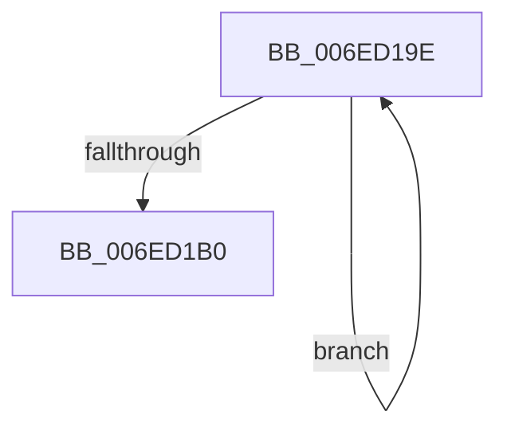

# sub_006ED19E

- RVA: `0x006ED19E`–`0x006ED1B5` (길이 `23` bytes)
- VA: `0x00000001406ED19E`
- 실행 섹션: `.text`
- PDB 이름 있음: `아니요`; PDB Function 태그: `아니요`
- unwind 정보 RVA: `0x0009BFA0`
- 디코드: `6`개 명령, `23/23` bytes 표시
- 미해석 바이트: `0` (있으면 어셈블리에 `.byte`로 보존)

> 이 문서는 커널 이미지의 기계어와 PDB 기호를 분석해 생성했습니다. 4번과 5번은 함수 원형과 자료형을 바이너리 사용 방식에서 추정한 C 해석이며 원본 소스 복구 결과는 아닙니다.

## 1. Dependencies

- 직접 호출 지점: **0**; 고유 호출 대상: **0**
- 직접 호출자로 확인된 함수: **0**
- RIP 상대 이미지 참조: **0**

### Outgoing calls
- 직접 디코드된 call 명령이 없습니다.

### Direct callers
- 이 함수 시작 RVA로 연결되는 직접 call은 확인되지 않았습니다. 간접 호출은 완전히 역산할 수 없습니다.

### Static image references
- 디코드된 RIP-relative 메모리 참조가 없습니다.

## 2. Other-region calls and transfers

- 다른 실행 섹션으로 향하는 call: **0**
- call이 아닌 외부 분기/꼬리 이동: **1**
  - `0x006ED1B0` → [PpmEventTraceHeteroResponse + 0xB3](../41/PpmEventTraceHeteroResponse_function_004133AC.md) (`tail-transfer`)

## 3. Assembly (complete function range)

```asm
006ED19E  02 0A                           add cl, byte ptr [rdx]
006ED1A0  48 8D 92 80 02 00 00            lea rdx, [rdx + 0x280]
006ED1A7  88 4C 24 40                     mov byte ptr [rsp + 0x40], cl
006ED1AB  4D 2B CA                        sub r9, r10
006ED1AE  75 EE                           jne 0x1406ed19e
006ED1B0  E9 AA 62 D2 FF                  jmp 0x14041345f
```

## 4. C-style interpretation (structured pseudocode)

```c
void __fastcall sub_006ED19E(unsigned __int8 a1, __int64 a2, __int64 a3, __int64 a4)
{
    unsigned __int8 v_stack_p40;

    a1 = (unsigned __int8)((a1) + (*(unsigned __int8 *)(a2)));
    v_stack_p40 = a1;
    a4 = (a4) - (v_r10);
    if (condition_is_not_equal) goto loc_006ED19E;
}
```

## 5. (Beta) C Style

```c
void sub_006ED19E(uint8_t Arg1, void *Arg2, int64_t Arg3, int64_t Arg4)
{
    uint8_t *arg2 = (uint8_t *)Arg2;

    uint8_t v_stack_p40;

    Arg1 = (uint8_t)((Arg1) + (*(uint8_t *)(arg2)));
    v_stack_p40 = Arg1;
    Arg4 = (Arg4) - (local_r10);
    if (condition_is_not_equal) goto loc_006ED19E;
}
```

### 관측된 메모리 오프셋

구조체 형식이 확인되지 않은 접근은 인자 기준의 오프셋으로만 기록했습니다.

| 기준 인자 | 오프셋 표현 | 폭 (bit) | 접근 |
|---|---:|---:|---|
| `Arg2` | `+ 0x0` | `8` | `R` |
| `Arg2` | `+ 0x280` | `64` | `R` |

## 6. Execution-region graph

[열기: 2D/3D 그래프와 함수 탐색 컨트롤 패널](../../../control-panel.html?section=text&rva=0x006ED19E&view=graph)

- 2D 그래프는 위에서 아래로 흐르고, 3D 그래프는 빈 공간을 드래그해 회전합니다. Shift+드래그는 이동, 휠은 확대·축소, 함수 노드 선택은 대상 보고서 이동입니다.

### Static fallback


