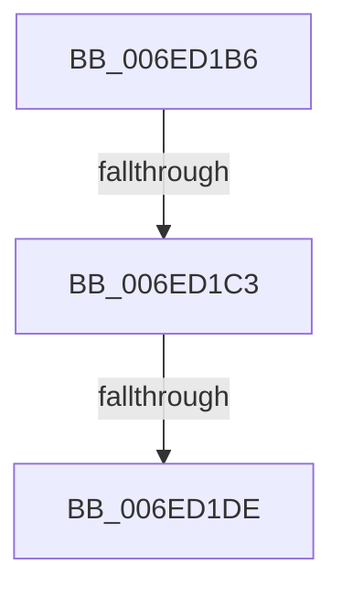

# sub_006ED1B6

- RVA: `0x006ED1B6`–`0x006ED29C` (길이 `230` bytes)
- VA: `0x00000001406ED1B6`
- 실행 섹션: `.text`
- PDB 이름 있음: `아니요`; PDB Function 태그: `아니요`
- unwind 정보 RVA: `0x0009C0F8`
- 디코드: `48`개 명령, `230/230` bytes 표시
- 미해석 바이트: `0` (있으면 어셈블리에 `.byte`로 보존)

> 이 문서는 커널 이미지의 기계어와 PDB 기호를 분석해 생성했습니다. 4번과 5번은 함수 원형과 자료형을 바이너리 사용 방식에서 추정한 C 해석이며 원본 소스 복구 결과는 아닙니다.

## 1. Dependencies

- 직접 호출 지점: **2**; 고유 호출 대상: **2**
- 직접 호출자로 확인된 함수: **0**
- RIP 상대 이미지 참조: **4**

### Outgoing calls
- `0x006ED1D1` → [EtwEventEnabled](../39/EtwEventEnabled_function_00392450.md) (function, `0x00392450`)
- `0x006ED291` → [EtwWriteEx](../25/EtwWriteEx_function_0025F0D0.md) (function, `0x0025F0D0`)

### Direct callers
- 이 함수 시작 RVA로 연결되는 직접 call은 확인되지 않았습니다. 간접 호출은 완전히 역산할 수 없습니다.

### Static image references
- `0x006ED1B6` → RVA `0x00E67A39` (`.data`; read)
- `0x006ED1C3` → RVA `0x00F083E8` (`.data`; read)
- `0x006ED1CA` → RVA `0x00022878` (`.rdata`; read)
- `0x006ED1DE` → RVA `0x00FC501C` (`ALMOSTRO`; read)

## 2. Other-region calls and transfers

- 다른 실행 섹션으로 향하는 call: **0**
- call이 아닌 외부 분기/꼬리 이동: **3**
  - `0x006ED1BD` → [PpmEventHgsCoresUnparkedCount + 0x38](../41/PpmEventHgsCoresUnparkedCount_function_0041432C.md) (`tail-transfer`)
  - `0x006ED1D8` → [PpmEventHgsCoresUnparkedCount + 0x38](../41/PpmEventHgsCoresUnparkedCount_function_0041432C.md) (`tail-transfer`)
  - `0x006ED297` → [PpmEventHgsCoresUnparkedCount + 0x38](../41/PpmEventHgsCoresUnparkedCount_function_0041432C.md) (`tail-transfer`)

## 3. Assembly (complete function range)

```asm
006ED1B6  80 3D 7C A8 77 00 00            cmp byte ptr [rip + 0x77a87c], 0
006ED1BD  0F 84 A1 71 D2 FF               je 0x140414364
006ED1C3  48 8B 0D 1E B2 81 00            mov rcx, qword ptr [rip + 0x81b21e]
006ED1CA  48 8D 15 A7 56 93 FF            lea rdx, [rip - 0x6ca959]
006ED1D1  E8 7A 52 CA FF                  call 0x140392450
006ED1D6  84 C0                           test al, al
006ED1D8  0F 84 86 71 D2 FF               je 0x140414364
006ED1DE  8B 05 38 7E 8D 00               mov eax, dword ptr [rip + 0x8d7e38]
006ED1E4  48 8D 15 8D 56 93 FF            lea rdx, [rip - 0x6ca973]
006ED1EB  83 65 F3 00                     and dword ptr [rbp - 0xd], 0
006ED1EF  B9 01 00 00 00                  mov ecx, 1
006ED1F4  83 65 03 00                     and dword ptr [rbp + 3], 0
006ED1F8  45 33 C9                        xor r9d, r9d
006ED1FB  83 65 13 00                     and dword ptr [rbp + 0x13], 0
006ED1FF  45 33 C0                        xor r8d, r8d
006ED202  83 65 23 00                     and dword ptr [rbp + 0x23], 0
006ED206  83 65 33 00                     and dword ptr [rbp + 0x33], 0
006ED20A  83 65 43 00                     and dword ptr [rbp + 0x43], 0
006ED20E  C1 E8 03                        shr eax, 3
006ED211  23 C1                           and eax, ecx
006ED213  89 4D 0F                        mov dword ptr [rbp + 0xf], ecx
006ED216  89 45 D7                        mov dword ptr [rbp - 0x29], eax
006ED219  48 8D 43 04                     lea rax, [rbx + 4]
006ED21D  48 89 45 E7                     mov qword ptr [rbp - 0x19], rax
006ED221  48 8D 43 10                     lea rax, [rbx + 0x10]
006ED225  48 89 45 F7                     mov qword ptr [rbp - 9], rax
006ED229  48 8D 83 F4 04 00 00            lea rax, [rbx + 0x4f4]
006ED230  48 89 45 07                     mov qword ptr [rbp + 7], rax
006ED234  48 8D 83 F0 04 00 00            lea rax, [rbx + 0x4f0]
006ED23B  48 89 45 17                     mov qword ptr [rbp + 0x17], rax
006ED23F  48 8D 83 F2 04 00 00            lea rax, [rbx + 0x4f2]
006ED246  48 89 45 27                     mov qword ptr [rbp + 0x27], rax
006ED24A  48 8D 45 D7                     lea rax, [rbp - 0x29]
006ED24E  48 89 45 37                     mov qword ptr [rbp + 0x37], rax
006ED252  48 8D 45 E7                     lea rax, [rbp - 0x19]
006ED256  48 89 44 24 38                  mov qword ptr [rsp + 0x38], rax
006ED25B  C7 44 24 30 06 00 00 00         mov dword ptr [rsp + 0x30], 6
006ED263  48 83 64 24 28 00               and qword ptr [rsp + 0x28], 0
006ED269  48 83 64 24 20 00               and qword ptr [rsp + 0x20], 0
006ED26F  89 4D 1F                        mov dword ptr [rbp + 0x1f], ecx
006ED272  89 4D 2F                        mov dword ptr [rbp + 0x2f], ecx
006ED275  48 8B 0D 6C B1 81 00            mov rcx, qword ptr [rip + 0x81b16c]
006ED27C  C7 45 EF 02 00 00 00            mov dword ptr [rbp - 0x11], 2
006ED283  C7 45 FF 08 00 00 00            mov dword ptr [rbp - 1], 8
006ED28A  C7 45 3F 04 00 00 00            mov dword ptr [rbp + 0x3f], 4
006ED291  E8 3A 1E B7 FF                  call 0x14025f0d0
006ED296  90                              nop
006ED297  E9 C8 70 D2 FF                  jmp 0x140414364
```

## 4. C-style interpretation (structured pseudocode)

```c
__int64 __fastcall sub_006ED1B6(__int64 a1, __int64 a2, int a3, int a4, __int64 a5)
{
    __int64 result;
    unsigned __int64 v_stack_p20;
    unsigned int v_stack_p30;
    unsigned __int64 v_stack_p38;

    result = EtwEventEnabled(*(unsigned __int64 *)(v_rip + 8499742), v_rip - 7121241, a3, a4);
    a4 = 0;
    a3 = 0;
    result = (unsigned int)(((unsigned int)(*(unsigned int *)(v_rip + 9272888))) >> (3));
    result = (unsigned int)((result) & (1));
    *(unsigned int *)(v_rbp + 15) = 1;
    *(unsigned int *)(v_rbp - 41) = (unsigned int)(result);
    *(unsigned __int64 *)(v_rbp - 25) = v_rbx + 4;
    *(unsigned __int64 *)(v_rbp - 9) = v_rbx + 16;
    *(unsigned __int64 *)(v_rbp + 7) = v_rbx + 1268;
    *(unsigned __int64 *)(v_rbp + 23) = v_rbx + 1264;
    *(unsigned __int64 *)(v_rbp + 39) = v_rbx + 1266;
    *(unsigned __int64 *)(v_rbp + 55) = v_rbp - 41;
    v_stack_p38 = v_rbp - 25;
    v_stack_p30 = 6;
    *(unsigned int *)(v_rbp + 31) = 1;
    *(unsigned int *)(v_rbp + 47) = 1;
    *(unsigned int *)(v_rbp - 17) = 2;
    *(unsigned int *)(v_rbp - 1) = 8;
    *(unsigned int *)(v_rbp + 63) = 4;
    result = EtwWriteEx(*(unsigned __int64 *)(v_rip + 8499564), v_rip - 7121267, a3, a4);
}
```

## 5. (Beta) C Style

```c
int64_t sub_006ED1B6(int64_t Arg1, int64_t Arg2, int32_t Arg3, int32_t Arg4, int64_t Arg5)
{
    int64_t result;
    uint64_t v_stack_p20;
    uint32_t v_stack_p30;
    uint64_t v_stack_p38;

    result = EtwEventEnabled(*(uint64_t *)(v_rip + 0x81B21E), v_rip - 7121241, Arg3, Arg4);
    Arg4 = 0;
    Arg3 = 0;
    result = (uint32_t)(((uint32_t)(*(uint32_t *)(v_rip + 0x8D7E38))) >> (3));
    result = (uint32_t)((result) & (1));
    *(uint32_t *)(local_rbp + 0xF) = 1;
    *(uint32_t *)(local_rbp - 0x29) = (uint32_t)(result);
    *(uint64_t *)(local_rbp - 0x19) = local_rbx + 4;
    *(uint64_t *)(local_rbp - 0x9) = local_rbx + 16;
    *(uint64_t *)(local_rbp + 0x7) = local_rbx + 1268;
    *(uint64_t *)(local_rbp + 0x17) = local_rbx + 1264;
    *(uint64_t *)(local_rbp + 0x27) = local_rbx + 1266;
    *(uint64_t *)(local_rbp + 0x37) = local_rbp - 41;
    v_stack_p38 = local_rbp - 25;
    v_stack_p30 = 6;
    *(uint32_t *)(local_rbp + 0x1F) = 1;
    *(uint32_t *)(local_rbp + 0x2F) = 1;
    *(uint32_t *)(local_rbp - 0x11) = 2;
    *(uint32_t *)(local_rbp - 0x1) = 8;
    *(uint32_t *)(local_rbp + 0x3F) = 4;
    result = EtwWriteEx(*(uint64_t *)(v_rip + 0x81B16C), v_rip - 7121267, Arg3, Arg4);
}
```

## 6. Execution-region graph

[열기: 2D/3D 그래프와 함수 탐색 컨트롤 패널](../../../control-panel.html?section=text&rva=0x006ED1B6&view=graph)

- 2D 그래프는 위에서 아래로 흐르고, 3D 그래프는 빈 공간을 드래그해 회전합니다. Shift+드래그는 이동, 휠은 확대·축소, 함수 노드 선택은 대상 보고서 이동입니다.

### Static fallback


