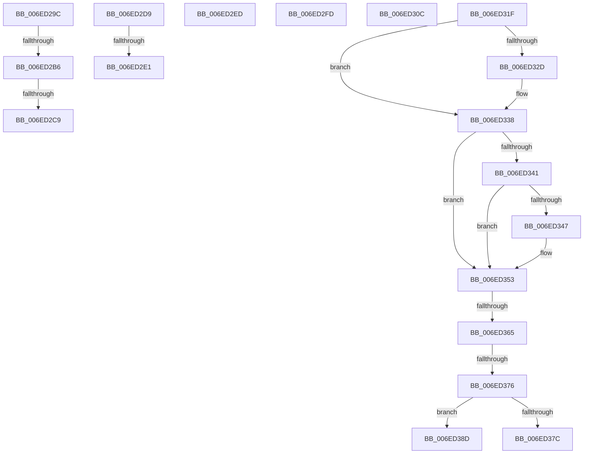

# sub_006ED29C

- RVA: `0x006ED29C`–`0x006ED39E` (길이 `258` bytes)
- VA: `0x00000001406ED29C`
- 실행 섹션: `.text`
- PDB 이름 있음: `아니요`; PDB Function 태그: `아니요`
- unwind 정보 RVA: `0x0009C13C`
- 디코드: `58`개 명령, `258/258` bytes 표시
- 미해석 바이트: `0` (있으면 어셈블리에 `.byte`로 보존)

> 이 문서는 커널 이미지의 기계어와 PDB 기호를 분석해 생성했습니다. 4번과 5번은 함수 원형과 자료형을 바이너리 사용 방식에서 추정한 C 해석이며 원본 소스 복구 결과는 아닙니다.

## 1. Dependencies

- 직접 호출 지점: **1**; 고유 호출 대상: **1**
- 직접 호출자로 확인된 함수: **0**
- RIP 상대 이미지 참조: **0**

### Outgoing calls
- `0x006ED2A1` → [Feature_WpsHybridToNoneZoneFix__private_IsEnabledDeviceUsageNoInline](../5D/Feature_WpsHybridToNoneZoneFix__private_IsEnabledDeviceUsageNoInline_function_005D866C.md) (function, `0x005D866C`)

### Direct callers
- 이 함수 시작 RVA로 연결되는 직접 call은 확인되지 않았습니다. 간접 호출은 완전히 역산할 수 없습니다.

### Static image references
- 디코드된 RIP-relative 메모리 참조가 없습니다.

## 2. Other-region calls and transfers

- 다른 실행 섹션으로 향하는 call: **0**
- call이 아닌 외부 분기/꼬리 이동: **12**
  - `0x006ED2B0` → [PpmHeteroHgsCalculateContainmentCount + 0xCD](../41/PpmHeteroHgsCalculateContainmentCount_function_004144E4.md) (`tail-transfer`)
  - `0x006ED2C3` → [PpmHeteroHgsCalculateContainmentCount + 0xCD](../41/PpmHeteroHgsCalculateContainmentCount_function_004144E4.md) (`tail-transfer`)
  - `0x006ED2D4` → [PpmHeteroHgsCalculateContainmentCount + 0xCD](../41/PpmHeteroHgsCalculateContainmentCount_function_004144E4.md) (`tail-transfer`)
  - `0x006ED2DB` → [PpmHeteroHgsCalculateContainmentCount + 0xF4](../41/PpmHeteroHgsCalculateContainmentCount_function_004144E4.md) (`tail-transfer`)
  - `0x006ED2E8` → [PpmHeteroHgsCalculateContainmentCount + 0xF4](../41/PpmHeteroHgsCalculateContainmentCount_function_004144E4.md) (`tail-transfer`)
  - `0x006ED2F8` → [PpmHeteroHgsCalculateContainmentCount + 0xF4](../41/PpmHeteroHgsCalculateContainmentCount_function_004144E4.md) (`tail-transfer`)
  - `0x006ED307` → [PpmHeteroHgsCalculateContainmentCount + 0x114](../41/PpmHeteroHgsCalculateContainmentCount_function_004144E4.md) (`tail-transfer`)
  - `0x006ED31A` → [PpmHeteroHgsCalculateContainmentCount + 0x114](../41/PpmHeteroHgsCalculateContainmentCount_function_004144E4.md) (`tail-transfer`)
  - `0x006ED35F` → [PpmHeteroHgsCalculateContainmentCount + 0x145](../41/PpmHeteroHgsCalculateContainmentCount_function_004144E4.md) (`tail-transfer`)
  - `0x006ED370` → [PpmHeteroHgsCalculateContainmentCount + 0x145](../41/PpmHeteroHgsCalculateContainmentCount_function_004144E4.md) (`tail-transfer`)
  - `0x006ED388` → [PpmHeteroHgsCalculateContainmentCount + 0x145](../41/PpmHeteroHgsCalculateContainmentCount_function_004144E4.md) (`tail-transfer`)
  - `0x006ED399` → [PpmHeteroHgsCalculateContainmentCount + 0x145](../41/PpmHeteroHgsCalculateContainmentCount_function_004144E4.md) (`tail-transfer`)

## 3. Assembly (complete function range)

```asm
006ED29C  BE 01 00 00 00                  mov esi, 1
006ED2A1  E8 C6 B3 EE FF                  call 0x1405d866c
006ED2A6  44 8B 44 24 44                  mov r8d, dword ptr [rsp + 0x44]
006ED2AB  45 33 D2                        xor r10d, r10d
006ED2AE  85 C0                           test eax, eax
006ED2B0  0F 84 FB 72 D2 FF               je 0x1404145b1
006ED2B6  41 8B 06                        mov eax, dword ptr [r14]
006ED2B9  0F BA E8 0D                     bts eax, 0xd
006ED2BD  41 89 06                        mov dword ptr [r14], eax
006ED2C0  44 3B FD                        cmp r15d, ebp
006ED2C3  0F 86 E8 72 D2 FF               jbe 0x1404145b1
006ED2C9  0F BA E8 0E                     bts eax, 0xe
006ED2CD  41 8D 72 02                     lea esi, [r10 + 2]
006ED2D1  41 89 06                        mov dword ptr [r14], eax
006ED2D4  E9 D8 72 D2 FF                  jmp 0x1404145b1
006ED2D9  85 F6                           test esi, esi
006ED2DB  0F 85 F7 72 D2 FF               jne 0x1404145d8
006ED2E1  C6 83 3A 03 00 00 01            mov byte ptr [rbx + 0x33a], 1
006ED2E8  E9 EB 72 D2 FF                  jmp 0x1404145d8
006ED2ED  C6 83 30 03 00 00 01            mov byte ptr [rbx + 0x330], 1
006ED2F4  41 83 0E 40                     or dword ptr [r14], 0x40
006ED2F8  E9 DB 72 D2 FF                  jmp 0x1404145d8
006ED2FD  41 B4 01                        mov r12b, 1
006ED300  48 8D 8B 3A 03 00 00            lea rcx, [rbx + 0x33a]
006ED307  E9 EC 72 D2 FF                  jmp 0x1404145f8
006ED30C  C6 83 30 03 00 00 01            mov byte ptr [rbx + 0x330], 1
006ED313  41 83 0E 20                     or dword ptr [r14], 0x20
006ED317  41 B4 01                        mov r12b, 1
006ED31A  E9 D9 72 D2 FF                  jmp 0x1404145f8
006ED31F  44 0F B7 8F F0 04 00 00         movzx r9d, word ptr [rdi + 0x4f0]
006ED327  66 44 3B CA                     cmp r9w, dx
006ED32B  76 0B                           jbe 0x1406ed338
006ED32D  66 89 97 F0 04 00 00            mov word ptr [rdi + 0x4f0], dx
006ED334  44 0F B7 CA                     movzx r9d, dx
006ED338  44 0F B7 C0                     movzx r8d, ax
006ED33C  66 3B C2                        cmp ax, dx
006ED33F  75 12                           jne 0x1406ed353
006ED341  66 44 3B CA                     cmp r9w, dx
006ED345  75 0C                           jne 0x1406ed353
006ED347  66 44 2B C2                     sub r8w, dx
006ED34B  66 44 89 87 F2 04 00 00         mov word ptr [rdi + 0x4f2], r8w
006ED353  41 0F B7 C8                     movzx ecx, r8w
006ED357  41 0F B7 C1                     movzx eax, r9w
006ED35B  03 C8                           add ecx, eax
006ED35D  3B CA                           cmp ecx, edx
006ED35F  0F 86 C4 72 D2 FF               jbe 0x140414629
006ED365  41 0F B7 C0                     movzx eax, r8w
006ED369  66 2B C2                        sub ax, dx
006ED36C  66 41 03 C1                     add ax, r9w
006ED370  0F 84 B3 72 D2 FF               je 0x140414629
006ED376  66 45 3B C8                     cmp r9w, r8w
006ED37A  76 11                           jbe 0x1406ed38d
006ED37C  66 44 2B C8                     sub r9w, ax
006ED380  66 44 89 8F F0 04 00 00         mov word ptr [rdi + 0x4f0], r9w
006ED388  E9 9C 72 D2 FF                  jmp 0x140414629
006ED38D  66 44 2B C0                     sub r8w, ax
006ED391  66 44 89 87 F2 04 00 00         mov word ptr [rdi + 0x4f2], r8w
006ED399  E9 8B 72 D2 FF                  jmp 0x140414629
```

## 4. C-style interpretation (structured pseudocode)

```c
__int64 __fastcall sub_006ED29C(__int64 a1, int a2)
{
    __int64 result;
    __int64 v_r10;
    unsigned int v_stack_p44;

    result = Feature_WpsHybridToNoneZoneFix__private_IsEnabledDeviceUsageNoInline(a1, a2, a3, a4);
    v_r10 = 0;
    *(unsigned int *)(v_r14) = (unsigned int)((unsigned int)(*(unsigned int *)(v_r14)));
    *(unsigned int *)(v_r14) = (unsigned int)((unsigned int)(*(unsigned int *)(v_r14)));
}
```

## 5. (Beta) C Style

```c
int64_t sub_006ED29C(int64_t Arg1, int32_t Arg2)
{
    int64_t result;
    int64_t local_r10;
    uint32_t v_stack_p44;

    result = Feature_WpsHybridToNoneZoneFix__private_IsEnabledDeviceUsageNoInline(Arg1, Arg2, a3, a4);
    local_r10 = 0;
    *(uint32_t *)(local_r14) = (uint32_t)((uint32_t)(*(uint32_t *)(local_r14)));
    *(uint32_t *)(local_r14) = (uint32_t)((uint32_t)(*(uint32_t *)(local_r14)));
}
```

## 6. Execution-region graph

[열기: 2D/3D 그래프와 함수 탐색 컨트롤 패널](../../../control-panel.html?section=text&rva=0x006ED29C&view=graph)

- 2D 그래프는 위에서 아래로 흐르고, 3D 그래프는 빈 공간을 드래그해 회전합니다. Shift+드래그는 이동, 휠은 확대·축소, 함수 노드 선택은 대상 보고서 이동입니다.

### Static fallback


