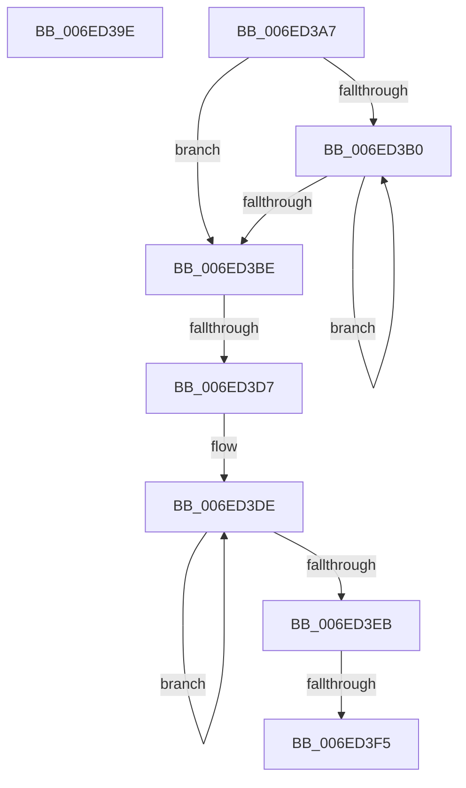

# sub_006ED39E

- RVA: `0x006ED39E`–`0x006ED400` (길이 `98` bytes)
- VA: `0x00000001406ED39E`
- 실행 섹션: `.text`
- PDB 이름 있음: `아니요`; PDB Function 태그: `아니요`
- unwind 정보 RVA: `0x0009C1A8`
- 디코드: `27`개 명령, `98/98` bytes 표시
- 미해석 바이트: `0` (있으면 어셈블리에 `.byte`로 보존)

> 이 문서는 커널 이미지의 기계어와 PDB 기호를 분석해 생성했습니다. 4번과 5번은 함수 원형과 자료형을 바이너리 사용 방식에서 추정한 C 해석이며 원본 소스 복구 결과는 아닙니다.

## 1. Dependencies

- 직접 호출 지점: **2**; 고유 호출 대상: **2**
- 직접 호출자로 확인된 함수: **0**
- RIP 상대 이미지 참조: **0**

### Outgoing calls
- `0x006ED3B0` → [HalProcessorIdle](../6A/HalProcessorIdle_function_006AC7C0.md) (function, `0x006AC7C0`)
- `0x006ED3F5` → [KiRemoveSystemWorkPriorityKick](../26/KiRemoveSystemWorkPriorityKick_function_002631D0.md) (function, `0x002631D0`)

### Direct callers
- 이 함수 시작 RVA로 연결되는 직접 call은 확인되지 않았습니다. 간접 호출은 완전히 역산할 수 없습니다.

### Static image references
- 디코드된 RIP-relative 메모리 참조가 없습니다.

## 2. Other-region calls and transfers

- 다른 실행 섹션으로 향하는 call: **0**
- call이 아닌 외부 분기/꼬리 이동: **4**
  - `0x006ED3A2` → [KxWaitForLockOwnerShipWithIrql + 0x54](../41/KxWaitForLockOwnerShipWithIrql_function_00414E30.md) (`tail-transfer`)
  - `0x006ED3D1` → [KxWaitForLockOwnerShipWithIrql + 0x10A](../41/KxWaitForLockOwnerShipWithIrql_function_00414E30.md) (`tail-transfer`)
  - `0x006ED3EF` → [KxWaitForLockOwnerShipWithIrql + 0x10A](../41/KxWaitForLockOwnerShipWithIrql_function_00414E30.md) (`tail-transfer`)
  - `0x006ED3FB` → [KxWaitForLockOwnerShipWithIrql + 0x10A](../41/KxWaitForLockOwnerShipWithIrql_function_00414E30.md) (`tail-transfer`)

## 3. Assembly (complete function range)

```asm
006ED39E  40 88 37                        mov byte ptr [rdi], sil
006ED3A1  FB                              sti
006ED3A2  E9 DD 7A D2 FF                  jmp 0x140414e84
006ED3A7  FA                              cli
006ED3A8  8B 45 C8                        mov eax, dword ptr [rbp - 0x38]
006ED3AB  83 F8 01                        cmp eax, 1
006ED3AE  74 0E                           je 0x1406ed3be
006ED3B0  E8 0B F4 FB FF                  call 0x1406ac7c0
006ED3B5  FA                              cli
006ED3B6  8B 45 C8                        mov eax, dword ptr [rbp - 0x38]
006ED3B9  83 F8 01                        cmp eax, 1
006ED3BC  75 F2                           jne 0x1406ed3b0
006ED3BE  65 48 8B 0C 25 20 00 00 00      mov rcx, qword ptr gs:[0x20]
006ED3C7  4C 8B 81 B8 8E 00 00            mov r8, qword ptr [rcx + 0x8eb8]
006ED3CE  4D 85 C0                        test r8, r8
006ED3D1  0F 84 63 7B D2 FF               je 0x140414f3a
006ED3D7  41 0F 0D 08                     prefetchw byte ptr [r8]
006ED3DB  41 8B 00                        mov eax, dword ptr [r8]
006ED3DE  8B D0                           mov edx, eax
006ED3E0  0F BA F2 15                     btr edx, 0x15
006ED3E4  F0 41 0F B1 10                  lock cmpxchg dword ptr [r8], edx
006ED3E9  75 F3                           jne 0x1406ed3de
006ED3EB  0F BA E0 15                     bt eax, 0x15
006ED3EF  0F 83 45 7B D2 FF               jae 0x140414f3a
006ED3F5  E8 D6 5D B7 FF                  call 0x1402631d0
006ED3FA  90                              nop
006ED3FB  E9 3A 7B D2 FF                  jmp 0x140414f3a
```

## 4. C-style interpretation (structured pseudocode)

```c
__int64 __fastcall sub_006ED39E(void)
{
    *(unsigned __int8 *)(v_rdi) = (unsigned __int8)(v_rsi);
}
```

## 5. (Beta) C Style

```c
void sub_006ED39E(void)
{
    *(uint8_t *)(local_rdi) = (uint8_t)(local_rsi);
}
```

## 6. Execution-region graph

[열기: 2D/3D 그래프와 함수 탐색 컨트롤 패널](../../../control-panel.html?section=text&rva=0x006ED39E&view=graph)

- 2D 그래프는 위에서 아래로 흐르고, 3D 그래프는 빈 공간을 드래그해 회전합니다. Shift+드래그는 이동, 휠은 확대·축소, 함수 노드 선택은 대상 보고서 이동입니다.

### Static fallback


