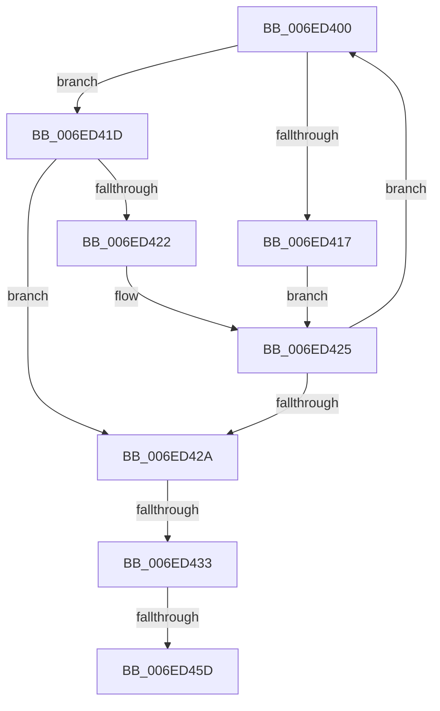

# sub_006ED400

- RVA: `0x006ED400`–`0x006ED465` (길이 `101` bytes)
- VA: `0x00000001406ED400`
- 실행 섹션: `.text`
- PDB 이름 있음: `아니요`; PDB Function 태그: `아니요`
- unwind 정보 RVA: `0x0009CEDC`
- 디코드: `27`개 명령, `101/101` bytes 표시
- 미해석 바이트: `0` (있으면 어셈블리에 `.byte`로 보존)

> 이 문서는 커널 이미지의 기계어와 PDB 기호를 분석해 생성했습니다. 4번과 5번은 함수 원형과 자료형을 바이너리 사용 방식에서 추정한 C 해석이며 원본 소스 복구 결과는 아닙니다.

## 1. Dependencies

- 직접 호출 지점: **0**; 고유 호출 대상: **0**
- 직접 호출자로 확인된 함수: **0**
- RIP 상대 이미지 참조: **0**

### Outgoing calls
- 직접 디코드된 call 명령이 없습니다.

### Direct callers
- 이 함수 시작 RVA로 연결되는 직접 call은 확인되지 않았습니다. 간접 호출은 완전히 역산할 수 없습니다.

### Static image references
- 디코드된 RIP-relative 메모리 참조가 없습니다.

## 2. Other-region calls and transfers

- 다른 실행 섹션으로 향하는 call: **0**
- call이 아닌 외부 분기/꼬리 이동: **3**
  - `0x006ED42D` → [MiComputeMaximumFaultCluster + 0x18C](../41/MiComputeMaximumFaultCluster_function_00418210.md) (`tail-transfer`)
  - `0x006ED457` → [MiComputeMaximumFaultCluster + 0x18C](../41/MiComputeMaximumFaultCluster_function_00418210.md) (`tail-transfer`)
  - `0x006ED460` → [MiComputeMaximumFaultCluster + 0x18C](../41/MiComputeMaximumFaultCluster_function_00418210.md) (`tail-transfer`)

## 3. Assembly (complete function range)

```asm
006ED400  4C 8B 42 58                     mov r8, qword ptr [rdx + 0x58]
006ED404  48 8B 4A 20                     mov rcx, qword ptr [rdx + 0x20]
006ED408  49 81 E0 00 F0 FF FF            and r8, 0xfffffffffffff000
006ED40F  49 03 C8                        add rcx, r8
006ED412  48 3B F1                        cmp rsi, rcx
006ED415  72 06                           jb 0x1406ed41d
006ED417  48 8B 52 08                     mov rdx, qword ptr [rdx + 8]
006ED41B  EB 08                           jmp 0x1406ed425
006ED41D  49 3B F0                        cmp rsi, r8
006ED420  73 08                           jae 0x1406ed42a
006ED422  48 8B 12                        mov rdx, qword ptr [rdx]
006ED425  48 85 D2                        test rdx, rdx
006ED428  75 D6                           jne 0x1406ed400
006ED42A  48 85 D2                        test rdx, rdx
006ED42D  0F 84 69 AF D2 FF               je 0x14041839c
006ED433  48 8B 42 58                     mov rax, qword ptr [rdx + 0x58]
006ED437  BD 08 00 00 00                  mov ebp, 8
006ED43C  48 25 00 F0 FF FF               and rax, 0xfffffffffffff000
006ED442  48 2B F0                        sub rsi, rax
006ED445  48 8B 42 20                     mov rax, qword ptr [rdx + 0x20]
006ED449  48 C1 E8 0C                     shr rax, 0xc
006ED44D  48 C1 EE 0C                     shr rsi, 0xc
006ED451  48 2B C6                        sub rax, rsi
006ED454  48 3B C5                        cmp rax, rbp
006ED457  0F 83 3F AF D2 FF               jae 0x14041839c
006ED45D  48 8B E8                        mov rbp, rax
006ED460  E9 37 AF D2 FF                  jmp 0x14041839c
```

## 4. C-style interpretation (structured pseudocode)

```c
__int64 __fastcall sub_006ED400(__int64 a1, __int64 a2)
{
    __int64 result;
    __int64 v_rsi;

    a3 = (*(unsigned __int64 *)(a2 + 88)) & (0xFFFFFFFFFFFFF000ULL);
    a1 = (*(unsigned __int64 *)(a2 + 32)) + (a3);
    if (v_rsi < a1) goto loc_006ED41D;
    goto loc_006ED425;
loc_006ED41D:
    if (v_rsi >= a3) goto loc_006ED42A;
loc_006ED425:
    if (*(unsigned __int64 *)(*(unsigned __int64 *)(a2 + 8)) != 0) goto loc_006ED400;
loc_006ED42A:
    result = (*(unsigned __int64 *)(*(unsigned __int64 *)(*(unsigned __int64 *)(a2 + 8)) + 88)) & (0xFFFFFFFFFFFFF000ULL);
    v_rsi = (v_rsi) - (result);
    result = (*(unsigned __int64 *)(*(unsigned __int64 *)(*(unsigned __int64 *)(a2 + 8)) + 32)) >> (12);
    v_rsi = (v_rsi) >> (12);
    result = (result) - (v_rsi);
}
```

## 5. (Beta) C Style

```c
int64_t sub_006ED400(int64_t Arg1, int64_t Arg2)
{
    int64_t result;
    int64_t local_rsi;

    a3 = (*(uint64_t *)(Arg2 + 0x58)) & (0xFFFFFFFFFFFFF000ULL);
    Arg1 = (*(uint64_t *)(Arg2 + 0x20)) + (a3);
    if (local_rsi < Arg1) goto loc_006ED41D;
    goto loc_006ED425;
loc_006ED41D:
    if (local_rsi >= a3) goto loc_006ED42A;
loc_006ED425:
    if (*(uint64_t *)(*(uint64_t *)(Arg2 + 0x8)) != 0) goto loc_006ED400;
loc_006ED42A:
    result = (*(uint64_t *)(*(uint64_t *)(*(uint64_t *)(Arg2 + 0x8)) + 0x58)) & (0xFFFFFFFFFFFFF000ULL);
    local_rsi = (local_rsi) - (result);
    result = (*(uint64_t *)(*(uint64_t *)(*(uint64_t *)(Arg2 + 0x8)) + 0x20)) >> (12);
    local_rsi = (local_rsi) >> (12);
    result = (result) - (local_rsi);
}
```

## 6. Execution-region graph

[열기: 2D/3D 그래프와 함수 탐색 컨트롤 패널](../../../control-panel.html?section=text&rva=0x006ED400&view=graph)

- 2D 그래프는 위에서 아래로 흐르고, 3D 그래프는 빈 공간을 드래그해 회전합니다. Shift+드래그는 이동, 휠은 확대·축소, 함수 노드 선택은 대상 보고서 이동입니다.

### Static fallback


