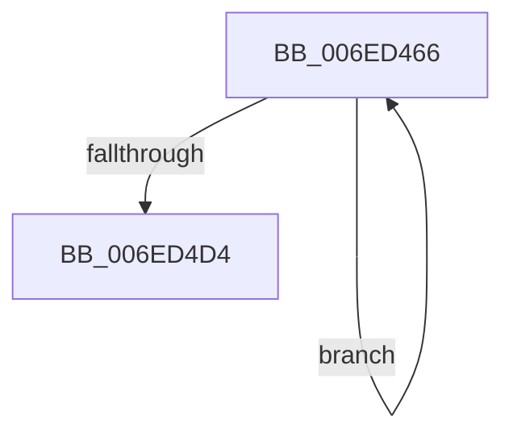

# sub_006ED466

- RVA: `0x006ED466`–`0x006ED4D9` (길이 `115` bytes)
- VA: `0x00000001406ED466`
- 실행 섹션: `.text`
- PDB 이름 있음: `아니요`; PDB Function 태그: `아니요`
- unwind 정보 RVA: `0x0009CFB4`
- 디코드: `26`개 명령, `115/115` bytes 표시
- 미해석 바이트: `0` (있으면 어셈블리에 `.byte`로 보존)

> 이 문서는 커널 이미지의 기계어와 PDB 기호를 분석해 생성했습니다. 4번과 5번은 함수 원형과 자료형을 바이너리 사용 방식에서 추정한 C 해석이며 원본 소스 복구 결과는 아닙니다.

## 1. Dependencies

- 직접 호출 지점: **3**; 고유 호출 대상: **3**
- 직접 호출자로 확인된 함수: **0**
- RIP 상대 이미지 참조: **0**

### Outgoing calls
- `0x006ED4AC` → [MiReleaseSpinLockExclusive](../24/MiReleaseSpinLockExclusive_function_002482C0.md) (function, `0x002482C0`)
- `0x006ED4BD` → [KeWaitForGate](../2C/KeWaitForGate_function_002CA794.md) (function, `0x002CA794`)
- `0x006ED4C5` → [ExAcquireSpinLockExclusive](../24/ExAcquireSpinLockExclusive_function_00248690.md) (function, `0x00248690`)

### Direct callers
- 이 함수 시작 RVA로 연결되는 직접 call은 확인되지 않았습니다. 간접 호출은 완전히 역산할 수 없습니다.

### Static image references
- 디코드된 RIP-relative 메모리 참조가 없습니다.

## 2. Other-region calls and transfers

- 다른 실행 섹션으로 향하는 call: **0**
- call이 아닌 외부 분기/꼬리 이동: **1**
  - `0x006ED4D4` → [sub_00418763 + 0xB](../41/Unknown_function_00418763.md) (`tail-transfer`)

## 3. Assembly (complete function range)

```asm
006ED466  48 8D 44 24 38                  lea rax, [rsp + 0x38]
006ED46B  44 89 74 24 28                  mov dword ptr [rsp + 0x28], r14d
006ED470  48 89 44 24 40                  mov qword ptr [rsp + 0x40], rax
006ED475  40 0F B6 D5                     movzx edx, bpl
006ED479  48 8D 44 24 38                  lea rax, [rsp + 0x38]
006ED47E  66 C7 44 24 30 07 01            mov word ptr [rsp + 0x30], 0x107
006ED485  48 89 44 24 38                  mov qword ptr [rsp + 0x38], rax
006ED48A  48 8B CB                        mov rcx, rbx
006ED48D  48 8B 47 50                     mov rax, qword ptr [rdi + 0x50]
006ED491  48 89 44 24 20                  mov qword ptr [rsp + 0x20], rax
006ED496  48 8D 44 24 20                  lea rax, [rsp + 0x20]
006ED49B  48 89 47 50                     mov qword ptr [rdi + 0x50], rax
006ED49F  C6 44 24 32 06                  mov byte ptr [rsp + 0x32], 6
006ED4A4  C7 44 24 34 00 00 00 00         mov dword ptr [rsp + 0x34], 0
006ED4AC  E8 0F AE B5 FF                  call 0x1402482c0
006ED4B1  45 33 C0                        xor r8d, r8d
006ED4B4  48 8D 4C 24 30                  lea rcx, [rsp + 0x30]
006ED4B9  41 8D 50 12                     lea edx, [r8 + 0x12]
006ED4BD  E8 D2 D2 BD FF                  call 0x1402ca794
006ED4C2  48 8B CB                        mov rcx, rbx
006ED4C5  E8 C6 B1 B5 FF                  call 0x140248690
006ED4CA  0F B6 E8                        movzx ebp, al
006ED4CD  8B 47 38                        mov eax, dword ptr [rdi + 0x38]
006ED4D0  A8 04                           test al, 4
006ED4D2  75 92                           jne 0x1406ed466
006ED4D4  E9 95 B2 D2 FF                  jmp 0x14041876e
```

## 4. C-style interpretation (structured pseudocode)

```c
__int64 __fastcall sub_006ED466(__int64 a1, __int64 a2, int a3, __int64 a4, __int64 a5, __int64 a6, __int64 a7)
{
    __int64 result;
    unsigned __int64 v_stack_p20;
    unsigned int v_stack_p28;
    unsigned __int16 v_stack_p30;
    unsigned __int8 v_stack_p32;
    unsigned int v_stack_p34;
    unsigned __int64 v_stack_p38;
    unsigned __int64 v_stack_p40;

    v_stack_p28 = (unsigned int)(v_r14);
    v_stack_p40 = a7;
    v_stack_p30 = 263;
    v_stack_p38 = a7;
    v_stack_p20 = *(unsigned __int64 *)(v_rdi + 80);
    *(unsigned __int64 *)(v_rdi + 80) = v_stack_p20;
    v_stack_p32 = 6;
    v_stack_p34 = 0;
    result = MiReleaseSpinLockExclusive(v_rbx, (unsigned __int8)(v_rbp), a3, a4);
    a3 = 0;
    result = KeWaitForGate(a6, a3 + 18, a3, a4);
    result = ExAcquireSpinLockExclusive(v_rbx, a3 + 18, a3, a4);
    if ((((unsigned __int8)((unsigned int)(*(unsigned int *)(v_rdi + 56)))) & (4)) != 0) goto loc_006ED466;
}
```

## 5. (Beta) C Style

```c
int64_t sub_006ED466(int64_t Arg1, int64_t Arg2, int32_t Arg3, int64_t Arg4, uint64_t Arg5, int64_t Arg6, int64_t Arg7)
{
    int64_t result;
    uint64_t v_stack_p20;
    uint32_t v_stack_p28;
    uint16_t v_stack_p30;
    uint8_t v_stack_p32;
    uint32_t v_stack_p34;
    uint64_t v_stack_p38;
    uint64_t v_stack_p40;

    v_stack_p28 = (uint32_t)(local_r14);
    v_stack_p40 = Arg7;
    v_stack_p30 = 263;
    v_stack_p38 = Arg7;
    v_stack_p20 = *(uint64_t *)(local_rdi + 0x50);
    *(uint64_t *)(local_rdi + 0x50) = v_stack_p20;
    v_stack_p32 = 6;
    v_stack_p34 = 0;
    result = MiReleaseSpinLockExclusive(local_rbx, (uint8_t)(local_rbp), Arg3, Arg4);
    Arg3 = 0;
    result = KeWaitForGate(Arg6, Arg3 + 18, Arg3, Arg4);
    result = ExAcquireSpinLockExclusive(local_rbx, Arg3 + 18, Arg3, Arg4);
    if ((((uint8_t)((uint32_t)(*(uint32_t *)(local_rdi + 0x38)))) & (4)) != 0) goto loc_006ED466;
}
```

## 6. Execution-region graph

[열기: 2D/3D 그래프와 함수 탐색 컨트롤 패널](../../../control-panel.html?section=text&rva=0x006ED466&view=graph)

- 2D 그래프는 위에서 아래로 흐르고, 3D 그래프는 빈 공간을 드래그해 회전합니다. Shift+드래그는 이동, 휠은 확대·축소, 함수 노드 선택은 대상 보고서 이동입니다.

### Static fallback


