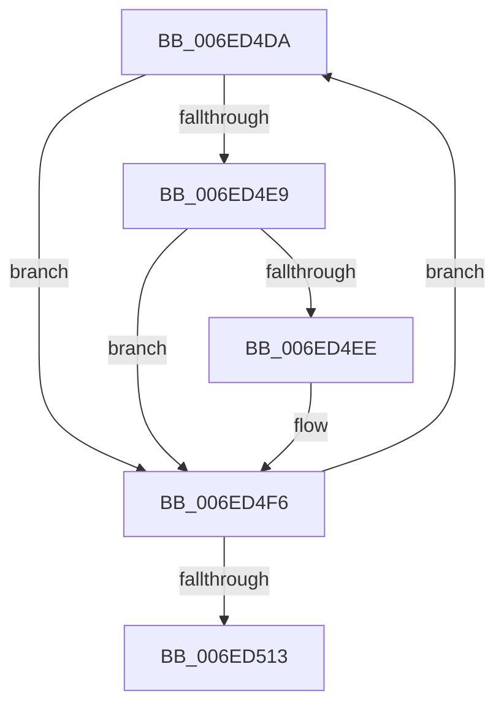

# sub_006ED4DA

- RVA: `0x006ED4DA`–`0x006ED518` (길이 `62` bytes)
- VA: `0x00000001406ED4DA`
- 실행 섹션: `.text`
- PDB 이름 있음: `아니요`; PDB Function 태그: `아니요`
- unwind 정보 RVA: `0x0009D09C`
- 디코드: `17`개 명령, `62/62` bytes 표시
- 미해석 바이트: `0` (있으면 어셈블리에 `.byte`로 보존)

> 이 문서는 커널 이미지의 기계어와 PDB 기호를 분석해 생성했습니다. 4번과 5번은 함수 원형과 자료형을 바이너리 사용 방식에서 추정한 C 해석이며 원본 소스 복구 결과는 아닙니다.

## 1. Dependencies

- 직접 호출 지점: **0**; 고유 호출 대상: **0**
- 직접 호출자로 확인된 함수: **0**
- RIP 상대 이미지 참조: **0**

### Outgoing calls
- 직접 디코드된 call 명령이 없습니다.

### Direct callers
- 이 함수 시작 RVA로 연결되는 직접 call은 확인되지 않았습니다. 간접 호출은 완전히 역산할 수 없습니다.

### Static image references
- 디코드된 RIP-relative 메모리 참조가 없습니다.

## 2. Other-region calls and transfers

- 다른 실행 섹션으로 향하는 call: **0**
- call이 아닌 외부 분기/꼬리 이동: **1**
  - `0x006ED513` → [RtlNumberOfSetBitsEx + 0xB5](../41/RtlNumberOfSetBitsEx_function_00418CA0.md) (`tail-transfer`)

## 3. Assembly (complete function range)

```asm
006ED4DA  0F B6 10                        movzx edx, byte ptr [rax]
006ED4DD  48 8D 40 01                     lea rax, [rax + 1]
006ED4E1  41 8B C9                        mov ecx, r9d
006ED4E4  48 3B CB                        cmp rcx, rbx
006ED4E7  75 0D                           jne 0x1406ed4f6
006ED4E9  48 85 ED                        test rbp, rbp
006ED4EC  74 08                           je 0x1406ed4f6
006ED4EE  41 22 94 2F 90 C8 02 00         and dl, byte ptr [r15 + rbp + 0x2c890]
006ED4F6  0F B6 CA                        movzx ecx, dl
006ED4F9  41 FF C1                        inc r9d
006ED4FC  F7 D1                           not ecx
006ED4FE  0F B6 D1                        movzx edx, cl
006ED501  42 0F B6 8C 3A 40 41 03 00      movzx ecx, byte ptr [rdx + r15 + 0x34140]
006ED50A  4C 03 C1                        add r8, rcx
006ED50D  41 83 C6 FF                     add r14d, -1
006ED511  75 C7                           jne 0x1406ed4da
006ED513  E9 3D B8 D2 FF                  jmp 0x140418d55
```

## 4. C-style interpretation (structured pseudocode)

```c
__int64 __fastcall sub_006ED4DA(__int64 a1, __int64 a2, __int64 a3, int a4)
{
    __int64 v_r14;

    if (((unsigned int)(a4)) != v_rbx) goto loc_006ED4F6;
    if (v_rbp != 0) {
        a2 = (unsigned __int8)((*(unsigned __int8 *)(result)) & (*(unsigned __int8 *)(v_r15 + v_rbp * 1 + 182416)));
    }
    a4 = (unsigned int)((a4) + 1);
    a1 = (unsigned int)(~((unsigned __int8)(a2)));
    a3 = (a3) + (*(unsigned __int8 *)((unsigned __int8)(a1) + v_r15 * 1 + 213312));
    v_r14 = (unsigned int)((v_r14) + (-1));
    if (condition_is_not_equal) goto loc_006ED4DA;
}
```

## 5. (Beta) C Style

```c
int64_t sub_006ED4DA(int64_t Arg1, int64_t Arg2, int64_t Arg3, int32_t Arg4)
{
    int64_t local_r14;

    if (((uint32_t)(Arg4)) != local_rbx) goto loc_006ED4F6;
    if (local_rbp != 0) {
        Arg2 = (uint8_t)((*(uint8_t *)(result)) & (*(uint8_t *)(local_r15 + local_rbp * 1 + 0x2C890)));
    }
    Arg4 = (uint32_t)((Arg4) + 1);
    Arg1 = (uint32_t)(~((uint8_t)(Arg2)));
    Arg3 = (Arg3) + (*(uint8_t *)((uint8_t)(Arg1) + local_r15 * 1 + 0x34140));
    local_r14 = (uint32_t)((local_r14) + (-1));
    if (condition_is_not_equal) goto loc_006ED4DA;
}
```

## 6. Execution-region graph

[열기: 2D/3D 그래프와 함수 탐색 컨트롤 패널](../../../control-panel.html?section=text&rva=0x006ED4DA&view=graph)

- 2D 그래프는 위에서 아래로 흐르고, 3D 그래프는 빈 공간을 드래그해 회전합니다. Shift+드래그는 이동, 휠은 확대·축소, 함수 노드 선택은 대상 보고서 이동입니다.

### Static fallback


