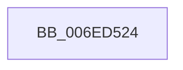

# sub_006ED524

- RVA: `0x006ED524`–`0x006ED541` (길이 `29` bytes)
- VA: `0x00000001406ED524`
- 실행 섹션: `.text`
- PDB 이름 있음: `아니요`; PDB Function 태그: `아니요`
- unwind 정보 RVA: `0x0009D4D0`
- 디코드: `8`개 명령, `29/29` bytes 표시
- 미해석 바이트: `0` (있으면 어셈블리에 `.byte`로 보존)

> 이 문서는 커널 이미지의 기계어와 PDB 기호를 분석해 생성했습니다. 4번과 5번은 함수 원형과 자료형을 바이너리 사용 방식에서 추정한 C 해석이며 원본 소스 복구 결과는 아닙니다.

## 1. Dependencies

- 직접 호출 지점: **1**; 고유 호출 대상: **1**
- 직접 호출자로 확인된 함수: **0**
- RIP 상대 이미지 참조: **0**

### Outgoing calls
- `0x006ED53B` → [KeBugCheckEx](../4F/KeBugCheckEx_function_004FD660.md) (function, `0x004FD660`)

### Direct callers
- 이 함수 시작 RVA로 연결되는 직접 call은 확인되지 않았습니다. 간접 호출은 완전히 역산할 수 없습니다.

### Static image references
- 디코드된 RIP-relative 메모리 참조가 없습니다.

## 2. Other-region calls and transfers

- 다른 실행 섹션으로 향하는 call: **0**
- 별도 외부 분기/꼬리 이동을 확인하지 못했습니다.

## 3. Assembly (complete function range)

```asm
006ED524  48 63 47 04                     movsxd rax, dword ptr [rdi + 4]
006ED528  33 D2                           xor edx, edx
006ED52A  41 B9 06 00 00 00               mov r9d, 6
006ED530  48 89 44 24 20                  mov qword ptr [rsp + 0x20], rax
006ED535  4C 8B C7                        mov r8, rdi
006ED538  8D 4A 18                        lea ecx, [rdx + 0x18]
006ED53B  E8 20 01 E1 FF                  call 0x1404fd660
006ED540  CC                              int3
```

## 4. C-style interpretation (structured pseudocode)

```c
__int64 __fastcall sub_006ED524(__int64 a1, int a2)
{
    __int64 result;
    unsigned __int64 v_stack_p20;

    a2 = 0;
    v_stack_p20 = (int)(*(unsigned int *)(v_rdi + 4));
    result = KeBugCheckEx(a2 + 24, a2, v_rdi, 6);
    return result;
}
```

## 5. (Beta) C Style

```c
int64_t sub_006ED524(int64_t Arg1, int32_t Arg2)
{
    int64_t result;
    uint64_t v_stack_p20;

    Arg2 = 0;
    v_stack_p20 = (int32_t)(*(uint32_t *)(local_rdi + 0x4));
    result = KeBugCheckEx(Arg2 + 24, Arg2, local_rdi, 6);
    return result;
}
```

## 6. Execution-region graph

[열기: 2D/3D 그래프와 함수 탐색 컨트롤 패널](../../../control-panel.html?section=text&rva=0x006ED524&view=graph)

- 2D 그래프는 위에서 아래로 흐르고, 3D 그래프는 빈 공간을 드래그해 회전합니다. Shift+드래그는 이동, 휠은 확대·축소, 함수 노드 선택은 대상 보고서 이동입니다.

### Static fallback


