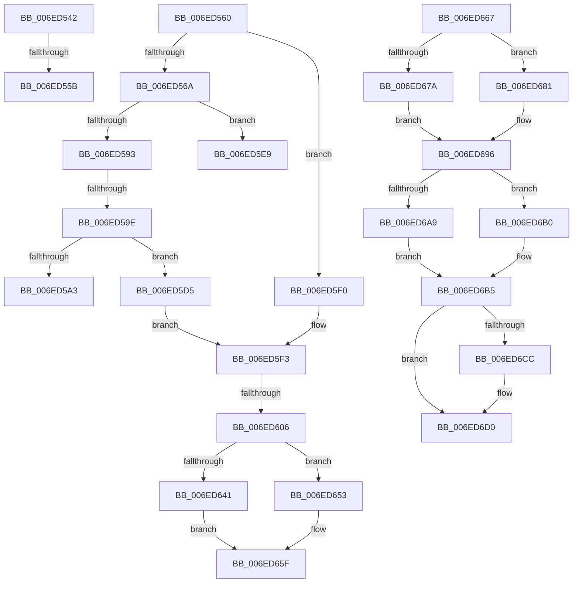

# sub_006ED542

- RVA: `0x006ED542`–`0x006ED6E5` (길이 `419` bytes)
- VA: `0x00000001406ED542`
- 실행 섹션: `.text`
- PDB 이름 있음: `아니요`; PDB Function 태그: `아니요`
- unwind 정보 RVA: `0x0009D530`
- 디코드: `112`개 명령, `419/419` bytes 표시
- 미해석 바이트: `0` (있으면 어셈블리에 `.byte`로 보존)

> 이 문서는 커널 이미지의 기계어와 PDB 기호를 분석해 생성했습니다. 4번과 5번은 함수 원형과 자료형을 바이너리 사용 방식에서 추정한 C 해석이며 원본 소스 복구 결과는 아닙니다.

## 1. Dependencies

- 직접 호출 지점: **25**; 고유 호출 대상: **22**
- 직접 호출자로 확인된 함수: **0**
- RIP 상대 이미지 참조: **0**

### Outgoing calls
- `0x006ED54C` → [CmpPrepareDiscardAndReplaceKcbAndUnbackedHigherLayers](../../page/7F/CmpPrepareDiscardAndReplaceKcbAndUnbackedHigherLayers_function_007F1610.md) (function, `0x007F1610`)
- `0x006ED56E` → [CmpUnlockKcbStack](../../page/84/CmpUnlockKcbStack_function_00848460.md) (function, `0x00848460`)
- `0x006ED577` → [CmpUnlockKcbStack](../../page/84/CmpUnlockKcbStack_function_00848460.md) (function, `0x00848460`)
- `0x006ED585` → [CmpPromoteKey](../../page/84/CmpPromoteKey_function_00844388.md) (function, `0x00844388`)
- `0x006ED5A6` → [CmpUnlockHashEntryByKcb](../../page/86/CmpUnlockHashEntryByKcb_function_00864370.md) (function, `0x00864370`)
- `0x006ED5AF` → [CmpCleanupKcbStack](../../page/94/CmpCleanupKcbStack_function_009470A0.md) (function, `0x009470A0`)
- `0x006ED5B8` → [CmpInitializeKcbStack](../../page/9A/CmpInitializeKcbStack_function_009A2CD0.md) (function, `0x009A2CD0`)
- `0x006ED5C1` → [CmpCleanupKcbStack](../../page/94/CmpCleanupKcbStack_function_009470A0.md) (function, `0x009470A0`)
- `0x006ED5CA` → [CmpInitializeKcbStack](../../page/9A/CmpInitializeKcbStack_function_009A2CD0.md) (function, `0x009A2CD0`)
- `0x006ED5D9` → [CmpLockKcbStackTopExclusiveRestShared](../../page/84/CmpLockKcbStackTopExclusiveRestShared_function_00846B04.md) (function, `0x00846B04`)
- `0x006ED5E2` → [CmpLockKcbStackExclusive](../../page/94/CmpLockKcbStackExclusive_function_009491C0.md) (function, `0x009491C0`)
- `0x006ED5F7` → [CmpCreateTombstone](../66/CmpCreateTombstone_function_0066AF50.md) (function, `0x0066AF50`)
- `0x006ED614` → [CmpReportNotifyForKcbStack](../../page/8C/CmpReportNotifyForKcbStack_function_008C718C.md) (function, `0x008C718C`)
- `0x006ED622` → [CmpFlushNotifiesOnAllUnbackedHigherLayerKcbs](../../page/A5/CmpFlushNotifiesOnAllUnbackedHigherLayerKcbs_function_00A547AC.md) (function, `0x00A547AC`)
- `0x006ED634` → [CmpFlushNotifiesOnKeyBodyList](../../page/9B/CmpFlushNotifiesOnKeyBodyList_function_009B3594.md) (function, `0x009B3594`)
- `0x006ED644` → [CmpMarkKeyUnbacked](../../page/9B/CmpMarkKeyUnbacked_function_009B3C4C.md) (function, `0x009B3C4C`)
- `0x006ED64C` → [CmpDiscardKcb](../../page/9B/CmpDiscardKcb_function_009B2F34.md) (function, `0x009B2F34`)
- `0x006ED65A` → [CmpCommitDiscardAndReplaceKcbAndUnbackedHigherLayers](../../page/A5/CmpCommitDiscardAndReplaceKcbAndUnbackedHigherLayers_function_00A55070.md) (function, `0x00A55070`)
- `0x006ED667` → [HvpGetCellPaged](../../page/85/HvpGetCellPaged_function_00854CB0.md) (function, `0x00854CB0`)
- `0x006ED67A` → [CmpHashCompressedComponent](../../page/85/CmpHashCompressedComponent_function_0085E420.md) (function, `0x0085E420`)
- `0x006ED691` → [CmpHashUnicodeComponent](../../page/84/CmpHashUnicodeComponent_function_0084AC24.md) (function, `0x0084AC24`)
- `0x006ED6A9` → [HvpReleaseCellFlat](../../page/85/HvpReleaseCellFlat_function_0085CC20.md) (function, `0x0085CC20`)
- `0x006ED6B0` → [HvpReleaseCellPaged](../../page/85/HvpReleaseCellPaged_function_00855F40.md) (function, `0x00855F40`)
- `0x006ED6C2` → [CmpFindKcbInHashEntryByCellIndex](../../page/7E/CmpFindKcbInHashEntryByCellIndex_function_007EAD94.md) (function, `0x007EAD94`)
- `0x006ED6DA` → [CmpFreeKeyByCell](../../page/84/CmpFreeKeyByCell_function_0084AD70.md) (function, `0x0084AD70`)

### Direct callers
- 이 함수 시작 RVA로 연결되는 직접 call은 확인되지 않았습니다. 간접 호출은 완전히 역산할 수 없습니다.

### Static image references
- 디코드된 RIP-relative 메모리 참조가 없습니다.

## 2. Other-region calls and transfers

- 다른 실행 섹션으로 향하는 call: **24**
  - `0x006ED54C` → [CmpPrepareDiscardAndReplaceKcbAndUnbackedHigherLayers](../../page/7F/CmpPrepareDiscardAndReplaceKcbAndUnbackedHigherLayers_function_007F1610.md) (`.text` → `PAGE`)
  - `0x006ED56E` → [CmpUnlockKcbStack](../../page/84/CmpUnlockKcbStack_function_00848460.md) (`.text` → `PAGE`)
  - `0x006ED577` → [CmpUnlockKcbStack](../../page/84/CmpUnlockKcbStack_function_00848460.md) (`.text` → `PAGE`)
  - `0x006ED585` → [CmpPromoteKey](../../page/84/CmpPromoteKey_function_00844388.md) (`.text` → `PAGE`)
  - `0x006ED5A6` → [CmpUnlockHashEntryByKcb](../../page/86/CmpUnlockHashEntryByKcb_function_00864370.md) (`.text` → `PAGE`)
  - `0x006ED5AF` → [CmpCleanupKcbStack](../../page/94/CmpCleanupKcbStack_function_009470A0.md) (`.text` → `PAGE`)
  - `0x006ED5B8` → [CmpInitializeKcbStack](../../page/9A/CmpInitializeKcbStack_function_009A2CD0.md) (`.text` → `PAGE`)
  - `0x006ED5C1` → [CmpCleanupKcbStack](../../page/94/CmpCleanupKcbStack_function_009470A0.md) (`.text` → `PAGE`)
  - `0x006ED5CA` → [CmpInitializeKcbStack](../../page/9A/CmpInitializeKcbStack_function_009A2CD0.md) (`.text` → `PAGE`)
  - `0x006ED5D9` → [CmpLockKcbStackTopExclusiveRestShared](../../page/84/CmpLockKcbStackTopExclusiveRestShared_function_00846B04.md) (`.text` → `PAGE`)
  - `0x006ED5E2` → [CmpLockKcbStackExclusive](../../page/94/CmpLockKcbStackExclusive_function_009491C0.md) (`.text` → `PAGE`)
  - `0x006ED614` → [CmpReportNotifyForKcbStack](../../page/8C/CmpReportNotifyForKcbStack_function_008C718C.md) (`.text` → `PAGE`)
  - `0x006ED622` → [CmpFlushNotifiesOnAllUnbackedHigherLayerKcbs](../../page/A5/CmpFlushNotifiesOnAllUnbackedHigherLayerKcbs_function_00A547AC.md) (`.text` → `PAGE`)
  - `0x006ED634` → [CmpFlushNotifiesOnKeyBodyList](../../page/9B/CmpFlushNotifiesOnKeyBodyList_function_009B3594.md) (`.text` → `PAGE`)
  - `0x006ED644` → [CmpMarkKeyUnbacked](../../page/9B/CmpMarkKeyUnbacked_function_009B3C4C.md) (`.text` → `PAGE`)
  - `0x006ED64C` → [CmpDiscardKcb](../../page/9B/CmpDiscardKcb_function_009B2F34.md) (`.text` → `PAGE`)
  - `0x006ED65A` → [CmpCommitDiscardAndReplaceKcbAndUnbackedHigherLayers](../../page/A5/CmpCommitDiscardAndReplaceKcbAndUnbackedHigherLayers_function_00A55070.md) (`.text` → `PAGE`)
  - `0x006ED667` → [HvpGetCellPaged](../../page/85/HvpGetCellPaged_function_00854CB0.md) (`.text` → `PAGE`)
  - `0x006ED67A` → [CmpHashCompressedComponent](../../page/85/CmpHashCompressedComponent_function_0085E420.md) (`.text` → `PAGE`)
  - `0x006ED691` → [CmpHashUnicodeComponent](../../page/84/CmpHashUnicodeComponent_function_0084AC24.md) (`.text` → `PAGE`)
  - `0x006ED6A9` → [HvpReleaseCellFlat](../../page/85/HvpReleaseCellFlat_function_0085CC20.md) (`.text` → `PAGE`)
  - `0x006ED6B0` → [HvpReleaseCellPaged](../../page/85/HvpReleaseCellPaged_function_00855F40.md) (`.text` → `PAGE`)
  - `0x006ED6C2` → [CmpFindKcbInHashEntryByCellIndex](../../page/7E/CmpFindKcbInHashEntryByCellIndex_function_007EAD94.md) (`.text` → `PAGE`)
  - `0x006ED6DA` → [CmpFreeKeyByCell](../../page/84/CmpFreeKeyByCell_function_0084AD70.md) (`.text` → `PAGE`)
- call이 아닌 외부 분기/꼬리 이동: **8**
  - `0x006ED555` → [CmDeleteLayeredKey + 0x276](../41/CmDeleteLayeredKey_function_0041B598.md) (`tail-transfer`)
  - `0x006ED55B` → [CmDeleteLayeredKey + 0x130](../41/CmDeleteLayeredKey_function_0041B598.md) (`tail-transfer`)
  - `0x006ED598` → [CmDeleteLayeredKey + 0x288](../41/CmDeleteLayeredKey_function_0041B598.md) (`tail-transfer`)
  - `0x006ED5D0` → [CmDeleteLayeredKey + 0x8C](../41/CmDeleteLayeredKey_function_0041B598.md) (`tail-transfer`)
  - `0x006ED5EB` → [CmDeleteLayeredKey + 0x288](../41/CmDeleteLayeredKey_function_0041B598.md) (`tail-transfer`)
  - `0x006ED600` → [CmDeleteLayeredKey + 0x276](../41/CmDeleteLayeredKey_function_0041B598.md) (`tail-transfer`)
  - `0x006ED662` → [CmDeleteLayeredKey + 0x276](../41/CmDeleteLayeredKey_function_0041B598.md) (`tail-transfer`)
  - `0x006ED6E0` → [CmDeleteLayeredKey + 0x194](../41/CmDeleteLayeredKey_function_0041B598.md) (`tail-transfer`)

## 3. Assembly (complete function range)

```asm
006ED542  48 8D 55 07                     lea rdx, [rbp + 7]
006ED546  48 8B CF                        mov rcx, rdi
006ED549  41 B4 01                        mov r12b, 1
006ED54C  E8 BF 40 10 00                  call 0x1407f1610
006ED551  8B D8                           mov ebx, eax
006ED553  85 C0                           test eax, eax
006ED555  0F 88 B3 E2 D2 FF               js 0x14041b80e
006ED55B  E9 68 E1 D2 FF                  jmp 0x14041b6c8
006ED560  41 39 47 28                     cmp dword ptr [r15 + 0x28], eax
006ED564  0F 85 86 00 00 00               jne 0x1406ed5f0
006ED56A  48 8D 4D D7                     lea rcx, [rbp - 0x29]
006ED56E  E8 ED AE 15 00                  call 0x140848460
006ED573  48 8D 4D B7                     lea rcx, [rbp - 0x49]
006ED577  E8 E4 AE 15 00                  call 0x140848460
006ED57C  45 33 C0                        xor r8d, r8d
006ED57F  48 8D 4D B7                     lea rcx, [rbp - 0x49]
006ED583  33 D2                           xor edx, edx
006ED585  E8 FE 6D 15 00                  call 0x140844388
006ED58A  8B D8                           mov ebx, eax
006ED58C  3D 7C 01 00 C0                  cmp eax, 0xc000017c
006ED591  74 56                           je 0x1406ed5e9
006ED593  45 33 FF                        xor r15d, r15d
006ED596  85 C0                           test eax, eax
006ED598  0F 88 82 E2 D2 FF               js 0x14041b820
006ED59E  45 84 F6                        test r14b, r14b
006ED5A1  75 32                           jne 0x1406ed5d5
006ED5A3  48 8B CF                        mov rcx, rdi
006ED5A6  E8 C5 6D 17 00                  call 0x140864370
006ED5AB  48 8D 4D B7                     lea rcx, [rbp - 0x49]
006ED5AF  E8 EC 9A 25 00                  call 0x1409470a0
006ED5B4  48 8D 4D B7                     lea rcx, [rbp - 0x49]
006ED5B8  E8 13 57 2B 00                  call 0x1409a2cd0
006ED5BD  48 8D 4D D7                     lea rcx, [rbp - 0x29]
006ED5C1  E8 DA 9A 25 00                  call 0x1409470a0
006ED5C6  48 8D 4D D7                     lea rcx, [rbp - 0x29]
006ED5CA  E8 01 57 2B 00                  call 0x1409a2cd0
006ED5CF  90                              nop
006ED5D0  E9 4F E0 D2 FF                  jmp 0x14041b624
006ED5D5  48 8D 4D B7                     lea rcx, [rbp - 0x49]
006ED5D9  E8 26 95 15 00                  call 0x140846b04
006ED5DE  48 8D 4D D7                     lea rcx, [rbp - 0x29]
006ED5E2  E8 D9 BB 25 00                  call 0x1409491c0
006ED5E7  EB 0A                           jmp 0x1406ed5f3
006ED5E9  33 DB                           xor ebx, ebx
006ED5EB  E9 30 E2 D2 FF                  jmp 0x14041b820
006ED5F0  45 33 FF                        xor r15d, r15d
006ED5F3  48 8D 55 D7                     lea rdx, [rbp - 0x29]
006ED5F7  E8 54 D9 F7 FF                  call 0x14066af50
006ED5FC  8B D8                           mov ebx, eax
006ED5FE  85 C0                           test eax, eax
006ED600  0F 88 08 E2 D2 FF               js 0x14041b80e
006ED606  4C 8B 4D 6F                     mov r9, qword ptr [rbp + 0x6f]
006ED60A  48 8D 4D B7                     lea rcx, [rbp - 0x49]
006ED60E  33 D2                           xor edx, edx
006ED610  44 8D 42 01                     lea r8d, [rdx + 1]
006ED614  E8 73 9B 1D 00                  call 0x1408c718c
006ED619  45 33 C9                        xor r9d, r9d
006ED61C  4C 8B C6                        mov r8, rsi
006ED61F  48 8B CF                        mov rcx, rdi
006ED622  E8 85 71 36 00                  call 0x140a547ac
006ED627  45 33 C9                        xor r9d, r9d
006ED62A  4C 8B C6                        mov r8, rsi
006ED62D  48 8B CF                        mov rcx, rdi
006ED630  41 8D 51 08                     lea edx, [r9 + 8]
006ED634  E8 5B 5F 2C 00                  call 0x1409b3594
006ED639  48 8B CF                        mov rcx, rdi
006ED63C  45 84 E4                        test r12b, r12b
006ED63F  75 12                           jne 0x1406ed653
006ED641  48 8B D6                        mov rdx, rsi
006ED644  E8 03 66 2C 00                  call 0x1409b3c4c
006ED649  48 8B CF                        mov rcx, rdi
006ED64C  E8 E3 58 2C 00                  call 0x1409b2f34
006ED651  EB 0C                           jmp 0x1406ed65f
006ED653  4C 8B C6                        mov r8, rsi
006ED656  48 8D 55 07                     lea rdx, [rbp + 7]
006ED65A  E8 11 7A 36 00                  call 0x140a55070
006ED65F  41 8B DF                        mov ebx, r15d
006ED662  E9 A7 E1 D2 FF                  jmp 0x14041b80e
006ED667  E8 44 76 16 00                  call 0x140854cb0
006ED66C  F6 40 02 20                     test byte ptr [rax + 2], 0x20
006ED670  48 8D 48 4C                     lea rcx, [rax + 0x4c]
006ED674  0F B7 50 48                     movzx edx, word ptr [rax + 0x48]
006ED678  74 07                           je 0x1406ed681
006ED67A  E8 A1 0D 17 00                  call 0x14085e420
006ED67F  EB 15                           jmp 0x1406ed696
006ED681  48 89 4D FF                     mov qword ptr [rbp - 1], rcx
006ED685  48 8D 4D F7                     lea rcx, [rbp - 9]
006ED689  66 89 55 F7                     mov word ptr [rbp - 9], dx
006ED68D  66 89 55 F9                     mov word ptr [rbp - 7], dx
006ED691  E8 8E D5 15 00                  call 0x14084ac24
006ED696  48 8B 4F 20                     mov rcx, qword ptr [rdi + 0x20]
006ED69A  48 8D 55 A7                     lea rdx, [rbp - 0x59]
006ED69E  8B D8                           mov ebx, eax
006ED6A0  F6 81 8C 00 00 00 01            test byte ptr [rcx + 0x8c], 1
006ED6A7  74 07                           je 0x1406ed6b0
006ED6A9  E8 72 F5 16 00                  call 0x14085cc20
006ED6AE  EB 05                           jmp 0x1406ed6b5
006ED6B0  E8 8B 88 16 00                  call 0x140855f40
006ED6B5  6B 57 10 25                     imul edx, dword ptr [rdi + 0x10], 0x25
006ED6B9  45 8B C7                        mov r8d, r15d
006ED6BC  48 8B 4F 20                     mov rcx, qword ptr [rdi + 0x20]
006ED6C0  03 D3                           add edx, ebx
006ED6C2  E8 CD D6 0F 00                  call 0x1407ead94
006ED6C7  48 85 C0                        test rax, rax
006ED6CA  74 04                           je 0x1406ed6d0
006ED6CC  83 48 28 FF                     or dword ptr [rax + 0x28], 0xffffffff
006ED6D0  48 8B 4F 20                     mov rcx, qword ptr [rdi + 0x20]
006ED6D4  41 B0 01                        mov r8b, 1
006ED6D7  41 8B D7                        mov edx, r15d
006ED6DA  E8 91 D6 15 00                  call 0x14084ad70
006ED6DF  90                              nop
006ED6E0  E9 47 E0 D2 FF                  jmp 0x14041b72c
```

## 4. C-style interpretation (structured pseudocode)

```c
__int64 __fastcall sub_006ED542(__int64 a1, __int64 a2, int a3)
{
    __int64 result;

    result = CmpPrepareDiscardAndReplaceKcbAndUnbackedHigherLayers(v_rdi, v_rbp + 7, a3, a4);
}
```

## 5. (Beta) C Style

```c
int64_t sub_006ED542(int64_t Arg1, int64_t Arg2, int32_t Arg3)
{
    int64_t result;

    result = CmpPrepareDiscardAndReplaceKcbAndUnbackedHigherLayers(local_rdi, local_rbp + 7, Arg3, a4);
}
```

## 6. Execution-region graph

[열기: 2D/3D 그래프와 함수 탐색 컨트롤 패널](../../../control-panel.html?section=text&rva=0x006ED542&view=graph)

- 2D 그래프는 위에서 아래로 흐르고, 3D 그래프는 빈 공간을 드래그해 회전합니다. Shift+드래그는 이동, 휠은 확대·축소, 함수 노드 선택은 대상 보고서 이동입니다.

### Static fallback


