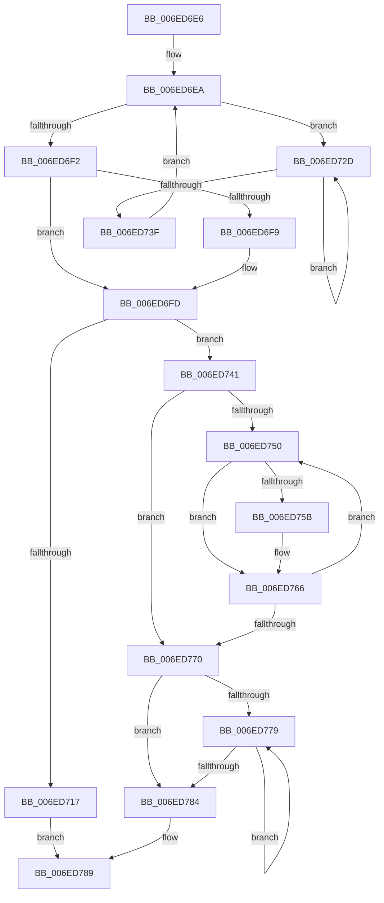

# sub_006ED6E6

- RVA: `0x006ED6E6`–`0x006ED793` (길이 `173` bytes)
- VA: `0x00000001406ED6E6`
- 실행 섹션: `.text`
- PDB 이름 있음: `아니요`; PDB Function 태그: `아니요`
- unwind 정보 RVA: `0x0009D6A8`
- 디코드: `51`개 명령, `173/173` bytes 표시
- 미해석 바이트: `0` (있으면 어셈블리에 `.byte`로 보존)

> 이 문서는 커널 이미지의 기계어와 PDB 기호를 분석해 생성했습니다. 4번과 5번은 함수 원형과 자료형을 바이너리 사용 방식에서 추정한 C 해석이며 원본 소스 복구 결과는 아닙니다.

## 1. Dependencies

- 직접 호출 지점: **2**; 고유 호출 대상: **2**
- 직접 호출자로 확인된 함수: **0**
- RIP 상대 이미지 참조: **0**

### Outgoing calls
- `0x006ED732` → [KeYieldProcessorEx](../3F/KeYieldProcessorEx_function_003FBD00.md) (function, `0x003FBD00`)
- `0x006ED761` → [KiSendSoftwareInterrupt](../25/KiSendSoftwareInterrupt_function_00250A30.md) (function, `0x00250A30`)

### Direct callers
- 이 함수 시작 RVA로 연결되는 직접 call은 확인되지 않았습니다. 간접 호출은 완전히 역산할 수 없습니다.

### Static image references
- 디코드된 RIP-relative 메모리 참조가 없습니다.

## 2. Other-region calls and transfers

- 다른 실행 섹션으로 향하는 call: **0**
- call이 아닌 외부 분기/꼬리 이동: **1**
  - `0x006ED78E` → [KiSynchronizeUserIsolationDomainExit + 0x2B](../41/KiSynchronizeUserIsolationDomainExit_function_0041BFA0.md) (`tail-transfer`)

## 3. Assembly (complete function range)

```asm
006ED6E6  89 74 24 30                     mov dword ptr [rsp + 0x30], esi
006ED6EA  F0 48 0F BA 2B 00               lock bts qword ptr [rbx], 0
006ED6F0  72 3B                           jb 0x1406ed72d
006ED6F2  48 83 7B 10 01                  cmp qword ptr [rbx + 0x10], 1
006ED6F7  75 04                           jne 0x1406ed6fd
006ED6F9  48 89 73 10                     mov qword ptr [rbx + 0x10], rsi
006ED6FD  0F B6 43 1A                     movzx eax, byte ptr [rbx + 0x1a]
006ED701  0F B6 4B 19                     movzx ecx, byte ptr [rbx + 0x19]
006ED705  FE C0                           inc al
006ED707  0F B6 D0                        movzx edx, al
006ED70A  0F B6 43 18                     movzx eax, byte ptr [rbx + 0x18]
006ED70E  03 CA                           add ecx, edx
006ED710  88 53 1A                        mov byte ptr [rbx + 0x1a], dl
006ED713  3B C1                           cmp eax, ecx
006ED715  75 2A                           jne 0x1406ed741
006ED717  48 89 73 08                     mov qword ptr [rbx + 8], rsi
006ED71B  40 88 73 1A                     mov byte ptr [rbx + 0x1a], sil
006ED71F  48 C7 43 10 01 00 00 00         mov qword ptr [rbx + 0x10], 1
006ED727  F0 48 21 33                     lock and qword ptr [rbx], rsi
006ED72B  EB 5C                           jmp 0x1406ed789
006ED72D  48 8D 4C 24 30                  lea rcx, [rsp + 0x30]
006ED732  E8 C9 E5 D0 FF                  call 0x1403fbd00
006ED737  48 8B 03                        mov rax, qword ptr [rbx]
006ED73A  48 85 C0                        test rax, rax
006ED73D  75 EE                           jne 0x1406ed72d
006ED73F  EB A9                           jmp 0x1406ed6ea
006ED741  C6 44 1F 1C 02                  mov byte ptr [rdi + rbx + 0x1c], 2
006ED746  F0 48 21 33                     lock and qword ptr [rbx], rsi
006ED74A  40 38 73 18                     cmp byte ptr [rbx + 0x18], sil
006ED74E  76 20                           jbe 0x1406ed770
006ED750  8B CE                           mov ecx, esi
006ED752  0F B6 44 19 1C                  movzx eax, byte ptr [rcx + rbx + 0x1c]
006ED757  A8 03                           test al, 3
006ED759  75 0B                           jne 0x1406ed766
006ED75B  8B 4C CB 20                     mov ecx, dword ptr [rbx + rcx*8 + 0x20]
006ED75F  B2 01                           mov dl, 1
006ED761  E8 CA 32 B6 FF                  call 0x140250a30
006ED766  0F B6 43 18                     movzx eax, byte ptr [rbx + 0x18]
006ED76A  FF C6                           inc esi
006ED76C  3B F0                           cmp esi, eax
006ED76E  72 E0                           jb 0x1406ed750
006ED770  48 8B 43 08                     mov rax, qword ptr [rbx + 8]
006ED774  48 85 C0                        test rax, rax
006ED777  74 0B                           je 0x1406ed784
006ED779  F3 90                           pause
006ED77B  48 8B 43 08                     mov rax, qword ptr [rbx + 8]
006ED77F  48 85 C0                        test rax, rax
006ED782  75 F5                           jne 0x1406ed779
006ED784  C6 44 1F 1C 00                  mov byte ptr [rdi + rbx + 0x1c], 0
006ED789  48 8B 74 24 38                  mov rsi, qword ptr [rsp + 0x38]
006ED78E  E9 38 E8 D2 FF                  jmp 0x14041bfcb
```

## 4. C-style interpretation (structured pseudocode)

```c
__int64 __fastcall sub_006ED6E6(__int64 a1, __int64 a2, __int64 a3, __int64 a4, __int64 a5, __int64 a6, __int64 a7)
{
    __int64 result;
    __int64 v_rsi;
    unsigned int v_stack_p30;

    v_stack_p30 = (unsigned int)(v_rsi);
loc_006ED6EA:
    if (condition_is_below) goto loc_006ED72D;
    if ((*(unsigned __int64 *)(v_rbx + 16)) == 1) {
        *(unsigned __int64 *)(v_rbx + 16) = v_rsi;
    }
    result = (unsigned __int8)((*(unsigned __int8 *)(v_rbx + 26)) + 1);
    a1 = (unsigned int)((*(unsigned __int8 *)(v_rbx + 25)) + ((unsigned int)((unsigned __int8)(result))));
    *(unsigned __int8 *)(v_rbx + 26) = (unsigned __int8)((unsigned __int8)(result));
    if (((unsigned int)(*(unsigned __int8 *)(v_rbx + 24))) != ((unsigned int)(a1))) goto loc_006ED741;
    *(unsigned __int64 *)(v_rbx + 8) = v_rsi;
    *(unsigned __int8 *)(v_rbx + 26) = (unsigned __int8)(v_rsi);
    *(unsigned __int64 *)(v_rbx + 16) = 1;
    goto loc_006ED789;
loc_006ED72D:
    result = KeYieldProcessorEx(a6, (unsigned __int8)(result), a3, a4);
    if (*(unsigned __int64 *)(v_rbx) != 0) goto loc_006ED72D;
    goto loc_006ED6EA;
loc_006ED741:
    *(unsigned __int8 *)(v_rdi + v_rbx * 1 + 28) = 2;
    if ((*(unsigned __int8 *)(v_rbx + 24)) <= ((unsigned __int8)(v_rsi))) goto loc_006ED770;
loc_006ED750:
    result = *(unsigned __int8 *)((unsigned int)((unsigned int)(v_rsi)) + v_rbx * 1 + 28);
    if ((((unsigned __int8)(*(unsigned __int8 *)((unsigned int)((unsigned int)(v_rsi)) + v_rbx * 1 + 28))) & (3)) == 0) {
        a1 = *(unsigned int *)(v_rbx + (unsigned int)((unsigned int)(v_rsi)) * 8 + 32);
        a2 = 1;
        result = KiSendSoftwareInterrupt(a1, a2, a3, a4);
    }
    v_rsi = (unsigned int)((v_rsi) + 1);
    if (((unsigned int)(v_rsi)) < ((unsigned int)(*(unsigned __int8 *)(v_rbx + 24)))) goto loc_006ED750;
loc_006ED770:
    if (*(unsigned __int64 *)(v_rbx + 8) == 0) goto loc_006ED784;
loc_006ED779:
    if (*(unsigned __int64 *)(v_rbx + 8) != 0) goto loc_006ED779;
loc_006ED784:
    *(unsigned __int8 *)(v_rdi + v_rbx * 1 + 28) = 0;
loc_006ED789:
}
```

## 5. (Beta) C Style

```c
int64_t sub_006ED6E6(int64_t Arg1, int64_t Arg2, int64_t Arg3, int64_t Arg4, uint64_t Arg5, int64_t Arg6, int64_t Arg7)
{
    int64_t result;
    int64_t local_rsi;
    uint32_t v_stack_p30;

    v_stack_p30 = (uint32_t)(local_rsi);
loc_006ED6EA:
    if (condition_is_below) goto loc_006ED72D;
    if ((*(uint64_t *)(local_rbx + 0x10)) == 1) {
        *(uint64_t *)(local_rbx + 0x10) = local_rsi;
    }
    result = (uint8_t)((*(uint8_t *)(local_rbx + 0x1A)) + 1);
    Arg1 = (uint32_t)((*(uint8_t *)(local_rbx + 0x19)) + ((uint32_t)((uint8_t)(result))));
    *(uint8_t *)(local_rbx + 0x1A) = (uint8_t)((uint8_t)(result));
    if (((uint32_t)(*(uint8_t *)(local_rbx + 0x18))) != ((uint32_t)(Arg1))) goto loc_006ED741;
    *(uint64_t *)(local_rbx + 0x8) = local_rsi;
    *(uint8_t *)(local_rbx + 0x1A) = (uint8_t)(local_rsi);
    *(uint64_t *)(local_rbx + 0x10) = 1;
    goto loc_006ED789;
loc_006ED72D:
    result = KeYieldProcessorEx(Arg6, (uint8_t)(result), Arg3, Arg4);
    if (*(uint64_t *)(local_rbx) != 0) goto loc_006ED72D;
    goto loc_006ED6EA;
loc_006ED741:
    *(uint8_t *)(local_rdi + local_rbx * 1 + 0x1C) = 2;
    if ((*(uint8_t *)(local_rbx + 0x18)) <= ((uint8_t)(local_rsi))) goto loc_006ED770;
loc_006ED750:
    result = *(uint8_t *)((uint32_t)((uint32_t)(local_rsi)) + local_rbx * 1 + 0x1C);
    if ((((uint8_t)(*(uint8_t *)((uint32_t)((uint32_t)(local_rsi)) + local_rbx * 1 + 0x1C))) & (3)) == 0) {
        Arg1 = *(uint32_t *)(local_rbx + (uint32_t)((uint32_t)(local_rsi)) * 8 + 0x20);
        Arg2 = 1;
        result = KiSendSoftwareInterrupt(Arg1, Arg2, Arg3, Arg4);
    }
    local_rsi = (uint32_t)((local_rsi) + 1);
    if (((uint32_t)(local_rsi)) < ((uint32_t)(*(uint8_t *)(local_rbx + 0x18)))) goto loc_006ED750;
loc_006ED770:
    if (*(uint64_t *)(local_rbx + 0x8) == 0) goto loc_006ED784;
loc_006ED779:
    if (*(uint64_t *)(local_rbx + 0x8) != 0) goto loc_006ED779;
loc_006ED784:
    *(uint8_t *)(local_rdi + local_rbx * 1 + 0x1C) = 0;
loc_006ED789:
}
```

## 6. Execution-region graph

[열기: 2D/3D 그래프와 함수 탐색 컨트롤 패널](../../../control-panel.html?section=text&rva=0x006ED6E6&view=graph)

- 2D 그래프는 위에서 아래로 흐르고, 3D 그래프는 빈 공간을 드래그해 회전합니다. Shift+드래그는 이동, 휠은 확대·축소, 함수 노드 선택은 대상 보고서 이동입니다.

### Static fallback


