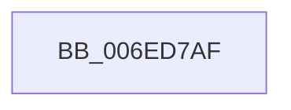

# sub_006ED7AF

- RVA: `0x006ED7AF`–`0x006ED7E4` (길이 `53` bytes)
- VA: `0x00000001406ED7AF`
- 실행 섹션: `.text`
- PDB 이름 있음: `아니요`; PDB Function 태그: `아니요`
- unwind 정보 RVA: `0x0009FA64`
- 디코드: `15`개 명령, `53/53` bytes 표시
- 미해석 바이트: `0` (있으면 어셈블리에 `.byte`로 보존)

> 이 문서는 커널 이미지의 기계어와 PDB 기호를 분석해 생성했습니다. 4번과 5번은 함수 원형과 자료형을 바이너리 사용 방식에서 추정한 C 해석이며 원본 소스 복구 결과는 아닙니다.

## 1. Dependencies

- 직접 호출 지점: **0**; 고유 호출 대상: **0**
- 직접 호출자로 확인된 함수: **0**
- RIP 상대 이미지 참조: **0**

### Outgoing calls
- 직접 디코드된 call 명령이 없습니다.

### Direct callers
- 이 함수 시작 RVA로 연결되는 직접 call은 확인되지 않았습니다. 간접 호출은 완전히 역산할 수 없습니다.

### Static image references
- 디코드된 RIP-relative 메모리 참조가 없습니다.

## 2. Other-region calls and transfers

- 다른 실행 섹션으로 향하는 call: **0**
- call이 아닌 외부 분기/꼬리 이동: **1**
  - `0x006ED7E2` → [sub_006ED862](Unknown_function_006ED862.md) (`tail-transfer`)

## 3. Assembly (complete function range)

```asm
006ED7AF  4C 89 7C 24 20                  mov qword ptr [rsp + 0x20], r15
006ED7B4  49 C1 E8 06                     shr r8, 6
006ED7B8  83 E7 3F                        and edi, 0x3f
006ED7BB  41 BA 01 00 00 00               mov r10d, 1
006ED7C1  BD 40 00 00 00                  mov ebp, 0x40
006ED7C6  48 2B EF                        sub rbp, rdi
006ED7C9  41 8B F2                        mov esi, r10d
006ED7CC  48 8B CD                        mov rcx, rbp
006ED7CF  48 D3 E6                        shl rsi, cl
006ED7D2  4E 8D 1C C2                     lea r11, [rdx + r8*8]
006ED7D6  8B CF                           mov ecx, edi
006ED7D8  45 8B C2                        mov r8d, r10d
006ED7DB  49 D3 E0                        shl r8, cl
006ED7DE  48 83 FB 40                     cmp rbx, 0x40
006ED7E2  72 7E                           jb 0x1406ed862
```

## 4. C-style interpretation (structured pseudocode)

```c
void __fastcall sub_006ED7AF(__int64 a1, __int64 a2, __int64 a3)
{
    __int64 v_rbp;
    __int64 v_rdi;
    __int64 v_rsi;
    unsigned __int64 v_stack_p20;

    v_stack_p20 = v_r15;
    a3 = (a3) >> (6);
    v_rdi = (unsigned int)((v_rdi) & (63));
    v_rbp = (64) - (v_rdi);
    v_rsi = (1) << ((unsigned __int8)(v_rbp));
    a3 = (1) << ((unsigned __int8)((unsigned int)((unsigned int)(v_rdi))));
}
```

## 5. (Beta) C Style

```c
void sub_006ED7AF(int64_t Arg1, void *Arg2, int64_t Arg3)
{
    uint8_t *arg2 = (uint8_t *)Arg2;

    int64_t local_rbp;
    int64_t local_rdi;
    int64_t local_rsi;
    uint64_t v_stack_p20;

    v_stack_p20 = local_r15;
    Arg3 = (Arg3) >> (6);
    local_rdi = (uint32_t)((local_rdi) & (63));
    local_rbp = (64) - (local_rdi);
    local_rsi = (1) << ((uint8_t)(local_rbp));
    Arg3 = (1) << ((uint8_t)((uint32_t)((uint32_t)(local_rdi))));
}
```

### 관측된 메모리 오프셋

구조체 형식이 확인되지 않은 접근은 인자 기준의 오프셋으로만 기록했습니다.

| 기준 인자 | 오프셋 표현 | 폭 (bit) | 접근 |
|---|---:|---:|---|
| `Arg2` | `+ 0x0 + r8*8` | `64` | `R` |

## 6. Execution-region graph

[열기: 2D/3D 그래프와 함수 탐색 컨트롤 패널](../../../control-panel.html?section=text&rva=0x006ED7AF&view=graph)

- 2D 그래프는 위에서 아래로 흐르고, 3D 그래프는 빈 공간을 드래그해 회전합니다. Shift+드래그는 이동, 휠은 확대·축소, 함수 노드 선택은 대상 보고서 이동입니다.

### Static fallback


