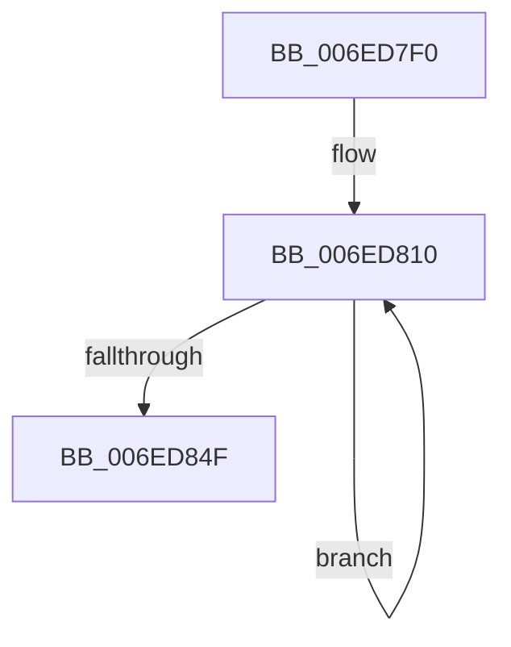

# sub_006ED7F0

- RVA: `0x006ED7F0`–`0x006ED862` (길이 `114` bytes)
- VA: `0x00000001406ED7F0`
- 실행 섹션: `.text`
- PDB 이름 있음: `아니요`; PDB Function 태그: `아니요`
- unwind 정보 RVA: `0x0009FA8C`
- 디코드: `34`개 명령, `114/114` bytes 표시
- 미해석 바이트: `0` (있으면 어셈블리에 `.byte`로 보존)

> 이 문서는 커널 이미지의 기계어와 PDB 기호를 분석해 생성했습니다. 4번과 5번은 함수 원형과 자료형을 바이너리 사용 방식에서 추정한 C 해석이며 원본 소스 복구 결과는 아닙니다.

## 1. Dependencies

- 직접 호출 지점: **0**; 고유 호출 대상: **0**
- 직접 호출자로 확인된 함수: **0**
- RIP 상대 이미지 참조: **0**

### Outgoing calls
- 직접 디코드된 call 명령이 없습니다.

### Direct callers
- 이 함수 시작 RVA로 연결되는 직접 call은 확인되지 않았습니다. 간접 호출은 완전히 역산할 수 없습니다.

### Static image references
- 디코드된 RIP-relative 메모리 참조가 없습니다.

## 2. Other-region calls and transfers

- 다른 실행 섹션으로 향하는 call: **0**
- call이 아닌 외부 분기/꼬리 이동: **1**
  - `0x006ED860` → [sub_006ED862 + 0x79](Unknown_function_006ED862.md) (`tail-transfer`)

## 3. Assembly (complete function range)

```asm
006ED7F0  4C 89 6C 24 68                  mov qword ptr [rsp + 0x68], r13
006ED7F5  4D 8B 2B                        mov r13, qword ptr [r11]
006ED7F8  4D 8D 60 FF                     lea r12, [r8 - 1]
006ED7FC  49 C1 EE 06                     shr r14, 6
006ED800  4D 8B FA                        mov r15, r10
006ED803  49 6B C6 C0                     imul rax, r14, -0x40
006ED807  49 F7 D7                        not r15
006ED80A  49 F7 D4                        not r12
006ED80D  48 03 D8                        add rbx, rax
006ED810  49 8B 11                        mov rdx, qword ptr [r9]
006ED813  49 8D 40 FF                     lea rax, [r8 - 1]
006ED817  49 23 C5                        and rax, r13
006ED81A  49 23 D2                        and rdx, r10
006ED81D  48 8B CF                        mov rcx, rdi
006ED820  4D 8B EC                        mov r13, r12
006ED823  48 D3 E2                        shl rdx, cl
006ED826  48 8B CD                        mov rcx, rbp
006ED829  48 0B C2                        or rax, rdx
006ED82C  49 89 03                        mov qword ptr [r11], rax
006ED82F  49 83 C3 08                     add r11, 8
006ED833  49 8B C7                        mov rax, r15
006ED836  49 23 01                        and rax, qword ptr [r9]
006ED839  49 83 C1 08                     add r9, 8
006ED83D  48 D3 E8                        shr rax, cl
006ED840  4D 23 2B                        and r13, qword ptr [r11]
006ED843  4C 0B E8                        or r13, rax
006ED846  4D 89 2B                        mov qword ptr [r11], r13
006ED849  49 83 EE 01                     sub r14, 1
006ED84D  75 C1                           jne 0x1406ed810
006ED84F  4C 8B 6C 24 68                  mov r13, qword ptr [rsp + 0x68]
006ED854  45 8D 56 01                     lea r10d, [r14 + 1]
006ED858  4C 8B 64 24 60                  mov r12, qword ptr [rsp + 0x60]
006ED85D  48 85 DB                        test rbx, rbx
006ED860  74 79                           je 0x1406ed8db
```

## 4. C-style interpretation (structured pseudocode)

```c
__int64 __fastcall sub_006ED7F0(__int64 a1, __int64 a2, __int64 a3, __int64 a4, __int64 a5, __int64 a6, __int64 a7, __int64 a8, __int64 a9, __int64 a10, __int64 a11, __int64 a12, __int64 a13)
{
    __int64 result;
    __int64 v_r11;
    __int64 v_r12;
    __int64 v_r13;
    __int64 v_r14;
    __int64 v_r15;
    __int64 v_rbx;
    unsigned __int64 v_stack_p68;

    v_stack_p68 = v_r13;
    v_r14 = (v_r14) >> (6);
    result = (result) * (v_r14);
    v_r15 = ~(v_r10);
    v_r12 = ~(a3 - 1);
    v_rbx = (v_rbx) + (result);
loc_006ED810:
    result = (a3 - 1) & (*(unsigned __int64 *)(v_r11));
    a2 = (*(unsigned __int64 *)(a4)) & (v_r10);
    a2 = (a2) << ((unsigned __int8)(v_rdi));
    result = (result) | (a2);
    *(unsigned __int64 *)(v_r11) = result;
    v_r11 = (v_r11) + (8);
    result = (v_r15) & (*(unsigned __int64 *)(a4));
    a4 = (a4) + (8);
    result = (result) >> ((unsigned __int8)(v_rbp));
    v_r13 = (v_r12) & (*(unsigned __int64 *)(v_r11));
    v_r13 = (v_r13) | (result);
    *(unsigned __int64 *)(v_r11) = v_r13;
    v_r14 = (v_r14) - (1);
    if (condition_is_not_equal) goto loc_006ED810;
}
```

## 5. (Beta) C Style

```c
int64_t sub_006ED7F0(int64_t Arg1, int64_t Arg2, void *Arg3, void *Arg4, uint64_t Arg5, uint64_t Arg6, uint64_t Arg7, uint64_t Arg8, uint64_t Arg9, uint64_t Arg10, uint64_t Arg11, int64_t Arg12, int64_t Arg13)
{
    uint8_t *arg3 = (uint8_t *)Arg3;
    uint8_t *arg4 = (uint8_t *)Arg4;

    int64_t result;
    int64_t local_r11;
    int64_t local_r12;
    int64_t local_r13;
    int64_t local_r14;
    int64_t local_r15;
    int64_t local_rbx;
    uint64_t v_stack_p68;

    v_stack_p68 = local_r13;
    local_r14 = (local_r14) >> (6);
    result = (result) * (local_r14);
    local_r15 = ~(local_r10);
    local_r12 = ~(Arg3 - 1);
    local_rbx = (local_rbx) + (result);
loc_006ED810:
    result = (Arg3 - 1) & (*(uint64_t *)(local_r11));
    Arg2 = (*(uint64_t *)(arg4)) & (local_r10);
    Arg2 = (Arg2) << ((uint8_t)(local_rdi));
    result = (result) | (Arg2);
    *(uint64_t *)(local_r11) = result;
    local_r11 = (local_r11) + (8);
    result = (local_r15) & (*(uint64_t *)(arg4));
    Arg4 = (Arg4) + (8);
    result = (result) >> ((uint8_t)(local_rbp));
    local_r13 = (local_r12) & (*(uint64_t *)(local_r11));
    local_r13 = (local_r13) | (result);
    *(uint64_t *)(local_r11) = local_r13;
    local_r14 = (local_r14) - (1);
    if (condition_is_not_equal) goto loc_006ED810;
}
```

### 관측된 메모리 오프셋

구조체 형식이 확인되지 않은 접근은 인자 기준의 오프셋으로만 기록했습니다.

| 기준 인자 | 오프셋 표현 | 폭 (bit) | 접근 |
|---|---:|---:|---|
| `Arg3` | `- 0x1` | `64` | `R` |
| `Arg4` | `+ 0x0` | `64` | `R` |

## 6. Execution-region graph

[열기: 2D/3D 그래프와 함수 탐색 컨트롤 패널](../../../control-panel.html?section=text&rva=0x006ED7F0&view=graph)

- 2D 그래프는 위에서 아래로 흐르고, 3D 그래프는 빈 공간을 드래그해 회전합니다. Shift+드래그는 이동, 휠은 확대·축소, 함수 노드 선택은 대상 보고서 이동입니다.

### Static fallback


