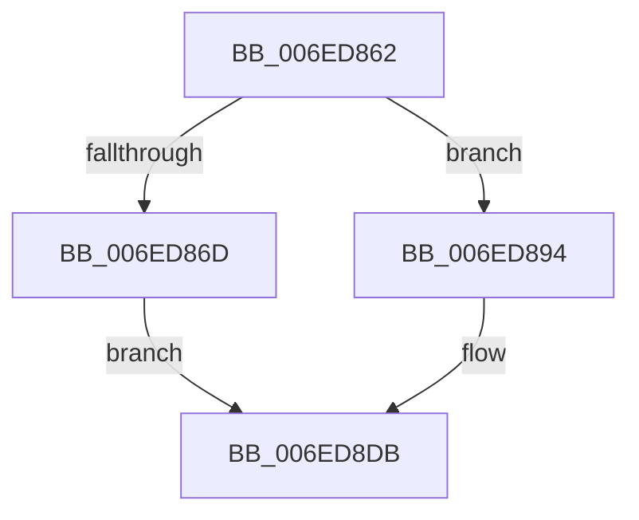

# sub_006ED862

- RVA: `0x006ED862`–`0x006ED8E5` (길이 `131` bytes)
- VA: `0x00000001406ED862`
- 실행 섹션: `.text`
- PDB 이름 있음: `아니요`; PDB Function 태그: `아니요`
- unwind 정보 RVA: `0x0009FAA0`
- 디코드: `40`개 명령, `131/131` bytes 표시
- 미해석 바이트: `0` (있으면 어셈블리에 `.byte`로 보존)

> 이 문서는 커널 이미지의 기계어와 PDB 기호를 분석해 생성했습니다. 4번과 5번은 함수 원형과 자료형을 바이너리 사용 방식에서 추정한 C 해석이며 원본 소스 복구 결과는 아닙니다.

## 1. Dependencies

- 직접 호출 지점: **0**; 고유 호출 대상: **0**
- 직접 호출자로 확인된 함수: **0**
- RIP 상대 이미지 참조: **0**

### Outgoing calls
- 직접 디코드된 call 명령이 없습니다.

### Direct callers
- 이 함수 시작 RVA로 연결되는 직접 call은 확인되지 않았습니다. 간접 호출은 완전히 역산할 수 없습니다.

### Static image references
- 디코드된 RIP-relative 메모리 참조가 없습니다.

## 2. Other-region calls and transfers

- 다른 실행 섹션으로 향하는 call: **0**
- call이 아닌 외부 분기/꼬리 이동: **1**
  - `0x006ED8E0` → [sub_0041DF44 + 0x6F](../41/Unknown_function_0041DF44.md) (`tail-transfer`)

## 3. Assembly (complete function range)

```asm
006ED862  4D 8B 31                        mov r14, qword ptr [r9]
006ED865  4D 8B 3B                        mov r15, qword ptr [r11]
006ED868  48 3B DD                        cmp rbx, rbp
006ED86B  77 27                           ja 0x1406ed894
006ED86D  48 8B CB                        mov rcx, rbx
006ED870  49 D3 E2                        shl r10, cl
006ED873  48 8B CF                        mov rcx, rdi
006ED876  49 8D 52 FF                     lea rdx, [r10 - 1]
006ED87A  48 8B C2                        mov rax, rdx
006ED87D  49 23 D6                        and rdx, r14
006ED880  48 D3 E0                        shl rax, cl
006ED883  48 F7 D0                        not rax
006ED886  48 D3 E2                        shl rdx, cl
006ED889  49 23 C7                        and rax, r15
006ED88C  48 0B C2                        or rax, rdx
006ED88F  49 89 03                        mov qword ptr [r11], rax
006ED892  EB 47                           jmp 0x1406ed8db
006ED894  48 8B CF                        mov rcx, rdi
006ED897  48 8D 56 FF                     lea rdx, [rsi - 1]
006ED89B  49 23 D6                        and rdx, r14
006ED89E  49 8D 40 FF                     lea rax, [r8 - 1]
006ED8A2  48 D3 E2                        shl rdx, cl
006ED8A5  49 23 C7                        and rax, r15
006ED8A8  48 0B D0                        or rdx, rax
006ED8AB  40 02 FB                        add dil, bl
006ED8AE  49 89 13                        mov qword ptr [r11], rdx
006ED8B1  8D 8F C0 00 00 00               lea ecx, [rdi + 0xc0]
006ED8B7  49 D3 E2                        shl r10, cl
006ED8BA  48 8B CD                        mov rcx, rbp
006ED8BD  49 8D 52 FF                     lea rdx, [r10 - 1]
006ED8C1  48 8B C2                        mov rax, rdx
006ED8C4  48 F7 D2                        not rdx
006ED8C7  49 23 53 08                     and rdx, qword ptr [r11 + 8]
006ED8CB  48 D3 E0                        shl rax, cl
006ED8CE  49 23 01                        and rax, qword ptr [r9]
006ED8D1  48 D3 E8                        shr rax, cl
006ED8D4  48 0B D0                        or rdx, rax
006ED8D7  49 89 53 08                     mov qword ptr [r11 + 8], rdx
006ED8DB  4C 8B 7C 24 20                  mov r15, qword ptr [rsp + 0x20]
006ED8E0  E9 CE 06 D3 FF                  jmp 0x14041dfb3
```

## 4. C-style interpretation (structured pseudocode)

```c
__int64 __fastcall sub_006ED862(__int64 a1, __int64 a2, __int64 a3, __int64 a4)
{
    __int64 result;
    __int64 v_r10;
    __int64 v_rdi;
    unsigned __int64 v_stack_p20;

    if (v_rbx > v_rbp) goto loc_006ED894;
    v_r10 = (v_r10) << ((unsigned __int8)(v_rbx));
    a2 = (v_r10 - 1) & (*(unsigned __int64 *)(a4));
    result = (v_r10 - 1) << ((unsigned __int8)(v_rdi));
    result = ~(result);
    a2 = (a2) << ((unsigned __int8)(v_rdi));
    result = (result) & (*(unsigned __int64 *)(v_r11));
    result = (result) | (a2);
    *(unsigned __int64 *)(v_r11) = result;
    goto loc_006ED8DB;
loc_006ED894:
    a2 = (v_rsi - 1) & (*(unsigned __int64 *)(a4));
    a2 = (a2) << ((unsigned __int8)(v_rdi));
    result = (a3 - 1) & (*(unsigned __int64 *)(v_r11));
    a2 = (a2) | (result);
    v_rdi = (unsigned __int8)((v_rdi) + ((unsigned __int8)(v_rbx)));
    *(unsigned __int64 *)(v_r11) = a2;
    v_r10 = (v_r10) << ((unsigned __int8)(v_rdi + 192));
    a2 = ~(v_r10 - 1);
    a2 = (a2) & (*(unsigned __int64 *)(v_r11 + 8));
    result = (v_r10 - 1) << ((unsigned __int8)(v_rbp));
    result = (result) & (*(unsigned __int64 *)(a4));
    result = (result) >> ((unsigned __int8)(v_rbp));
    a2 = (a2) | (result);
    *(unsigned __int64 *)(v_r11 + 8) = a2;
loc_006ED8DB:
}
```

## 5. (Beta) C Style

```c
int64_t sub_006ED862(int64_t Arg1, int64_t Arg2, void *Arg3, void *Arg4)
{
    uint8_t *arg3 = (uint8_t *)Arg3;
    uint8_t *arg4 = (uint8_t *)Arg4;

    int64_t result;
    int64_t local_r10;
    int64_t local_rdi;
    uint64_t v_stack_p20;

    if (local_rbx > local_rbp) goto loc_006ED894;
    local_r10 = (local_r10) << ((uint8_t)(local_rbx));
    Arg2 = (local_r10 - 1) & (*(uint64_t *)(arg4));
    result = (local_r10 - 1) << ((uint8_t)(local_rdi));
    result = ~(result);
    Arg2 = (Arg2) << ((uint8_t)(local_rdi));
    result = (result) & (*(uint64_t *)(local_r11));
    result = (result) | (Arg2);
    *(uint64_t *)(local_r11) = result;
    goto loc_006ED8DB;
loc_006ED894:
    Arg2 = (local_rsi - 1) & (*(uint64_t *)(arg4));
    Arg2 = (Arg2) << ((uint8_t)(local_rdi));
    result = (Arg3 - 1) & (*(uint64_t *)(local_r11));
    Arg2 = (Arg2) | (result);
    local_rdi = (uint8_t)((local_rdi) + ((uint8_t)(local_rbx)));
    *(uint64_t *)(local_r11) = Arg2;
    local_r10 = (local_r10) << ((uint8_t)(local_rdi + 192));
    Arg2 = ~(local_r10 - 1);
    Arg2 = (Arg2) & (*(uint64_t *)(local_r11 + 0x8));
    result = (local_r10 - 1) << ((uint8_t)(local_rbp));
    result = (result) & (*(uint64_t *)(arg4));
    result = (result) >> ((uint8_t)(local_rbp));
    Arg2 = (Arg2) | (result);
    *(uint64_t *)(local_r11 + 0x8) = Arg2;
loc_006ED8DB:
}
```

### 관측된 메모리 오프셋

구조체 형식이 확인되지 않은 접근은 인자 기준의 오프셋으로만 기록했습니다.

| 기준 인자 | 오프셋 표현 | 폭 (bit) | 접근 |
|---|---:|---:|---|
| `Arg3` | `- 0x1` | `64` | `R` |
| `Arg4` | `+ 0x0` | `64` | `R` |

## 6. Execution-region graph

[열기: 2D/3D 그래프와 함수 탐색 컨트롤 패널](../../../control-panel.html?section=text&rva=0x006ED862&view=graph)

- 2D 그래프는 위에서 아래로 흐르고, 3D 그래프는 빈 공간을 드래그해 회전합니다. Shift+드래그는 이동, 휠은 확대·축소, 함수 노드 선택은 대상 보고서 이동입니다.

### Static fallback


