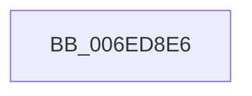

# sub_006ED8E6

- RVA: `0x006ED8E6`–`0x006ED93C` (길이 `86` bytes)
- VA: `0x00000001406ED8E6`
- 실행 섹션: `.text`
- PDB 이름 있음: `아니요`; PDB Function 태그: `아니요`
- unwind 정보 RVA: `0x0009FBCC`
- 디코드: `18`개 명령, `86/86` bytes 표시
- 미해석 바이트: `0` (있으면 어셈블리에 `.byte`로 보존)

> 이 문서는 커널 이미지의 기계어와 PDB 기호를 분석해 생성했습니다. 4번과 5번은 함수 원형과 자료형을 바이너리 사용 방식에서 추정한 C 해석이며 원본 소스 복구 결과는 아닙니다.

## 1. Dependencies

- 직접 호출 지점: **2**; 고유 호출 대상: **2**
- 직접 호출자로 확인된 함수: **0**
- RIP 상대 이미지 참조: **0**

### Outgoing calls
- `0x006ED8F5` → [memset](../6C/memset_function_006C6C40.md) (function, `0x006C6C40`)
- `0x006ED931` → [DbgkQueueUserExceptionReport](../../page/71/DbgkQueueUserExceptionReport_function_00710B04.md) (function, `0x00710B04`)

### Direct callers
- 이 함수 시작 RVA로 연결되는 직접 call은 확인되지 않았습니다. 간접 호출은 완전히 역산할 수 없습니다.

### Static image references
- 디코드된 RIP-relative 메모리 참조가 없습니다.

## 2. Other-region calls and transfers

- 다른 실행 섹션으로 향하는 call: **1**
  - `0x006ED931` → [DbgkQueueUserExceptionReport](../../page/71/DbgkQueueUserExceptionReport_function_00710B04.md) (`.text` → `PAGE`)
- call이 아닌 외부 분기/꼬리 이동: **1**
  - `0x006ED937` → [SepLogLpacAccessFailure + 0x68](../41/SepLogLpacAccessFailure_function_0041E8A0.md) (`tail-transfer`)

## 3. Assembly (complete function range)

```asm
006ED8E6  8B 5D 67                        mov ebx, dword ptr [rbp + 0x67]
006ED8E9  33 D2                           xor edx, edx
006ED8EB  48 8D 4D B7                     lea rcx, [rbp - 0x49]
006ED8EF  41 B8 98 00 00 00               mov r8d, 0x98
006ED8F5  E8 46 93 FD FF                  call 0x1406c6c40
006ED8FA  83 65 BB 00                     and dword ptr [rbp - 0x45], 0
006ED8FE  4C 8D 45 B7                     lea r8, [rbp - 0x49]
006ED902  48 83 65 C7 00                  and qword ptr [rbp - 0x39], 0
006ED907  BA 1E 00 00 00                  mov edx, 0x1e
006ED90C  65 48 8B 0C 25 88 01 00 00      mov rcx, qword ptr gs:[0x188]
006ED915  8B C3                           mov eax, ebx
006ED917  48 89 45 DF                     mov qword ptr [rbp - 0x21], rax
006ED91B  C7 45 B7 09 04 00 C0            mov dword ptr [rbp - 0x49], 0xc0000409
006ED922  C7 45 CF 02 00 00 00            mov dword ptr [rbp - 0x31], 2
006ED929  48 C7 45 D7 2B 00 00 00         mov qword ptr [rbp - 0x29], 0x2b
006ED931  E8 CE 31 02 00                  call 0x140710b04
006ED936  90                              nop
006ED937  E9 CC 0F D3 FF                  jmp 0x14041e908
```

## 4. C-style interpretation (structured pseudocode)

```c
__int64 __fastcall sub_006ED8E6(__int64 a1, int a2)
{
    __int64 result;

    a2 = 0;
    result = memset(v_rbp - 73, a2, 152, a4);
    *(unsigned __int64 *)(v_rbp - 33) = (unsigned int)((unsigned int)((unsigned int)(*(unsigned int *)(v_rbp + 103))));
    *(unsigned int *)(v_rbp - 73) = 0xC0000409ULL;
    *(unsigned int *)(v_rbp - 49) = 2;
    *(unsigned __int64 *)(v_rbp - 41) = 43;
    result = DbgkQueueUserExceptionReport(*(unsigned __int64 *)(gs_base + (0 + 392)), 30, v_rbp - 73, a4);
}
```

## 5. (Beta) C Style

```c
int64_t sub_006ED8E6(int64_t Arg1, int32_t Arg2)
{
    int64_t result;

    Arg2 = 0;
    result = memset(local_rbp - 73, Arg2, 152, a4);
    *(uint64_t *)(local_rbp - 0x21) = (uint32_t)((uint32_t)((uint32_t)(*(uint32_t *)(local_rbp + 0x67))));
    *(uint32_t *)(local_rbp - 0x49) = 0xC0000409ULL;
    *(uint32_t *)(local_rbp - 0x31) = 2;
    *(uint64_t *)(local_rbp - 0x29) = 43;
    result = DbgkQueueUserExceptionReport(*(uint64_t *)(gs_base + (0 + 0x188)), 30, local_rbp - 73, a4);
}
```

## 6. Execution-region graph

[열기: 2D/3D 그래프와 함수 탐색 컨트롤 패널](../../../control-panel.html?section=text&rva=0x006ED8E6&view=graph)

- 2D 그래프는 위에서 아래로 흐르고, 3D 그래프는 빈 공간을 드래그해 회전합니다. Shift+드래그는 이동, 휠은 확대·축소, 함수 노드 선택은 대상 보고서 이동입니다.

### Static fallback


