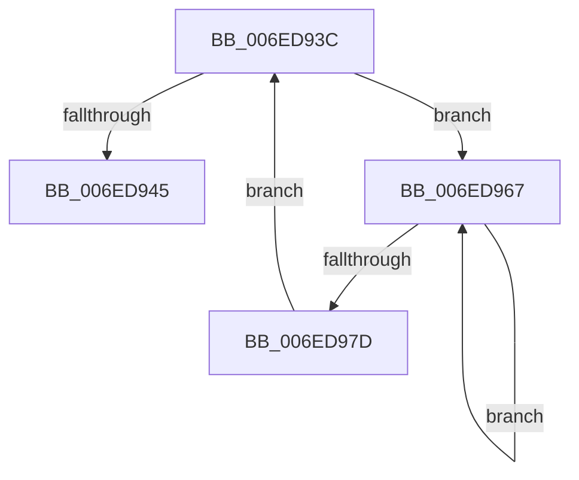

# sub_006ED93C

- RVA: `0x006ED93C`–`0x006ED97F` (길이 `67` bytes)
- VA: `0x00000001406ED93C`
- 실행 섹션: `.text`
- PDB 이름 있음: `아니요`; PDB Function 태그: `아니요`
- unwind 정보 RVA: `0x0009FDCC`
- 디코드: `15`개 명령, `67/67` bytes 표시
- 미해석 바이트: `0` (있으면 어셈블리에 `.byte`로 보존)

> 이 문서는 커널 이미지의 기계어와 PDB 기호를 분석해 생성했습니다. 4번과 5번은 함수 원형과 자료형을 바이너리 사용 방식에서 추정한 C 해석이며 원본 소스 복구 결과는 아닙니다.

## 1. Dependencies

- 직접 호출 지점: **2**; 고유 호출 대상: **2**
- 직접 호출자로 확인된 함수: **0**
- RIP 상대 이미지 참조: **0**

### Outgoing calls
- `0x006ED94B` → [MiReduceShareCount](../37/MiReduceShareCount_function_00370E90.md) (function, `0x00370E90`)
- `0x006ED96F` → [KeYieldProcessorEx](../3F/KeYieldProcessorEx_function_003FBD00.md) (function, `0x003FBD00`)

### Direct callers
- 이 함수 시작 RVA로 연결되는 직접 call은 확인되지 않았습니다. 간접 호출은 완전히 역산할 수 없습니다.

### Static image references
- 디코드된 RIP-relative 메모리 참조가 없습니다.

## 2. Other-region calls and transfers

- 다른 실행 섹션으로 향하는 call: **0**
- call이 아닌 외부 분기/꼬리 이동: **1**
  - `0x006ED962` → [MiDecommitFreePagesTail + 0x229](../41/MiDecommitFreePagesTail_function_0041ECE0.md) (`tail-transfer`)

## 3. Assembly (complete function range)

```asm
006ED93C  F0 48 0F BA 6F 18 3F            lock bts qword ptr [rdi + 0x18], 0x3f
006ED943  72 22                           jb 0x1406ed967
006ED945  41 8B D7                        mov edx, r15d
006ED948  48 8B CF                        mov rcx, rdi
006ED94B  E8 40 35 C8 FF                  call 0x140370e90
006ED950  48 B8 FF FF FF FF FF FF FF 7F   movabs rax, 0x7fffffffffffffff
006ED95A  F0 48 21 47 18                  lock and qword ptr [rdi + 0x18], rax
006ED95F  45 33 FF                        xor r15d, r15d
006ED962  E9 A2 15 D3 FF                  jmp 0x14041ef09
006ED967  48 8D 8C 24 A0 00 00 00         lea rcx, [rsp + 0xa0]
006ED96F  E8 8C E3 D0 FF                  call 0x1403fbd00
006ED974  48 8B 47 18                     mov rax, qword ptr [rdi + 0x18]
006ED978  48 85 C0                        test rax, rax
006ED97B  78 EA                           js 0x1406ed967
006ED97D  EB BD                           jmp 0x1406ed93c
```

## 4. C-style interpretation (structured pseudocode)

```c
__int64 __fastcall sub_006ED93C(__int64 a1, __int64 a2, __int64 a3, __int64 a4, __int64 a5, __int64 a6, __int64 a7, __int64 a8, __int64 a9, __int64 a10, __int64 a11, __int64 a12, __int64 a13, __int64 a14, __int64 a15, __int64 a16, __int64 a17, __int64 a18, __int64 a19, __int64 a20)
{
    __int64 result;
    __int64 v_r15;

    if (condition_is_below) goto loc_006ED967;
    result = MiReduceShareCount(v_rdi, (unsigned int)((unsigned int)(v_r15)), a3, a4);
    v_r15 = 0;
loc_006ED967:
    result = KeYieldProcessorEx(a20, (unsigned int)((unsigned int)(v_r15)), a3, a4);
    if (sign_flag) goto loc_006ED967;
    goto loc_006ED93C;
}
```

## 5. (Beta) C Style

```c
int64_t sub_006ED93C(int64_t Arg1, int64_t Arg2, int64_t Arg3, int64_t Arg4, uint64_t Arg5, uint64_t Arg6, uint64_t Arg7, uint64_t Arg8, uint64_t Arg9, uint64_t Arg10, uint64_t Arg11, uint64_t Arg12, uint64_t Arg13, uint64_t Arg14, uint64_t Arg15, uint64_t Arg16, uint64_t Arg17, uint64_t Arg18, uint64_t Arg19, int64_t Arg20)
{
    int64_t result;
    int64_t local_r15;

    if (condition_is_below) goto loc_006ED967;
    result = MiReduceShareCount(local_rdi, (uint32_t)((uint32_t)(local_r15)), Arg3, Arg4);
    local_r15 = 0;
loc_006ED967:
    result = KeYieldProcessorEx(Arg20, (uint32_t)((uint32_t)(local_r15)), Arg3, Arg4);
    if (sign_flag) goto loc_006ED967;
    goto loc_006ED93C;
}
```

## 6. Execution-region graph

[열기: 2D/3D 그래프와 함수 탐색 컨트롤 패널](../../../control-panel.html?section=text&rva=0x006ED93C&view=graph)

- 2D 그래프는 위에서 아래로 흐르고, 3D 그래프는 빈 공간을 드래그해 회전합니다. Shift+드래그는 이동, 휠은 확대·축소, 함수 노드 선택은 대상 보고서 이동입니다.

### Static fallback


