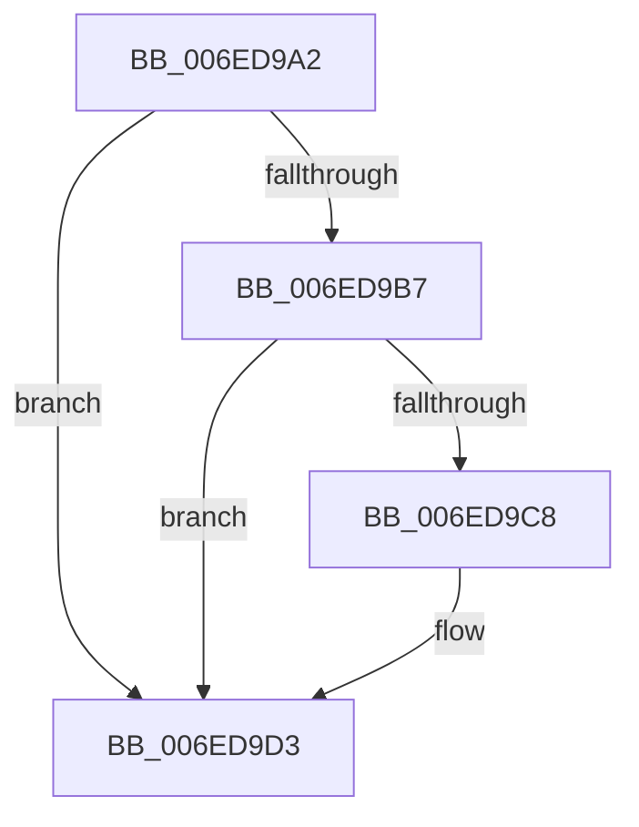

# sub_006ED9A2

- RVA: `0x006ED9A2`–`0x006ED9D8` (길이 `54` bytes)
- VA: `0x00000001406ED9A2`
- 실행 섹션: `.text`
- PDB 이름 있음: `아니요`; PDB Function 태그: `아니요`
- unwind 정보 RVA: `0x0009FECC`
- 디코드: `16`개 명령, `54/54` bytes 표시
- 미해석 바이트: `0` (있으면 어셈블리에 `.byte`로 보존)

> 이 문서는 커널 이미지의 기계어와 PDB 기호를 분석해 생성했습니다. 4번과 5번은 함수 원형과 자료형을 바이너리 사용 방식에서 추정한 C 해석이며 원본 소스 복구 결과는 아닙니다.

## 1. Dependencies

- 직접 호출 지점: **3**; 고유 호출 대상: **3**
- 직접 호출자로 확인된 함수: **0**
- RIP 상대 이미지 참조: **0**

### Outgoing calls
- `0x006ED9AA` → [RtlStdLogStackTrace](../49/RtlStdLogStackTrace_function_00495BF8.md) (function, `0x00495BF8`)
- `0x006ED9BD` → [RtlpStdGetRecordedStackTraceIndex](../49/RtlpStdGetRecordedStackTraceIndex_function_00495C84.md) (function, `0x00495C84`)
- `0x006ED9CE` → [RtlStdReleaseStackTrace](../49/RtlStdReleaseStackTrace_function_00495D58.md) (function, `0x00495D58`)

### Direct callers
- 이 함수 시작 RVA로 연결되는 직접 call은 확인되지 않았습니다. 간접 호출은 완전히 역산할 수 없습니다.

### Static image references
- 디코드된 RIP-relative 메모리 참조가 없습니다.

## 2. Other-region calls and transfers

- 다른 실행 섹션으로 향하는 call: **0**
- 별도 외부 분기/꼬리 이동을 확인하지 못했습니다.

## 3. Assembly (complete function range)

```asm
006ED9A2  48 89 6C 24 30                  mov qword ptr [rsp + 0x30], rbp
006ED9A7  48 8B CE                        mov rcx, rsi
006ED9AA  E8 49 82 DA FF                  call 0x140495bf8
006ED9AF  48 8B E8                        mov rbp, rax
006ED9B2  48 85 C0                        test rax, rax
006ED9B5  74 1C                           je 0x1406ed9d3
006ED9B7  48 8B D0                        mov rdx, rax
006ED9BA  48 8B CE                        mov rcx, rsi
006ED9BD  E8 C2 82 DA FF                  call 0x140495c84
006ED9C2  8B F8                           mov edi, eax
006ED9C4  85 C0                           test eax, eax
006ED9C6  75 0B                           jne 0x1406ed9d3
006ED9C8  48 8B D5                        mov rdx, rbp
006ED9CB  48 8B CE                        mov rcx, rsi
006ED9CE  E8 85 83 DA FF                  call 0x140495d58
006ED9D3  48 8B 6C 24 30                  mov rbp, qword ptr [rsp + 0x30]
```

## 4. C-style interpretation (structured pseudocode)

```c
__int64 __fastcall sub_006ED9A2(__int64 a1, __int64 a2, __int64 a3, __int64 a4, __int64 a5, __int64 a6)
{
    __int64 result;
    unsigned __int64 v_stack_p30;

    v_stack_p30 = v_rbp;
    result = RtlStdLogStackTrace(v_rsi, a2, a3, a4);
    if (result == 0) goto loc_006ED9D3;
    result = RtlpStdGetRecordedStackTraceIndex(v_rsi, result, a3, a4);
    if ((unsigned int)(result) == 0) {
        a2 = result;
        a1 = v_rsi;
        result = RtlStdReleaseStackTrace(a1, a2, a3, a4);
    }
    return result;
}
```

## 5. (Beta) C Style

```c
int64_t sub_006ED9A2(int64_t Arg1, int64_t Arg2, int64_t Arg3, int64_t Arg4, uint64_t Arg5, int64_t Arg6)
{
    int64_t result;
    uint64_t v_stack_p30;

    v_stack_p30 = local_rbp;
    result = RtlStdLogStackTrace(local_rsi, Arg2, Arg3, Arg4);
    if (result == 0) goto loc_006ED9D3;
    result = RtlpStdGetRecordedStackTraceIndex(local_rsi, result, Arg3, Arg4);
    if ((uint32_t)(result) == 0) {
        Arg2 = result;
        Arg1 = local_rsi;
        result = RtlStdReleaseStackTrace(Arg1, Arg2, Arg3, Arg4);
    }
    return result;
}
```

## 6. Execution-region graph

[열기: 2D/3D 그래프와 함수 탐색 컨트롤 패널](../../../control-panel.html?section=text&rva=0x006ED9A2&view=graph)

- 2D 그래프는 위에서 아래로 흐르고, 3D 그래프는 빈 공간을 드래그해 회전합니다. Shift+드래그는 이동, 휠은 확대·축소, 함수 노드 선택은 대상 보고서 이동입니다.

### Static fallback


