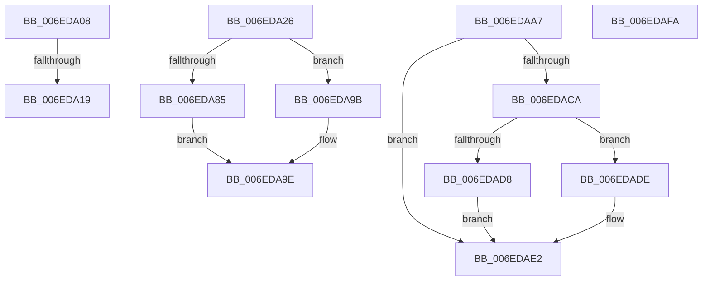

# sub_006EDA08

- RVA: `0x006EDA08`–`0x006EDB05` (길이 `253` bytes)
- VA: `0x00000001406EDA08`
- 실행 섹션: `.text`
- PDB 이름 있음: `아니요`; PDB Function 태그: `아니요`
- unwind 정보 RVA: `0x000A0110`
- 디코드: `66`개 명령, `253/253` bytes 표시
- 미해석 바이트: `0` (있으면 어셈블리에 `.byte`로 보존)

> 이 문서는 커널 이미지의 기계어와 PDB 기호를 분석해 생성했습니다. 4번과 5번은 함수 원형과 자료형을 바이너리 사용 방식에서 추정한 C 해석이며 원본 소스 복구 결과는 아닙니다.

## 1. Dependencies

- 직접 호출 지점: **3**; 고유 호출 대상: **3**
- 직접 호출자로 확인된 함수: **0**
- RIP 상대 이미지 참조: **0**

### Outgoing calls
- `0x006EDA48` → [ST_STORE<SM_TRAITS>::StDmCompletePendingReads](../60/ST_STORE_SM_TRAITS_StDmCompletePendingReads_function_0060D174.md) (function, `0x0060D174`)
- `0x006EDA94` → [memcpy](../6C/memcpy_function_006C6840.md) (function, `0x006C6840`)
- `0x006EDAE8` → [ST_STORE<SM_TRAITS>::StDmDeviceIoCompletion](../4B/ST_STORE_SM_TRAITS_StDmDeviceIoCompletion_function_004BBB70.md) (function, `0x004BBB70`)

### Direct callers
- 이 함수 시작 RVA로 연결되는 직접 call은 확인되지 않았습니다. 간접 호출은 완전히 역산할 수 없습니다.

### Static image references
- 디코드된 RIP-relative 메모리 참조가 없습니다.

## 2. Other-region calls and transfers

- 다른 실행 섹션으로 향하는 call: **0**
- call이 아닌 외부 분기/꼬리 이동: **5**
  - `0x006EDA13` → [ST_STORE<SM_TRAITS>::StDmPageRetrieve + 0x176](../41/ST_STORE_SM_TRAITS_StDmPageRetrieve_function_0041FE20.md) (`tail-transfer`)
  - `0x006EDA21` → [ST_STORE<SM_TRAITS>::StDmPageRetrieve + 0x1B2](../41/ST_STORE_SM_TRAITS_StDmPageRetrieve_function_0041FE20.md) (`tail-transfer`)
  - `0x006EDAA2` → [ST_STORE<SM_TRAITS>::StDmPageRetrieve + 0x1C2](../41/ST_STORE_SM_TRAITS_StDmPageRetrieve_function_0041FE20.md) (`tail-transfer`)
  - `0x006EDAF5` → [ST_STORE<SM_TRAITS>::StDmPageRetrieve + 0x308](../41/ST_STORE_SM_TRAITS_StDmPageRetrieve_function_0041FE20.md) (`tail-transfer`)
  - `0x006EDB00` → [ST_STORE<SM_TRAITS>::StDmPageRetrieve + 0x1F7](../41/ST_STORE_SM_TRAITS_StDmPageRetrieve_function_0041FE20.md) (`tail-transfer`)

## 3. Assembly (complete function range)

```asm
006EDA08  48 8B 45 C0                     mov rax, qword ptr [rbp - 0x40]
006EDA0C  48 83 C6 18                     add rsi, 0x18
006EDA10  48 3B F0                        cmp rsi, rax
006EDA13  0F 85 7D 25 D3 FF               jne 0x14041ff96
006EDA19  44 8B 65 48                     mov r12d, dword ptr [rbp + 0x48]
006EDA1D  4C 8B 55 B8                     mov r10, qword ptr [rbp - 0x48]
006EDA21  E9 AC 25 D3 FF                  jmp 0x14041ffd2
006EDA26  83 CB 01                        or ebx, 1
006EDA29  8B C3                           mov eax, ebx
006EDA2B  48 8D 4D 60                     lea rcx, [rbp + 0x60]
006EDA2F  48 89 4C 24 28                  mov qword ptr [rsp + 0x28], rcx
006EDA34  48 8D 56 E8                     lea rdx, [rsi - 0x18]
006EDA38  83 E0 01                        and eax, 1
006EDA3B  49 8B CA                        mov rcx, r10
006EDA3E  4D 8B CF                        mov r9, r15
006EDA41  89 44 24 20                     mov dword ptr [rsp + 0x20], eax
006EDA45  4D 8B C5                        mov r8, r13
006EDA48  E8 27 F7 F1 FF                  call 0x14060d174
006EDA4D  85 C0                           test eax, eax
006EDA4F  48 8B D6                        mov rdx, rsi
006EDA52  44 0F 48 E0                     cmovs r12d, eax
006EDA56  49 2B D6                        sub rdx, r14
006EDA59  48 C1 FA 03                     sar rdx, 3
006EDA5D  48 B8 AB AA AA AA AA AA AA AA   movabs rax, 0xaaaaaaaaaaaaaaab
006EDA67  48 0F AF D0                     imul rdx, rax
006EDA6B  8B 45 60                        mov eax, dword ptr [rbp + 0x60]
006EDA6E  44 89 65 48                     mov dword ptr [rbp + 0x48], r12d
006EDA72  48 8D 0C 40                     lea rcx, [rax + rax*2]
006EDA76  48 8D 0C CD 00 00 00 00         lea rcx, [rcx*8]
006EDA7E  48 2B F1                        sub rsi, rcx
006EDA81  2B D0                           sub edx, eax
006EDA83  74 16                           je 0x1406eda9b
006EDA85  4C 8D 04 52                     lea r8, [rdx + rdx*2]
006EDA89  4A 8D 14 31                     lea rdx, [rcx + r14]
006EDA8D  49 C1 E0 03                     shl r8, 3
006EDA91  49 8B CE                        mov rcx, r14
006EDA94  E8 A7 8D FD FF                  call 0x1406c6840
006EDA99  EB 03                           jmp 0x1406eda9e
006EDA9B  83 E3 FD                        and ebx, 0xfffffffd
006EDA9E  4C 8B 55 B8                     mov r10, qword ptr [rbp - 0x48]
006EDAA2  E9 3B 25 D3 FF                  jmp 0x14041ffe2
006EDAA7  48 8B 0A                        mov rcx, qword ptr [rdx]
006EDAAA  48 8B C1                        mov rax, rcx
006EDAAD  83 E1 07                        and ecx, 7
006EDAB0  48 C1 E8 03                     shr rax, 3
006EDAB4  48 8D 04 C5 F8 FF FF FF         lea rax, [rax*8 - 8]
006EDABC  48 0B C1                        or rax, rcx
006EDABF  48 89 02                        mov qword ptr [rdx], rax
006EDAC2  41 8B 40 1C                     mov eax, dword ptr [r8 + 0x1c]
006EDAC6  A8 01                           test al, 1
006EDAC8  75 18                           jne 0x1406edae2
006EDACA  41 83 48 1C 01                  or dword ptr [r8 + 0x1c], 1
006EDACF  49 8B 40 10                     mov rax, qword ptr [r8 + 0x10]
006EDAD3  48 85 C0                        test rax, rax
006EDAD6  74 06                           je 0x1406edade
006EDAD8  44 89 60 04                     mov dword ptr [rax + 4], r12d
006EDADC  EB 04                           jmp 0x1406edae2
006EDADE  45 89 60 08                     mov dword ptr [r8 + 8], r12d
006EDAE2  49 8B D0                        mov rdx, r8
006EDAE5  49 8B CA                        mov rcx, r10
006EDAE8  E8 83 E0 DC FF                  call 0x1404bbb70
006EDAED  48 8B 55 D0                     mov rdx, qword ptr [rbp - 0x30]
006EDAF1  4C 8B 55 B8                     mov r10, qword ptr [rbp - 0x48]
006EDAF5  E9 2E 26 D3 FF                  jmp 0x140420128
006EDAFA  41 BC 03 01 00 00               mov r12d, 0x103
006EDB00  E9 12 25 D3 FF                  jmp 0x140420017
```

## 4. C-style interpretation (structured pseudocode)

```c
__int64 __fastcall sub_006EDA08(void)
{
    __int64 v_rsi;
    unsigned int v_stack_p20;
    unsigned __int64 v_stack_p28;

    v_rsi = (v_rsi) + (24);
}
```

## 5. (Beta) C Style

```c
void sub_006EDA08(void)
{
    int64_t local_rsi;
    uint32_t v_stack_p20;
    uint64_t v_stack_p28;

    local_rsi = (local_rsi) + (24);
}
```

## 6. Execution-region graph

[열기: 2D/3D 그래프와 함수 탐색 컨트롤 패널](../../../control-panel.html?section=text&rva=0x006EDA08&view=graph)

- 2D 그래프는 위에서 아래로 흐르고, 3D 그래프는 빈 공간을 드래그해 회전합니다. Shift+드래그는 이동, 휠은 확대·축소, 함수 노드 선택은 대상 보고서 이동입니다.

### Static fallback


