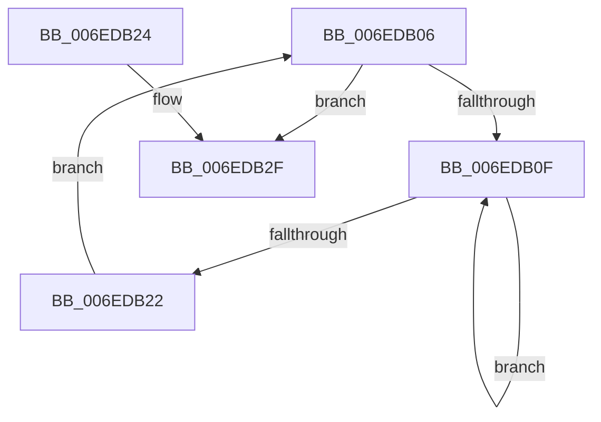

# sub_006EDB06

- RVA: `0x006EDB06`–`0x006EDB4A` (길이 `68` bytes)
- VA: `0x00000001406EDB06`
- 실행 섹션: `.text`
- PDB 이름 있음: `아니요`; PDB Function 태그: `아니요`
- unwind 정보 RVA: `0x000A01CC`
- 디코드: `19`개 명령, `68/68` bytes 표시
- 미해석 바이트: `0` (있으면 어셈블리에 `.byte`로 보존)

> 이 문서는 커널 이미지의 기계어와 PDB 기호를 분석해 생성했습니다. 4번과 5번은 함수 원형과 자료형을 바이너리 사용 방식에서 추정한 C 해석이며 원본 소스 복구 결과는 아닙니다.

## 1. Dependencies

- 직접 호출 지점: **4**; 고유 호출 대상: **4**
- 직접 호출자로 확인된 함수: **0**
- RIP 상대 이미지 참조: **0**

### Outgoing calls
- `0x006EDB14` → [KeYieldProcessorEx](../3F/KeYieldProcessorEx_function_003FBD00.md) (function, `0x003FBD00`)
- `0x006EDB27` → [MiLockPageInline](../31/MiLockPageInline_function_0031A340.md) (function, `0x0031A340`)
- `0x006EDB34` → [MiSetFreeZeroPfnCold](../37/MiSetFreeZeroPfnCold_function_00379428.md) (function, `0x00379428`)
- `0x006EDB3F` → [MiUnlockPage](../31/MiUnlockPage_function_0031A3E0.md) (function, `0x0031A3E0`)

### Direct callers
- 이 함수 시작 RVA로 연결되는 직접 call은 확인되지 않았습니다. 간접 호출은 완전히 역산할 수 없습니다.

### Static image references
- 디코드된 RIP-relative 메모리 참조가 없습니다.

## 2. Other-region calls and transfers

- 다른 실행 섹션으로 향하는 call: **0**
- call이 아닌 외부 분기/꼬리 이동: **1**
  - `0x006EDB45` → [MiLargeFreePageToMdl + 0x67](../42/MiLargeFreePageToMdl_function_00420880.md) (`tail-transfer`)

## 3. Assembly (complete function range)

```asm
006EDB06  F0 48 0F BA 6B 18 3F            lock bts qword ptr [rbx + 0x18], 0x3f
006EDB0D  73 20                           jae 0x1406edb2f
006EDB0F  48 8D 4C 24 48                  lea rcx, [rsp + 0x48]
006EDB14  E8 E7 E1 D0 FF                  call 0x1403fbd00
006EDB19  48 8B 43 18                     mov rax, qword ptr [rbx + 0x18]
006EDB1D  48 85 C0                        test rax, rax
006EDB20  78 ED                           js 0x1406edb0f
006EDB22  EB E2                           jmp 0x1406edb06
006EDB24  48 8B CB                        mov rcx, rbx
006EDB27  E8 14 C8 C2 FF                  call 0x14031a340
006EDB2C  44 8A F0                        mov r14b, al
006EDB2F  33 D2                           xor edx, edx
006EDB31  48 8B CB                        mov rcx, rbx
006EDB34  E8 EF B8 C8 FF                  call 0x140379428
006EDB39  41 8A D6                        mov dl, r14b
006EDB3C  48 8B CB                        mov rcx, rbx
006EDB3F  E8 9C C8 C2 FF                  call 0x14031a3e0
006EDB44  90                              nop
006EDB45  E9 9D 2D D3 FF                  jmp 0x1404208e7
```

## 4. C-style interpretation (structured pseudocode)

```c
__int64 __fastcall sub_006EDB06(__int64 a1, int a2, __int64 a3, __int64 a4, __int64 a5, __int64 a6, __int64 a7, __int64 a8, __int64 a9)
{
    __int64 result;

    if (condition_is_above_or_equal) goto loc_006EDB2F;
loc_006EDB0F:
    result = KeYieldProcessorEx(a9, a2, a3, a4);
    if (sign_flag) goto loc_006EDB0F;
    goto loc_006EDB06;
loc_006EDB2F:
    a2 = 0;
    result = MiSetFreeZeroPfnCold(v_rbx, a2, a3, a4);
    result = MiUnlockPage(v_rbx, (unsigned __int8)(v_r14), a3, a4);
}
```

## 5. (Beta) C Style

```c
int64_t sub_006EDB06(int64_t Arg1, int32_t Arg2, int64_t Arg3, int64_t Arg4, uint64_t Arg5, uint64_t Arg6, uint64_t Arg7, uint64_t Arg8, int64_t Arg9)
{
    int64_t result;

    if (condition_is_above_or_equal) goto loc_006EDB2F;
loc_006EDB0F:
    result = KeYieldProcessorEx(Arg9, Arg2, Arg3, Arg4);
    if (sign_flag) goto loc_006EDB0F;
    goto loc_006EDB06;
loc_006EDB2F:
    Arg2 = 0;
    result = MiSetFreeZeroPfnCold(local_rbx, Arg2, Arg3, Arg4);
    result = MiUnlockPage(local_rbx, (uint8_t)(local_r14), Arg3, Arg4);
}
```

## 6. Execution-region graph

[열기: 2D/3D 그래프와 함수 탐색 컨트롤 패널](../../../control-panel.html?section=text&rva=0x006EDB06&view=graph)

- 2D 그래프는 위에서 아래로 흐르고, 3D 그래프는 빈 공간을 드래그해 회전합니다. Shift+드래그는 이동, 휠은 확대·축소, 함수 노드 선택은 대상 보고서 이동입니다.

### Static fallback


