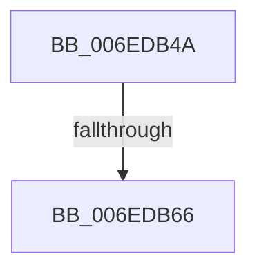

# sub_006EDB4A

- RVA: `0x006EDB4A`–`0x006EDB76` (길이 `44` bytes)
- VA: `0x00000001406EDB4A`
- 실행 섹션: `.text`
- PDB 이름 있음: `아니요`; PDB Function 태그: `아니요`
- unwind 정보 RVA: `0x000A01FC`
- 디코드: `11`개 명령, `44/44` bytes 표시
- 미해석 바이트: `0` (있으면 어셈블리에 `.byte`로 보존)

> 이 문서는 커널 이미지의 기계어와 PDB 기호를 분석해 생성했습니다. 4번과 5번은 함수 원형과 자료형을 바이너리 사용 방식에서 추정한 C 해석이며 원본 소스 복구 결과는 아닙니다.

## 1. Dependencies

- 직접 호출 지점: **1**; 고유 호출 대상: **1**
- 직접 호출자로 확인된 함수: **0**
- RIP 상대 이미지 참조: **1**

### Outgoing calls
- `0x006EDB6B` → [KiRaiseIrqlProcessIrqlFlags](../4F/KiRaiseIrqlProcessIrqlFlags_function_004F56FC.md) (function, `0x004F56FC`)

### Direct callers
- 이 함수 시작 RVA로 연결되는 직접 call은 확인되지 않았습니다. 간접 호출은 완전히 역산할 수 없습니다.

### Static image references
- `0x006EDB59` → RVA `0x00FC6D20` (`ALMOSTRO`; read)

## 2. Other-region calls and transfers

- 다른 실행 섹션으로 향하는 call: **0**
- call이 아닌 외부 분기/꼬리 이동: **2**
  - `0x006EDB60` → [MiConvertLargeFreePageToActive + 0xC7](../42/MiConvertLargeFreePageToActive_function_00420974.md) (`tail-transfer`)
  - `0x006EDB71` → [MiConvertLargeFreePageToActive + 0xC7](../42/MiConvertLargeFreePageToActive_function_00420974.md) (`tail-transfer`)

## 3. Assembly (complete function range)

```asm
006EDB4A  0F B6 C3                        movzx eax, bl
006EDB4D  44 0F 22 C0                     mov cr8, rax
006EDB51  44 0F 20 C3                     mov rbx, cr8
006EDB55  45 0F 22 C6                     mov cr8, r14
006EDB59  83 3D C0 91 8D 00 00            cmp dword ptr [rip + 0x8d91c0], 0
006EDB60  0F 84 D5 2E D3 FF               je 0x140420a3b
006EDB66  41 8A D6                        mov dl, r14b
006EDB69  8A CB                           mov cl, bl
006EDB6B  E8 8C 7B E0 FF                  call 0x1404f56fc
006EDB70  90                              nop
006EDB71  E9 C5 2E D3 FF                  jmp 0x140420a3b
```

## 4. C-style interpretation (structured pseudocode)

```c
__int64 __fastcall sub_006EDB4A(void)
{
    __int64 result;

    result = KiRaiseIrqlProcessIrqlFlags((unsigned __int8)((unsigned __int8)(v_rbx)), (unsigned __int8)(v_r14), a3, a4);
}
```

## 5. (Beta) C Style

```c
void sub_006EDB4A(void)
{
    int64_t result;

    result = KiRaiseIrqlProcessIrqlFlags((uint8_t)((uint8_t)(local_rbx)), (uint8_t)(local_r14), a3, a4);
}
```

## 6. Execution-region graph

[열기: 2D/3D 그래프와 함수 탐색 컨트롤 패널](../../../control-panel.html?section=text&rva=0x006EDB4A&view=graph)

- 2D 그래프는 위에서 아래로 흐르고, 3D 그래프는 빈 공간을 드래그해 회전합니다. Shift+드래그는 이동, 휠은 확대·축소, 함수 노드 선택은 대상 보고서 이동입니다.

### Static fallback


