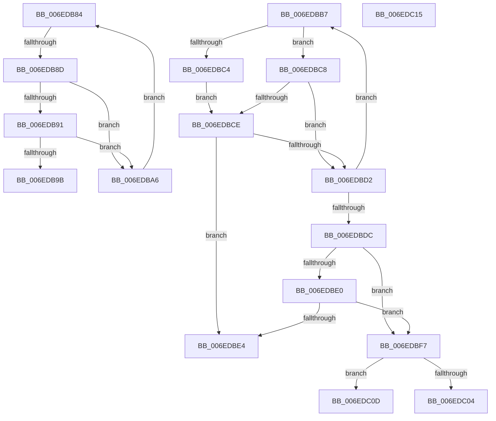

# sub_006EDB84

- RVA: `0x006EDB84`–`0x006EDC28` (길이 `164` bytes)
- VA: `0x00000001406EDB84`
- 실행 섹션: `.text`
- PDB 이름 있음: `아니요`; PDB Function 태그: `아니요`
- unwind 정보 RVA: `0x000A04EC`
- 디코드: `49`개 명령, `164/164` bytes 표시
- 미해석 바이트: `0` (있으면 어셈블리에 `.byte`로 보존)

> 이 문서는 커널 이미지의 기계어와 PDB 기호를 분석해 생성했습니다. 4번과 5번은 함수 원형과 자료형을 바이너리 사용 방식에서 추정한 C 해석이며 원본 소스 복구 결과는 아닙니다.

## 1. Dependencies

- 직접 호출 지점: **0**; 고유 호출 대상: **0**
- 직접 호출자로 확인된 함수: **0**
- RIP 상대 이미지 참조: **0**

### Outgoing calls
- 직접 디코드된 call 명령이 없습니다.

### Direct callers
- 이 함수 시작 RVA로 연결되는 직접 call은 확인되지 않았습니다. 간접 호출은 완전히 역산할 수 없습니다.

### Static image references
- 디코드된 RIP-relative 메모리 참조가 없습니다.

## 2. Other-region calls and transfers

- 다른 실행 섹션으로 향하는 call: **0**
- call이 아닌 외부 분기/꼬리 이동: **6**
  - `0x006EDB87` → [FsRtlpComputeShareableOplockState + 0x84](../42/FsRtlpComputeShareableOplockState_function_004256EC.md) (`tail-transfer`)
  - `0x006EDBA1` → [FsRtlpComputeShareableOplockState + 0x78](../42/FsRtlpComputeShareableOplockState_function_004256EC.md) (`tail-transfer`)
  - `0x006EDBF2` → [FsRtlpComputeShareableOplockState + 0x7E](../42/FsRtlpComputeShareableOplockState_function_004256EC.md) (`tail-transfer`)
  - `0x006EDC08` → [FsRtlpComputeShareableOplockState + 0x7E](../42/FsRtlpComputeShareableOplockState_function_004256EC.md) (`tail-transfer`)
  - `0x006EDC10` → [FsRtlpComputeShareableOplockState + 0x7E](../42/FsRtlpComputeShareableOplockState_function_004256EC.md) (`tail-transfer`)
  - `0x006EDC23` → [FsRtlpComputeShareableOplockState + 0x7E](../42/FsRtlpComputeShareableOplockState_function_004256EC.md) (`tail-transfer`)

## 3. Assembly (complete function range)

```asm
006EDB84  4D 3B C3                        cmp r8, r11
006EDB87  0F 84 E3 7B D3 FF               je 0x140425770
006EDB8D  85 C9                           test ecx, ecx
006EDB8F  74 15                           je 0x1406edba6
006EDB91  41 8B 40 30                     mov eax, dword ptr [r8 + 0x30]
006EDB95  23 C7                           and eax, edi
006EDB97  3B C1                           cmp eax, ecx
006EDB99  74 0B                           je 0x1406edba6
006EDB9B  8B 83 90 00 00 00               mov eax, dword ptr [rbx + 0x90]
006EDBA1  E9 BE 7B D3 FF                  jmp 0x140425764
006EDBA6  41 8B 48 30                     mov ecx, dword ptr [r8 + 0x30]
006EDBAA  23 CF                           and ecx, edi
006EDBAC  09 8B 90 00 00 00               or dword ptr [rbx + 0x90], ecx
006EDBB2  4D 8B 00                        mov r8, qword ptr [r8]
006EDBB5  EB CD                           jmp 0x1406edb84
006EDBB7  49 8B 40 10                     mov rax, qword ptr [r8 + 0x10]
006EDBBB  81 78 18 40 02 09 00            cmp dword ptr [rax + 0x18], 0x90240
006EDBC2  75 04                           jne 0x1406edbc8
006EDBC4  B2 01                           mov dl, 1
006EDBC6  EB 06                           jmp 0x1406edbce
006EDBC8  B1 01                           mov cl, 1
006EDBCA  84 D2                           test dl, dl
006EDBCC  74 04                           je 0x1406edbd2
006EDBCE  84 C9                           test cl, cl
006EDBD0  75 12                           jne 0x1406edbe4
006EDBD2  4D 8B 00                        mov r8, qword ptr [r8]
006EDBD5  8A C2                           mov al, dl
006EDBD7  4D 3B C1                        cmp r8, r9
006EDBDA  75 DB                           jne 0x1406edbb7
006EDBDC  84 C0                           test al, al
006EDBDE  74 17                           je 0x1406edbf7
006EDBE0  84 C9                           test cl, cl
006EDBE2  74 13                           je 0x1406edbf7
006EDBE4  8B 83 90 00 00 00               mov eax, dword ptr [rbx + 0x90]
006EDBEA  83 E0 20                        and eax, 0x20
006EDBED  0D 10 10 00 00                  or eax, 0x1010
006EDBF2  E9 73 7B D3 FF                  jmp 0x14042576a
006EDBF7  8B 83 90 00 00 00               mov eax, dword ptr [rbx + 0x90]
006EDBFD  83 E0 20                        and eax, 0x20
006EDC00  84 D2                           test dl, dl
006EDC02  74 09                           je 0x1406edc0d
006EDC04  0F BA E8 0C                     bts eax, 0xc
006EDC08  E9 5D 7B D3 FF                  jmp 0x14042576a
006EDC0D  83 C8 10                        or eax, 0x10
006EDC10  E9 55 7B D3 FF                  jmp 0x14042576a
006EDC15  8B 83 90 00 00 00               mov eax, dword ptr [rbx + 0x90]
006EDC1B  83 E0 20                        and eax, 0x20
006EDC1E  0D 00 B0 00 00                  or eax, 0xb000
006EDC23  E9 42 7B D3 FF                  jmp 0x14042576a
```

## 4. C-style interpretation (structured pseudocode)

```c
__int64 __fastcall sub_006EDB84(int a1, __int64 a2, __int64 a3, __int64 a4)
{
    __int64 result;

    if (a1 == 0) goto loc_006EDBA6;
    result = (unsigned int)(((unsigned int)(*(unsigned int *)(a3 + 48))) & ((unsigned int)(v_rdi)));
    if (((unsigned int)(result)) == a1) goto loc_006EDBA6;
loc_006EDBA6:
    a1 = (unsigned int)(((unsigned int)(*(unsigned int *)(a3 + 48))) & ((unsigned int)(v_rdi)));
    goto loc_006EDB84;
}
```

## 5. (Beta) C Style

```c
int64_t sub_006EDB84(int32_t Arg1, int64_t Arg2, int64_t Arg3, int64_t Arg4)
{
    int64_t result;

    if (Arg1 == 0) goto loc_006EDBA6;
    result = (uint32_t)(((uint32_t)(*(uint32_t *)(Arg3 + 0x30))) & ((uint32_t)(local_rdi)));
    if (((uint32_t)(result)) == Arg1) goto loc_006EDBA6;
loc_006EDBA6:
    Arg1 = (uint32_t)(((uint32_t)(*(uint32_t *)(Arg3 + 0x30))) & ((uint32_t)(local_rdi)));
    goto loc_006EDB84;
}
```

## 6. Execution-region graph

[열기: 2D/3D 그래프와 함수 탐색 컨트롤 패널](../../../control-panel.html?section=text&rva=0x006EDB84&view=graph)

- 2D 그래프는 위에서 아래로 흐르고, 3D 그래프는 빈 공간을 드래그해 회전합니다. Shift+드래그는 이동, 휠은 확대·축소, 함수 노드 선택은 대상 보고서 이동입니다.

### Static fallback


