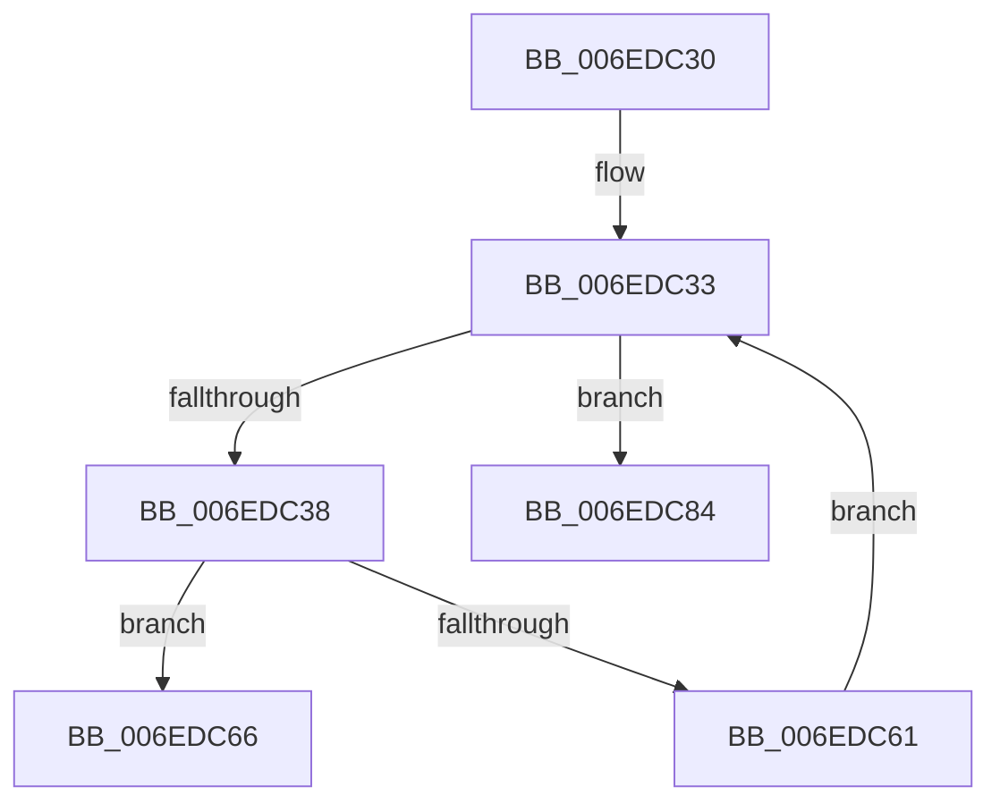

# sub_006EDC30

- RVA: `0x006EDC30`–`0x006EDC8E` (길이 `94` bytes)
- VA: `0x00000001406EDC30`
- 실행 섹션: `.text`
- PDB 이름 있음: `아니요`; PDB Function 태그: `아니요`
- unwind 정보 RVA: `0x000A0560`
- 디코드: `25`개 명령, `94/94` bytes 표시
- 미해석 바이트: `0` (있으면 어셈블리에 `.byte`로 보존)

> 이 문서는 커널 이미지의 기계어와 PDB 기호를 분석해 생성했습니다. 4번과 5번은 함수 원형과 자료형을 바이너리 사용 방식에서 추정한 C 해석이며 원본 소스 복구 결과는 아닙니다.

## 1. Dependencies

- 직접 호출 지점: **1**; 고유 호출 대상: **1**
- 직접 호출자로 확인된 함수: **0**
- RIP 상대 이미지 참조: **0**

### Outgoing calls
- `0x006EDC55` → [FsRtlpOplockKeysEqual](../3F/FsRtlpOplockKeysEqual_function_003F26B0.md) (function, `0x003F26B0`)

### Direct callers
- 이 함수 시작 RVA로 연결되는 직접 call은 확인되지 않았습니다. 간접 호출은 완전히 역산할 수 없습니다.

### Static image references
- 디코드된 RIP-relative 메모리 참조가 없습니다.

## 2. Other-region calls and transfers

- 다른 실행 섹션으로 향하는 call: **0**
- call이 아닌 외부 분기/꼬리 이동: **2**
  - `0x006EDC7F` → [FsRtlpReleaseIrpsWaitingForRH + 0x2C1](../42/FsRtlpReleaseIrpsWaitingForRH_function_00425CBC.md) (`tail-transfer`)
  - `0x006EDC89` → [FsRtlpReleaseIrpsWaitingForRH + 0x2A5](../42/FsRtlpReleaseIrpsWaitingForRH_function_00425CBC.md) (`tail-transfer`)

## 3. Assembly (complete function range)

```asm
006EDC30  4D 8B F5                        mov r14, r13
006EDC33  49 3B F6                        cmp rsi, r14
006EDC36  74 4C                           je 0x1406edc84
006EDC38  F7 87 90 00 00 00 00 00 01 00   test dword ptr [rdi + 0x90], 0x10000
006EDC42  48 8D 46 C8                     lea rax, [rsi - 0x38]
006EDC46  48 8B 4B 38                     mov rcx, qword ptr [rbx + 0x38]
006EDC4A  48 0F 44 C6                     cmove rax, rsi
006EDC4E  45 33 C0                        xor r8d, r8d
006EDC51  48 8B 50 18                     mov rdx, qword ptr [rax + 0x18]
006EDC55  E8 56 4A D0 FF                  call 0x1403f26b0
006EDC5A  45 33 C9                        xor r9d, r9d
006EDC5D  84 C0                           test al, al
006EDC5F  74 05                           je 0x1406edc66
006EDC61  48 8B 36                        mov rsi, qword ptr [rsi]
006EDC64  EB CD                           jmp 0x1406edc33
006EDC66  8B 44 24 40                     mov eax, dword ptr [rsp + 0x40]
006EDC6A  8B 54 24 44                     mov edx, dword ptr [rsp + 0x44]
006EDC6E  FF C0                           inc eax
006EDC70  44 8B 44 24 48                  mov r8d, dword ptr [rsp + 0x48]
006EDC75  FF C2                           inc edx
006EDC77  89 54 24 44                     mov dword ptr [rsp + 0x44], edx
006EDC7B  89 44 24 40                     mov dword ptr [rsp + 0x40], eax
006EDC7F  E9 F9 82 D3 FF                  jmp 0x140425f7d
006EDC84  48 8B 4C 24 50                  mov rcx, qword ptr [rsp + 0x50]
006EDC89  E9 D3 82 D3 FF                  jmp 0x140425f61
```

## 4. C-style interpretation (structured pseudocode)

```c
__int64 __fastcall sub_006EDC30(__int64 a1, __int64 a2, int a3, int a4, __int64 a5, __int64 a6, __int64 a7, unsigned int a8, unsigned int a9, __int64 a10)
{
    __int64 result;
    unsigned int v_stack_p40;
    unsigned int v_stack_p44;

loc_006EDC33:
    if (v_rsi == v_r13) goto loc_006EDC84;
    result = v_rsi - 56;
    if (((*(unsigned int *)(v_rdi + 144)) & (0x10000ULL)) == 0) { result = v_rsi; }
    a3 = 0;
    result = FsRtlpOplockKeysEqual(*(unsigned __int64 *)(v_rbx + 56), *(unsigned __int64 *)(result + 24), a3, a4);
    a4 = 0;
    if ((unsigned __int8)(result) == 0) goto loc_006EDC66;
    goto loc_006EDC33;
loc_006EDC66:
    result = (unsigned int)(((unsigned int)(a8)) + 1);
    a2 = (unsigned int)(((unsigned int)(v_stack_p44)) + 1);
    v_stack_p44 = (unsigned int)(a2);
    v_stack_p40 = (unsigned int)(result);
loc_006EDC84:
}
```

## 5. (Beta) C Style

```c
int64_t sub_006EDC30(int64_t Arg1, int64_t Arg2, int32_t Arg3, int32_t Arg4, uint64_t Arg5, uint64_t Arg6, uint64_t Arg7, uint32_t Arg8, uint32_t Arg9, int64_t Arg10)
{
    int64_t result;
    uint32_t v_stack_p40;
    uint32_t v_stack_p44;

loc_006EDC33:
    if (local_rsi == local_r13) goto loc_006EDC84;
    result = local_rsi - 56;
    if (((*(uint32_t *)(local_rdi + 0x90)) & (0x10000ULL)) == 0) { result = local_rsi; }
    Arg3 = 0;
    result = FsRtlpOplockKeysEqual(*(uint64_t *)(local_rbx + 0x38), *(uint64_t *)(result + 0x18), Arg3, Arg4);
    Arg4 = 0;
    if ((uint8_t)(result) == 0) goto loc_006EDC66;
    goto loc_006EDC33;
loc_006EDC66:
    result = (uint32_t)(((uint32_t)(Arg8)) + 1);
    Arg2 = (uint32_t)(((uint32_t)(v_stack_p44)) + 1);
    v_stack_p44 = (uint32_t)(Arg2);
    v_stack_p40 = (uint32_t)(result);
loc_006EDC84:
}
```

## 6. Execution-region graph

[열기: 2D/3D 그래프와 함수 탐색 컨트롤 패널](../../../control-panel.html?section=text&rva=0x006EDC30&view=graph)

- 2D 그래프는 위에서 아래로 흐르고, 3D 그래프는 빈 공간을 드래그해 회전합니다. Shift+드래그는 이동, 휠은 확대·축소, 함수 노드 선택은 대상 보고서 이동입니다.

### Static fallback


