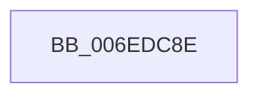

# sub_006EDC8E

- RVA: `0x006EDC8E`–`0x006EDD32` (길이 `164` bytes)
- VA: `0x00000001406EDC8E`
- 실행 섹션: `.text`
- PDB 이름 있음: `아니요`; PDB Function 태그: `아니요`
- unwind 정보 RVA: `0x000A05B8`
- 디코드: `34`개 명령, `164/164` bytes 표시
- 미해석 바이트: `0` (있으면 어셈블리에 `.byte`로 보존)

> 이 문서는 커널 이미지의 기계어와 PDB 기호를 분석해 생성했습니다. 4번과 5번은 함수 원형과 자료형을 바이너리 사용 방식에서 추정한 C 해석이며 원본 소스 복구 결과는 아닙니다.

## 1. Dependencies

- 직접 호출 지점: **1**; 고유 호출 대상: **1**
- 직접 호출자로 확인된 함수: **0**
- RIP 상대 이미지 참조: **3**

### Outgoing calls
- `0x006EDD27` → [tlgWriteTransfer_EtwWriteTransfer](../42/tlgWriteTransfer_EtwWriteTransfer_function_004260E0.md) (function, `0x004260E0`)

### Direct callers
- 이 함수 시작 RVA로 연결되는 직접 call은 확인되지 않았습니다. 간접 호출은 완전히 역산할 수 없습니다.

### Static image references
- `0x006EDC8E` → RVA `0x00F0B6B0` (`.data`; read)
- `0x006EDC95` → RVA `0x00E076D8` (`.data`; read)
- `0x006EDCFD` → RVA `0x0004A4B4` (`.rdata`; read)

## 2. Other-region calls and transfers

- 다른 실행 섹션으로 향하는 call: **0**
- call이 아닌 외부 분기/꼬리 이동: **1**
  - `0x006EDD2D` → [PopFxStopDeviceAccounting + 0x29A](../42/PopFxStopDeviceAccounting_function_004261D8.md) (`tail-transfer`)

## 3. Assembly (complete function range)

```asm
006EDC8E  48 8B 05 1B DA 81 00            mov rax, qword ptr [rip + 0x81da1b]
006EDC95  48 8D 0D 3C 9A 71 00            lea rcx, [rip + 0x719a3c]
006EDC9C  48 89 44 24 30                  mov qword ptr [rsp + 0x30], rax
006EDCA1  BA 08 00 00 00                  mov edx, 8
006EDCA6  48 8D 44 24 30                  lea rax, [rsp + 0x30]
006EDCAB  48 89 55 F8                     mov qword ptr [rbp - 8], rdx
006EDCAF  48 89 45 F0                     mov qword ptr [rbp - 0x10], rax
006EDCB3  45 33 C9                        xor r9d, r9d
006EDCB6  48 8D 44 24 60                  lea rax, [rsp + 0x60]
006EDCBB  48 89 55 08                     mov qword ptr [rbp + 8], rdx
006EDCBF  48 89 45 00                     mov qword ptr [rbp], rax
006EDCC3  45 33 C0                        xor r8d, r8d
006EDCC6  48 8D 45 50                     lea rax, [rbp + 0x50]
006EDCCA  48 89 55 38                     mov qword ptr [rbp + 0x38], rdx
006EDCCE  48 89 45 10                     mov qword ptr [rbp + 0x10], rax
006EDCD2  48 8D 45 78                     lea rax, [rbp + 0x78]
006EDCD6  48 89 45 20                     mov qword ptr [rbp + 0x20], rax
006EDCDA  48 8D 44 24 68                  lea rax, [rsp + 0x68]
006EDCDF  48 89 45 30                     mov qword ptr [rbp + 0x30], rax
006EDCE3  48 8D 44 24 48                  lea rax, [rsp + 0x48]
006EDCE8  48 89 45 40                     mov qword ptr [rbp + 0x40], rax
006EDCEC  48 8D 45 D0                     lea rax, [rbp - 0x30]
006EDCF0  48 89 44 24 28                  mov qword ptr [rsp + 0x28], rax
006EDCF5  89 54 24 20                     mov dword ptr [rsp + 0x20], edx
006EDCF9  48 89 55 48                     mov qword ptr [rbp + 0x48], rdx
006EDCFD  48 8D 15 B0 C7 95 FF            lea rdx, [rip - 0x6a3850]
006EDD04  48 89 5C 24 60                  mov qword ptr [rsp + 0x60], rbx
006EDD09  48 C7 45 18 28 00 00 00         mov qword ptr [rbp + 0x18], 0x28
006EDD11  48 C7 45 28 28 00 00 00         mov qword ptr [rbp + 0x28], 0x28
006EDD19  48 89 7C 24 68                  mov qword ptr [rsp + 0x68], rdi
006EDD1E  48 C7 44 24 48 00 00 00 01      mov qword ptr [rsp + 0x48], 0x1000000
006EDD27  E8 B4 83 D3 FF                  call 0x1404260e0
006EDD2C  90                              nop
006EDD2D  E9 40 87 D3 FF                  jmp 0x140426472
```

## 4. C-style interpretation (structured pseudocode)

```c
__int64 __fastcall sub_006EDC8E(__int64 a1, __int64 a2, int a3, int a4, __int64 a5, __int64 a6, __int64 a7, __int64 a8, __int64 a9, __int64 a10, __int64 a11, __int64 a12, __int64 a13)
{
    __int64 result;
    unsigned int v_stack_p20;
    unsigned __int64 v_stack_p28;
    unsigned __int64 v_stack_p30;
    unsigned __int64 v_stack_p48;
    unsigned __int64 v_stack_p60;
    unsigned __int64 v_stack_p68;

    v_stack_p30 = *(unsigned __int64 *)(v_rip + 8509979);
    *(unsigned __int64 *)(v_rbp - 8) = 8;
    *(unsigned __int64 *)(v_rbp - 16) = a6;
    a4 = 0;
    *(unsigned __int64 *)(v_rbp + 8) = 8;
    *(unsigned __int64 *)(v_rbp) = a12;
    a3 = 0;
    *(unsigned __int64 *)(v_rbp + 56) = 8;
    *(unsigned __int64 *)(v_rbp + 16) = v_rbp + 80;
    *(unsigned __int64 *)(v_rbp + 32) = v_rbp + 120;
    *(unsigned __int64 *)(v_rbp + 48) = a13;
    *(unsigned __int64 *)(v_rbp + 64) = a9;
    v_stack_p28 = v_rbp - 48;
    v_stack_p20 = 8;
    *(unsigned __int64 *)(v_rbp + 72) = 8;
    v_stack_p60 = v_rbx;
    *(unsigned __int64 *)(v_rbp + 24) = 40;
    *(unsigned __int64 *)(v_rbp + 40) = 40;
    v_stack_p68 = v_rdi;
    v_stack_p48 = 0x1000000ULL;
    result = tlgWriteTransfer_EtwWriteTransfer(v_rip + 7445052, v_rip - 6961232, a3, a4);
}
```

## 5. (Beta) C Style

```c
int64_t sub_006EDC8E(int64_t Arg1, int64_t Arg2, int32_t Arg3, int32_t Arg4, uint64_t Arg5, int64_t Arg6, uint64_t Arg7, uint64_t Arg8, int64_t Arg9, uint64_t Arg10, uint64_t Arg11, int64_t Arg12, int64_t Arg13)
{
    int64_t result;
    uint32_t v_stack_p20;
    uint64_t v_stack_p28;
    uint64_t v_stack_p30;
    uint64_t v_stack_p48;
    uint64_t v_stack_p60;
    uint64_t v_stack_p68;

    v_stack_p30 = *(uint64_t *)(v_rip + 0x81DA1B);
    *(uint64_t *)(local_rbp - 0x8) = 8;
    *(uint64_t *)(local_rbp - 0x10) = Arg6;
    Arg4 = 0;
    *(uint64_t *)(local_rbp + 0x8) = 8;
    *(uint64_t *)(local_rbp) = Arg12;
    Arg3 = 0;
    *(uint64_t *)(local_rbp + 0x38) = 8;
    *(uint64_t *)(local_rbp + 0x10) = local_rbp + 80;
    *(uint64_t *)(local_rbp + 0x20) = local_rbp + 120;
    *(uint64_t *)(local_rbp + 0x30) = Arg13;
    *(uint64_t *)(local_rbp + 0x40) = Arg9;
    v_stack_p28 = local_rbp - 48;
    v_stack_p20 = 8;
    *(uint64_t *)(local_rbp + 0x48) = 8;
    v_stack_p60 = local_rbx;
    *(uint64_t *)(local_rbp + 0x18) = 40;
    *(uint64_t *)(local_rbp + 0x28) = 40;
    v_stack_p68 = local_rdi;
    v_stack_p48 = 0x1000000ULL;
    result = tlgWriteTransfer_EtwWriteTransfer(v_rip + 7445052, v_rip - 6961232, Arg3, Arg4);
}
```

## 6. Execution-region graph

[열기: 2D/3D 그래프와 함수 탐색 컨트롤 패널](../../../control-panel.html?section=text&rva=0x006EDC8E&view=graph)

- 2D 그래프는 위에서 아래로 흐르고, 3D 그래프는 빈 공간을 드래그해 회전합니다. Shift+드래그는 이동, 휠은 확대·축소, 함수 노드 선택은 대상 보고서 이동입니다.

### Static fallback


