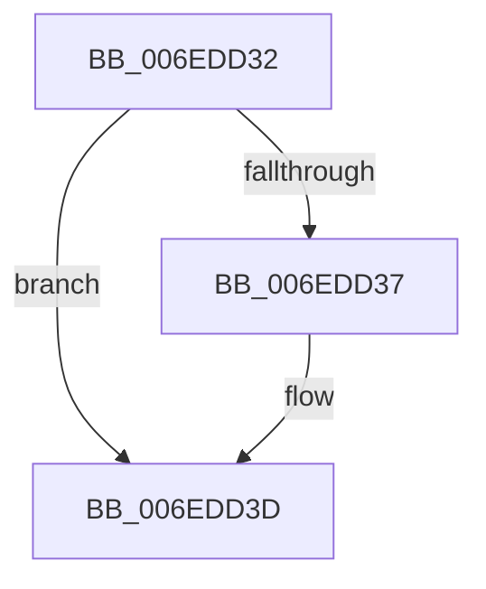

# sub_006EDD32

- RVA: `0x006EDD32`–`0x006EDD4F` (길이 `29` bytes)
- VA: `0x00000001406EDD32`
- 실행 섹션: `.text`
- PDB 이름 있음: `아니요`; PDB Function 태그: `아니요`
- unwind 정보 RVA: `0x000A066C`
- 디코드: `9`개 명령, `29/29` bytes 표시
- 미해석 바이트: `0` (있으면 어셈블리에 `.byte`로 보존)

> 이 문서는 커널 이미지의 기계어와 PDB 기호를 분석해 생성했습니다. 4번과 5번은 함수 원형과 자료형을 바이너리 사용 방식에서 추정한 C 해석이며 원본 소스 복구 결과는 아닙니다.

## 1. Dependencies

- 직접 호출 지점: **1**; 고유 호출 대상: **1**
- 직접 호출자로 확인된 함수: **0**
- RIP 상대 이미지 참조: **0**

### Outgoing calls
- `0x006EDD44` → [KiInitializeSystemSubNodeEnumerationContext](../42/KiInitializeSystemSubNodeEnumerationContext_function_0042798C.md) (function, `0x0042798C`)

### Direct callers
- 이 함수 시작 RVA로 연결되는 직접 call은 확인되지 않았습니다. 간접 호출은 완전히 역산할 수 없습니다.

### Static image references
- 디코드된 RIP-relative 메모리 참조가 없습니다.

## 2. Other-region calls and transfers

- 다른 실행 섹션으로 향하는 call: **0**
- call이 아닌 외부 분기/꼬리 이동: **1**
  - `0x006EDD4A` → [KeConfigureHeteroProcessors + 0xF2](../42/KeConfigureHeteroProcessors_function_00427338.md) (`tail-transfer`)

## 3. Assembly (complete function range)

```asm
006EDD32  39 58 10                        cmp dword ptr [rax + 0x10], ebx
006EDD35  74 06                           je 0x1406edd3d
006EDD37  8B 68 08                        mov ebp, dword ptr [rax + 8]
006EDD3A  41 8B FD                        mov edi, r13d
006EDD3D  33 D2                           xor edx, edx
006EDD3F  48 8D 4C 24 30                  lea rcx, [rsp + 0x30]
006EDD44  E8 43 9C D3 FF                  call 0x14042798c
006EDD49  90                              nop
006EDD4A  E9 DB 96 D3 FF                  jmp 0x14042742a
```

## 4. C-style interpretation (structured pseudocode)

```c
__int64 __fastcall sub_006EDD32(__int64 a1, int a2, __int64 a3, __int64 a4, __int64 a5, __int64 a6)
{
    __int64 result;
    __int64 v_rbp;
    __int64 v_rdi;

    if ((*(unsigned int *)(result + 16)) != ((unsigned int)(v_rbx))) {
        v_rbp = *(unsigned int *)(result + 8);
        v_rdi = (unsigned int)(v_r13);
    }
    a2 = 0;
    result = KiInitializeSystemSubNodeEnumerationContext(a6, a2, a3, a4);
}
```

## 5. (Beta) C Style

```c
int64_t sub_006EDD32(int64_t Arg1, int32_t Arg2, int64_t Arg3, int64_t Arg4, uint64_t Arg5, int64_t Arg6)
{
    int64_t result;
    int64_t local_rbp;
    int64_t local_rdi;

    if ((*(uint32_t *)(result + 0x10)) != ((uint32_t)(local_rbx))) {
        local_rbp = *(uint32_t *)(result + 0x8);
        local_rdi = (uint32_t)(local_r13);
    }
    Arg2 = 0;
    result = KiInitializeSystemSubNodeEnumerationContext(Arg6, Arg2, Arg3, Arg4);
}
```

## 6. Execution-region graph

[열기: 2D/3D 그래프와 함수 탐색 컨트롤 패널](../../../control-panel.html?section=text&rva=0x006EDD32&view=graph)

- 2D 그래프는 위에서 아래로 흐르고, 3D 그래프는 빈 공간을 드래그해 회전합니다. Shift+드래그는 이동, 휠은 확대·축소, 함수 노드 선택은 대상 보고서 이동입니다.

### Static fallback


