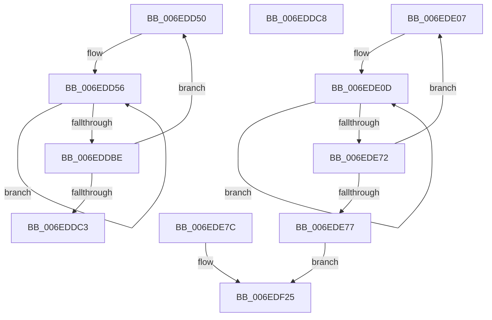

# sub_006EDD50

- RVA: `0x006EDD50`–`0x006EDF3F` (길이 `495` bytes)
- VA: `0x00000001406EDD50`
- 실행 섹션: `.text`
- PDB 이름 있음: `아니요`; PDB Function 태그: `아니요`
- unwind 정보 RVA: `0x000A0698`
- 디코드: `101`개 명령, `495/495` bytes 표시
- 미해석 바이트: `0` (있으면 어셈블리에 `.byte`로 보존)

> 이 문서는 커널 이미지의 기계어와 PDB 기호를 분석해 생성했습니다. 4번과 5번은 함수 원형과 자료형을 바이너리 사용 방식에서 추정한 C 해석이며 원본 소스 복구 결과는 아닙니다.

## 1. Dependencies

- 직접 호출 지점: **16**; 고유 호출 대상: **3**
- 직접 호출자로 확인된 함수: **0**
- RIP 상대 이미지 참조: **2**

### Outgoing calls
- `0x006EDD6B` → [memset](../6C/memset_function_006C6C40.md) (function, `0x006C6C40`)
- `0x006EDD86` → [memset](../6C/memset_function_006C6C40.md) (function, `0x006C6C40`)
- `0x006EDDA5` → [memset](../6C/memset_function_006C6C40.md) (function, `0x006C6C40`)
- `0x006EDDCE` → [KeAddProcessorAffinityEx](../25/KeAddProcessorAffinityEx_function_0025B6F0.md) (function, `0x0025B6F0`)
- `0x006EDDDC` → [KeAddProcessorAffinityEx](../25/KeAddProcessorAffinityEx_function_0025B6F0.md) (function, `0x0025B6F0`)
- `0x006EDDEA` → [KeAddProcessorAffinityEx](../25/KeAddProcessorAffinityEx_function_0025B6F0.md) (function, `0x0025B6F0`)
- `0x006EDDF8` → [KeAddProcessorAffinityEx](../25/KeAddProcessorAffinityEx_function_0025B6F0.md) (function, `0x0025B6F0`)
- `0x006EDE22` → [KiCopyAffinityEx](../2C/KiCopyAffinityEx_function_002CE860.md) (function, `0x002CE860`)
- `0x006EDE3B` → [KiCopyAffinityEx](../2C/KiCopyAffinityEx_function_002CE860.md) (function, `0x002CE860`)
- `0x006EDE5B` → [KiCopyAffinityEx](../2C/KiCopyAffinityEx_function_002CE860.md) (function, `0x002CE860`)
- `0x006EDE97` → [KiCopyAffinityEx](../2C/KiCopyAffinityEx_function_002CE860.md) (function, `0x002CE860`)
- `0x006EDEB0` → [KiCopyAffinityEx](../2C/KiCopyAffinityEx_function_002CE860.md) (function, `0x002CE860`)
- `0x006EDEC9` → [KiCopyAffinityEx](../2C/KiCopyAffinityEx_function_002CE860.md) (function, `0x002CE860`)
- `0x006EDEE2` → [KiCopyAffinityEx](../2C/KiCopyAffinityEx_function_002CE860.md) (function, `0x002CE860`)
- `0x006EDEFB` → [KiCopyAffinityEx](../2C/KiCopyAffinityEx_function_002CE860.md) (function, `0x002CE860`)
- `0x006EDF14` → [KiCopyAffinityEx](../2C/KiCopyAffinityEx_function_002CE860.md) (function, `0x002CE860`)

### Direct callers
- 이 함수 시작 RVA로 연결되는 직접 call은 확인되지 않았습니다. 간접 호출은 완전히 역산할 수 없습니다.

### Static image references
- `0x006EDE1B` → RVA `0x00FC7120` (`ALMOSTRO`; read)
- `0x006EDE27` → RVA `0x00FC6A80` (`ALMOSTRO`; read)

## 2. Other-region calls and transfers

- 다른 실행 섹션으로 향하는 call: **0**
- call이 아닌 외부 분기/꼬리 이동: **3**
  - `0x006EDDC3` → [KiComputeHeteroConfig + 0x143](../42/KiComputeHeteroConfig_function_00427544.md) (`tail-transfer`)
  - `0x006EDE02` → [KiComputeHeteroConfig + 0x27B](../42/KiComputeHeteroConfig_function_00427544.md) (`tail-transfer`)
  - `0x006EDF3A` → [KiComputeHeteroConfig + 0x2A5](../42/KiComputeHeteroConfig_function_00427544.md) (`tail-transfer`)

## 3. Assembly (complete function range)

```asm
006EDD50  41 BF 02 00 00 00               mov r15d, 2
006EDD56  44 0F B7 83 88 F1 FF FF         movzx r8d, word ptr [rbx - 0xe78]
006EDD5E  48 8D 8B 90 F1 FF FF            lea rcx, [rbx - 0xe70]
006EDD65  49 C1 E0 03                     shl r8, 3
006EDD69  33 D2                           xor edx, edx
006EDD6B  E8 D0 8E FD FF                  call 0x1406c6c40
006EDD70  66 44 89 AB 88 F1 FF FF         mov word ptr [rbx - 0xe78], r13w
006EDD78  33 D2                           xor edx, edx
006EDD7A  44 0F B7 43 F8                  movzx r8d, word ptr [rbx - 8]
006EDD7F  48 8B CB                        mov rcx, rbx
006EDD82  49 C1 E0 03                     shl r8, 3
006EDD86  E8 B5 8E FD FF                  call 0x1406c6c40
006EDD8B  66 44 89 6B F8                  mov word ptr [rbx - 8], r13w
006EDD90  48 8D 8B 70 0E 00 00            lea rcx, [rbx + 0xe70]
006EDD97  44 0F B7 83 68 0E 00 00         movzx r8d, word ptr [rbx + 0xe68]
006EDD9F  33 D2                           xor edx, edx
006EDDA1  49 C1 E0 03                     shl r8, 3
006EDDA5  E8 96 8E FD FF                  call 0x1406c6c40
006EDDAA  66 44 89 AB 68 0E 00 00         mov word ptr [rbx + 0xe68], r13w
006EDDB2  48 81 C3 08 01 00 00            add rbx, 0x108
006EDDB9  4D 2B FD                        sub r15, r13
006EDDBC  75 98                           jne 0x1406edd56
006EDDBE  4D 2B F5                        sub r14, r13
006EDDC1  75 8D                           jne 0x1406edd50
006EDDC3  E9 BF 98 D3 FF                  jmp 0x140427687
006EDDC8  48 8D 4F F8                     lea rcx, [rdi - 8]
006EDDCC  8B D3                           mov edx, ebx
006EDDCE  E8 1D D9 B6 FF                  call 0x14025b6f0
006EDDD3  48 8D 8F 00 01 00 00            lea rcx, [rdi + 0x100]
006EDDDA  8B D3                           mov edx, ebx
006EDDDC  E8 0F D9 B6 FF                  call 0x14025b6f0
006EDDE1  48 8D 8F 08 02 00 00            lea rcx, [rdi + 0x208]
006EDDE8  8B D3                           mov edx, ebx
006EDDEA  E8 01 D9 B6 FF                  call 0x14025b6f0
006EDDEF  48 8D 8F 10 03 00 00            lea rcx, [rdi + 0x310]
006EDDF6  8B D3                           mov edx, ebx
006EDDF8  E8 F3 D8 B6 FF                  call 0x14025b6f0
006EDDFD  48 8B 4C 24 28                  mov rcx, qword ptr [rsp + 0x28]
006EDE02  E9 B8 99 D3 FF                  jmp 0x1404277bf
006EDE07  41 BC 02 00 00 00               mov r12d, 2
006EDE0D  0F B7 93 20 E3 FF FF            movzx edx, word ptr [rbx - 0x1ce0]
006EDE14  48 8D 8B 1E E3 FF FF            lea rcx, [rbx - 0x1ce2]
006EDE1B  4C 8D 05 FE 92 8D 00            lea r8, [rip + 0x8d92fe]
006EDE22  E8 39 0A BE FF                  call 0x1402ce860
006EDE27  8B 05 53 8C 8D 00               mov eax, dword ptr [rip + 0x8d8c53]
006EDE2D  48 8D 4B FE                     lea rcx, [rbx - 2]
006EDE31  0F B7 13                        movzx edx, word ptr [rbx]
006EDE34  4C 8D 05 E5 92 8D 00            lea r8, [rip + 0x8d92e5]
006EDE3B  E8 20 0A BE FF                  call 0x1402ce860
006EDE40  8B 05 3A 8C 8D 00               mov eax, dword ptr [rip + 0x8d8c3a]
006EDE46  48 8D 8B 8E F1 FF FF            lea rcx, [rbx - 0xe72]
006EDE4D  0F B7 93 90 F1 FF FF            movzx edx, word ptr [rbx - 0xe70]
006EDE54  4C 8D 05 C5 92 8D 00            lea r8, [rip + 0x8d92c5]
006EDE5B  E8 00 0A BE FF                  call 0x1402ce860
006EDE60  8B 05 1A 8C 8D 00               mov eax, dword ptr [rip + 0x8d8c1a]
006EDE66  48 81 C3 08 01 00 00            add rbx, 0x108
006EDE6D  4D 2B E5                        sub r12, r13
006EDE70  75 9B                           jne 0x1406ede0d
006EDE72  4D 2B FD                        sub r15, r13
006EDE75  75 90                           jne 0x1406ede07
006EDE77  E9 A9 00 00 00                  jmp 0x1406edf25
006EDE7C  0F B7 97 EA FD FF FF            movzx edx, word ptr [rdi - 0x216]
006EDE83  48 8D 9F E8 FD FF FF            lea rbx, [rdi - 0x218]
006EDE8A  4C 8D 3D 8F 92 8D 00            lea r15, [rip + 0x8d928f]
006EDE91  48 8B CB                        mov rcx, rbx
006EDE94  4D 8B C7                        mov r8, r15
006EDE97  E8 C4 09 BE FF                  call 0x1402ce860
006EDE9C  8B 05 DE 8B 8D 00               mov eax, dword ptr [rip + 0x8d8bde]
006EDEA2  48 8D 8B 08 01 00 00            lea rcx, [rbx + 0x108]
006EDEA9  0F B7 51 02                     movzx edx, word ptr [rcx + 2]
006EDEAD  4D 8B C7                        mov r8, r15
006EDEB0  E8 AB 09 BE FF                  call 0x1402ce860
006EDEB5  8B 05 C5 8B 8D 00               mov eax, dword ptr [rip + 0x8d8bc5]
006EDEBB  48 8D 8B 10 02 00 00            lea rcx, [rbx + 0x210]
006EDEC2  0F B7 51 02                     movzx edx, word ptr [rcx + 2]
006EDEC6  4D 8B C7                        mov r8, r15
006EDEC9  E8 92 09 BE FF                  call 0x1402ce860
006EDECE  8B 05 AC 8B 8D 00               mov eax, dword ptr [rip + 0x8d8bac]
006EDED4  48 8D 8B 18 03 00 00            lea rcx, [rbx + 0x318]
006EDEDB  0F B7 51 02                     movzx edx, word ptr [rcx + 2]
006EDEDF  4D 8B C7                        mov r8, r15
006EDEE2  E8 79 09 BE FF                  call 0x1402ce860
006EDEE7  8B 05 93 8B 8D 00               mov eax, dword ptr [rip + 0x8d8b93]
006EDEED  48 8D 8B 20 04 00 00            lea rcx, [rbx + 0x420]
006EDEF4  0F B7 51 02                     movzx edx, word ptr [rcx + 2]
006EDEF8  4D 8B C7                        mov r8, r15
006EDEFB  E8 60 09 BE FF                  call 0x1402ce860
006EDF00  8B 05 7A 8B 8D 00               mov eax, dword ptr [rip + 0x8d8b7a]
006EDF06  48 8D 8B 28 05 00 00            lea rcx, [rbx + 0x528]
006EDF0D  0F B7 51 02                     movzx edx, word ptr [rcx + 2]
006EDF11  4D 8B C7                        mov r8, r15
006EDF14  E8 47 09 BE FF                  call 0x1402ce860
006EDF19  8B 05 61 8B 8D 00               mov eax, dword ptr [rip + 0x8d8b61]
006EDF1F  41 BD 01 00 00 00               mov r13d, 1
006EDF25  8B 84 24 98 00 00 00            mov eax, dword ptr [rsp + 0x98]
006EDF2C  89 46 0C                        mov dword ptr [rsi + 0xc], eax
006EDF2F  33 C0                           xor eax, eax
006EDF31  45 84 F6                        test r14b, r14b
006EDF34  0F 95 C0                        setne al
006EDF37  89 46 10                        mov dword ptr [rsi + 0x10], eax
006EDF3A  E9 AA 98 D3 FF                  jmp 0x1404277e9
```

## 4. C-style interpretation (structured pseudocode)

```c
__int64 __fastcall sub_006EDD50(__int64 a1, int a2)
{
    __int64 result;
    __int64 v_r14;
    __int64 v_r15;
    __int64 v_rbx;
    unsigned __int64 v_stack_p28;
    unsigned int v_stack_p98;

loc_006EDD56:
    a3 = (*(unsigned __int16 *)(v_rbx - 3704)) << (3);
    a2 = 0;
    result = memset(v_rbx - 3696, a2, a3, a4);
    *(unsigned __int16 *)(v_rbx - 3704) = (unsigned __int16)(v_r13);
    a2 = 0;
    a3 = (*(unsigned __int16 *)(v_rbx - 8)) << (3);
    result = memset(v_rbx, a2, a3, a4);
    *(unsigned __int16 *)(v_rbx - 8) = (unsigned __int16)(v_r13);
    a2 = 0;
    a3 = (*(unsigned __int16 *)(v_rbx + 3688)) << (3);
    result = memset(v_rbx + 3696, a2, a3, a4);
    *(unsigned __int16 *)(v_rbx + 3688) = (unsigned __int16)(v_r13);
    v_rbx = (v_rbx) + (264);
    v_r15 = (2) - (v_r13);
    if (condition_is_not_equal) goto loc_006EDD56;
    v_r14 = (v_r14) - (v_r13);
    if (condition_is_not_equal) goto loc_006EDD50;
}
```

## 5. (Beta) C Style

```c
int64_t sub_006EDD50(int64_t Arg1, int32_t Arg2)
{
    int64_t result;
    int64_t local_r14;
    int64_t local_r15;
    int64_t local_rbx;
    uint64_t v_stack_p28;
    uint32_t v_stack_p98;

loc_006EDD56:
    a3 = (*(uint16_t *)(local_rbx - 0xE78)) << (3);
    Arg2 = 0;
    result = memset(local_rbx - 3696, Arg2, a3, a4);
    *(uint16_t *)(local_rbx - 0xE78) = (uint16_t)(local_r13);
    Arg2 = 0;
    a3 = (*(uint16_t *)(local_rbx - 0x8)) << (3);
    result = memset(local_rbx, Arg2, a3, a4);
    *(uint16_t *)(local_rbx - 0x8) = (uint16_t)(local_r13);
    Arg2 = 0;
    a3 = (*(uint16_t *)(local_rbx + 0xE68)) << (3);
    result = memset(local_rbx + 3696, Arg2, a3, a4);
    *(uint16_t *)(local_rbx + 0xE68) = (uint16_t)(local_r13);
    local_rbx = (local_rbx) + (264);
    local_r15 = (2) - (local_r13);
    if (condition_is_not_equal) goto loc_006EDD56;
    local_r14 = (local_r14) - (local_r13);
    if (condition_is_not_equal) goto loc_006EDD50;
}
```

## 6. Execution-region graph

[열기: 2D/3D 그래프와 함수 탐색 컨트롤 패널](../../../control-panel.html?section=text&rva=0x006EDD50&view=graph)

- 2D 그래프는 위에서 아래로 흐르고, 3D 그래프는 빈 공간을 드래그해 회전합니다. Shift+드래그는 이동, 휠은 확대·축소, 함수 노드 선택은 대상 보고서 이동입니다.

### Static fallback


