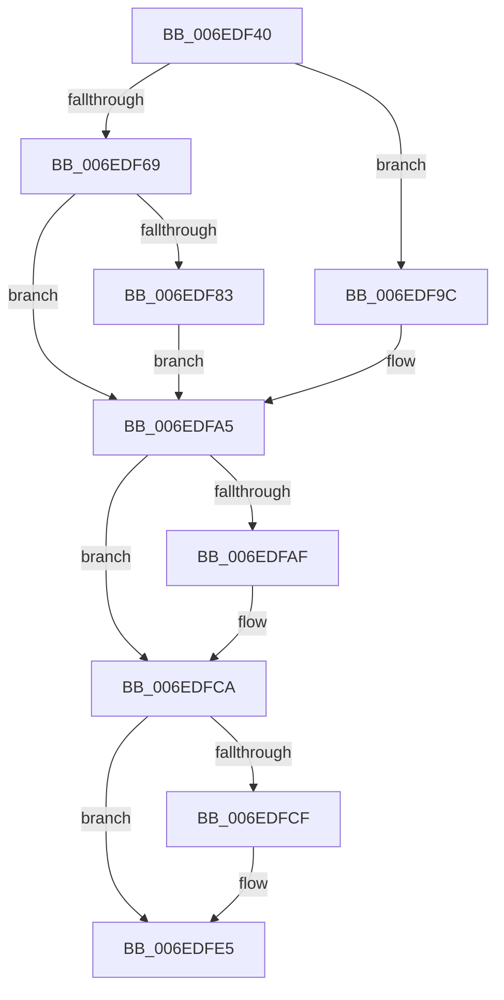

# sub_006EDF40

- RVA: `0x006EDF40`–`0x006EDFF1` (길이 `177` bytes)
- VA: `0x00000001406EDF40`
- 실행 섹션: `.text`
- PDB 이름 있음: `아니요`; PDB Function 태그: `아니요`
- unwind 정보 RVA: `0x000A0DAC`
- 디코드: `48`개 명령, `177/177` bytes 표시
- 미해석 바이트: `0` (있으면 어셈블리에 `.byte`로 보존)

> 이 문서는 커널 이미지의 기계어와 PDB 기호를 분석해 생성했습니다. 4번과 5번은 함수 원형과 자료형을 바이너리 사용 방식에서 추정한 C 해석이며 원본 소스 복구 결과는 아닙니다.

## 1. Dependencies

- 직접 호출 지점: **3**; 고유 호출 대상: **1**
- 직접 호출자로 확인된 함수: **0**
- RIP 상대 이미지 참조: **0**

### Outgoing calls
- `0x006EDF95` → [VmpInvalidateSingleGpaRange](../46/VmpInvalidateSingleGpaRange_function_004628D8.md) (function, `0x004628D8`)
- `0x006EDFC5` → [VmpInvalidateSingleGpaRange](../46/VmpInvalidateSingleGpaRange_function_004628D8.md) (function, `0x004628D8`)
- `0x006EDFE0` → [VmpInvalidateSingleGpaRange](../46/VmpInvalidateSingleGpaRange_function_004628D8.md) (function, `0x004628D8`)

### Direct callers
- 이 함수 시작 RVA로 연결되는 직접 call은 확인되지 않았습니다. 간접 호출은 완전히 역산할 수 없습니다.

### Static image references
- 디코드된 RIP-relative 메모리 참조가 없습니다.

## 2. Other-region calls and transfers

- 다른 실행 섹션으로 향하는 call: **0**
- call이 아닌 외부 분기/꼬리 이동: **1**
  - `0x006EDFEC` → [VmpProcessInvalidateList + 0xF1](../42/VmpProcessInvalidateList_function_00428A54.md) (`tail-transfer`)

## 3. Assembly (complete function range)

```asm
006EDF40  48 8B 6B 10                     mov rbp, qword ptr [rbx + 0x10]
006EDF44  4C 8B 73 08                     mov r14, qword ptr [rbx + 8]
006EDF48  48 C1 ED 0C                     shr rbp, 0xc
006EDF4C  48 8D BD FF 01 00 00            lea rdi, [rbp + 0x1ff]
006EDF53  48 81 E7 00 FE FF FF            and rdi, 0xfffffffffffffe00
006EDF5A  48 2B FD                        sub rdi, rbp
006EDF5D  48 8D 87 00 02 00 00            lea rax, [rdi + 0x200]
006EDF64  4C 3B F0                        cmp r14, rax
006EDF67  72 33                           jb 0x1406edf9c
006EDF69  49 8B F6                        mov rsi, r14
006EDF6C  48 2B F7                        sub rsi, rdi
006EDF6F  81 E6 FF 01 00 00               and esi, 0x1ff
006EDF75  4C 2B F6                        sub r14, rsi
006EDF78  4C 2B F7                        sub r14, rdi
006EDF7B  4D 8B FE                        mov r15, r14
006EDF7E  48 85 FF                        test rdi, rdi
006EDF81  74 22                           je 0x1406edfa5
006EDF83  48 8B 4C 24 70                  mov rcx, qword ptr [rsp + 0x70]
006EDF88  45 8B CC                        mov r9d, r12d
006EDF8B  4C 8B C7                        mov r8, rdi
006EDF8E  48 8B D5                        mov rdx, rbp
006EDF91  48 8B 49 68                     mov rcx, qword ptr [rcx + 0x68]
006EDF95  E8 3E 49 D7 FF                  call 0x1404628d8
006EDF9A  EB 09                           jmp 0x1406edfa5
006EDF9C  48 8B FE                        mov rdi, rsi
006EDF9F  4C 8B FE                        mov r15, rsi
006EDFA2  49 8B F6                        mov rsi, r14
006EDFA5  4C 8B 74 24 70                  mov r14, qword ptr [rsp + 0x70]
006EDFAA  4D 85 FF                        test r15, r15
006EDFAD  74 1B                           je 0x1406edfca
006EDFAF  49 8B 4E 68                     mov rcx, qword ptr [r14 + 0x68]
006EDFB3  48 8D 14 2F                     lea rdx, [rdi + rbp]
006EDFB7  45 8B CC                        mov r9d, r12d
006EDFBA  4D 8B C7                        mov r8, r15
006EDFBD  41 83 C9 01                     or r9d, 1
006EDFC1  49 C1 E8 09                     shr r8, 9
006EDFC5  E8 0E 49 D7 FF                  call 0x1404628d8
006EDFCA  48 85 F6                        test rsi, rsi
006EDFCD  74 16                           je 0x1406edfe5
006EDFCF  49 8B 4E 68                     mov rcx, qword ptr [r14 + 0x68]
006EDFD3  4A 8D 14 3F                     lea rdx, [rdi + r15]
006EDFD7  48 03 D5                        add rdx, rbp
006EDFDA  45 8B CC                        mov r9d, r12d
006EDFDD  4C 8B C6                        mov r8, rsi
006EDFE0  E8 F3 48 D7 FF                  call 0x1404628d8
006EDFE5  BD 02 00 00 00                  mov ebp, 2
006EDFEA  33 F6                           xor esi, esi
006EDFEC  E9 54 AB D3 FF                  jmp 0x140428b45
```

## 4. C-style interpretation (structured pseudocode)

```c
__int64 __fastcall sub_006EDF40(__int64 a1, __int64 a2, __int64 a3, __int64 a4, __int64 a5, __int64 a6, __int64 a7, __int64 a8, __int64 a9, __int64 a10, __int64 a11, __int64 a12, __int64 a13, __int64 a14)
{
    __int64 result;
    __int64 v_r14;
    __int64 v_rbp;
    __int64 v_rdi;
    __int64 v_rsi;

    v_rbp = (*(unsigned __int64 *)(v_rbx + 16)) >> (12);
    v_rdi = (v_rbp + 511) & (-512);
    v_rdi = (v_rdi) - (v_rbp);
    if ((*(unsigned __int64 *)(v_rbx + 8)) < (v_rdi + 512)) goto loc_006EDF9C;
    v_rsi = (*(unsigned __int64 *)(v_rbx + 8)) - (v_rdi);
    v_rsi = (unsigned int)((v_rsi) & (511));
    v_r14 = (*(unsigned __int64 *)(v_rbx + 8)) - (v_rsi);
    v_r14 = (v_r14) - (v_rdi);
    if (v_rdi == 0) goto loc_006EDFA5;
    result = VmpInvalidateSingleGpaRange(*(unsigned __int64 *)(a14 + 104), v_rbp, v_rdi, (unsigned int)((unsigned int)(v_r12)));
    goto loc_006EDFA5;
loc_006EDF9C:
loc_006EDFA5:
    if (v_rsi != 0) {
        a1 = *(unsigned __int64 *)(a14 + 104);
        a2 = v_rsi + v_rbp * 1;
        a4 = (unsigned int)(v_r12);
        a3 = v_rsi;
        a4 = (unsigned int)((a4) | (1));
        a3 = (a3) >> (9);
        result = VmpInvalidateSingleGpaRange(a1, a2, a3, a4);
    }
    if (v_r14 != 0) {
        a1 = *(unsigned __int64 *)(a14 + 104);
        a2 = v_rsi + v_rsi * 1;
        a2 = (a2) + (v_rbp);
        a4 = (unsigned int)(v_r12);
        a3 = v_r14;
        result = VmpInvalidateSingleGpaRange(a1, a2, a3, a4);
    }
    v_rsi = 0;
}
```

## 5. (Beta) C Style

```c
int64_t sub_006EDF40(int64_t Arg1, int64_t Arg2, int64_t Arg3, int64_t Arg4, uint64_t Arg5, uint64_t Arg6, uint64_t Arg7, uint64_t Arg8, uint64_t Arg9, uint64_t Arg10, uint64_t Arg11, uint64_t Arg12, uint64_t Arg13, void *Arg14)
{
    uint8_t *arg14 = (uint8_t *)Arg14;

    int64_t result;
    int64_t local_r14;
    int64_t local_rbp;
    int64_t local_rdi;
    int64_t local_rsi;

    local_rbp = (*(uint64_t *)(local_rbx + 0x10)) >> (12);
    local_rdi = (local_rbp + 511) & (-512);
    local_rdi = (local_rdi) - (local_rbp);
    if ((*(uint64_t *)(local_rbx + 0x8)) < (local_rdi + 512)) goto loc_006EDF9C;
    local_rsi = (*(uint64_t *)(local_rbx + 0x8)) - (local_rdi);
    local_rsi = (uint32_t)((local_rsi) & (511));
    local_r14 = (*(uint64_t *)(local_rbx + 0x8)) - (local_rsi);
    local_r14 = (local_r14) - (local_rdi);
    if (local_rdi == 0) goto loc_006EDFA5;
    result = VmpInvalidateSingleGpaRange(*(uint64_t *)(arg14 + 0x68), local_rbp, local_rdi, (uint32_t)((uint32_t)(local_r12)));
    goto loc_006EDFA5;
loc_006EDF9C:
loc_006EDFA5:
    if (local_rsi != 0) {
        Arg1 = *(uint64_t *)(arg14 + 0x68);
        Arg2 = local_rsi + local_rbp * 1;
        Arg4 = (uint32_t)(local_r12);
        Arg3 = local_rsi;
        Arg4 = (uint32_t)((Arg4) | (1));
        Arg3 = (Arg3) >> (9);
        result = VmpInvalidateSingleGpaRange(Arg1, Arg2, Arg3, Arg4);
    }
    if (local_r14 != 0) {
        Arg1 = *(uint64_t *)(arg14 + 0x68);
        Arg2 = local_rsi + local_rsi * 1;
        Arg2 = (Arg2) + (local_rbp);
        Arg4 = (uint32_t)(local_r12);
        Arg3 = local_r14;
        result = VmpInvalidateSingleGpaRange(Arg1, Arg2, Arg3, Arg4);
    }
    local_rsi = 0;
}
```

### 관측된 메모리 오프셋

구조체 형식이 확인되지 않은 접근은 인자 기준의 오프셋으로만 기록했습니다.

| 기준 인자 | 오프셋 표현 | 폭 (bit) | 접근 |
|---|---:|---:|---|
| `Arg14` | `+ 0x68` | `64` | `R` |

## 6. Execution-region graph

[열기: 2D/3D 그래프와 함수 탐색 컨트롤 패널](../../../control-panel.html?section=text&rva=0x006EDF40&view=graph)

- 2D 그래프는 위에서 아래로 흐르고, 3D 그래프는 빈 공간을 드래그해 회전합니다. Shift+드래그는 이동, 휠은 확대·축소, 함수 노드 선택은 대상 보고서 이동입니다.

### Static fallback


