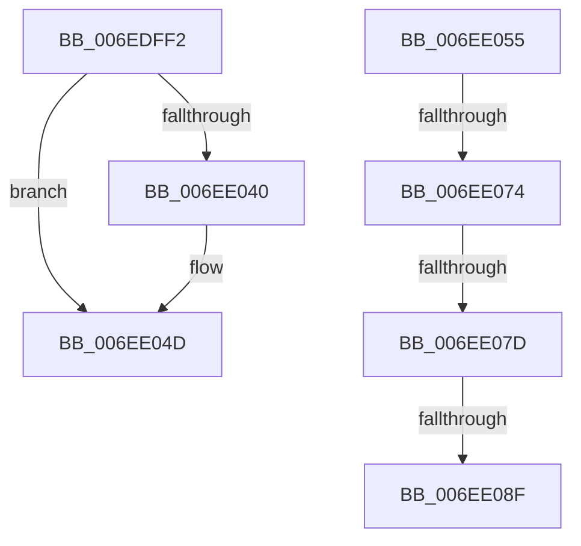

# sub_006EDFF2

- RVA: `0x006EDFF2`–`0x006EE0BE` (길이 `204` bytes)
- VA: `0x00000001406EDFF2`
- 실행 섹션: `.text`
- PDB 이름 있음: `아니요`; PDB Function 태그: `아니요`
- unwind 정보 RVA: `0x000A0E94`
- 디코드: `51`개 명령, `204/204` bytes 표시
- 미해석 바이트: `0` (있으면 어셈블리에 `.byte`로 보존)

> 이 문서는 커널 이미지의 기계어와 PDB 기호를 분석해 생성했습니다. 4번과 5번은 함수 원형과 자료형을 바이너리 사용 방식에서 추정한 C 해석이며 원본 소스 복구 결과는 아닙니다.

## 1. Dependencies

- 직접 호출 지점: **6**; 고유 호출 대상: **6**
- 직접 호출자로 확인된 함수: **0**
- RIP 상대 이미지 참조: **1**

### Outgoing calls
- `0x006EDFFD` → [VmpProcessContextUnlockShared](../42/VmpProcessContextUnlockShared_function_00429DFC.md) (function, `0x00429DFC`)
- `0x006EE027` → [VmpProcessAccessedBatch](../42/VmpProcessAccessedBatch_function_0042A2DC.md) (function, `0x0042A2DC`)
- `0x006EE031` → [VmpProcessContextLockShared](../42/VmpProcessContextLockShared_function_00429DB0.md) (function, `0x00429DB0`)
- `0x006EE059` → [KeQueryUnbiasedInterruptTimePrecise](../37/KeQueryUnbiasedInterruptTimePrecise_function_0037AC20.md) (function, `0x0037AC20`)
- `0x006EE082` → [tlgKeywordOn](../42/tlgKeywordOn_function_0042EAA0.md) (function, `0x0042EAA0`)
- `0x006EE0B3` → [VmpLogQueryAccessedState](../64/VmpLogQueryAccessedState_function_0064DAE0.md) (function, `0x0064DAE0`)

### Direct callers
- 이 함수 시작 RVA로 연결되는 직접 call은 확인되지 않았습니다. 간접 호출은 완전히 역산할 수 없습니다.

### Static image references
- `0x006EE05E` → RVA `0x00F02458` (`.data`; read)

## 2. Other-region calls and transfers

- 다른 실행 섹션으로 향하는 call: **0**
- call이 아닌 외부 분기/꼬리 이동: **5**
  - `0x006EE050` → [VmpQueryAccessedState + 0x129](../42/VmpQueryAccessedState_function_004290A8.md) (`tail-transfer`)
  - `0x006EE06E` → [VmpQueryAccessedState + 0x15D](../42/VmpQueryAccessedState_function_004290A8.md) (`tail-transfer`)
  - `0x006EE077` → [VmpQueryAccessedState + 0x15D](../42/VmpQueryAccessedState_function_004290A8.md) (`tail-transfer`)
  - `0x006EE089` → [VmpQueryAccessedState + 0x15D](../42/VmpQueryAccessedState_function_004290A8.md) (`tail-transfer`)
  - `0x006EE0B9` → [VmpQueryAccessedState + 0x15D](../42/VmpQueryAccessedState_function_004290A8.md) (`tail-transfer`)

## 3. Assembly (complete function range)

```asm
006EDFF2  48 8B 55 BF                     mov rdx, qword ptr [rbp - 0x41]
006EDFF6  49 8B CE                        mov rcx, r14
006EDFF9  49 8B 5E 48                     mov rbx, qword ptr [r14 + 0x48]
006EDFFD  E8 FA BD D3 FF                  call 0x140429dfc
006EE002  8B 4D 7F                        mov ecx, dword ptr [rbp + 0x7f]
006EE005  49 8D 87 00 10 00 00            lea rax, [r15 + 0x1000]
006EE00C  4C 8B 4D D7                     mov r9, qword ptr [rbp - 0x29]
006EE010  44 8B C6                        mov r8d, esi
006EE013  44 89 6C 24 30                  mov dword ptr [rsp + 0x30], r13d
006EE018  49 8B D7                        mov rdx, r15
006EE01B  89 4C 24 28                     mov dword ptr [rsp + 0x28], ecx
006EE01F  49 8B CE                        mov rcx, r14
006EE022  48 89 44 24 20                  mov qword ptr [rsp + 0x20], rax
006EE027  E8 B0 C2 D3 FF                  call 0x14042a2dc
006EE02C  49 8B CE                        mov rcx, r14
006EE02F  33 F6                           xor esi, esi
006EE031  E8 7A BD D3 FF                  call 0x140429db0
006EE036  48 89 45 BF                     mov qword ptr [rbp - 0x41], rax
006EE03A  49 3B 5E 48                     cmp rbx, qword ptr [r14 + 0x48]
006EE03E  74 0D                           je 0x1406ee04d
006EE040  0F 57 C0                        xorps xmm0, xmm0
006EE043  33 C9                           xor ecx, ecx
006EE045  0F 11 45 07                     movups xmmword ptr [rbp + 7], xmm0
006EE049  48 89 4D 17                     mov qword ptr [rbp + 0x17], rcx
006EE04D  41 FF C4                        inc r12d
006EE050  E9 7C B1 D3 FF                  jmp 0x1404291d1
006EE055  48 8D 4D 6F                     lea rcx, [rbp + 0x6f]
006EE059  E8 C2 CB C8 FF                  call 0x14037ac20
006EE05E  48 8B 0D F3 43 81 00            mov rcx, qword ptr [rip + 0x8143f3]
006EE065  4C 8B C0                        mov r8, rax
006EE068  4D 2B C5                        sub r8, r13
006EE06B  48 85 C9                        test rcx, rcx
006EE06E  0F 84 91 B1 D3 FF               je 0x140429205
006EE074  83 39 00                        cmp dword ptr [rcx], 0
006EE077  0F 86 88 B1 D3 FF               jbe 0x140429205
006EE07D  BA 00 02 00 00                  mov edx, 0x200
006EE082  E8 19 0A D4 FF                  call 0x14042eaa0
006EE087  84 C0                           test al, al
006EE089  0F 84 76 B1 D3 FF               je 0x140429205
006EE08F  49 8B 46 68                     mov rax, qword ptr [r14 + 0x68]
006EE093  44 8B 4D B7                     mov r9d, dword ptr [rbp - 0x49]
006EE097  8B 55 77                        mov edx, dword ptr [rbp + 0x77]
006EE09A  48 89 44 24 38                  mov qword ptr [rsp + 0x38], rax
006EE09F  8B 45 BB                        mov eax, dword ptr [rbp - 0x45]
006EE0A2  4C 89 44 24 30                  mov qword ptr [rsp + 0x30], r8
006EE0A7  44 8B C3                        mov r8d, ebx
006EE0AA  89 44 24 28                     mov dword ptr [rsp + 0x28], eax
006EE0AE  44 89 64 24 20                  mov dword ptr [rsp + 0x20], r12d
006EE0B3  E8 28 FA F5 FF                  call 0x14064dae0
006EE0B8  90                              nop
006EE0B9  E9 47 B1 D3 FF                  jmp 0x140429205
```

## 4. C-style interpretation (structured pseudocode)

```c
__int64 __fastcall sub_006EDFF2(void)
{
    __int64 result;
    __int64 v_r12;
    __int64 v_rsi;
    unsigned __int64 v_stack_p20;
    unsigned int v_stack_p28;
    unsigned int v_stack_p30;
    unsigned __int64 v_stack_p38;

    result = VmpProcessContextUnlockShared(v_r14, *(unsigned __int64 *)(v_rbp - 65), a3, a4);
    v_stack_p30 = (unsigned int)(v_r13);
    v_stack_p28 = (unsigned int)((unsigned int)(*(unsigned int *)(v_rbp + 127)));
    v_stack_p20 = v_r15 + 4096;
    result = VmpProcessAccessedBatch(v_r14, v_r15, (unsigned int)((unsigned int)(v_rsi)), *(unsigned __int64 *)(v_rbp - 41));
    v_rsi = 0;
    result = VmpProcessContextLockShared(v_r14, v_r15, (unsigned int)((unsigned int)(v_rsi)), *(unsigned __int64 *)(v_rbp - 41));
    *(unsigned __int64 *)(v_rbp - 65) = result;
    if ((*(unsigned __int64 *)(v_r14 + 72)) != (*(unsigned __int64 *)(v_r14 + 72))) {
        a1 = 0;
        *(unsigned __int64 *)(v_rbp + 7) = v_xmm0;
        *(unsigned __int64 *)(v_rbp + 23) = 0;
    }
    v_r12 = (unsigned int)((v_r12) + 1);
}
```

## 5. (Beta) C Style

```c
void sub_006EDFF2(void)
{
    int64_t result;
    int64_t local_r12;
    int64_t local_rsi;
    uint64_t v_stack_p20;
    uint32_t v_stack_p28;
    uint32_t v_stack_p30;
    uint64_t v_stack_p38;

    result = VmpProcessContextUnlockShared(local_r14, *(uint64_t *)(local_rbp - 0x41), a3, a4);
    v_stack_p30 = (uint32_t)(local_r13);
    v_stack_p28 = (uint32_t)((uint32_t)(*(uint32_t *)(local_rbp + 0x7F)));
    v_stack_p20 = local_r15 + 4096;
    result = VmpProcessAccessedBatch(local_r14, local_r15, (uint32_t)((uint32_t)(local_rsi)), *(uint64_t *)(local_rbp - 0x29));
    local_rsi = 0;
    result = VmpProcessContextLockShared(local_r14, local_r15, (uint32_t)((uint32_t)(local_rsi)), *(uint64_t *)(local_rbp - 0x29));
    *(uint64_t *)(local_rbp - 0x41) = result;
    if ((*(uint64_t *)(local_r14 + 0x48)) != (*(uint64_t *)(local_r14 + 0x48))) {
        a1 = 0;
        *(uint64_t *)(local_rbp + 0x7) = v_xmm0;
        *(uint64_t *)(local_rbp + 0x17) = 0;
    }
    local_r12 = (uint32_t)((local_r12) + 1);
}
```

## 6. Execution-region graph

[열기: 2D/3D 그래프와 함수 탐색 컨트롤 패널](../../../control-panel.html?section=text&rva=0x006EDFF2&view=graph)

- 2D 그래프는 위에서 아래로 흐르고, 3D 그래프는 빈 공간을 드래그해 회전합니다. Shift+드래그는 이동, 휠은 확대·축소, 함수 노드 선택은 대상 보고서 이동입니다.

### Static fallback


