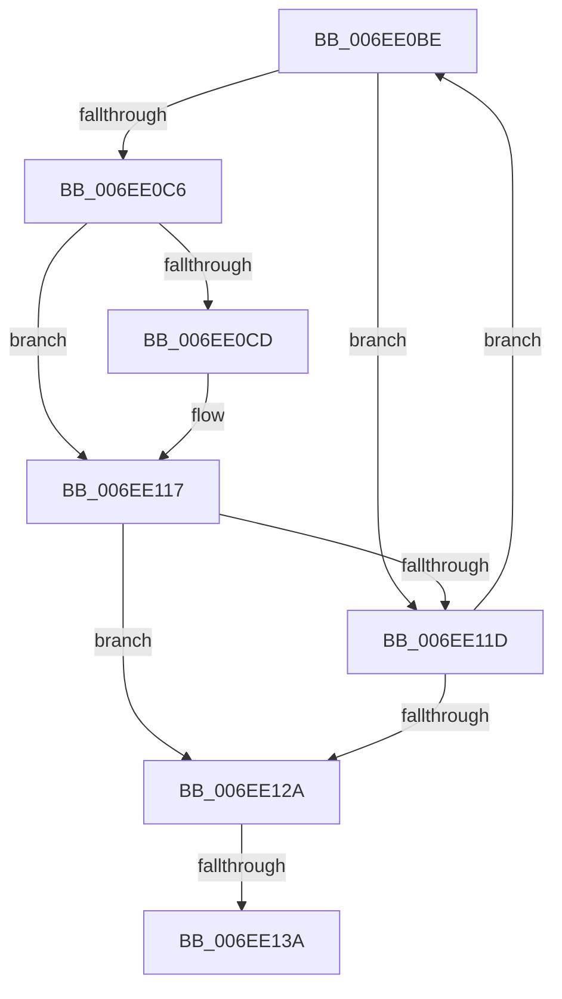

# sub_006EE0BE

- RVA: `0x006EE0BE`–`0x006EE147` (길이 `137` bytes)
- VA: `0x00000001406EE0BE`
- 실행 섹션: `.text`
- PDB 이름 있음: `아니요`; PDB Function 태그: `아니요`
- unwind 정보 RVA: `0x000A0EE4`
- 디코드: `31`개 명령, `137/137` bytes 표시
- 미해석 바이트: `0` (있으면 어셈블리에 `.byte`로 보존)

> 이 문서는 커널 이미지의 기계어와 PDB 기호를 분석해 생성했습니다. 4번과 5번은 함수 원형과 자료형을 바이너리 사용 방식에서 추정한 C 해석이며 원본 소스 복구 결과는 아닙니다.

## 1. Dependencies

- 직접 호출 지점: **0**; 고유 호출 대상: **0**
- 직접 호출자로 확인된 함수: **0**
- RIP 상대 이미지 참조: **0**

### Outgoing calls
- 직접 디코드된 call 명령이 없습니다.

### Direct callers
- 이 함수 시작 RVA로 연결되는 직접 call은 확인되지 않았습니다. 간접 호출은 완전히 역산할 수 없습니다.

### Static image references
- 디코드된 RIP-relative 메모리 참조가 없습니다.

## 2. Other-region calls and transfers

- 다른 실행 섹션으로 향하는 call: **0**
- call이 아닌 외부 분기/꼬리 이동: **2**
  - `0x006EE134` → [VmpAccessFaultBatch + 0x14F](../42/VmpAccessFaultBatch_function_00429398.md) (`tail-transfer`)
  - `0x006EE142` → [VmpAccessFaultBatch + 0x32](../42/VmpAccessFaultBatch_function_00429398.md) (`tail-transfer`)

## 3. Assembly (complete function range)

```asm
006EE0BE  48 8B 02                        mov rax, qword ptr [rdx]
006EE0C1  48 85 C1                        test rcx, rax
006EE0C4  74 57                           je 0x1406ee11d
006EE0C6  48 0F BA E0 39                  bt rax, 0x39
006EE0CB  72 4A                           jb 0x1406ee117
006EE0CD  48 B9 FF FF FF FF FF FF EF FF   movabs rcx, 0xffefffffffffffff
006EE0D7  48 21 4A F8                     and qword ptr [rdx - 8], rcx
006EE0DB  48 B9 FF FF FF FF FF FF 0F 00   movabs rcx, 0xfffffffffffff
006EE0E5  48 23 C1                        and rax, rcx
006EE0E8  48 8D 0C 76                     lea rcx, [rsi + rsi*2]
006EE0EC  48 89 02                        mov qword ptr [rdx], rax
006EE0EF  48 03 C9                        add rcx, rcx
006EE0F2  0F 10 42 E0                     movups xmm0, xmmword ptr [rdx - 0x20]
006EE0F6  FF C6                           inc esi
006EE0F8  0F 11 04 CF                     movups xmmword ptr [rdi + rcx*8], xmm0
006EE0FC  0F 10 4A F0                     movups xmm1, xmmword ptr [rdx - 0x10]
006EE100  0F 11 4C CF 10                  movups xmmword ptr [rdi + rcx*8 + 0x10], xmm1
006EE105  0F 10 02                        movups xmm0, xmmword ptr [rdx]
006EE108  0F 11 44 CF 20                  movups xmmword ptr [rdi + rcx*8 + 0x20], xmm0
006EE10D  48 B9 00 00 00 00 00 00 00 01   movabs rcx, 0x100000000000000
006EE117  41 83 C7 FF                     add r15d, -1
006EE11B  74 0D                           je 0x1406ee12a
006EE11D  48 83 C2 30                     add rdx, 0x30
006EE121  48 8D 42 E0                     lea rax, [rdx - 0x20]
006EE125  49 3B C5                        cmp rax, r13
006EE128  72 94                           jb 0x1406ee0be
006EE12A  48 8B AC 24 80 00 00 00         mov rbp, qword ptr [rsp + 0x80]
006EE132  85 F6                           test esi, esi
006EE134  0F 84 AD B3 D3 FF               je 0x1404294e7
006EE13A  48 8B 9C 24 98 00 00 00         mov rbx, qword ptr [rsp + 0x98]
006EE142  E9 83 B2 D3 FF                  jmp 0x1404293ca
```

## 4. C-style interpretation (structured pseudocode)

```c
__int64 __fastcall sub_006EE0BE(__int64 a1, __int64 a2, __int64 a3, __int64 a4, __int64 a5, __int64 a6, __int64 a7, __int64 a8, __int64 a9, __int64 a10, __int64 a11, __int64 a12, __int64 a13, __int64 a14, __int64 a15, __int64 a16, __int64 a17, __int64 a18, __int64 a19)
{
    __int64 result;
    __int64 v_r15;
    __int64 v_rsi;

    if (((a1) & (*(unsigned __int64 *)(a2))) == 0) goto loc_006EE11D;
    result = *(unsigned __int64 *)(a2);
    if (!(condition_is_below)) {
        result = (*(unsigned __int64 *)(a2)) & (a1);
        a1 = v_rsi + v_rsi * 2;
        *(unsigned __int64 *)(a2) = result;
        a1 = (a1) + (a1);
        v_rsi = (unsigned int)((v_rsi) + 1);
        *(unsigned __int64 *)(v_rdi + a1 * 8) = v_xmm0;
        *(unsigned __int64 *)(v_rdi + a1 * 8 + 16) = v_xmm1;
        *(unsigned __int64 *)(v_rdi + a1 * 8 + 32) = v_xmm0;
    }
    v_r15 = (unsigned int)((v_r15) + (-1));
    if (condition_is_equal) goto loc_006EE12A;
loc_006EE11D:
    a2 = (a2) + (48);
    if ((a2 - 32) < v_r13) goto loc_006EE0BE;
loc_006EE12A:
}
```

## 5. (Beta) C Style

```c
int64_t sub_006EE0BE(int64_t Arg1, void *Arg2, int64_t Arg3, int64_t Arg4, uint64_t Arg5, uint64_t Arg6, uint64_t Arg7, uint64_t Arg8, uint64_t Arg9, uint64_t Arg10, uint64_t Arg11, uint64_t Arg12, uint64_t Arg13, uint64_t Arg14, uint64_t Arg15, int64_t Arg16, uint64_t Arg17, uint64_t Arg18, int64_t Arg19)
{
    uint8_t *arg2 = (uint8_t *)Arg2;

    int64_t result;
    int64_t local_r15;
    int64_t local_rsi;

    if (((Arg1) & (*(uint64_t *)(arg2))) == 0) goto loc_006EE11D;
    result = *(uint64_t *)(arg2);
    if (!(condition_is_below)) {
        result = (*(uint64_t *)(arg2)) & (Arg1);
        Arg1 = local_rsi + local_rsi * 2;
        *(uint64_t *)(arg2) = result;
        Arg1 = (Arg1) + (Arg1);
        local_rsi = (uint32_t)((local_rsi) + 1);
        *(uint64_t *)(local_rdi + Arg1 * 8) = v_xmm0;
        *(uint64_t *)(local_rdi + Arg1 * 8 + 0x10) = v_xmm1;
        *(uint64_t *)(local_rdi + Arg1 * 8 + 0x20) = v_xmm0;
    }
    local_r15 = (uint32_t)((local_r15) + (-1));
    if (condition_is_equal) goto loc_006EE12A;
loc_006EE11D:
    Arg2 = (Arg2) + (48);
    if ((Arg2 - 32) < local_r13) goto loc_006EE0BE;
loc_006EE12A:
}
```

### 관측된 메모리 오프셋

구조체 형식이 확인되지 않은 접근은 인자 기준의 오프셋으로만 기록했습니다.

| 기준 인자 | 오프셋 표현 | 폭 (bit) | 접근 |
|---|---:|---:|---|
| `Arg2` | `- 0x20` | `64` | `R` |
| `Arg2` | `- 0x20` | `128` | `R` |
| `Arg2` | `- 0x10` | `128` | `R` |
| `Arg2` | `- 0x8` | `64` | `R/W` |
| `Arg2` | `+ 0x0` | `64` | `R` |
| `Arg2` | `+ 0x0` | `64` | `W` |
| `Arg2` | `+ 0x0` | `128` | `R` |

## 6. Execution-region graph

[열기: 2D/3D 그래프와 함수 탐색 컨트롤 패널](../../../control-panel.html?section=text&rva=0x006EE0BE&view=graph)

- 2D 그래프는 위에서 아래로 흐르고, 3D 그래프는 빈 공간을 드래그해 회전합니다. Shift+드래그는 이동, 휠은 확대·축소, 함수 노드 선택은 대상 보고서 이동입니다.

### Static fallback


