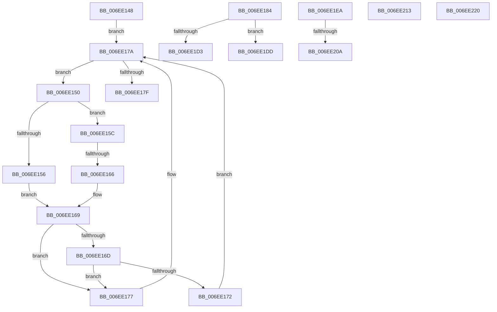

# sub_006EE148

- RVA: `0x006EE148`–`0x006EE22B` (길이 `227` bytes)
- VA: `0x00000001406EE148`
- 실행 섹션: `.text`
- PDB 이름 있음: `아니요`; PDB Function 태그: `아니요`
- unwind 정보 RVA: `0x000A0F2C`
- 디코드: `61`개 명령, `227/227` bytes 표시
- 미해석 바이트: `0` (있으면 어셈블리에 `.byte`로 보존)

> 이 문서는 커널 이미지의 기계어와 PDB 기호를 분석해 생성했습니다. 4번과 5번은 함수 원형과 자료형을 바이너리 사용 방식에서 추정한 C 해석이며 원본 소스 복구 결과는 아닙니다.

## 1. Dependencies

- 직접 호출 지점: **3**; 고유 호출 대상: **3**
- 직접 호출자로 확인된 함수: **0**
- RIP 상대 이미지 참조: **0**

### Outgoing calls
- `0x006EE1C8` → [VmpSecureMemoryForPin](../../page/7A/VmpSecureMemoryForPin_function_007ADED4.md) (function, `0x007ADED4`)
- `0x006EE1FB` → [VmpFindNextPinnedPageStateHelper](../64/VmpFindNextPinnedPageStateHelper_function_0064C7E4.md) (function, `0x0064C7E4`)
- `0x006EE220` → [VmpProcessContextUnlockExclusive](../48/VmpProcessContextUnlockExclusive_function_004894C8.md) (function, `0x004894C8`)

### Direct callers
- 이 함수 시작 RVA로 연결되는 직접 call은 확인되지 않았습니다. 간접 호출은 완전히 역산할 수 없습니다.

### Static image references
- 디코드된 RIP-relative 메모리 참조가 없습니다.

## 2. Other-region calls and transfers

- 다른 실행 섹션으로 향하는 call: **1**
  - `0x006EE1C8` → [VmpSecureMemoryForPin](../../page/7A/VmpSecureMemoryForPin_function_007ADED4.md) (`.text` → `PAGE`)
- call이 아닌 외부 분기/꼬리 이동: **8**
  - `0x006EE160` → [VmpSplitMemoryRange + 0x8C](../42/VmpSplitMemoryRange_function_00429754.md) (`tail-transfer`)
  - `0x006EE17F` → [VmpSplitMemoryRange + 0x8C](../42/VmpSplitMemoryRange_function_00429754.md) (`tail-transfer`)
  - `0x006EE1D8` → [VmpSplitMemoryRange + 0xE7](../42/VmpSplitMemoryRange_function_00429754.md) (`tail-transfer`)
  - `0x006EE1E5` → [VmpSplitMemoryRange + 0x296](../42/VmpSplitMemoryRange_function_00429754.md) (`tail-transfer`)
  - `0x006EE204` → [VmpSplitMemoryRange + 0x1E0](../42/VmpSplitMemoryRange_function_00429754.md) (`tail-transfer`)
  - `0x006EE20E` → [VmpSplitMemoryRange + 0x1E0](../42/VmpSplitMemoryRange_function_00429754.md) (`tail-transfer`)
  - `0x006EE21B` → [VmpSplitMemoryRange + 0x26A](../42/VmpSplitMemoryRange_function_00429754.md) (`tail-transfer`)
  - `0x006EE226` → [VmpSplitMemoryRange + 0x286](../42/VmpSplitMemoryRange_function_00429754.md) (`tail-transfer`)

## 3. Assembly (complete function range)

```asm
006EE148  0F B6 4E 08                     movzx ecx, byte ptr [rsi + 8]
006EE14C  23 CD                           and ecx, ebp
006EE14E  EB 2A                           jmp 0x1406ee17a
006EE150  4C 3B 7F 20                     cmp r15, qword ptr [rdi + 0x20]
006EE154  76 06                           jbe 0x1406ee15c
006EE156  48 8B 47 08                     mov rax, qword ptr [rdi + 8]
006EE15A  EB 0D                           jmp 0x1406ee169
006EE15C  4C 3B 7F 18                     cmp r15, qword ptr [rdi + 0x18]
006EE160  0F 83 7A B6 D3 FF               jae 0x1404297e0
006EE166  48 8B 07                        mov rax, qword ptr [rdi]
006EE169  85 C9                           test ecx, ecx
006EE16B  74 0A                           je 0x1406ee177
006EE16D  48 85 C0                        test rax, rax
006EE170  74 05                           je 0x1406ee177
006EE172  48 33 F8                        xor rdi, rax
006EE175  EB 03                           jmp 0x1406ee17a
006EE177  48 8B F8                        mov rdi, rax
006EE17A  48 85 FF                        test rdi, rdi
006EE17D  75 D1                           jne 0x1406ee150
006EE17F  E9 5C B6 D3 FF                  jmp 0x1404297e0
006EE184  48 8B 57 18                     mov rdx, qword ptr [rdi + 0x18]
006EE188  4C 8D 4C 24 48                  lea r9, [rsp + 0x48]
006EE18D  48 8B 47 20                     mov rax, qword ptr [rdi + 0x20]
006EE191  44 8B 6F 48                     mov r13d, dword ptr [rdi + 0x48]
006EE195  48 8B C8                        mov rcx, rax
006EE198  48 2B CA                        sub rcx, rdx
006EE19B  48 89 54 24 50                  mov qword ptr [rsp + 0x50], rdx
006EE1A0  48 FF C1                        inc rcx
006EE1A3  4C 89 A4 24 C0 00 00 00         mov qword ptr [rsp + 0xc0], r12
006EE1AB  49 2B C4                        sub rax, r12
006EE1AE  48 89 4C 24 30                  mov qword ptr [rsp + 0x30], rcx
006EE1B3  48 FF C0                        inc rax
006EE1B6  49 8B CE                        mov rcx, r14
006EE1B9  4C 8B C0                        mov r8, rax
006EE1BC  48 89 44 24 58                  mov qword ptr [rsp + 0x58], rax
006EE1C1  49 8B D4                        mov rdx, r12
006EE1C4  41 83 E5 01                     and r13d, 1
006EE1C8  E8 07 FD 0B 00                  call 0x1407aded4
006EE1CD  8B D8                           mov ebx, eax
006EE1CF  85 C0                           test eax, eax
006EE1D1  78 0A                           js 0x1406ee1dd
006EE1D3  48 8B 5C 24 48                  mov rbx, qword ptr [rsp + 0x48]
006EE1D8  E9 5E B6 D3 FF                  jmp 0x14042983b
006EE1DD  48 8B 74 24 48                  mov rsi, qword ptr [rsp + 0x48]
006EE1E2  49 8B FC                        mov rdi, r12
006EE1E5  E9 00 B8 D3 FF                  jmp 0x1404299ea
006EE1EA  4C 8B 43 38                     mov r8, qword ptr [rbx + 0x38]
006EE1EE  41 B9 01 00 00 00               mov r9d, 1
006EE1F4  48 8B 53 30                     mov rdx, qword ptr [rbx + 0x30]
006EE1F8  49 8B CE                        mov rcx, r14
006EE1FB  E8 E4 E5 F5 FF                  call 0x14064c7e4
006EE200  48 83 F8 FF                     cmp rax, -1
006EE204  0F 84 2A B7 D3 FF               je 0x140429934
006EE20A  83 4B 40 01                     or dword ptr [rbx + 0x40], 1
006EE20E  E9 21 B7 D3 FF                  jmp 0x140429934
006EE213  4C 8B 7C 24 58                  mov r15, qword ptr [rsp + 0x58]
006EE218  4C 8B EF                        mov r13, rdi
006EE21B  E9 9E B7 D3 FF                  jmp 0x1404299be
006EE220  E8 A3 B2 D9 FF                  call 0x1404894c8
006EE225  90                              nop
006EE226  E9 AF B7 D3 FF                  jmp 0x1404299da
```

## 4. C-style interpretation (structured pseudocode)

```c
__int64 __fastcall sub_006EE148(void)
{
    __int64 v_rdi;
    unsigned __int64 v_stack_p30;
    unsigned __int64 v_stack_p48;
    unsigned __int64 v_stack_p50;
    unsigned __int64 v_stack_p58;
    unsigned __int64 v_stack_pC0;

    a1 = (unsigned int)((*(unsigned __int8 *)(v_rsi + 8)) & ((unsigned int)(v_rbp)));
    goto loc_006EE17A;
loc_006EE150:
    if (v_r15 <= (*(unsigned __int64 *)(v_rdi + 32))) goto loc_006EE15C;
    goto loc_006EE169;
loc_006EE15C:
loc_006EE169:
    if ((unsigned int)(a1) == 0) goto loc_006EE177;
    if (*(unsigned __int64 *)(v_rdi) == 0) goto loc_006EE177;
    v_rdi = (v_rdi) ^ (*(unsigned __int64 *)(v_rdi));
    goto loc_006EE17A;
loc_006EE177:
loc_006EE17A:
    if (*(unsigned __int64 *)(v_rdi) != 0) goto loc_006EE150;
}
```

## 5. (Beta) C Style

```c
void sub_006EE148(void)
{
    int64_t local_rdi;
    uint64_t v_stack_p30;
    uint64_t v_stack_p48;
    uint64_t v_stack_p50;
    uint64_t v_stack_p58;
    uint64_t v_stack_pC0;

    a1 = (uint32_t)((*(uint8_t *)(local_rsi + 0x8)) & ((uint32_t)(local_rbp)));
    goto loc_006EE17A;
loc_006EE150:
    if (local_r15 <= (*(uint64_t *)(local_rdi + 0x20))) goto loc_006EE15C;
    goto loc_006EE169;
loc_006EE15C:
loc_006EE169:
    if ((uint32_t)(a1) == 0) goto loc_006EE177;
    if (*(uint64_t *)(local_rdi) == 0) goto loc_006EE177;
    local_rdi = (local_rdi) ^ (*(uint64_t *)(local_rdi));
    goto loc_006EE17A;
loc_006EE177:
loc_006EE17A:
    if (*(uint64_t *)(local_rdi) != 0) goto loc_006EE150;
}
```

## 6. Execution-region graph

[열기: 2D/3D 그래프와 함수 탐색 컨트롤 패널](../../../control-panel.html?section=text&rva=0x006EE148&view=graph)

- 2D 그래프는 위에서 아래로 흐르고, 3D 그래프는 빈 공간을 드래그해 회전합니다. Shift+드래그는 이동, 휠은 확대·축소, 함수 노드 선택은 대상 보고서 이동입니다.

### Static fallback


