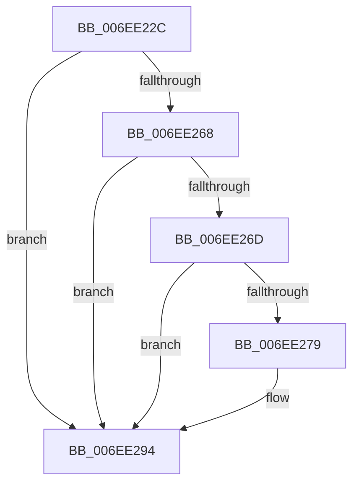

# sub_006EE22C

- RVA: `0x006EE22C`–`0x006EE2A3` (길이 `119` bytes)
- VA: `0x00000001406EE22C`
- 실행 섹션: `.text`
- PDB 이름 있음: `아니요`; PDB Function 태그: `아니요`
- unwind 정보 RVA: `0x000A0FA0`
- 디코드: `31`개 명령, `119/119` bytes 표시
- 미해석 바이트: `0` (있으면 어셈블리에 `.byte`로 보존)

> 이 문서는 커널 이미지의 기계어와 PDB 기호를 분석해 생성했습니다. 4번과 5번은 함수 원형과 자료형을 바이너리 사용 방식에서 추정한 C 해석이며 원본 소스 복구 결과는 아닙니다.

## 1. Dependencies

- 직접 호출 지점: **3**; 고유 호출 대상: **3**
- 직접 호출자로 확인된 함수: **0**
- RIP 상대 이미지 참조: **1**

### Outgoing calls
- `0x006EE255` → [HvlMapGpaPages](../46/HvlMapGpaPages_function_00462934.md) (function, `0x00462934`)
- `0x006EE270` → [tlgKeywordOn](../42/tlgKeywordOn_function_0042EAA0.md) (function, `0x0042EAA0`)
- `0x006EE28F` → [VmpLogLargeSlatFill](../64/VmpLogLargeSlatFill_function_0064D9C8.md) (function, `0x0064D9C8`)

### Direct callers
- 이 함수 시작 RVA로 연결되는 직접 call은 확인되지 않았습니다. 간접 호출은 완전히 역산할 수 없습니다.

### Static image references
- `0x006EE25A` → RVA `0x00F02458` (`.data`; read)

## 2. Other-region calls and transfers

- 다른 실행 섹션으로 향하는 call: **0**
- call이 아닌 외부 분기/꼬리 이동: **1**
  - `0x006EE29E` → [VmpFillSlat + 0x68](../42/VmpFillSlat_function_0042A014.md) (`tail-transfer`)

## 3. Assembly (complete function range)

```asm
006EE22C  66 44 09 A5 88 00 00 00         or word ptr [rbp + 0x88], r12w
006EE234  45 8B C6                        mov r8d, r14d
006EE237  49 8B 11                        mov rdx, qword ptr [r9]
006EE23A  41 0F BA E8 1F                  bts r8d, 0x1f
006EE23F  48 8B 74 24 70                  mov rsi, qword ptr [rsp + 0x70]
006EE244  4D 8B CC                        mov r9, r12
006EE247  48 8B 4D 68                     mov rcx, qword ptr [rbp + 0x68]
006EE24B  48 89 74 24 28                  mov qword ptr [rsp + 0x28], rsi
006EE250  4C 89 7C 24 20                  mov qword ptr [rsp + 0x20], r15
006EE255  E8 DA 46 D7 FF                  call 0x140462934
006EE25A  48 8B 0D F7 41 81 00            mov rcx, qword ptr [rip + 0x8141f7]
006EE261  8B F8                           mov edi, eax
006EE263  48 85 C9                        test rcx, rcx
006EE266  74 2C                           je 0x1406ee294
006EE268  83 39 00                        cmp dword ptr [rcx], 0
006EE26B  76 27                           jbe 0x1406ee294
006EE26D  49 8B D4                        mov rdx, r12
006EE270  E8 2B 08 D4 FF                  call 0x14042eaa0
006EE275  84 C0                           test al, al
006EE277  74 1B                           je 0x1406ee294
006EE279  48 8B 45 68                     mov rax, qword ptr [rbp + 0x68]
006EE27D  45 8B CE                        mov r9d, r14d
006EE280  4D 8B 07                        mov r8, qword ptr [r15]
006EE283  48 8B 13                        mov rdx, qword ptr [rbx]
006EE286  89 7C 24 28                     mov dword ptr [rsp + 0x28], edi
006EE28A  48 89 44 24 20                  mov qword ptr [rsp + 0x20], rax
006EE28F  E8 34 F7 F5 FF                  call 0x14064d9c8
006EE294  48 8B 06                        mov rax, qword ptr [rsi]
006EE297  48 C1 E0 09                     shl rax, 9
006EE29B  48 89 06                        mov qword ptr [rsi], rax
006EE29E  E9 D9 BD D3 FF                  jmp 0x14042a07c
```

## 4. C-style interpretation (structured pseudocode)

```c
__int64 __fastcall sub_006EE22C(__int64 a1, __int64 a2, __int64 a3, __int64 a4, __int64 a5, __int64 a6, __int64 a7, __int64 a8, __int64 a9, __int64 a10, __int64 a11, __int64 a12, __int64 a13, __int64 a14)
{
    __int64 result;
    unsigned __int64 v_stack_p20;
    unsigned __int64 v_stack_p28;

    v_stack_p28 = a14;
    v_stack_p20 = v_r15;
    result = HvlMapGpaPages(*(unsigned __int64 *)(v_rbp + 104), *(unsigned __int64 *)(a4), (unsigned int)((unsigned int)(v_r14)), v_r12);
    if (*(unsigned __int64 *)(v_rip + 8471031) == 0) goto loc_006EE294;
    if ((*(unsigned int *)(*(unsigned __int64 *)(v_rip + 8471031))) <= 0) goto loc_006EE294;
    result = tlgKeywordOn(*(unsigned __int64 *)(v_rip + 8471031), v_r12, (unsigned int)((unsigned int)(v_r14)), v_r12);
    if ((unsigned __int8)(result) != 0) {
        result = *(unsigned __int64 *)(v_rbp + 104);
        a4 = (unsigned int)(v_r14);
        a3 = *(unsigned __int64 *)(v_r15);
        a2 = *(unsigned __int64 *)(v_rbx);
        v_stack_p28 = (unsigned int)((unsigned int)((unsigned int)(result)));
        v_stack_p20 = result;
        result = VmpLogLargeSlatFill(*(unsigned __int64 *)(v_rip + 8471031), a2, a3, a4);
    }
    result = (*(unsigned __int64 *)(a14)) << (9);
    *(unsigned __int64 *)(a14) = result;
}
```

## 5. (Beta) C Style

```c
int64_t sub_006EE22C(int64_t Arg1, int64_t Arg2, int64_t Arg3, void *Arg4, uint64_t Arg5, uint64_t Arg6, uint64_t Arg7, uint64_t Arg8, uint64_t Arg9, uint64_t Arg10, uint64_t Arg11, uint64_t Arg12, uint64_t Arg13, void *Arg14)
{
    uint8_t *arg4 = (uint8_t *)Arg4;
    uint8_t *arg14 = (uint8_t *)Arg14;

    int64_t result;
    uint64_t v_stack_p20;
    uint64_t v_stack_p28;

    v_stack_p28 = Arg14;
    v_stack_p20 = local_r15;
    result = HvlMapGpaPages(*(uint64_t *)(local_rbp + 0x68), *(uint64_t *)(arg4), (uint32_t)((uint32_t)(local_r14)), local_r12);
    if (*(uint64_t *)(v_rip + 0x8141F7) == 0) goto loc_006EE294;
    if ((*(uint32_t *)(*(uint64_t *)(v_rip + 0x8141F7))) <= 0) goto loc_006EE294;
    result = tlgKeywordOn(*(uint64_t *)(v_rip + 0x8141F7), local_r12, (uint32_t)((uint32_t)(local_r14)), local_r12);
    if ((uint8_t)(result) != 0) {
        result = *(uint64_t *)(local_rbp + 0x68);
        Arg4 = (uint32_t)(local_r14);
        Arg3 = *(uint64_t *)(local_r15);
        Arg2 = *(uint64_t *)(local_rbx);
        v_stack_p28 = (uint32_t)((uint32_t)((uint32_t)(result)));
        v_stack_p20 = result;
        result = VmpLogLargeSlatFill(*(uint64_t *)(v_rip + 0x8141F7), Arg2, Arg3, Arg4);
    }
    result = (*(uint64_t *)(arg14)) << (9);
    *(uint64_t *)(arg14) = result;
}
```

### 관측된 메모리 오프셋

구조체 형식이 확인되지 않은 접근은 인자 기준의 오프셋으로만 기록했습니다.

| 기준 인자 | 오프셋 표현 | 폭 (bit) | 접근 |
|---|---:|---:|---|
| `Arg4` | `+ 0x0` | `64` | `R` |
| `Arg14` | `+ 0x0` | `64` | `R` |
| `Arg14` | `+ 0x0` | `64` | `W` |

## 6. Execution-region graph

[열기: 2D/3D 그래프와 함수 탐색 컨트롤 패널](../../../control-panel.html?section=text&rva=0x006EE22C&view=graph)

- 2D 그래프는 위에서 아래로 흐르고, 3D 그래프는 빈 공간을 드래그해 회전합니다. Shift+드래그는 이동, 휠은 확대·축소, 함수 노드 선택은 대상 보고서 이동입니다.

### Static fallback


