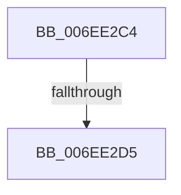

# sub_006EE2C4

- RVA: `0x006EE2C4`–`0x006EE2DA` (길이 `22` bytes)
- VA: `0x00000001406EE2C4`
- 실행 섹션: `.text`
- PDB 이름 있음: `아니요`; PDB Function 태그: `아니요`
- unwind 정보 RVA: `0x000A0FF4`
- 디코드: `5`개 명령, `22/22` bytes 표시
- 미해석 바이트: `0` (있으면 어셈블리에 `.byte`로 보존)

> 이 문서는 커널 이미지의 기계어와 PDB 기호를 분석해 생성했습니다. 4번과 5번은 함수 원형과 자료형을 바이너리 사용 방식에서 추정한 C 해석이며 원본 소스 복구 결과는 아닙니다.

## 1. Dependencies

- 직접 호출 지점: **0**; 고유 호출 대상: **0**
- 직접 호출자로 확인된 함수: **0**
- RIP 상대 이미지 참조: **0**

### Outgoing calls
- 직접 디코드된 call 명령이 없습니다.

### Direct callers
- 이 함수 시작 RVA로 연결되는 직접 call은 확인되지 않았습니다. 간접 호출은 완전히 역산할 수 없습니다.

### Static image references
- 디코드된 RIP-relative 메모리 참조가 없습니다.

## 2. Other-region calls and transfers

- 다른 실행 섹션으로 향하는 call: **0**
- call이 아닌 외부 분기/꼬리 이동: **2**
  - `0x006EE2CF` → [VmpProcessAccessedBatch + 0x2A](../42/VmpProcessAccessedBatch_function_0042A2DC.md) (`tail-transfer`)
  - `0x006EE2D5` → [VmpProcessAccessedBatch + 0x74](../42/VmpProcessAccessedBatch_function_0042A2DC.md) (`tail-transfer`)

## 3. Assembly (complete function range)

```asm
006EE2C4  48 83 C7 08                     add rdi, 8
006EE2C8  48 83 C3 08                     add rbx, 8
006EE2CC  83 C6 FF                        add esi, -1
006EE2CF  0F 85 31 C0 D3 FF               jne 0x14042a306
006EE2D5  E9 76 C0 D3 FF                  jmp 0x14042a350
```

## 4. C-style interpretation (structured pseudocode)

```c
void __fastcall sub_006EE2C4(void)
{
    __int64 v_rbx;
    __int64 v_rdi;
    __int64 v_rsi;

    v_rdi = (v_rdi) + (8);
    v_rbx = (v_rbx) + (8);
    v_rsi = (unsigned int)((v_rsi) + (-1));
}
```

## 5. (Beta) C Style

```c
void sub_006EE2C4(void)
{
    int64_t local_rbx;
    int64_t local_rdi;
    int64_t local_rsi;

    local_rdi = (local_rdi) + (8);
    local_rbx = (local_rbx) + (8);
    local_rsi = (uint32_t)((local_rsi) + (-1));
}
```

## 6. Execution-region graph

[열기: 2D/3D 그래프와 함수 탐색 컨트롤 패널](../../../control-panel.html?section=text&rva=0x006EE2C4&view=graph)

- 2D 그래프는 위에서 아래로 흐르고, 3D 그래프는 빈 공간을 드래그해 회전합니다. Shift+드래그는 이동, 휠은 확대·축소, 함수 노드 선택은 대상 보고서 이동입니다.

### Static fallback


