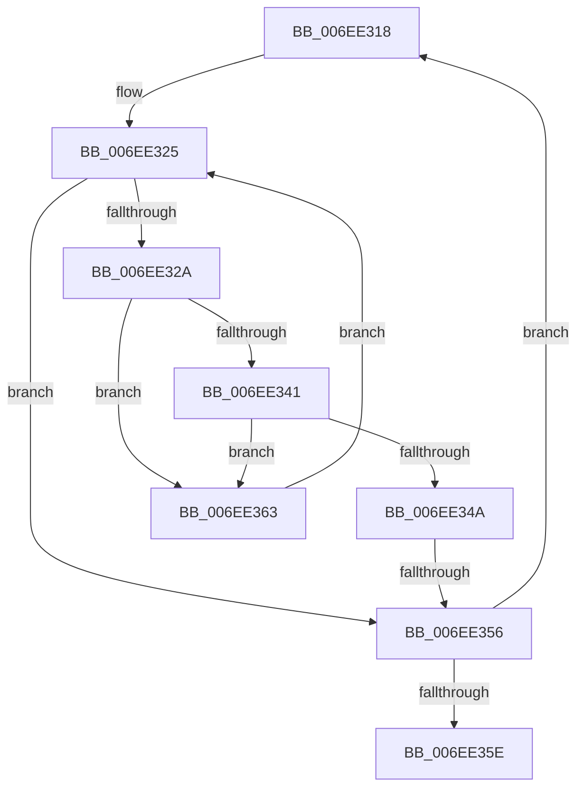

# sub_006EE318

- RVA: `0x006EE318`–`0x006EE368` (길이 `80` bytes)
- VA: `0x00000001406EE318`
- 실행 섹션: `.text`
- PDB 이름 있음: `아니요`; PDB Function 태그: `아니요`
- unwind 정보 RVA: `0x000A1698`
- 디코드: `22`개 명령, `80/80` bytes 표시
- 미해석 바이트: `0` (있으면 어셈블리에 `.byte`로 보존)

> 이 문서는 커널 이미지의 기계어와 PDB 기호를 분석해 생성했습니다. 4번과 5번은 함수 원형과 자료형을 바이너리 사용 방식에서 추정한 C 해석이며 원본 소스 복구 결과는 아닙니다.

## 1. Dependencies

- 직접 호출 지점: **0**; 고유 호출 대상: **0**
- 직접 호출자로 확인된 함수: **0**
- RIP 상대 이미지 참조: **0**

### Outgoing calls
- 직접 디코드된 call 명령이 없습니다.

### Direct callers
- 이 함수 시작 RVA로 연결되는 직접 call은 확인되지 않았습니다. 간접 호출은 완전히 역산할 수 없습니다.

### Static image references
- 디코드된 RIP-relative 메모리 참조가 없습니다.

## 2. Other-region calls and transfers

- 다른 실행 섹션으로 향하는 call: **0**
- call이 아닌 외부 분기/꼬리 이동: **2**
  - `0x006EE350` → [PpmRegisterPerfCap + 0x5A](../42/PpmRegisterPerfCap_function_0042B0D0.md) (`tail-transfer`)
  - `0x006EE35E` → [PpmRegisterPerfCap + 0x5A](../42/PpmRegisterPerfCap_function_0042B0D0.md) (`tail-transfer`)

## 3. Assembly (complete function range)

```asm
006EE318  44 8B 92 28 01 00 00            mov r10d, dword ptr [rdx + 0x128]
006EE31F  48 8B F2                        mov rsi, rdx
006EE322  44 8B C3                        mov r8d, ebx
006EE325  45 3B C2                        cmp r8d, r10d
006EE328  73 2C                           jae 0x1406ee356
006EE32A  41 8B C0                        mov eax, r8d
006EE32D  4C 69 C8 A8 04 00 00            imul r9, rax, 0x4a8
006EE334  4C 03 8A 38 01 00 00            add r9, qword ptr [rdx + 0x138]
006EE33B  41 39 59 10                     cmp dword ptr [r9 + 0x10], ebx
006EE33F  74 22                           je 0x1406ee363
006EE341  8B 45 04                        mov eax, dword ptr [rbp + 4]
006EE344  41 39 41 14                     cmp dword ptr [r9 + 0x14], eax
006EE348  75 19                           jne 0x1406ee363
006EE34A  49 8B F9                        mov rdi, r9
006EE34D  4D 85 C9                        test r9, r9
006EE350  0F 85 D4 CD D3 FF               jne 0x14042b12a
006EE356  48 8B 12                        mov rdx, qword ptr [rdx]
006EE359  49 3B D3                        cmp rdx, r11
006EE35C  75 BA                           jne 0x1406ee318
006EE35E  E9 C7 CD D3 FF                  jmp 0x14042b12a
006EE363  41 FF C0                        inc r8d
006EE366  EB BD                           jmp 0x1406ee325
```

## 4. C-style interpretation (structured pseudocode)

```c
__int64 __fastcall sub_006EE318(__int64 a1, __int64 a2)
{
loc_006EE325:
    if (((unsigned int)((unsigned int)((unsigned int)(v_rbx)))) >= ((unsigned int)((unsigned int)(*(unsigned int *)(a2 + 296))))) goto loc_006EE356;
    a4 = (a4) * ((unsigned int)((unsigned int)((unsigned int)((unsigned int)(v_rbx)))));
    a4 = (a4) + (*(unsigned __int64 *)(a2 + 312));
    if ((*(unsigned int *)(a4 + 16)) == ((unsigned int)(v_rbx))) goto loc_006EE363;
    if ((*(unsigned int *)(a4 + 20)) != ((unsigned int)((unsigned int)(*(unsigned int *)(v_rbp + 4))))) goto loc_006EE363;
loc_006EE356:
    if ((*(unsigned __int64 *)(a2)) != v_r11) goto loc_006EE318;
loc_006EE363:
    a3 = (unsigned int)(((unsigned int)((unsigned int)(v_rbx))) + 1);
    goto loc_006EE325;
}
```

## 5. (Beta) C Style

```c
int64_t sub_006EE318(int64_t Arg1, int64_t Arg2)
{
loc_006EE325:
    if (((uint32_t)((uint32_t)((uint32_t)(local_rbx)))) >= ((uint32_t)((uint32_t)(*(uint32_t *)(Arg2 + 0x128))))) goto loc_006EE356;
    a4 = (a4) * ((uint32_t)((uint32_t)((uint32_t)((uint32_t)(local_rbx)))));
    a4 = (a4) + (*(uint64_t *)(Arg2 + 0x138));
    if ((*(uint32_t *)(a4 + 0x10)) == ((uint32_t)(local_rbx))) goto loc_006EE363;
    if ((*(uint32_t *)(a4 + 0x14)) != ((uint32_t)((uint32_t)(*(uint32_t *)(local_rbp + 0x4))))) goto loc_006EE363;
loc_006EE356:
    if ((*(uint64_t *)(Arg2)) != local_r11) goto loc_006EE318;
loc_006EE363:
    a3 = (uint32_t)(((uint32_t)((uint32_t)(local_rbx))) + 1);
    goto loc_006EE325;
}
```

## 6. Execution-region graph

[열기: 2D/3D 그래프와 함수 탐색 컨트롤 패널](../../../control-panel.html?section=text&rva=0x006EE318&view=graph)

- 2D 그래프는 위에서 아래로 흐르고, 3D 그래프는 빈 공간을 드래그해 회전합니다. Shift+드래그는 이동, 휠은 확대·축소, 함수 노드 선택은 대상 보고서 이동입니다.

### Static fallback


