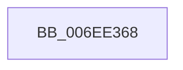

# sub_006EE368

- RVA: `0x006EE368`–`0x006EE3FA` (길이 `146` bytes)
- VA: `0x00000001406EE368`
- 실행 섹션: `.text`
- PDB 이름 있음: `아니요`; PDB Function 태그: `아니요`
- unwind 정보 RVA: `0x000A16C4`
- 디코드: `34`개 명령, `146/146` bytes 표시
- 미해석 바이트: `0` (있으면 어셈블리에 `.byte`로 보존)

> 이 문서는 커널 이미지의 기계어와 PDB 기호를 분석해 생성했습니다. 4번과 5번은 함수 원형과 자료형을 바이너리 사용 방식에서 추정한 C 해석이며 원본 소스 복구 결과는 아닙니다.

## 1. Dependencies

- 직접 호출 지점: **1**; 고유 호출 대상: **1**
- 직접 호출자로 확인된 함수: **0**
- RIP 상대 이미지 참조: **2**

### Outgoing calls
- `0x006EE3EF` → [EtwWriteEx](../25/EtwWriteEx_function_0025F0D0.md) (function, `0x0025F0D0`)

### Direct callers
- 이 함수 시작 RVA로 연결되는 직접 call은 확인되지 않았습니다. 간접 호출은 완전히 역산할 수 없습니다.

### Static image references
- `0x006EE374` → RVA `0x00014488` (`.rdata`; read)
- `0x006EE3E1` → RVA `0x00F0B408` (`.data`; read)

## 2. Other-region calls and transfers

- 다른 실행 섹션으로 향하는 call: **0**
- call이 아닌 외부 분기/꼬리 이동: **1**
  - `0x006EE3F5` → [PopDiagTraceProcessorThrottlePerfTrack + 0xAD](../42/PopDiagTraceProcessorThrottlePerfTrack_function_0042B2B0.md) (`tail-transfer`)

## 3. Assembly (complete function range)

```asm
006EE368  66 2B 5D CF                     sub bx, word ptr [rbp - 0x31]
006EE36C  48 8D 4D 67                     lea rcx, [rbp + 0x67]
006EE370  83 65 CB 00                     and dword ptr [rbp - 0x35], 0
006EE374  48 8D 15 0D 61 92 FF            lea rdx, [rip - 0x6d9ef3]
006EE37B  83 65 E3 00                     and dword ptr [rbp - 0x1d], 0
006EE37F  41 B8 04 00 00 00               mov r8d, 4
006EE385  83 65 F3 00                     and dword ptr [rbp - 0xd], 0
006EE389  45 33 C9                        xor r9d, r9d
006EE38C  83 65 03 00                     and dword ptr [rbp + 3], 0
006EE390  83 65 13 00                     and dword ptr [rbp + 0x13], 0
006EE394  48 89 4D D7                     mov qword ptr [rbp - 0x29], rcx
006EE398  48 8D 4D CB                     lea rcx, [rbp - 0x35]
006EE39C  48 89 4D E7                     mov qword ptr [rbp - 0x19], rcx
006EE3A0  48 8D 4D C7                     lea rcx, [rbp - 0x39]
006EE3A4  0F B7 C3                        movzx eax, bx
006EE3A7  66 89 45 C7                     mov word ptr [rbp - 0x39], ax
006EE3AB  03 C0                           add eax, eax
006EE3AD  48 89 4D F7                     mov qword ptr [rbp - 9], rcx
006EE3B1  48 8D 4D 17                     lea rcx, [rbp + 0x17]
006EE3B5  89 45 0F                        mov dword ptr [rbp + 0xf], eax
006EE3B8  48 8D 45 D7                     lea rax, [rbp - 0x29]
006EE3BC  48 89 44 24 38                  mov qword ptr [rsp + 0x38], rax
006EE3C1  44 89 44 24 30                  mov dword ptr [rsp + 0x30], r8d
006EE3C6  48 83 64 24 28 00               and qword ptr [rsp + 0x28], 0
006EE3CC  48 83 64 24 20 00               and qword ptr [rsp + 0x20], 0
006EE3D2  44 89 45 DF                     mov dword ptr [rbp - 0x21], r8d
006EE3D6  44 89 45 EF                     mov dword ptr [rbp - 0x11], r8d
006EE3DA  45 33 C0                        xor r8d, r8d
006EE3DD  48 89 4D 07                     mov qword ptr [rbp + 7], rcx
006EE3E1  48 8B 0D 20 D0 81 00            mov rcx, qword ptr [rip + 0x81d020]
006EE3E8  C7 45 FF 02 00 00 00            mov dword ptr [rbp - 1], 2
006EE3EF  E8 DC 0C B7 FF                  call 0x14025f0d0
006EE3F4  90                              nop
006EE3F5  E9 63 CF D3 FF                  jmp 0x14042b35d
```

## 4. C-style interpretation (structured pseudocode)

```c
__int64 __fastcall sub_006EE368(__int64 a1, __int64 a2, __int64 a3, int a4, __int64 a5)
{
    __int64 result;
    __int64 v_rbx;
    unsigned __int64 v_stack_p20;
    unsigned int v_stack_p30;
    unsigned __int64 v_stack_p38;

    v_rbx = (unsigned __int16)((v_rbx) - (*(unsigned __int16 *)(v_rbp - 49)));
    a4 = 0;
    *(unsigned __int64 *)(v_rbp - 41) = v_rbp + 103;
    *(unsigned __int64 *)(v_rbp - 25) = v_rbp - 53;
    *(unsigned __int16 *)(v_rbp - 57) = (unsigned __int16)((unsigned __int16)(v_rbx));
    result = (unsigned int)(((unsigned __int16)(v_rbx)) + ((unsigned int)((unsigned __int16)(v_rbx))));
    *(unsigned __int64 *)(v_rbp - 9) = v_rbp - 57;
    *(unsigned int *)(v_rbp + 15) = (unsigned int)(result);
    v_stack_p38 = v_rbp - 41;
    v_stack_p30 = 4;
    *(unsigned int *)(v_rbp - 33) = 4;
    *(unsigned int *)(v_rbp - 17) = 4;
    a3 = 0;
    *(unsigned __int64 *)(v_rbp + 7) = v_rbp + 23;
    *(unsigned int *)(v_rbp - 1) = 2;
    result = EtwWriteEx(*(unsigned __int64 *)(v_rip + 8507424), v_rip - 7184115, a3, a4);
}
```

## 5. (Beta) C Style

```c
int64_t sub_006EE368(int64_t Arg1, int64_t Arg2, int64_t Arg3, int32_t Arg4, int64_t Arg5)
{
    int64_t result;
    int64_t local_rbx;
    uint64_t v_stack_p20;
    uint32_t v_stack_p30;
    uint64_t v_stack_p38;

    local_rbx = (uint16_t)((local_rbx) - (*(uint16_t *)(local_rbp - 0x31)));
    Arg4 = 0;
    *(uint64_t *)(local_rbp - 0x29) = local_rbp + 103;
    *(uint64_t *)(local_rbp - 0x19) = local_rbp - 53;
    *(uint16_t *)(local_rbp - 0x39) = (uint16_t)((uint16_t)(local_rbx));
    result = (uint32_t)(((uint16_t)(local_rbx)) + ((uint32_t)((uint16_t)(local_rbx))));
    *(uint64_t *)(local_rbp - 0x9) = local_rbp - 57;
    *(uint32_t *)(local_rbp + 0xF) = (uint32_t)(result);
    v_stack_p38 = local_rbp - 41;
    v_stack_p30 = 4;
    *(uint32_t *)(local_rbp - 0x21) = 4;
    *(uint32_t *)(local_rbp - 0x11) = 4;
    Arg3 = 0;
    *(uint64_t *)(local_rbp + 0x7) = local_rbp + 23;
    *(uint32_t *)(local_rbp - 0x1) = 2;
    result = EtwWriteEx(*(uint64_t *)(v_rip + 0x81D020), v_rip - 7184115, Arg3, Arg4);
}
```

## 6. Execution-region graph

[열기: 2D/3D 그래프와 함수 탐색 컨트롤 패널](../../../control-panel.html?section=text&rva=0x006EE368&view=graph)

- 2D 그래프는 위에서 아래로 흐르고, 3D 그래프는 빈 공간을 드래그해 회전합니다. Shift+드래그는 이동, 휠은 확대·축소, 함수 노드 선택은 대상 보고서 이동입니다.

### Static fallback


