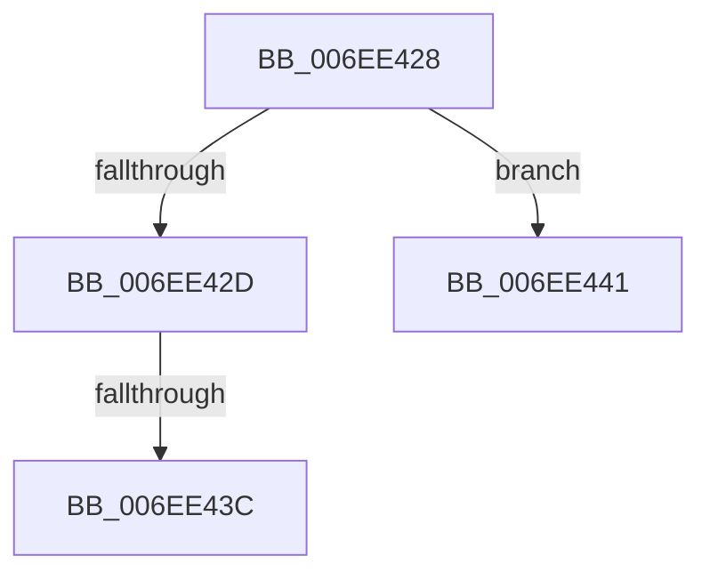

# sub_006EE428

- RVA: `0x006EE428`–`0x006EE448` (길이 `32` bytes)
- VA: `0x00000001406EE428`
- 실행 섹션: `.text`
- PDB 이름 있음: `아니요`; PDB Function 태그: `아니요`
- unwind 정보 RVA: `0x000A197C`
- 디코드: `8`개 명령, `32/32` bytes 표시
- 미해석 바이트: `0` (있으면 어셈블리에 `.byte`로 보존)

> 이 문서는 커널 이미지의 기계어와 PDB 기호를 분석해 생성했습니다. 4번과 5번은 함수 원형과 자료형을 바이너리 사용 방식에서 추정한 C 해석이며 원본 소스 복구 결과는 아닙니다.

## 1. Dependencies

- 직접 호출 지점: **0**; 고유 호출 대상: **0**
- 직접 호출자로 확인된 함수: **0**
- RIP 상대 이미지 참조: **0**

### Outgoing calls
- 직접 디코드된 call 명령이 없습니다.

### Direct callers
- 이 함수 시작 RVA로 연결되는 직접 call은 확인되지 않았습니다. 간접 호출은 완전히 역산할 수 없습니다.

### Static image references
- 디코드된 RIP-relative 메모리 참조가 없습니다.

## 2. Other-region calls and transfers

- 다른 실행 섹션으로 향하는 call: **0**
- call이 아닌 외부 분기/꼬리 이동: **3**
  - `0x006EE436` → [PpmPerfCalculateQosClassPolicies + 0x3B0](../42/PpmPerfCalculateQosClassPolicies_function_0042BFC8.md) (`tail-transfer`)
  - `0x006EE43C` → [PpmPerfCalculateQosClassPolicies + 0x80B](../42/PpmPerfCalculateQosClassPolicies_function_0042BFC8.md) (`tail-transfer`)
  - `0x006EE443` → [PpmPerfCalculateQosClassPolicies + 0x3B0](../42/PpmPerfCalculateQosClassPolicies_function_0042BFC8.md) (`tail-transfer`)

## 3. Assembly (complete function range)

```asm
006EE428  83 F9 02                        cmp ecx, 2
006EE42B  75 14                           jne 0x1406ee441
006EE42D  33 C9                           xor ecx, ecx
006EE42F  41 38 8F 2C 01 00 00            cmp byte ptr [r15 + 0x12c], cl
006EE436  0F 85 3C DF D3 FF               jne 0x14042c378
006EE43C  E9 92 E3 D3 FF                  jmp 0x14042c7d3
006EE441  33 C9                           xor ecx, ecx
006EE443  E9 30 DF D3 FF                  jmp 0x14042c378
```

## 4. C-style interpretation (structured pseudocode)

```c
void __fastcall sub_006EE428(int a1)
{
    if (a1 != 2) goto loc_006EE441;
    a1 = 0;
loc_006EE441:
    a1 = 0;
}
```

## 5. (Beta) C Style

```c
void sub_006EE428(int32_t Arg1)
{
    if (Arg1 != 2) goto loc_006EE441;
    Arg1 = 0;
loc_006EE441:
    Arg1 = 0;
}
```

## 6. Execution-region graph

[열기: 2D/3D 그래프와 함수 탐색 컨트롤 패널](../../../control-panel.html?section=text&rva=0x006EE428&view=graph)

- 2D 그래프는 위에서 아래로 흐르고, 3D 그래프는 빈 공간을 드래그해 회전합니다. Shift+드래그는 이동, 휠은 확대·축소, 함수 노드 선택은 대상 보고서 이동입니다.

### Static fallback


