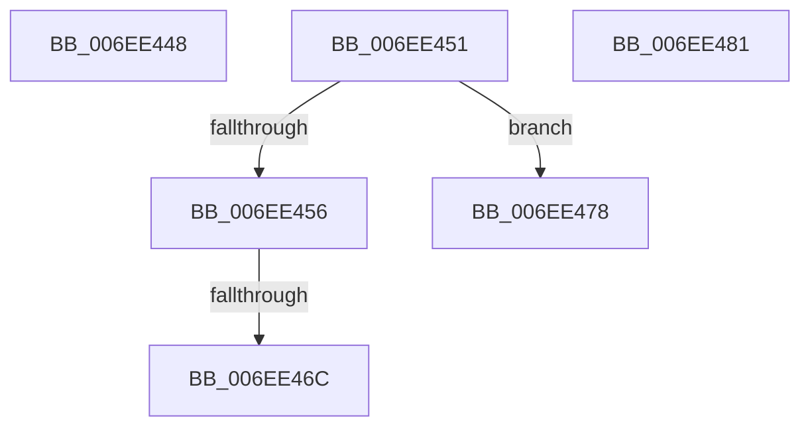

# sub_006EE448

- RVA: `0x006EE448`–`0x006EE4A2` (길이 `90` bytes)
- VA: `0x00000001406EE448`
- 실행 섹션: `.text`
- PDB 이름 있음: `아니요`; PDB Function 태그: `아니요`
- unwind 정보 RVA: `0x000A19F0`
- 디코드: `23`개 명령, `90/90` bytes 표시
- 미해석 바이트: `0` (있으면 어셈블리에 `.byte`로 보존)

> 이 문서는 커널 이미지의 기계어와 PDB 기호를 분석해 생성했습니다. 4번과 5번은 함수 원형과 자료형을 바이너리 사용 방식에서 추정한 C 해석이며 원본 소스 복구 결과는 아닙니다.

## 1. Dependencies

- 직접 호출 지점: **0**; 고유 호출 대상: **0**
- 직접 호출자로 확인된 함수: **0**
- RIP 상대 이미지 참조: **0**

### Outgoing calls
- 직접 디코드된 call 명령이 없습니다.

### Direct callers
- 이 함수 시작 RVA로 연결되는 직접 call은 확인되지 않았습니다. 간접 호출은 완전히 역산할 수 없습니다.

### Static image references
- 디코드된 RIP-relative 메모리 참조가 없습니다.

## 2. Other-region calls and transfers

- 다른 실행 섹션으로 향하는 call: **0**
- call이 아닌 외부 분기/꼬리 이동: **5**
  - `0x006EE44C` → [PpmPerfSelectProcessorState + 0x3A4](../42/PpmPerfSelectProcessorState_function_0042CA78.md) (`tail-transfer`)
  - `0x006EE466` → [PpmPerfSelectProcessorState + 0x3A4](../42/PpmPerfSelectProcessorState_function_0042CA78.md) (`tail-transfer`)
  - `0x006EE473` → [PpmPerfSelectProcessorState + 0x3A4](../42/PpmPerfSelectProcessorState_function_0042CA78.md) (`tail-transfer`)
  - `0x006EE47C` → [PpmPerfSelectProcessorState + 0x44F](../42/PpmPerfSelectProcessorState_function_0042CA78.md) (`tail-transfer`)
  - `0x006EE49D` → [PpmPerfSelectProcessorState + 0x2C6](../42/PpmPerfSelectProcessorState_function_0042CA78.md) (`tail-transfer`)

## 3. Assembly (complete function range)

```asm
006EE448  C6 46 3D 00                     mov byte ptr [rsi + 0x3d], 0
006EE44C  E9 CB E9 D3 FF                  jmp 0x14042ce1c
006EE451  44 3B C2                        cmp r8d, edx
006EE454  77 22                           ja 0x1406ee478
006EE456  8A 46 3D                        mov al, byte ptr [rsi + 0x3d]
006EE459  0F BA EF 13                     bts edi, 0x13
006EE45D  04 01                           add al, 1
006EE45F  88 46 3D                        mov byte ptr [rsi + 0x3d], al
006EE462  3A 44 2B 74                     cmp al, byte ptr [rbx + rbp + 0x74]
006EE466  0F 82 B0 E9 D3 FF               jb 0x14042ce1c
006EE46C  66 83 66 3C 00                  and word ptr [rsi + 0x3c], 0
006EE471  32 C9                           xor cl, cl
006EE473  E9 A4 E9 D3 FF                  jmp 0x14042ce1c
006EE478  C6 46 3D 00                     mov byte ptr [rsi + 0x3d], 0
006EE47C  E9 46 EA D3 FF                  jmp 0x14042cec7
006EE481  41 0F B6 CD                     movzx ecx, r13b
006EE485  33 D2                           xor edx, edx
006EE487  F7 F1                           div ecx
006EE489  8B 8C 24 D8 00 00 00            mov ecx, dword ptr [rsp + 0xd8]
006EE490  8B 94 24 E0 00 00 00            mov edx, dword ptr [rsp + 0xe0]
006EE497  8B D8                           mov ebx, eax
006EE499  0F BA EF 07                     bts edi, 7
006EE49D  E9 9C E8 D3 FF                  jmp 0x14042cd3e
```

## 4. C-style interpretation (structured pseudocode)

```c
__int64 __fastcall sub_006EE448(unsigned __int8 a1, int a2, int a3)
{
    unsigned int v_stack_pD8;
    unsigned int v_stack_pE0;

    *(unsigned __int8 *)(v_rsi + 61) = 0;
}
```

## 5. (Beta) C Style

```c
int64_t sub_006EE448(uint8_t Arg1, int32_t Arg2, int32_t Arg3)
{
    uint32_t v_stack_pD8;
    uint32_t v_stack_pE0;

    *(uint8_t *)(local_rsi + 0x3D) = 0;
}
```

## 6. Execution-region graph

[열기: 2D/3D 그래프와 함수 탐색 컨트롤 패널](../../../control-panel.html?section=text&rva=0x006EE448&view=graph)

- 2D 그래프는 위에서 아래로 흐르고, 3D 그래프는 빈 공간을 드래그해 회전합니다. Shift+드래그는 이동, 휠은 확대·축소, 함수 노드 선택은 대상 보고서 이동입니다.

### Static fallback


