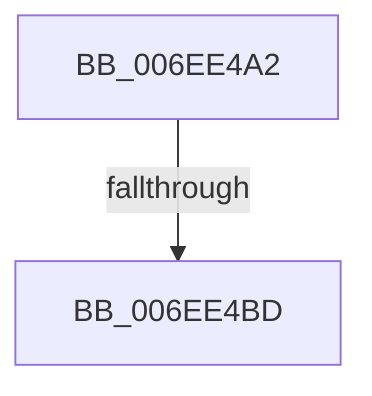

# sub_006EE4A2

- RVA: `0x006EE4A2`–`0x006EE4C2` (길이 `32` bytes)
- VA: `0x00000001406EE4A2`
- 실행 섹션: `.text`
- PDB 이름 있음: `아니요`; PDB Function 태그: `아니요`
- unwind 정보 RVA: `0x000A1A7C`
- 디코드: `8`개 명령, `32/32` bytes 표시
- 미해석 바이트: `0` (있으면 어셈블리에 `.byte`로 보존)

> 이 문서는 커널 이미지의 기계어와 PDB 기호를 분석해 생성했습니다. 4번과 5번은 함수 원형과 자료형을 바이너리 사용 방식에서 추정한 C 해석이며 원본 소스 복구 결과는 아닙니다.

## 1. Dependencies

- 직접 호출 지점: **1**; 고유 호출 대상: **1**
- 직접 호출자로 확인된 함수: **0**
- RIP 상대 이미지 참조: **1**

### Outgoing calls
- `0x006EE4AB` → [guard_dispatch_icall](../6B/guard_dispatch_icall_function_006BAAD0.md) (function, `0x006BAAD0`)

### Direct callers
- 이 함수 시작 RVA로 연결되는 직접 call은 확인되지 않았습니다. 간접 호출은 완전히 역산할 수 없습니다.

### Static image references
- `0x006EE4A2` → RVA `0x00E003E0` (`.data`; read)

## 2. Other-region calls and transfers

- 다른 실행 섹션으로 향하는 call: **0**
- call이 아닌 외부 분기/꼬리 이동: **2**
  - `0x006EE4B7` → [HalpGetSetCmosData + 0x54](../42/HalpGetSetCmosData_function_0042D794.md) (`tail-transfer`)
  - `0x006EE4BD` → [HalpGetSetCmosData + 0x35](../42/HalpGetSetCmosData_function_0042D794.md) (`tail-transfer`)

## 3. Assembly (complete function range)

```asm
006EE4A2  48 8B 05 37 1F 71 00            mov rax, qword ptr [rip + 0x711f37]
006EE4A9  8A 17                           mov dl, byte ptr [rdi]
006EE4AB  E8 20 C6 FC FF                  call 0x1406baad0
006EE4B0  FF C3                           inc ebx
006EE4B2  48 FF C7                        inc rdi
006EE4B5  3B DE                           cmp ebx, esi
006EE4B7  0F 86 2B F3 D3 FF               jbe 0x14042d7e8
006EE4BD  E9 07 F3 D3 FF                  jmp 0x14042d7c9
```

## 4. C-style interpretation (structured pseudocode)

```c
__int64 __fastcall sub_006EE4A2(void)
{
    __int64 result;
    __int64 v_rbx;
    __int64 v_rdi;

    result = guard_dispatch_icall(a1, *(unsigned __int8 *)(v_rdi), a3, a4);
    v_rbx = (unsigned int)((v_rbx) + 1);
    v_rdi = (v_rdi) + 1;
}
```

## 5. (Beta) C Style

```c
void sub_006EE4A2(void)
{
    int64_t result;
    int64_t local_rbx;
    int64_t local_rdi;

    result = guard_dispatch_icall(a1, *(uint8_t *)(local_rdi), a3, a4);
    local_rbx = (uint32_t)((local_rbx) + 1);
    local_rdi = (local_rdi) + 1;
}
```

## 6. Execution-region graph

[열기: 2D/3D 그래프와 함수 탐색 컨트롤 패널](../../../control-panel.html?section=text&rva=0x006EE4A2&view=graph)

- 2D 그래프는 위에서 아래로 흐르고, 3D 그래프는 빈 공간을 드래그해 회전합니다. Shift+드래그는 이동, 휠은 확대·축소, 함수 노드 선택은 대상 보고서 이동입니다.

### Static fallback


