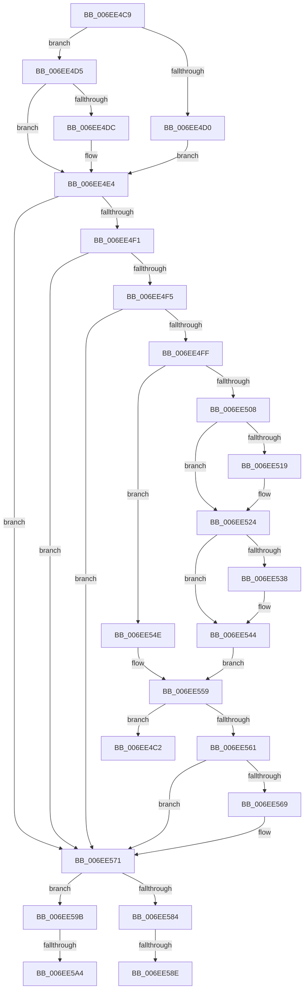

# sub_006EE4C2

- RVA: `0x006EE4C2`–`0x006EE5B1` (길이 `239` bytes)
- VA: `0x00000001406EE4C2`
- 실행 섹션: `.text`
- PDB 이름 있음: `아니요`; PDB Function 태그: `아니요`
- unwind 정보 RVA: `0x000A1AB0`
- 디코드: `59`개 명령, `239/239` bytes 표시
- 미해석 바이트: `0` (있으면 어셈블리에 `.byte`로 보존)

> 이 문서는 커널 이미지의 기계어와 PDB 기호를 분석해 생성했습니다. 4번과 5번은 함수 원형과 자료형을 바이너리 사용 방식에서 추정한 C 해석이며 원본 소스 복구 결과는 아닙니다.

## 1. Dependencies

- 직접 호출 지점: **5**; 고유 호출 대상: **4**
- 직접 호출자로 확인된 함수: **0**
- RIP 상대 이미지 참조: **4**

### Outgoing calls
- `0x006EE51F` → [KiRaiseIrqlProcessIrqlFlags](../4F/KiRaiseIrqlProcessIrqlFlags_function_004F56FC.md) (function, `0x004F56FC`)
- `0x006EE528` → [HalEfiGetTime](../54/HalEfiGetTime_function_0054DC6C.md) (function, `0x0054DC6C`)
- `0x006EE53F` → [KiLowerIrqlProcessIrqlFlags](../4F/KiLowerIrqlProcessIrqlFlags_function_004F5698.md) (function, `0x004F5698`)
- `0x006EE552` → [HalEfiGetTime](../54/HalEfiGetTime_function_0054DC6C.md) (function, `0x0054DC6C`)
- `0x006EE579` → [HalpQueryVirtualRtc](../54/HalpQueryVirtualRtc_function_0054C4D0.md) (function, `0x0054C4D0`)

### Direct callers
- 이 함수 시작 RVA로 연결되는 직접 call은 확인되지 않았습니다. 간접 호출은 완전히 역산할 수 없습니다.

### Static image references
- `0x006EE4DC` → RVA `0x00FC3F90` (`.data`; read/write)
- `0x006EE4E4` → RVA `0x00FC1A28` (`.data`; read)
- `0x006EE4F5` → RVA `0x00E0A808` (`.data`; read)
- `0x006EE510` → RVA `0x00FC6D20` (`ALMOSTRO`; read)

## 2. Other-region calls and transfers

- 다른 실행 섹션으로 향하는 call: **0**
- call이 아닌 외부 분기/꼬리 이동: **5**
  - `0x006EE4C4` → [HalQueryRealTimeClock + 0x98](../42/HalQueryRealTimeClock_function_0042D810.md) (`tail-transfer`)
  - `0x006EE588` → [HalQueryRealTimeClock + 0x98](../42/HalQueryRealTimeClock_function_0042D810.md) (`tail-transfer`)
  - `0x006EE596` → [HalQueryRealTimeClock + 0x98](../42/HalQueryRealTimeClock_function_0042D810.md) (`tail-transfer`)
  - `0x006EE59E` → [HalQueryRealTimeClock + 0xEB](../42/HalQueryRealTimeClock_function_0042D810.md) (`tail-transfer`)
  - `0x006EE5AC` → [HalQueryRealTimeClock + 0xEB](../42/HalQueryRealTimeClock_function_0042D810.md) (`tail-transfer`)

## 3. Assembly (complete function range)

```asm
006EE4C2  B3 01                           mov bl, 1
006EE4C4  E9 DF F3 D3 FF                  jmp 0x14042d8a8
006EE4C9  3D 95 04 00 C0                  cmp eax, 0xc0000495
006EE4CE  75 05                           jne 0x1406ee4d5
006EE4D0  40 B6 01                        mov sil, 1
006EE4D3  EB 0F                           jmp 0x1406ee4e4
006EE4D5  3D 02 00 00 C0                  cmp eax, 0xc0000002
006EE4DA  74 08                           je 0x1406ee4e4
006EE4DC  F0 44 09 25 AC 5A 8D 00         lock or dword ptr [rip + 0x8d5aac], r12d
006EE4E4  80 3D 3D 35 8D 00 00            cmp byte ptr [rip + 0x8d353d], 0
006EE4EB  0F 84 80 00 00 00               je 0x1406ee571
006EE4F1  85 DB                           test ebx, ebx
006EE4F3  74 7C                           je 0x1406ee571
006EE4F5  8B 05 0D C3 71 00               mov eax, dword ptr [rip + 0x71c30d]
006EE4FB  A8 08                           test al, 8
006EE4FD  75 72                           jne 0x1406ee571
006EE4FF  44 0F 20 C0                     mov rax, cr8
006EE503  41 3A C4                        cmp al, r12b
006EE506  73 46                           jae 0x1406ee54e
006EE508  44 0F 20 C7                     mov rdi, cr8
006EE50C  45 0F 22 C4                     mov cr8, r12
006EE510  83 3D 09 88 8D 00 00            cmp dword ptr [rip + 0x8d8809], 0
006EE517  74 0B                           je 0x1406ee524
006EE519  41 8A D4                        mov dl, r12b
006EE51C  40 8A CF                        mov cl, dil
006EE51F  E8 D8 71 E0 FF                  call 0x1404f56fc
006EE524  48 8D 4D C8                     lea rcx, [rbp - 0x38]
006EE528  E8 3F F7 E5 FF                  call 0x14054dc6c
006EE52D  83 3D EC 87 8D 00 00            cmp dword ptr [rip + 0x8d87ec], 0
006EE534  8B D8                           mov ebx, eax
006EE536  74 0C                           je 0x1406ee544
006EE538  44 0F 20 C1                     mov rcx, cr8
006EE53C  40 8A D7                        mov dl, dil
006EE53F  E8 54 71 E0 FF                  call 0x1404f5698
006EE544  40 0F B6 CF                     movzx ecx, dil
006EE548  44 0F 22 C1                     mov cr8, rcx
006EE54C  EB 0B                           jmp 0x1406ee559
006EE54E  48 8D 4D C8                     lea rcx, [rbp - 0x38]
006EE552  E8 15 F7 E5 FF                  call 0x14054dc6c
006EE557  8B D8                           mov ebx, eax
006EE559  85 DB                           test ebx, ebx
006EE55B  0F 89 61 FF FF FF               jns 0x1406ee4c2
006EE561  81 FB 02 00 00 C0               cmp ebx, 0xc0000002
006EE567  74 08                           je 0x1406ee571
006EE569  F0 83 0D 1F 5A 8D 00 04         lock or dword ptr [rip + 0x8d5a1f], 4
006EE571  48 8D 55 C0                     lea rdx, [rbp - 0x40]
006EE575  48 8D 4D C8                     lea rcx, [rbp - 0x38]
006EE579  E8 52 DF E5 FF                  call 0x14054c4d0
006EE57E  8A D8                           mov bl, al
006EE580  84 C0                           test al, al
006EE582  74 17                           je 0x1406ee59b
006EE584  80 7D C0 00                     cmp byte ptr [rbp - 0x40], 0
006EE588  0F 85 1A F3 D3 FF               jne 0x14042d8a8
006EE58E  F0 83 0D FA 59 8D 00 08         lock or dword ptr [rip + 0x8d59fa], 8
006EE596  E9 0D F3 D3 FF                  jmp 0x14042d8a8
006EE59B  40 84 F6                        test sil, sil
006EE59E  0F 85 57 F3 D3 FF               jne 0x14042d8fb
006EE5A4  F0 83 0D E4 59 8D 00 10         lock or dword ptr [rip + 0x8d59e4], 0x10
006EE5AC  E9 4A F3 D3 FF                  jmp 0x14042d8fb
```

## 4. C-style interpretation (structured pseudocode)

```c
__int64 __fastcall sub_006EE4C2(void)
{
}
```

## 5. (Beta) C Style

```c
void sub_006EE4C2(void)
{
}
```

## 6. Execution-region graph

[열기: 2D/3D 그래프와 함수 탐색 컨트롤 패널](../../../control-panel.html?section=text&rva=0x006EE4C2&view=graph)

- 2D 그래프는 위에서 아래로 흐르고, 3D 그래프는 빈 공간을 드래그해 회전합니다. Shift+드래그는 이동, 휠은 확대·축소, 함수 노드 선택은 대상 보고서 이동입니다.

### Static fallback


