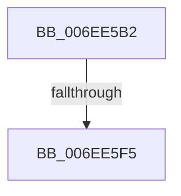

# sub_006EE5B2

- RVA: `0x006EE5B2`–`0x006EE62F` (길이 `125` bytes)
- VA: `0x00000001406EE5B2`
- 실행 섹션: `.text`
- PDB 이름 있음: `아니요`; PDB Function 태그: `아니요`
- unwind 정보 RVA: `0x000A1AD4`
- 디코드: `48`개 명령, `125/125` bytes 표시
- 미해석 바이트: `0` (있으면 어셈블리에 `.byte`로 보존)

> 이 문서는 커널 이미지의 기계어와 PDB 기호를 분석해 생성했습니다. 4번과 5번은 함수 원형과 자료형을 바이너리 사용 방식에서 추정한 C 해석이며 원본 소스 복구 결과는 아닙니다.

## 1. Dependencies

- 직접 호출 지점: **0**; 고유 호출 대상: **0**
- 직접 호출자로 확인된 함수: **0**
- RIP 상대 이미지 참조: **1**

### Outgoing calls
- 직접 디코드된 call 명령이 없습니다.

### Direct callers
- 이 함수 시작 RVA로 연결되는 직접 call은 확인되지 않았습니다. 간접 호출은 완전히 역산할 수 없습니다.

### Static image references
- `0x006EE5E7` → RVA `0x00FC1B4B` (`.data`; read)

## 2. Other-region calls and transfers

- 다른 실행 섹션으로 향하는 call: **0**
- call이 아닌 외부 분기/꼬리 이동: **2**
  - `0x006EE5EF` → [HalpSetWakeAlarm + 0xD1](../42/HalpSetWakeAlarm_function_0042DAC8.md) (`tail-transfer`)
  - `0x006EE62A` → [HalpSetWakeAlarm + 0xD1](../42/HalpSetWakeAlarm_function_0042DAC8.md) (`tail-transfer`)

## 3. Assembly (complete function range)

```asm
006EE5B2  0F B6 4B 04                     movzx ecx, byte ptr [rbx + 4]
006EE5B6  41 8B D1                        mov edx, r9d
006EE5B9  90                              nop
006EE5BA  44 8B C1                        mov r8d, ecx
006EE5BD  EE                              out dx, al
006EE5BE  90                              nop
006EE5BF  41 8B C3                        mov eax, r11d
006EE5C2  F7 E1                           mul ecx
006EE5C4  90                              nop
006EE5C5  41 8B C3                        mov eax, r11d
006EE5C8  8B CA                           mov ecx, edx
006EE5CA  41 F7 E0                        mul r8d
006EE5CD  C1 E9 03                        shr ecx, 3
006EE5D0  C1 EA 03                        shr edx, 3
006EE5D3  C0 E1 04                        shl cl, 4
006EE5D6  8D 04 92                        lea eax, [rdx + rdx*4]
006EE5D9  41 8B D2                        mov edx, r10d
006EE5DC  03 C0                           add eax, eax
006EE5DE  44 2B C0                        sub r8d, eax
006EE5E1  41 8D 04 08                     lea eax, [r8 + rcx]
006EE5E5  EE                              out dx, al
006EE5E6  90                              nop
006EE5E7  8A 05 5E 35 8D 00               mov al, byte ptr [rip + 0x8d355e]
006EE5ED  3C 09                           cmp al, 9
006EE5EF  0F 86 A4 F5 D3 FF               jbe 0x14042db99
006EE5F5  0F B6 4B 02                     movzx ecx, byte ptr [rbx + 2]
006EE5F9  41 8B D1                        mov edx, r9d
006EE5FC  44 8B C1                        mov r8d, ecx
006EE5FF  90                              nop
006EE600  EE                              out dx, al
006EE601  90                              nop
006EE602  41 8B C3                        mov eax, r11d
006EE605  F7 E1                           mul ecx
006EE607  90                              nop
006EE608  41 8B C3                        mov eax, r11d
006EE60B  8B CA                           mov ecx, edx
006EE60D  41 F7 E0                        mul r8d
006EE610  C1 E9 03                        shr ecx, 3
006EE613  C1 EA 03                        shr edx, 3
006EE616  C0 E1 04                        shl cl, 4
006EE619  8D 04 92                        lea eax, [rdx + rdx*4]
006EE61C  41 8B D2                        mov edx, r10d
006EE61F  03 C0                           add eax, eax
006EE621  44 2B C0                        sub r8d, eax
006EE624  41 8D 04 08                     lea eax, [r8 + rcx]
006EE628  EE                              out dx, al
006EE629  90                              nop
006EE62A  E9 6A F5 D3 FF                  jmp 0x14042db99
```

## 4. C-style interpretation (structured pseudocode)

```c
__int64 __fastcall sub_006EE5B2(__int64 a1, __int64 a2, __int64 a3, int a4)
{
    __int64 result;

    a1 = (unsigned int)(((unsigned int)((unsigned int)((unsigned int)(a4)))) >> (3));
    a2 = (unsigned int)(((unsigned int)(a4)) >> (3));
    a1 = (unsigned __int8)((a1) << (4));
    result = (unsigned int)((a2 + a2 * 4) + ((unsigned int)(a2 + a2 * 4)));
    a3 = (unsigned int)(((unsigned int)((unsigned int)(*(unsigned __int8 *)(v_rbx + 4)))) - ((unsigned int)(result)));
    a1 = (unsigned int)(((unsigned int)((unsigned int)((unsigned int)(a4)))) >> (3));
    a2 = (unsigned int)(((unsigned int)(a4)) >> (3));
    a1 = (unsigned __int8)((a1) << (4));
    result = (unsigned int)((a2 + a2 * 4) + ((unsigned int)(a2 + a2 * 4)));
    a3 = (unsigned int)(((unsigned int)((unsigned int)(*(unsigned __int8 *)(v_rbx + 2)))) - ((unsigned int)(result)));
}
```

## 5. (Beta) C Style

```c
int64_t sub_006EE5B2(int64_t Arg1, int64_t Arg2, int64_t Arg3, int32_t Arg4)
{
    int64_t result;

    Arg1 = (uint32_t)(((uint32_t)((uint32_t)((uint32_t)(Arg4)))) >> (3));
    Arg2 = (uint32_t)(((uint32_t)(Arg4)) >> (3));
    Arg1 = (uint8_t)((Arg1) << (4));
    result = (uint32_t)((Arg2 + Arg2 * 4) + ((uint32_t)(Arg2 + Arg2 * 4)));
    Arg3 = (uint32_t)(((uint32_t)((uint32_t)(*(uint8_t *)(local_rbx + 0x4)))) - ((uint32_t)(result)));
    Arg1 = (uint32_t)(((uint32_t)((uint32_t)((uint32_t)(Arg4)))) >> (3));
    Arg2 = (uint32_t)(((uint32_t)(Arg4)) >> (3));
    Arg1 = (uint8_t)((Arg1) << (4));
    result = (uint32_t)((Arg2 + Arg2 * 4) + ((uint32_t)(Arg2 + Arg2 * 4)));
    Arg3 = (uint32_t)(((uint32_t)((uint32_t)(*(uint8_t *)(local_rbx + 0x2)))) - ((uint32_t)(result)));
}
```

## 6. Execution-region graph

[열기: 2D/3D 그래프와 함수 탐색 컨트롤 패널](../../../control-panel.html?section=text&rva=0x006EE5B2&view=graph)

- 2D 그래프는 위에서 아래로 흐르고, 3D 그래프는 빈 공간을 드래그해 회전합니다. Shift+드래그는 이동, 휠은 확대·축소, 함수 노드 선택은 대상 보고서 이동입니다.

### Static fallback


