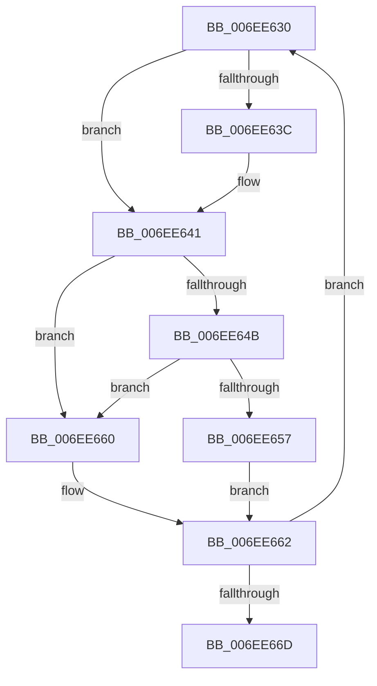

# sub_006EE630

- RVA: `0x006EE630`–`0x006EE672` (길이 `66` bytes)
- VA: `0x00000001406EE630`
- 실행 섹션: `.text`
- PDB 이름 있음: `아니요`; PDB Function 태그: `아니요`
- unwind 정보 RVA: `0x000A1AE4`
- 디코드: `18`개 명령, `66/66` bytes 표시
- 미해석 바이트: `0` (있으면 어셈블리에 `.byte`로 보존)

> 이 문서는 커널 이미지의 기계어와 PDB 기호를 분석해 생성했습니다. 4번과 5번은 함수 원형과 자료형을 바이너리 사용 방식에서 추정한 C 해석이며 원본 소스 복구 결과는 아닙니다.

## 1. Dependencies

- 직접 호출 지점: **2**; 고유 호출 대상: **1**
- 직접 호출자로 확인된 함수: **0**
- RIP 상대 이미지 참조: **4**

### Outgoing calls
- `0x006EE63C` → [guard_dispatch_icall](../6B/guard_dispatch_icall_function_006BAAD0.md) (function, `0x006BAAD0`)
- `0x006EE659` → [guard_dispatch_icall](../6B/guard_dispatch_icall_function_006BAAD0.md) (function, `0x006BAAD0`)

### Direct callers
- 이 함수 시작 RVA로 연결되는 직접 call은 확인되지 않았습니다. 간접 호출은 완전히 역산할 수 없습니다.

### Static image references
- `0x006EE630` → RVA `0x00FC2C58` (`.data`; read)
- `0x006EE643` → RVA `0x00FC1C7C` (`.data`; reference)
- `0x006EE64B` → RVA `0x00FC1C80` (`.data`; read)
- `0x006EE662` → RVA `0x00E0A804` (`.data`; read)

## 2. Other-region calls and transfers

- 다른 실행 섹션으로 향하는 call: **0**
- call이 아닌 외부 분기/꼬리 이동: **1**
  - `0x006EE66D` → [HalpAcquireCmosSpinLock + 0x8](../42/HalpAcquireCmosSpinLock_function_0042DEE8.md) (`tail-transfer`)

## 3. Assembly (complete function range)

```asm
006EE630  48 8B 05 21 46 8D 00            mov rax, qword ptr [rip + 0x8d4621]
006EE637  48 85 C0                        test rax, rax
006EE63A  74 05                           je 0x1406ee641
006EE63C  E8 8F C4 FC FF                  call 0x1406baad0
006EE641  FF C3                           inc ebx
006EE643  85 1D 33 36 8D 00               test dword ptr [rip + 0x8d3633], ebx
006EE649  75 15                           jne 0x1406ee660
006EE64B  48 8B 05 2E 36 8D 00            mov rax, qword ptr [rip + 0x8d362e]
006EE652  48 85 C0                        test rax, rax
006EE655  74 09                           je 0x1406ee660
006EE657  8B CB                           mov ecx, ebx
006EE659  E8 72 C4 FC FF                  call 0x1406baad0
006EE65E  EB 02                           jmp 0x1406ee662
006EE660  F3 90                           pause
006EE662  8B 05 9C C1 71 00               mov eax, dword ptr [rip + 0x71c19c]
006EE668  83 F8 FF                        cmp eax, -1
006EE66B  75 C3                           jne 0x1406ee630
006EE66D  E9 7E F8 D3 FF                  jmp 0x14042def0
```

## 4. C-style interpretation (structured pseudocode)

```c
__int64 __fastcall sub_006EE630(void)
{
    __int64 result;
    __int64 v_rbx;

    result = *(unsigned __int64 *)(v_rip + 9258529);
    if (*(unsigned __int64 *)(v_rip + 9258529) != 0) {
        result = guard_dispatch_icall(a1, a2, a3, a4);
    }
    v_rbx = (unsigned int)((v_rbx) + 1);
    if (((*(unsigned int *)(v_rip + 9254451)) & ((unsigned int)(v_rbx))) != 0) goto loc_006EE660;
    if (*(unsigned __int64 *)(v_rip + 9254446) == 0) goto loc_006EE660;
    result = guard_dispatch_icall((unsigned int)((unsigned int)(v_rbx)), a2, a3, a4);
    goto loc_006EE662;
loc_006EE660:
loc_006EE662:
    if (((unsigned int)((unsigned int)(*(unsigned int *)(v_rip + 7455132)))) != -1) goto loc_006EE630;
}
```

## 5. (Beta) C Style

```c
void sub_006EE630(void)
{
    int64_t result;
    int64_t local_rbx;

    result = *(uint64_t *)(v_rip + 0x8D4621);
    if (*(uint64_t *)(v_rip + 0x8D4621) != 0) {
        result = guard_dispatch_icall(a1, a2, a3, a4);
    }
    local_rbx = (uint32_t)((local_rbx) + 1);
    if (((*(uint32_t *)(v_rip + 0x8D3633)) & ((uint32_t)(local_rbx))) != 0) goto loc_006EE660;
    if (*(uint64_t *)(v_rip + 0x8D362E) == 0) goto loc_006EE660;
    result = guard_dispatch_icall((uint32_t)((uint32_t)(local_rbx)), a2, a3, a4);
    goto loc_006EE662;
loc_006EE660:
loc_006EE662:
    if (((uint32_t)((uint32_t)(*(uint32_t *)(v_rip + 0x71C19C)))) != -1) goto loc_006EE630;
}
```

## 6. Execution-region graph

[열기: 2D/3D 그래프와 함수 탐색 컨트롤 패널](../../../control-panel.html?section=text&rva=0x006EE630&view=graph)

- 2D 그래프는 위에서 아래로 흐르고, 3D 그래프는 빈 공간을 드래그해 회전합니다. Shift+드래그는 이동, 휠은 확대·축소, 함수 노드 선택은 대상 보고서 이동입니다.

### Static fallback


